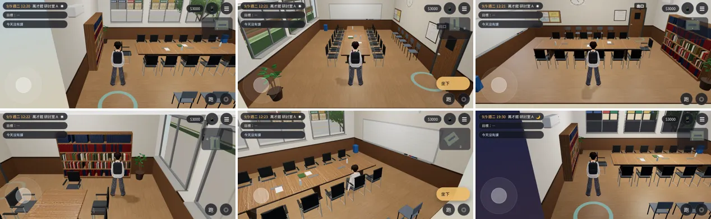
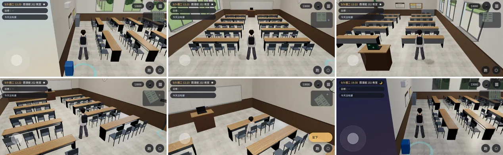
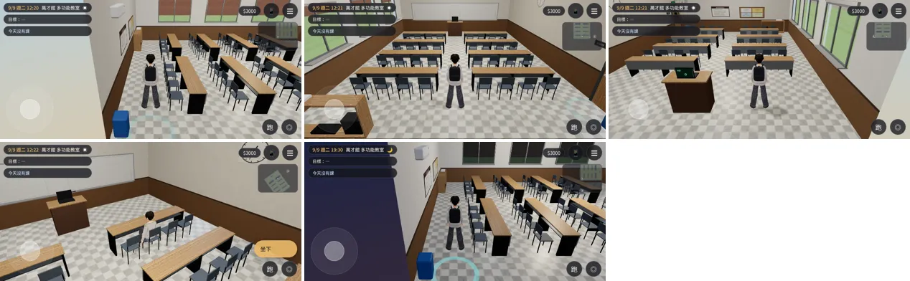
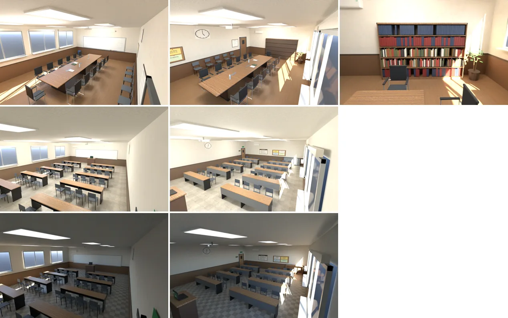

# 走得進去的教室：萬才館研討室 A、霖澤館 202、萬才館多功能教室

LAWWW2-C，2026-10-20。
- 使用者 10-20 第二項：霖澤館與萬才館樓層規劃，「不要讓玩家四年都只看到整修中」。
- LAWWW-C 15:51 回覆（[`../../LINZE_WANCAI_FLOORS_PLAN.md`](../../LINZE_WANCAI_FLOORS_PLAN.md) 第 0 節）：
  - 202 開成第二間平面教室；
  - 研討室 A、多功能教室要能走進去坐下；
  - 順序：研討室 A → 202 → 多功能教室。
- AA-C 15:57：這幾間的事件站位，模型做好以後看。

## 狀態（分開標）
| 項目 | 研討室 A | 霖澤館 202 | 多功能教室 |
|---|---|---|---|
| Blender 模型＋配置 | **MODEL_READY** | **MODEL_READY** | **MODEL_READY** |
| 接進遊戲 | **INTEGRATED**：LAWWW-C 開發分支 `6ac74b06`（`0a5cc70a` 的模型）；這次重建的模型還沒換 | 同左 | 同左 |
| 真實玩家流程（`tests/flow_rooms.py`） | **FUNCTIONAL_VERIFIED**：ALL PASS | 同左 | 同左 |
| 美術 | **READY_FOR_ART_REVIEW** | 同左 | 同左 |
| 上課、社課走進來坐下 | 沒接（LAWWW-C 改 `classes3d.js`：現在是「門口上課」） | 沒接（`courses.js` 的 LINZE 8 門課搬過來，LAWWW-C） | 沒接（吉他社的「門口參加」，LAWWW-C） |
| 事件站位 | 等 AA-C | — | 等 AA-C |

- 流程測試套在開發分支 `207d6c43`＋霖澤館 3F、4F 的 patch＋本頁的臨時接線上（第 5 節），不用 turbo。
  - 每間：從門口「進入」→ 走到座位「坐下」→ 站起來（研討室 A 另外坐一次旁聽席）→「離開」回到那棟樓那一層；
  - 沒有 JS 例外、卡住保險 0 次。
  - 第一次跑是 `0a5cc70a` 的模型；10-20 18:4x 重建以後（見「重建」那一節）三間重跑一次，都 ALL PASS。
- 流程測試是 Playwright 手機模擬，不是 iPhone 實機。
- LAWWW-C 接線時改了一處：門口有社課、大四研討課時照舊在門口參加，沒事才走進去（`CLS.roomDoorBusy`）。

## 1. 配置（房間自己的座標：x 往東、z 往南；進門的門在 −z 那一面，窗在 +z 那一面）
| | 研討室 A | 霖澤館 202 | 多功能教室 |
|---|---|---|---|
| 大小 | 9.0 × 6.6 m、高 3.2 m | 13.6 × 9.6 m、高 3.4 m | 11.6 × 9.0 m、高 3.4 m |
| 從哪裡進來 | 萬才館 2F 北側走廊「研討室 A」（`doors.seminarA`，lv 1） | 霖澤館 2F「202 教室」（`doors.c202`，lv 1） | 萬才館 1F 大廳北牆「多功能教室」（`doors.multi`，lv 0） |
| 座位 | 長會議桌 13 位（兩側各 6＋東端 1）＋靠牆旁聽椅 5 位（「一年級坐後面」） | 5 排 × 兩張長桌 × 4 位＝40 位，中間一條走道 | 4 排 × 兩張長桌 × 4 位＝32 位 |
| 老師／報告的人（`teacherSpot`） | 西牆白板前、會議桌西端 | 講桌後面、白板前 | 同左 |
| 牆上、靠牆 | 白板（擦過的：字由事件或課堂決定）、收起來的投影幕、吊掛投影機、東牆書櫃（法典、判決彙編、論文集，書背沒有字）、借用登記表、公告欄、時鐘 | 白板兩片、投影幕、講桌（筆電）、後面的公告欄、使用須知、學生置物櫃、安全門標示、時鐘 | 同 202，後面是開放層架（音箱、收起來的譜架、延長線盒） |
| 窗景 | 往北看法學院後面的樹、圍牆、馬路（`wancai_sema_day/night.webp`） | 用 201 的窗景（同一層樓；往北拍到的是很近的背景大樓牆） | 往北（`wancai_multi_day/night.webp`） |
| 走道 | 會議桌和旁聽椅之間 1.1 m、東端到書櫃 1.1 m | 排和排相距 1.9 m（椅子後面走得過去，和 201 階梯教室同一個道理）、中間走道 1.6 m | 同 202 |

- 座位都標 `kind: 'class'`，`uses` 寫用途；旁聽椅標 `kind: 'sit'`。
  - 研討室：['上課', '讀書會', '討論']；
  - 202：['上課', '自習']；
  - 多功能教室：['上課', '社課']。
- 每個座位都走得到：導航模擬 0 個問題。
- 研討室 A 的旁聽椅有走近點（`ap`）：椅子前 0.5 m。

## 2. 截圖
- 遊戲內（Playwright 844×390 橫向，9/9 週二 12:20；[捷徑] 人物放到位置、設鏡頭，只為了截圖）：

- 研討室 A：①從門口 ②往白板 ③往旁聽椅 ④書櫃 ⑤坐下 ⑥晚上 19:30

- 霖澤館 202：①從門口 ②往白板 ③從前面往後看 ④走道 ⑤坐下 ⑥晚上

- 多功能教室：①從門口 ②往白板 ③從前面往後看 ④坐下 ⑤晚上
- 晚上那張左邊深藍色的一大片，是剖面牆外面的夜空，不是房間的東西。

- Blender 算圖（Cycles，不是遊戲畫面）：

## 3. 模型規格
| | 研討室 A | 202 | 多功能教室 |
|---|---|---|---|
| GLB | `wancai_sema.glb` | `linze_202.glb` | `wancai_multi.glb` |
| 大小 | 1.54 MB | 1.40 MB | 1.14 MB |
| 三角形 | 18,304 | 16,138 | 13,094 |
| 網格 | 25 | 27 | 27 |
| 材質 | 12 | 13 | 13 |
| 貼圖 | 11 張、0.10 MB、最大 1024 px | 12 張、0.16 MB | 12 張、0.12 MB |
| 碰撞框 | 6 | 14 | 12 |

- 遊戲內效能（`tests/perf_rooms.py`，白天 12:20、出生點；SwiftShader，只能比相對值）：

| | 研討室 A | 202 | 多功能教室 | 參考：霖澤館大廳 |
|---|---|---|---|---|
| draw call | 80 | 71 | 71 | 155 |
| 三角形 | 99,816 | 92,118 | 89,326 | 184,946 |
| 沒有陰影那一輪 | 64 calls／63,120 | 55／55,422 | 55／52,630 | 134／148,022 |
| 投影的網格 | 11 | 11 | 11 | 16 |

- 三間都是霖澤館大廳的一半左右。

- 材質：
  - 地板、牆、腰牆、天花板、桌面：Poly Haven CC0（`tools/blender/env_second/textures/`）；
  - 椅子、鐵件：頂點色；
  - 日光燈：`GLOW_`。
- 印刷品自己畫：`textures/gen/wancai_sema_print.png`、`linze_202_print.png`。
  - 內容虛構，沒有真實姓名、課號、品牌。
- 腳本：
  - `tools/blender/env_second/wancai_seminar.py`；
  - `tools/blender/env_second/flat_classroom.py`（`--room linze_202|wancai_multi|all`，取代 10-20 的草稿 `wancai_room.py`）。

## 4. 已知缺點
- 白板、書櫃、公告欄的「看」：顯示的字還沒寫（`note` 空的，遊戲先顯示名稱「白板」），等 AA。
  - 原本寫在 `note` 的是給開發組的說明，LAWWW-C 回報會出現在遊戲裡，已經搬到 `dev`（遊戲不顯示）。
- 三間都還不能上課：現在只是走得進去、坐得下。上課、社課的流程由 LAWWW-C 接。
- 202 和多功能教室的家具相同（長桌、課椅），只有後牆、地板、腰牆顏色、窗景不一樣。
- 多功能教室是吉他社社課的地方，但現在擺滿課桌。
  - 社課要不要把桌子推開、留一塊空地，等 AA-C 看事件。
- 窗外的景是一張照片，斜著看沒有視差。
- 研討室 A 的會議椅是同一款，沒有高低、顏色的變化。

## 重建（10-20 18:4x）：牆淡出時飄在半空中的東西
- 鏡頭在牆外面時，那面牆會淡出；掛在牆上的東西要跟著牆一起藏。截圖發現下面這些沒跟著藏，放進那面牆的群組：
  - 白板筆、板擦（從講台後面往前看時，飄在半空中）；
  - 門把；
  - 研討室 A 的書櫃（整個書櫃靠東牆；背板放在牆那一側）；
  - 冷氣；
  - 202、多功能教室門上的 EXIT 燈條；
  - 202 的置物櫃飾條。
- 配置（座位、碰撞框、門、出生點）的座標沒有變；只有 `interact` 的 `note` → `dev`。
- 三角形：研討室 A 18,304、202 16,138、多功能教室 13,094（和第 3 節相同）。

## 5. 交付
- 模型＋配置：
  - `assets/models/env/second_ai/wancai_sema.*`；
  - `linze_202.*`；
  - `wancai_multi.*`（.glb、.json、.layout.json）。
- 窗景：`assets/models/env/views/wancai_sema_day.webp`、`wancai_sema_night.webp`、`wancai_multi_day.webp`、`wancai_multi_night.webp`。
- 臨時接線 patch：[`../../patches/rooms_glb_wire_test.diff`](../../patches/rooms_glb_wire_test.diff)。
  - 套在開發分支 `207d6c43`＋[`linze_upper_wire_test.diff`](../../patches/linze_upper_wire_test.diff) 上。
  - `src/rooms_glb3d.js`：三個區域，做法和霖澤館 3F 一樣。門的資料在 layout 的 `host_door`，接線時把那個門的 `closed` 拿掉、加 `to`。
  - `src/data/room_glb_layouts.js`：從 layout.json 產生。
  - `index.html`：兩行。
  - `src/wancai3d.js`：門有 `to` 時接成出入口。霖澤館的門照 3F patch 的 `d.spawn`。
  - `tools/shots/window_views.py`：兩筆。
  - `tests/flow_rooms.py`：三間的真實玩家流程。
  - `tests/shots_rooms.py`：本頁的截圖。
- **10-20 18:4x 重建的更新**（LAWWW-C 已經接了 `0a5cc70a`，這次只要換檔）：
  1. 換 `assets/models/env/second_ai/{wancai_sema,linze_202,wancai_multi}.glb`、`.json`、`.layout.json`；
  2. 重新產生 `src/data/room_glb_layouts.js`，或套 [`../../patches/rooms_layout_dev_note.diff`](../../patches/rooms_layout_dev_note.diff)（對 `0dc0460d`）。
- LAWWW-C 正式接線要做的：
  1. 門：拿掉 `closed`、加 `to`；
  2. 上課、社課從「門口上課」改成走進來坐下（`classes3d.js`、`courses.js` 的 rooms、`activities.js`）；
  3. 老師站 `teacherSpot`；
  4. 樓層簡介、電梯的字。
