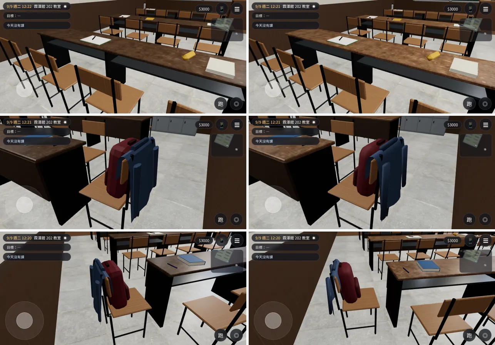
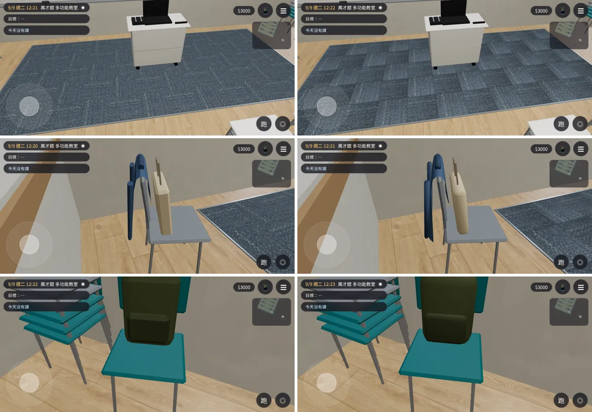
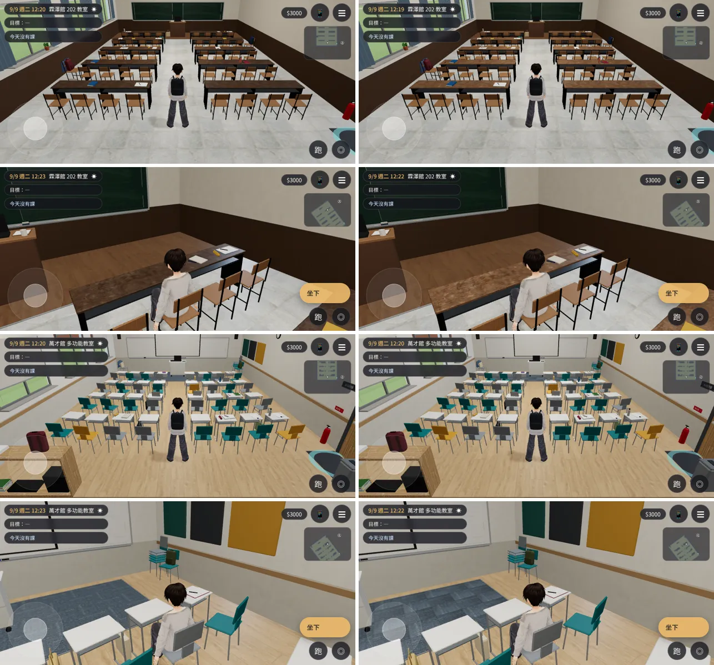
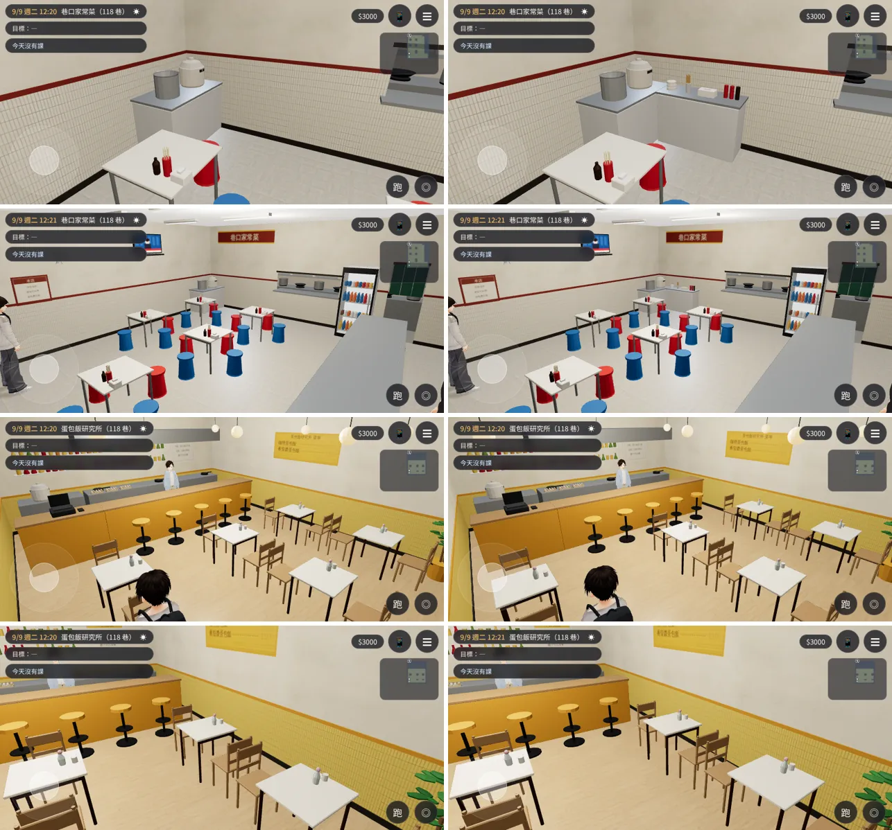

# ROOMS-REFINE-1021：霖澤館 202、萬才館多功能教室精修＋seatcheck 掃其他有座位的房間

LAWWW2-C，2026-10-21。
- 起因：LAWWW-C 07:42Z。
  - 美術子代理接手我的 WIP 做的版本（ART-ROOM-MULTI-1020、ART-ROOM-LIFE-1020）已經在開發分支；
  - #47 做完排「精修這兩間」；
  - 建議拿 `seatcheck()` 掃 Café、118 巷店內。
- 子代理版本我看過了（`docs/art-rebuild/rooms_1020/`）：
  - 兩間一眼看得出不同，比我的 WIP 好很多；
  - 這次只修四個缺點：
    1. 202 的長桌太深：BB-C「坐下的鏡頭裡桌面幾乎是黑的」；
    2. 外套、書包近看偏硬：LAWWW-C；
    3. 方塊地毯在遊戲裡看不出是方塊：LAWWW-C；
    4. GLB 變大：說明在下面，這次沒縮。
- 環境：Playwright 手機模擬（橫向 844×390）、SwiftShader；不是 iPhone 實機。

## 狀態
| 項目 | 狀態 |
|---|---|
| 202、多功能教室、118 巷家常菜、蛋包飯 | **MODEL_READY**（GLB 重匯出） |
| 接進遊戲 | **INTEGRATED（只在我的測試工作樹）**：開發分支 `0e7a5efa`＋換檔；**不用改程式** |
| 測試 | `flow_rooms.py` 202、多功能教室 **ALL PASS**；`rooms_glb_unit.js`、`x78_rooms_unit.js` ALL PASS；`reachability_all.py --zones l118_dian,l118_home,l118_omu` **ALL PASS**；`flow_l118_shops.py` **ALL PASS**；截圖沒有 JS 例外 |
| 美術 | **READY_FOR_ART_REVIEW**（等使用者看） |

## 1. 202、多功能教室（`flat_classroom.py`）
- 202 的長桌：桌面從 `#5b4738` 調亮到 `#7e6048`，比椅面深一點，木紋看得出來。
- 外套：
  - 布切得細一點（12 × 19）；
  - 往下垂的那一段有大、中、小三種褶子，每件不一樣，越往下越深；
  - 下襬高低不齊；兩側往椅背那邊包一點；
  - 袖子微彎、一長一短、袖口張開一點；
  - **平滑著色**。原本一格一格的平面，看起來像摺紙；這是「偏硬」的主要原因。
- 書包、帆布袋：倒角大一點、多一段（裝了東西鼓鼓的），平滑著色。
- 方塊地毯：每一塊用貼圖的一個象限、一塊轉 90 度交錯（子代理的做法照舊）。
  - 這次讓四個象限各自亮一點、暗一點；
  - 每一格裡沿毛的方向由暗到亮；
  - 格子邊緣暗一點（接縫）。
  - 真的方塊地毯就是這樣看出一格一格的（毛倒向不同、反光不同）。
- 座位、走近點、導航阻擋、出生點：**完全沒變**（`.layout.json` 和開發分支逐字相同）。
  - `src/data/room_glb_layouts.js` 不用重新產生。

### 近看（左：開發分支 `0e7a5efa`；右：這次）
- 202：
  1. 桌面；
  2. 椅子上的外套、書包（兩個角度）。
- [捷徑] 讀檔、電影鏡頭指定位置。

- 多功能教室：
  1. 方塊地毯；
  2. 外套；
  3. 書包。

- 一般遊戲鏡頭（202 往黑板、202 坐下；多功能教室往白板、坐下）：

### GLB
| 房間 | 開發分支 | 這次 | 三角形 |
|---|---|---|---|
| 202 | 1.34 MB | 1.43 MB | 15,061 → 16,311 |
| 多功能教室 | 1.75 MB | 1.86 MB | 17,670 → 19,176 |

- 貼圖只有 0.15～0.32 MB；大小主要是幾何（椅子、桌子、桌上的東西；頂點色）。
- 遊戲的 GLTFLoader 沒有接 meshopt 解碼，所以這次沒有壓縮。要壓的話是 LAWWW-C 的程式（`assets3d.js` 加 `setMeshoptDecoder`），之後所有 GLB 都能小一半左右。
- 待使用者確認：多功能教室的三色椅子比萬才館其他地方活潑（BB-C 提的，風格問題，沒改）。

## 2. seatcheck 掃其他有座位的房間（`flat_classroom.seatcheck`，和遊戲 `GAME.seatApproach` 同一套候選點）
| 房間 | 座位 | 問題 | 處理 |
|---|---|---|---|
| 118 巷 滇香小館 | 10 | 進門的位置離門邊那張桌子的椅子 0.73 m（不到 0.75：一進門就出現「坐下」） | 進門的位置往門口退 15 cm（離「離開」的範圍還有 0.9 m） |
| 118 巷 巷口家常菜 | 18 | 北邊那排椅子和北牆之間 0.8 m 的空地：站得進去、照格子卻走不出來，從某些方向按「坐下」可能被帶到那裡卡住 | 湯鍋旁邊沿北牆加一個**自取櫃**（疊起來的碗、筷筒、紙巾、辣椒醬、醬油），擋住那一條 |
| 118 巷 蛋包飯研究所 | 15 | 兩側的桌子和牆之間 0.45～0.75 m：同上（4 個候選點） | 兩側的桌子靠牆（x ±1.95／2.25 → ±2.6），中間的走道變寬 |
| 其他六間 118 巷的店 | — | 0 | — |
| 霖澤館 3F、4F、研討室 A、202、多功能教室 | — | 0 | — |
| 美國法學院圖書館 `us_lawlib` | 53 | 報 51 項 | **沒處理**：這一區的導航阻擋用旋轉的方塊、條帶（`us3d.js`），和 seatcheck 假設的「軸對齊、最小 0.4」不同，報的多半不準；要的話另外用遊戲的導航格查 |

- Café（兩點半）的室內配置在 `cafe_layout.py`（座位寫在程式裡，不是 `.layout.json`），**這次沒掃**（要先把它的座位、阻擋轉成同一個格式）。

### 截圖（左：開發分支；右：這次）
1. 家常菜的自取櫃；
2. 家常菜整間；
3. 蛋包飯整間；
4. 蛋包飯東側（桌子靠牆）。

## 交付（focused-cray，見 commit）
- 換檔（`assets/models/env/second_ai/`）：
  - `linze_202.glb`、`.json`；
  - `wancai_multi.glb`、`.json`；
  - `l118_home.glb`、`.json`、`.layout.json`；
  - `l118_omu.glb`、`.json`、`.layout.json`；
  - `l118_dian.layout.json`（GLB 沒變）。
- LAWWW-C：換檔以後跑 `python3 tools/lane118/gen_shop_layouts.py`（`src/data/l118_shop_layouts.js` 會改 1 行）。
- 腳本：
  - `tools/blender/env_second/flat_classroom.py`：子代理的版本＋這次；
  - `tools/blender/env_second/lane118_shops.py`。
- 腳本要的貼圖：`tools/blender/env_second/textures/rough_linen/`。
  - 子代理加的 Poly Haven CC0，開發分支本來就有；
  - LICENSES.md 開發分支已經寫了。

## 已知、還沒做
- 外套還是一片布＋兩隻袖子，沒有口袋、拉鍊、扣子；近看比較像披著的布。
- 書包沒有拉鍊、提把。
- iPhone 實機沒有測過。
