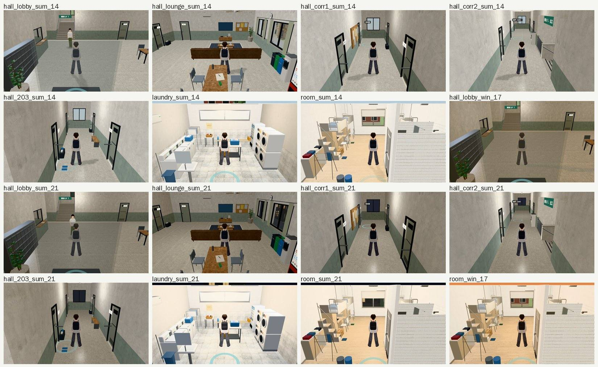

# D99 路線巡查①：寒暑假（2026-10-24，LAWWW2-B；LAWWW-B 12:38 派工）

開發 `6fd1eda5f`；Playwright＋SwiftShader，不是 iPhone 實機。

## 路線

照 `src/home3d.js` 的 `BREAK_PTS`：

- **寒假**：在臺北的家（摘要日、除夕、初一），從家「出門」只到校門口、公館、溫州街，最後回宿舍。
- **暑假**：宿舍抽籤、換房（大二 312），留宿舍的話是房間、交誼廳、洗衣間。

## 結果

| 地方 | 怎麼看的 | 結果 |
|---|---|---|
| 臺北的家 | 沒有 3D，是 2D 背景＋對話。`OUT.BG` 223 個背景在遊戲裡逐一 fetch | 家用到的背景全部有圖；0 張缺檔 |
| 校門口、公館、溫州街（寒假出門） | 第 5 區溫州街、第 8 區清晨／黃昏、第 4 區公館的巡查 | 沒有要修的 |
| 宿舍：門廳、交誼廳、一樓走廊、二樓走廊、203 門口、洗衣間、203 房間 | 暑假 2026-07-20 14:00、21:00；寒假回宿舍 2026-02-22 17:00（門廳、房間）；16 張，errors 0 | 沒有方盒、黑塊、穿模 |

- 洗衣間、房間的畫面最上面那一條，是鏡頭比牆高（剖面視角），照設計。

## 順便找到的

- 13 段劇情對話會是黑底（`OUT.BG` 沒有那個鍵）：`docs/art-rebuild/second_ai/research/dark_bg_scenes_1024.md`。
- LAWWW-B 12:57：
  - 別名已做（`45f1cd9e6`）；
  - 8 張從 3D 拍的 2D 背景派給我（BG-DARK-SCENES-1024）；
  - 4 張請 BB 向使用者要。
