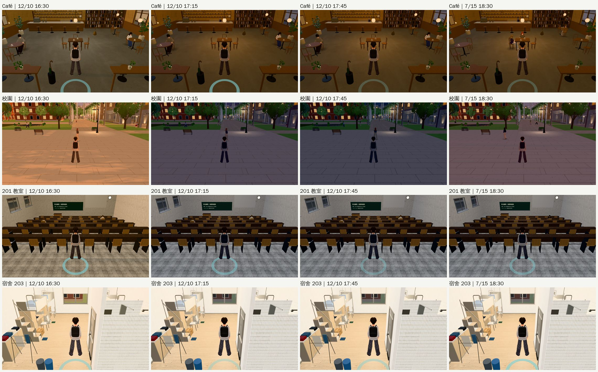
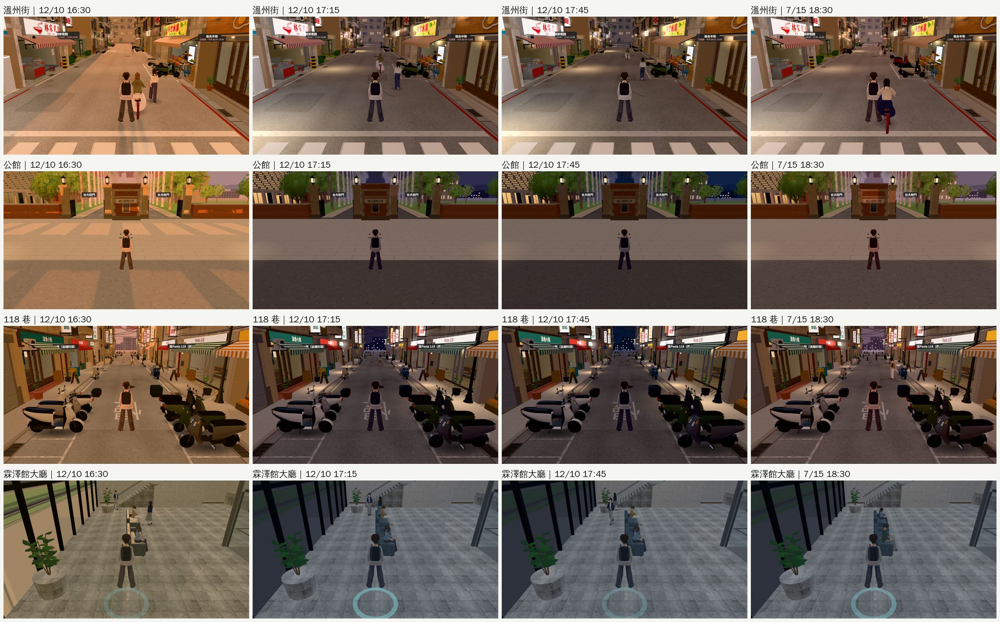
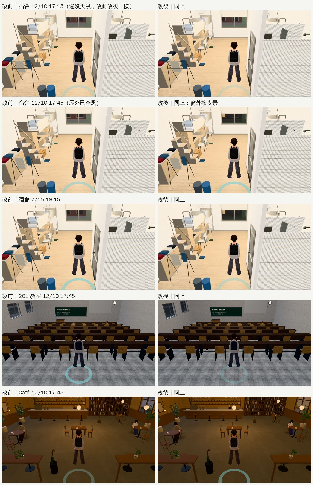

# 路線巡查④：傍晚光線照季節以後的每天路線（2026-10-24，LAWWW2-B）

- **為什麼巡**：ENGINE-SEASON-DUSK（傍晚光線照日期）v9.10.9 後已合進開發分支。每個冬天傍晚都會看到，所以先確認各區的燈、窗景、店招有沒有跟著一起變。
  - LAWWW-B 22:45 說照巡查表 P3 繼續；剩下的 P3 都不是每天看得到的，所以先做這一輪，已告知 LAWWW-B。
- **對**：開發 `5bcdd7e8e`。
- **環境**：Playwright＋SwiftShader 手機模擬（1280×720），不是 iPhone 實機。
- **狀態**：
  - 巡查：沒有要修的大問題。
  - 一項小修正（窗景比屋外晚 20 分鐘天黑）：`READY_FOR_ART_REVIEW`，patch 交 LAWWW-B。

## 怎麼巡

- **先看程式**：各區會依時間變的燈、窗、店招，是不是都用引擎傳進去的「光線用的時刻」。
  - 各區的 `zoneTime`／`applyTime`、校園 `onLamps`：都是；
  - 直接用時鐘 `G.hour` 的只有劇情和作息（誰在場、市集幾點開），不是光。
- **再拍**：8 個每天會去的地方（溫州街、公館、118 巷、校園、宿舍 203、Café、201 教室、霖澤館大廳）×4 個時刻，共 32 張，errors 0。
  - 12/10：16:30、17:15、17:45（臺北 17:06 日落、17:30 天黑）；
  - 7/15：18:30（18:46 日落）。

## 結果

- **校園、公館、118 巷**：
  - 16:30 是夕陽；17:15 天暗、路燈和亮著的窗、店招一起亮；17:45 是晚上。
  - 夏天 18:30 還是黃昏。
- **溫州街**：17:45 比校園亮。那一區原本就有城市夜光（`cityLight`），照設計。
- **霖澤館大廳**：大片玻璃外面 17:15 起是夜晚。
- **Café**：屋裡的暖光照舊。
- **找到一項（已修，下面）**：宿舍、教室、Café 的窗景比屋外晚天黑。

## 修正：窗景和屋外同一刻天黑（`patches/window_night_sync_1024.patch`，對 `5bcdd7e8e`）

- **原因**：
  - 引擎的夜晚係數在光線時刻 19.2 變成 1（星星出來、柏油調暗、屋外完全天黑）。
  - 但這幾個地方寫死 19.4 才換夜景：
    - 房間窗景（`zones3d.js` 的 `room()`：`winC`、`nightView`）；
    - 照片調色（`world3d.js` 的 `photoTint`）；
    - 118 巷店內窗景（`l118_shops3d.js` 的 `setPhotoView`）；
    - 總圖樓上的天光（`library_upper3d.js` 的 `skyTint`）。
  - 冬天傍晚光線拉長以後，這 0.2 小時變成將近 20 分鐘：12 月 17:35～17:58 屋外全黑，窗外還是調暗的白天照片。夏天是 19:12～19:24。
- **改法**：五個地方的 19.4 改成 19.2。早上那一頭（5.5）不動。
- **測試**：
  - 新 `tests/window_night_sync_unit.js`：從引擎讀出天黑的時刻，比對五個地方；修改前 FAIL 5，修改後 ALL PASS。
  - `tests/season_dusk_unit.js`（我上一份的）原本寫死 19.4，改成讀 `room()` 實際的門檻；修改前後都 ALL PASS。
  - 也都 ALL PASS：`us_lawlib_sky`、`l118_shops`、`after_midnight`、`ui_night_bg`、`campus_lamps`、`lamppost_nav`、`night_forget`、`zhoushan_lamps`、`bg_city_awnings`、`us_lamp_pools`、`shadow_snap`。
  - 沒跑：瀏覽器整套回歸、實機。

- **12/10 17:15**：還沒完全天黑，改前改後一樣。
- **12/10 17:45**：宿舍窗外從調暗的紅磚樓換成夜景。
- **7/15 19:15**：夏天也提早 12 分鐘換。
- **201 教室、Café 17:45**：窗也換成夜景，畫面縮小以後差別不大。
