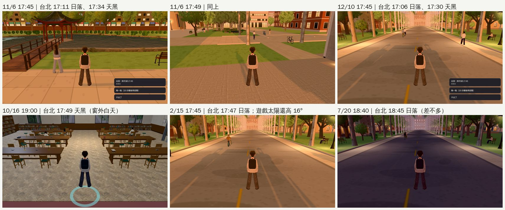

# D99 路線巡查③：經濟系那一年（2026-10-24，LAWWW2-B）

- **派工**：LAWWW-B 15:04（D99 第一優先）。
  - 路線照玩家的順序：新遊戲（8/23 宿營）→ 經濟系那一年（412、上課的教室、可昕出現的地方）→ 10/31 退宿回家 → 休學在家、重考（衝刺班、考場只看有 3D 的）→ 放榜 → 8/29 搬進法律系宿舍 → 9/1 第一堂課。
  - 日、夜都看；月份 9、10、12、2、7 月。
  - 找：邊界破掉、大片空白、晚上全黑或跟白天一樣亮、季節不對。ART-ECON-3D-GAP-1021 修過的不重做，只找漏掉的。
- **環境**：開發 `2b3a99cdd`。之後開發到 `fac17bba3`，只改了 `events.js`、`story3d.js` 的劇情文字，截圖照樣有效。
  - Playwright＋SwiftShader 手機模擬（1280×720），不是 iPhone 實機。
- **結論**：
  - 這一輪**沒有要我直接修的美術**，所以沒有 patch／GLB。
  - 找到一項要 LAWWW-B 決定的引擎問題：**傍晚的天色不分季節**（第 1 項）。
  - 第 2～4 項是 P3 記錄。

## 路線上哪些是 3D

| 段落 | 3D／2D | 看了什麼 | 結果 |
|---|---|---|---|
| 新遊戲：8/23～25 經濟系宿營 | 2D | 字卡、遊覽車、CG `cg_econ_camp`（`story3d.js` 的 `econCampPrologue`） | 不在 3D 範圍 |
| 9/1 搬進 412、宿舍大廳 | 3D | 412：9/1 23:30、9/30 19:00、10/31 09:00 退宿那天早上；`dorm_hall` 9/1 23:00、9/18 09:30 | 沒有要修的 |
| 9～10 月上課 | 3D | 普通教學館 9/19 15:10、10/3 18:48；博雅 10/7 中午；Café 10/12；總圖 3F 10/16 19:00；校園 9/18、9/23、10/1 19:30 | 總圖 19:00 窗外還是白天 → 第 1 項 |
| 可昕出現的地方 | 3D＋2D | 醉月湖 E12（11/6 17:45、20:00 兩個方向）；社科院門口「休學的來了」（11/1～11/15）；小福、豆花、公館是 2D | 湖：第 1 項＋P3 |
| 休學在家 | 2D | 家是 2D（照派工跳過）；回學校只到校門口（`home3d.js` 的 `toSchool`） | — |
| 回學校（校門口、椰林大道） | 3D | 12/10、2/15、7/20 × 15:00／17:45（7/20 加 18:40）；椰林大道 12/10 晚、2/15 白天 | 第 1 項 |
| 衝刺班、考場、放榜 | 2D | `cram_class`、`exam_hs_classroom`、`home_room`（模擬考 R4 已拿掉，AA_298） | 背景都有圖 |
| 8/29 搬進法律系宿舍 | 3D | `dorm_hall` 15:00、203（`203_movein`，阿哲還沒到）15:30 | 沒有要修的 |
| 9/1 第一堂課 | 3D | 霖澤館大廳 09:30、201 10:00 | 沒有要修的 |

- 2D 背景順便查了一遍：`events.js` 裡經濟系那一年（`stage:'econ'`）每一句寫了 `bg` 的，鍵都在 `OUT.BG` 裡，不會黑底。
  - 電話那幾段沒寫背景，照設計是「家」或 `phone_street_night`。
  - 「偷偷旁聽」（`ev_y0_e24b2`，霖澤館）、「登山社的行前會」（`ev_y0_c2_hiking`）沒寫背景，會是黑底（在家的時候是家的背景）。
  - 這兩段不在 AA_300 縮短後的流程（`econff3d.js` 的 `S.KEEP`）裡，現在不會演到。之後放回去要補背景（P3，記錄）。

## 找到的

### 1. 傍晚的天色不分季節（P2，引擎；請 LAWWW-B 決定）

- **玩家看到的**：
  - 11/6 17:45 在醉月湖等可昕、12/10 17:45 在校門口，畫面是夏天下午五點多的金黃色斜陽。
  - 實際上台北這兩天 17:30 左右天就黑了。
  - 10/16 19:00 在總圖三樓，窗外是白天的景。
- **原因**：
  - `engine3d.js` 的 `KEY0` 只照「幾點」排光線，一年四季同一張表。
  - 太陽高度：18:00 是 13°、18:36 是 3°、19:12 是 −2°，所以遊戲每天都在 18:57 左右日落。
  - 窗景換夜景、路燈、亮著的窗也只照時刻：例如 `zones3d.js` 的 `room()` 是 `h>=19.4` 換夜景，各區的路燈照 `KEY0` 最後一欄。
- **台北的日落**（標準日出日落公式，緯度 25.03°N、經度 121.56°E，UTC+8，誤差幾分鐘）：

  | 路線上的日期 | 日落 | 天黑（民用曙暮光結束） | 遊戲 | 差多少 |
  |---|---|---|---|---|
  | 9/1 | 18:13 | 18:36 | 18:57 日落 | 晚 44 分鐘 |
  | 10/3 | 17:38 | 18:01 | 同上 | 晚 1 小時 19 分 |
  | 10/16 | 17:26 | 17:49 | 同上 | 晚 1 小時 31 分 |
  | 11/6 | 17:11 | 17:34 | 同上 | 晚 1 小時 46 分 |
  | 12/10 | 17:06 | 17:30 | 同上 | 晚 1 小時 51 分 |
  | 2/15 | 17:47 | 18:11 | 同上 | 晚 1 小時 10 分 |
  | 7/20 | 18:45 | 19:10 | 同上 | 差不多 |

- **不只經濟系那一年**：法律系四年的每個秋冬傍晚（下課、社團、出門吃飯）都一樣。
- **建議（LAWWW-B 決定；引擎檔我不改，D108）**：
  - `E.applyTime(h)` 先照日期把「時鐘」換成「光線用的時刻」，再查 `KEY0`。
  - 同一個值也傳給各區的 `zone.applyTime`，這樣窗景、路燈、亮著的窗一起跟著變。
  - 時鐘、HUD、作息、事件時間都不動。
  - 只動傍晚那一段，其他時段的畫面和測試不受影響。例如三個錨點線性內插：
    - 15:00 → 15:00；
    - 當天的日落 → 18.95；
    - 21:00 → 21:00。
  - 套進去的效果：
    - 12/10 17:45 會變成光線的 19:17（天剛黑、路燈亮）；
    - 7/20 幾乎不變。
  - 早上（12 月 06:29 才日出，遊戲 06:00 已經是清晨）差得少，可以先不做。
  - 美國的區域（交換學期 8～12 月）緯度不同，要另外一組。
- **影響的測試**：時鐘不動，劇情時間的測試不受影響；直接用某個時刻檢查路燈、窗景、天色的測試，要逐一確認是不是要帶日期。

### 2. 醉月湖北邊那一排彩色店面（P3，記錄）

- 從 E12 等可昕的位置往北看，圍牆後面是 `TK.bgCity` 的北側那一排（`zones3d.js` 的 `campusBackdrop`，z −171，離人 74 m）。
- 紅、綠、黃、藍的遮雨棚一格一格重複，白天、晚上都很像舞台的布景。
- 和 118 巷兩頭的遠景剪影同一類：照之前的決定，先記錄、不改。

### 3. 醉月湖晚上（已記錄過）

- 20:00 水面很暗、湖心亭沒有燈。之前回報過，LAWWW-B 說這一輪不做。

### 4. 玩家一年四季同一套長袖（P3，人物，記錄）

- 7/20 下午三點在校門口，祐廷還是長袖上衣、長褲。遊戲裡沒有照季節換衣服的機制。
- 這是人物、不是場景，這一輪不動，記錄給 LAWWW-B。

## 看過、不用改的

- **412**：
  - 窗景：9/1 23:30、9/30 19:00 是夜景（對面亮著的窗），10/31 09:00 是白天的樹。
  - 退宿那天早上的鏡頭，右邊四成是洗手間的白磁磚牆。這是 ART-ECON-3D-GAP-1021 修過的樣子（原本是一整片暗灰色），不是新問題。
- **宿舍大廳**：9/1 23:00、9/18 早上、8/29 下午都正常。室內白天、晚上差不多亮，照設計（室內開燈）。
- **普通教學館**：
  - 走廊兩頭的教室、樓梯都看得到；10/3 18:48 晚上也正常。
  - 畫面下面那條深色的是一樓入口的門檻，鏡頭在門外，照設計。
- **博雅、Café**：正常。
- **總圖 3F**：地板是淺色的人字拼，深色木地板已換掉（P0，`b32ee2c4`）。窗外的問題見第 1 項。
- **校園**：
  - 9/18、9/23 白天正常；10/1 19:30 晚上路燈有光圈。
  - 12 月、2 月、7 月的樹都是綠的。台北的校園冬天也是綠的，季節沒有不對。
- **8/29 的 203、9/1 的霖澤館大廳、201**：正常。

## 這次沒有 patch／GLB

- 路線上 3D 的地方，ART-ECON-3D-GAP-1021（社科院捲簾、三棟教學館窗景、412 洗手間）都修過了，這一輪沒有再找到方盒、黑塊、破掉的邊界。
- 唯一要改的是第 1 項的引擎問題（`engine3d.js`），照 D108 由 LAWWW-B 決定。

## 怎麼拍的

- 工具：`fast_day` 截圖工具（同一個區域、同一天只載入一次）；路線 29 張＋社科院門口 2 張，`errors` 都是 0。
- 位置：照 `econff3d.js` 的 `STEPS`／`STEPS2` 每一場的區域與站位；社科院門口照遊戲真的找路（`E.pathTo`），從 E12 的位置走到「休學的來了」的位置 (14.1, −71.5)，鏡頭在最後一段路的後面，站得住（`nav.free`）。
- 重拍：
  - 第一輪拍到 2/15 17:45 時，休學在家那段「傍晚自動回家」的對話畫面蓋上來。
  - 之後換到別的區域，畫面一直卡在那一格：17 張重拍，同一個畫面的只留重拍那一張。

## 截圖

| 檔案 | 內容 |
|---|---|
| `01_dorm.jpg` | 412（9/1 夜、9/30 夜、10/31 早上）、宿舍大廳（9/1 夜、9/18 早上、8/29 下午）、203（8/29） |
| `02_classes.jpg` | 普通教學館（9/19、10/3 晚上）、博雅、Café、總圖 3F（10/16 19:00）、霖澤館大廳、201 |
| `03_campus.jpg` | 校園 9 月、10/1 晚上、醉月湖 11/6 17:45／20:00、社科院門口 11/6 17:50／19:30 |
| `04_gate.jpg` | 校門口 12/10、2/15、7/20 × 15:00／17:45（7/20 加 18:40）、椰林大道 12/10 晚上、2/15 白天 |
| `05_sunset.jpg` | 第 1 項：傍晚的天色和台北真實日落 |

- 醉月湖、校門口那幾張右下角的選單（「出發：醉月湖 17:45」）是遊戲的出遊選單。截圖用的存檔直接跳日期，11/6 那場出遊沒演，所以 12/10 也還掛著；正常玩不會這樣，和場景無關。
