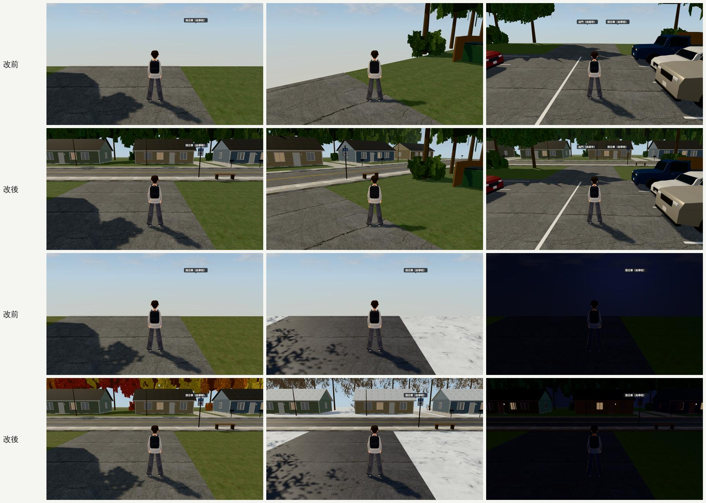
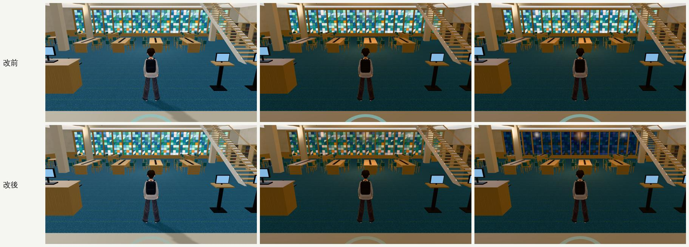
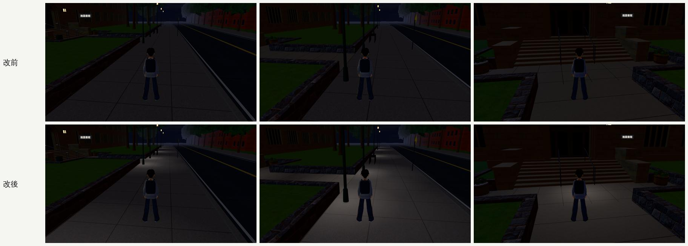

# D99 路線巡查②：美國交換（2026-10-24，LAWWW2-B）

- **派工**：LAWWW-B 12:38。
  - 路線：桃園出境 → 美國公寓 214 → C 棟 208（客廳、學姊的房間）→ 社區 → 校園 → 法學院圖書館一、二樓 → 超市街、草原超市、亞洲超市 → 桃園入境。
  - 日、夜都看；四季：9、10、11 月，12 月初雪以後。
  - 巡過的區域只看走路線時看得到的。找到方盒、黑塊、穿模、擋路、窗景不對的，直接修，清單給 LAWWW-B。
- **環境**：開發 `45f1cd9e6`（巡查）；`b2430412c`（修正、修改後截圖）。Playwright＋SwiftShader 手機模擬，不是 iPhone 實機。
- **季節**：照 `us3d.js` 的 `usSeasonKey`。
  - 8/2～10/8 夏末；10/9～10/31 秋天；11/1～12/1 初冬；12/2 起下雪。
  - 拍的日期：出發 2028-08-02、9/15、10/20、11/15、12/10、回國 12/23。
- **狀態**：
  - 三項修正 `READY_FOR_ART_REVIEW`：patch＋GLB 交 LAWWW-B，還沒整合。
  - 場景美術的 `ART_APPROVED` 只有使用者能標。

## 怎麼巡

1. **第一輪（74 張）**：
   - 12 個區域，每區 2～3 個角度 × 日夜 × 四季。
   - 人站在出生點、或我猜的路線上的點。
   - 其中 16 張的位置落在擋住的格子（草地、家具裡）：看得到景，但不是走得到的地方。
2. **第二輪（32 張）**：
   - 讓人站在**遊戲真的找路**（`E.pathTo`）從門口走到目的地那條路上的 15%～92%。
   - 鏡頭在人後面（跟走路時一樣）。
   - 每一張都確認站得住（`nav.free`）。
3. **改前、改後**：同一個鏡頭在開發分支和套了修正的測試樹各拍一次。

## 找到、修好的（三項）

### 1. 社區西邊出口外面什麼都沒有（P1：每天搭公車、走去超市都看得到）

- **改前**：
  - 站在公車站（「搭公車（去學校）」「出門（去超市）」）往外看，草地到社區邊界就斷了，後面是一片天空。
  - 原因：社區四周一圈樹林，在出口車道留了缺口，缺口外面沒有做。
- **改後**：`tools/blender/env_second/us_community.py` → `us_community.glb`。全部在社區邊界外、走不到，配置和導航都不用改。
  - **道路**：社區外面南北向的雙向兩線道（雙黃線、白邊線、路緣、兩邊人行道），出口車道接上去。
  - **公車站**：這一側的公車站牌（超市街同一張 BUS 牌）＋長椅。
  - **對面五棟平房**：
    - 壁板用社區同一套顏色；山牆屋頂，雪天積雪；白門＋門廊燈；車道、信箱、前院的樹；
    - 窗：正面中間、背面一扇是亮著的房間（晚上看得到有人在家），其他拉下白色百葉。
  - **房子後面一排大樹**擋住地平線；四季照社區的樹一起變。
- **數字**：
  - 三角形 100.6k → 116.7k；物件 50 → 55（每個物件 1 個 draw call）；GLB 7.6 → 8.7 MB。
  - 疊面檢查（`check_coplanar.py`）「一定會閃」115 → 115：新增的部分 0。
  - 第一版有 27 對（窗框背面貼在玻璃上、台階和地基同高、車道口），改掉了。

### 2. 法學院圖書館（美國）的彩色玻璃、天窗晚上和下午一樣亮（P2）

- **改前**：
  - `usll_stained_glass` 的自發光固定 0.9，`usll_skylight` 也是固定的。
  - Blender 腳本的註解寫「遊戲可以照時段調」，但沒有人接。結果 21:00 和 15:00 一模一樣。
- **改後**：`src/us3d.js` 的 `skyTint`，用的是窗外景同一張時段表 `VT`。
  - 顏色、自發光都乘 VT 的**平方**：21:00 是原本的 4%～13%，18:36 偏暖，白天原樣。
  - 只乘一次的版本試過：21:00 量起來還有下午的 58%（自發光 0.2 在螢幕上照樣看得清楚），所以改成平方。
  - 遊戲內量玻璃那一塊的平均顏色：

    | 時刻 | 平均 RGB |
    |---|---|
    | 15:00 | (99, 148, 145) |
    | 21:00 改前 | (97, 139, 132) |
    | 21:00 改後 | (36, 47, 54) |

- **測試**：`tests/us_lawlib_sky_unit.js`（新）：修改前 FAIL 3、修改後 ALL PASS。

### 3. 美國校園晚上沒有路燈光圈（P2）

- **改前**：
  - 21:00 從公車站沿人行道走到法學院大門，路燈只有燈頭亮，地上、台階前一片黑。
  - 超市街、公寓社區都有光圈（`lampPools`），只有校園沒有。
- **改後**：`us_campus` 加 `lampPools`。
  - 人行道 8 支綠色高路燈：半徑 5.5 m；
  - 校門廣場 2 支黑鐵燈柱：4 m；
  - 法學院台階前的小廣場：一圈，代表門兩側的壁燈。
  - 燈頭照 `us_campus.py`，在柱子正上方。
- **測試**：`tests/us_lamp_pools_unit.js` 加美國校園：修改前 FAIL 6、修改後 ALL PASS。

### 交件

- **patch**：`patches/us_route_night_1024.patch`。
  - 改 `src/us3d.js`、`tests/us_lamp_pools_unit.js`，新增 `tests/us_lawlib_sky_unit.js`；
  - 對開發 `b2430412c` 做的，在 `a7a7a6ed8` 上也套得乾淨。
- **GLB**：`assets/models/env/second_ai/us_community.glb`（＋`.json`），腳本 `tools/blender/env_second/us_community.py`。
- **測試**：套上 patch＋新 GLB（最終版），以下 17 支都 ALL PASS：
  - 美國 16 支：`aa370_us`、`aa412_us`、`aa424_us_blank`、`nav_us`、`us_bed_c`、`us_cam_walls`、`us_campus_shelter`、`us_lamp_pools`、`us_lawlib_2f`、`us_lawlib_sky`、`us_life`、`us_market_cam`、`us_market_street`、`us_ms_seethru`、`us_season`、`us_traffic`；
  - 另外 `ground_zfight_unit`。
- **沒測**：瀏覽器整套回歸、手機實機幀率（社區多 16k 三角形、5 個 draw call）。

## 看過、不用改的

- **四季切換**：社區、校園、超市街、臥室 C、214 的窗外都照日期換。
  - 9 月綠、10 月紅葉、11 月落光枯草、12 月雪；陽台、屋頂、草地積雪；柏油雪天變深。
- **桃園出境／入境**：
  - 出境大廳順著走到報到櫃台、資訊台都正常。
  - 往西側走時，鏡頭旁邊有一根深灰柱子佔畫面左邊 1/3（只在貼著柱子走時，P3，記錄）。
- **214、C 棟 208**：
  - 抵達是在戶外平台、門口，鏡頭在欄杆外，看得到門和門牌。
  - 屋內沿真的路線走到沙發、床：沒有擋住。
  - 窗都是拉下的百葉，看不到季節，不算問題。
- **社區**：
  - 從公寓到公車站，真的路線走在建築前的人行道上（z ≈ −13.6），**不是**從停車的車子中間穿過。
  - 第一輪那張被車擋住的，是我猜的位置在車道上，不算。
- **校園**：公車站 → 法學院大門 33 m，三個點都看得到人。9 月綠、10 月紅葉、11 月枯、12 月雪。
- **法學院圖書館二樓**：書架、木梯，沿路線走沒有擋住。第一輪那兩張是位置落在書架裡。
- **超市街、兩間超市**：
  - 晚上停車場有光圈、亞洲超市的店面亮著。
  - 超市一進門的鏡頭，10-22 已修（`us_market_cam`）。

## 記錄、這次沒改的（P3）

- **C 棟 208 剛進門**往臥室 C 走（正北）：跟隨鏡頭從開著的大門退到門外平台，看進去是一層層淡出的牆。
  - 只在門口那一段；10-22 用搖桿實走（j39b）的路線沒遇到。
- **出境大廳的柱子**：貼著柱子走時，柱子在鏡頭旁邊（見上）。
- **美國校園的夜**：加了光圈以後還是偏暗（燈少、間距 17 m）；照現有的燈，不另外加燈。

## 截圖（路線順序）

| 檔案 | 內容 |
|---|---|
| `01_airport_bedc_asian.jpg` | 出境、入境、亞洲超市、臥室 C（9 月、晚上、12 月） |
| `02_apt214.jpg` | 214 門口（四季、晚上；b 是我猜的位置在家具裡，不算） |
| `03_campus_seasons.jpg` | 美國校園四季＋晚上 |
| `04_lawlib.jpg` | 法學院圖書館一、二樓（日、夜，改前） |
| `05_community_market.jpg` | 社區 9 月日夜、草原超市 |
| `06_market_street.jpg` | 超市街 9／11／12 月＋晚上 |
| `07_community_seasons.jpg` | 社區 10／11／12 月＋晚上＋會所 |
| `08_c208.jpg` | C 棟 208 門口、客廳 |
| `09_community_path.jpg` | 社區沿真的路線（公寓 → 公車站、C 棟、會所；12 月、晚上） |
| `10_apt_208_path.jpg` | 214、208 屋內沿真的路線 |
