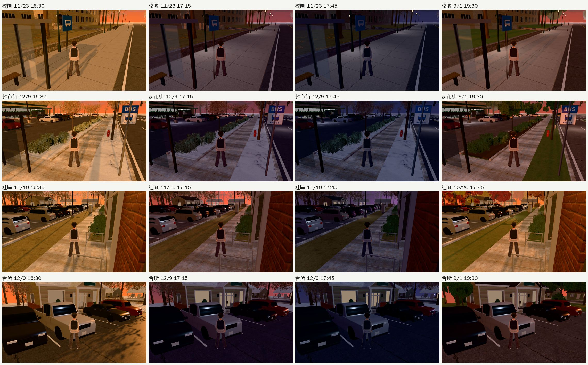
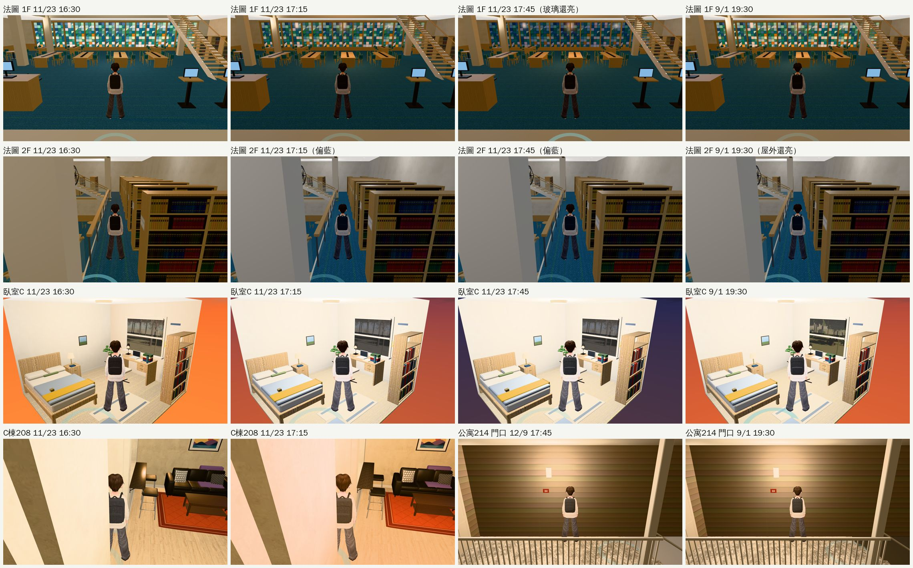

# 路線巡查⑤：美國交換那一學期的傍晚（2026-10-25，LAWWW2-B）

- **派工**：LAWWW-B 10-25 00:10（D99 第三優先）。
  - 天色改照布魯明頓的日落以後，美國那一學期的傍晚和晚上還沒有人巡過。
  - 要看的：窗景、臥室 C 窗外照片、路燈、店招、法圖彩色玻璃有沒有和屋外同一刻換；有沒有區域自己寫死時刻、沒走光線時刻。
- **對**：開發 `32ddad549`。
- **環境**：Playwright＋SwiftShader（1280×720），不是 iPhone 實機。【捷徑】用讀檔把玩家放進區域，直接設時刻。
- **結果**：
  - 拍了 117 張：9 個地方 × 13 個時刻；失敗 0、JS 錯誤 0。
  - 找到 3 項要修，都附 patch：見下面的「找到的」。

## 時刻

| 日期 | 布魯明頓日落 | 16:30 | 17:15 | 17:45 | 說明 |
|---|---|---|---|---|---|
| 10/20 | 19:01（夏令） | 16.48 | 17.22 | 17.71 | 三個時刻都是白天到傍晚 |
| 11/10 | 17:37（冬令） | 17.27 | 18.41 | 19.04 | 16:30 夕陽、17:15 日落、17:45 天黑 |
| 11/23 | 17:28 | 17.41 | 18.62 | 19.12 | 感恩節 |
| 12/9 | 17:23 | 17.47 | 18.71 | 19.15 | |
| 9/1 19:30 | 20:17（夏令） | — | — | — | 18.36：還沒日落 |

- 表裡的數字是「光線用的時刻」（`E.lightH`），從遊戲裡量的。
  - 日落＝18.95；屋外完全天黑＝19.2（引擎的夜晚係數 `nk`＝1）。

## 地點

- 公寓 214 門口、C 棟 208、臥室 C、社區停車場、會所門口、超市街、校園、法學院圖書館一樓、二樓。
- 會所裡面沒有 3D，所以從社區拍門口。

## 看了什麼

- **戶外（校園、超市街、社區、會所）**：
  - 16:30 夕陽；17:15 黃昏、路燈亮；17:45 晚上。
  - 12/9 地上有雪；9/1 19:30 還是傍晚。
  - 路燈、店招、會所的窗和天色同一刻變。
- **臥室 C**：窗外照片和屋外一起變暗（走 `room()` 的窗景，10-24 已同步）。
- **C 棟 208、公寓門口**：傍晚開燈的暖光，合理。208 的鏡頭貼牆是巡查②記過的。
- **程式**：美國那幾區會隨時間變的燈、窗景、玻璃，都用引擎傳進去的光線時刻。
  - 直接用時鐘 `G.hour` 的只有作息、事件、文字（例如 C 棟 18:00 以後的描述），不是光。
  - 沒有區域自己寫死時鐘時刻。

## 找到的（3 項，都已做 patch）

| | 哪裡 | 毛病 | patch |
|---|---|---|---|
| 1 | 美國公寓的窗景、法圖天窗和彩色玻璃（`us3d.js` 的 `VT` 色調表） | 最後一列（完全夜晚）寫 19.5，屋外是 19.2。冬天差半小時：11/23 屋外 17:54 全黑，玻璃要到 18:25 才暗。照片：法圖 1F 11/23 17:45 玻璃還亮 | `window_night_sync_v2_1025.patch` |
| 2 | 美國法學院圖書館 2F（沒有窗） | 光線時刻 18:00 以後走「室內晚上」：偏藍偏暗。連 9/1 19:30 屋外還亮的時候也是 | `windowless_night_1025.patch`（見 `../windowless_night_1025/README.md`） |
| 3 | 臺灣七棟建築的大廳窗景（看程式時找到）：霖澤館、宿舍大廳、法律學院圖書館、總圖大廳、教學館、萬才館、社科院 | `h≥18.6` 就換夜景照片，比日落（18.95）還早；冬天比屋外天黑早約 40 分鐘。10-24 的同步只改了寫 19.4 的五處，這七處寫 18.6，漏掉 | `window_night_sync_v2_1025.patch` |

- 只記錄、不改：桃園機場（`apOutside`）的窗外遠景，光線 18.3 起換夜景（日落前）。機場是出國那天、不在這次巡查範圍。

## patch：`patches/window_night_sync_v2_1025.patch`（對 `32ddad549`）

- 接著 10-24 的 `window_night_sync_1024`（五處 19.4 → 19.2）：所有「換夜景」的時刻都對齊屋外完全天黑（引擎的 `nk`＝1，光線時刻 19.2）。
- **改了什麼**：

| 檔案 | 原本 | 改成 |
|---|---|---|
| `src/building3d.js`（霖澤館）、`dorm3d.js`（宿舍大廳）、`lawlib3d.js`（法律學院圖書館）、`library3d.js`（總圖大廳）、`teach3d.js`（教學館）、`wancai3d.js`（萬才館）、`soclib3d.js`（社科院） | `night=(h%24<6\|\|h%24>=18.6)` | `>=19.2` |
| `src/us3d.js` 的 `VT`（美國公寓窗景、法圖天窗和彩色玻璃） | 最後一列 19.5 | 19.2 |
| `tests/window_night_sync_unit.js` | 檢查 5 處 | 多檢查這 8 處（第 4、5 項） |

- 早上那一頭（`<6`、`5.5`）都不動。
- **測試**：
  - `window_night_sync_unit`：新版測試對改前的程式 FAIL 8，改後 ALL PASS。
  - 和 `windowless_night_1025.patch` 一起套在 `32ddad549` 上，下面這些都 ALL PASS：
    - `season_dusk`、`after_midnight`、`us_lawlib_sky`、`us_lamp_pools`、`campus_lamps`、`l118_shops`、`library_upper`、`library_b1`、`rooms_glb`、`linze_5f`、`shadow_levels`、`ui_night_bg`、`night_forget`、`nav_buildings`、`gym_*`；
    - 還有 20 支會讀到改過的大廳檔案的測試（`boya_*`、`dorm_*`、`classes`、`crowd`……）。
  - 兩份 patch 一起套、分開套都乾淨。
