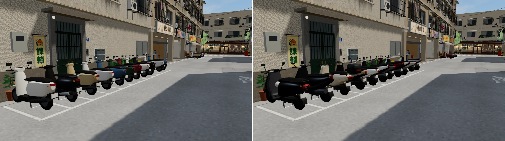
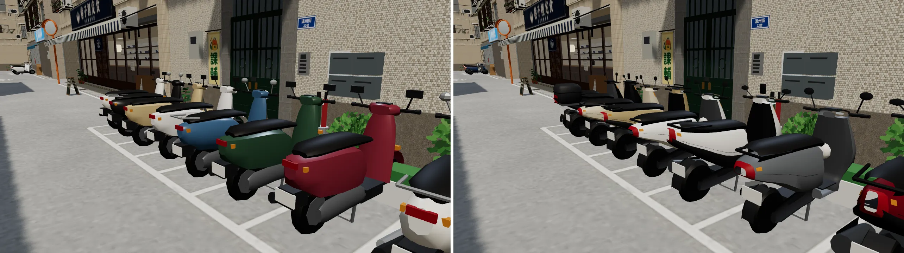
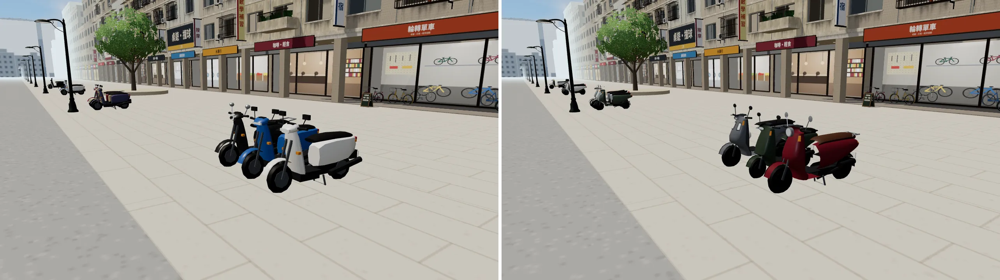
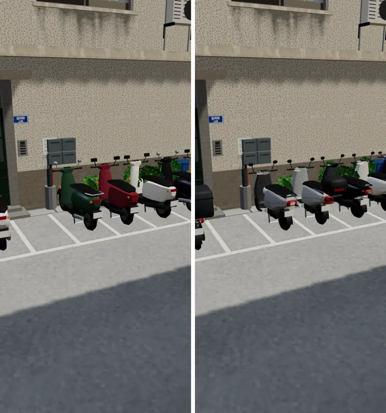
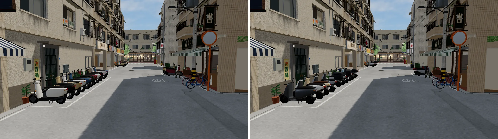
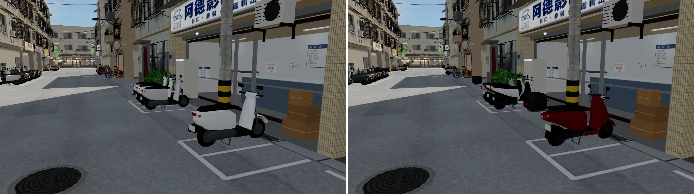
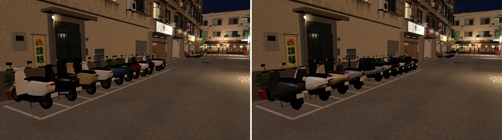
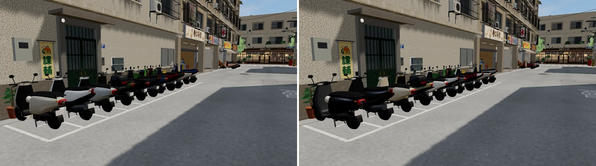

# 機車 v2：12 款車型（使用者 2026-10-16 20:2x：「機車都只是同個模板換顏色，太假了……路上不會全部都一樣，不要只改顏色」）

- **做的人**：LAWWW2-B（D89：美術歸 LAWWW2）。
- **狀態**：`READY_FOR_ART_REVIEW`。場景美術的 `ART_APPROVED` 由使用者決定。
- **交付**：
  - 模型 `assets/models/env/second_ai/scooter.glb`（＋`.json`）。
  - 遊戲端 patch `docs/art-rebuild/second_ai/patches/scooters_v2.patch`（由 LAWWW-B 整合）。
- **還沒做**：腳踏車多款式（下一件）。

## 1. 問題（修改前）
- 舊的 `scooter.glb` 只有兩款：現代款、復古款，每台 1,286 三角形。遊戲三台裡一台復古，其他乘一個顏色（InstancedMesh）。
- 溫州街、公館整排是同一個方塊感的車身，只有顏色不同。前擋、車尾、燈都是方塊。

## 2. 參考
- **研究筆記**：`docs/art-rebuild/second_ai/research/vehicles_research.md`。
  - 台北街上常見的 9 種機車原型：尺寸、造型線索、常見顏色。
  - 停車排的樣子。
  - 數字來自搜尋摘要，標「估」的是估計。
- **只參考車型的類別**（國民通勤、運動型、電動換電、復古圓弧……），外型比例自己定。
  - 不照抄任何一款的前臉或飾條；不放商標；車牌空白。

## 3. 修改前後（遊戲內，同鏡頭、同時段；左舊右新）
溫州街停車格，11:00：


近看（看得到後箱、運動型的雙色車殼、不同的車尾）：


公館：


手機直向 390×844：


主巷往東、北側停車排、晚上 20:30：




配色第一版太暗（黑、灰太多），調成台北巷口的比例（白、銀灰多，黑和彩色少）。左第一版、右現在：


- 截圖工具：`tools/blender/env_second/shots/fast_shots.py`。手機模擬，Playwright＋SwiftShader，**不是真機**。
- 測試工作樹：開發分支 `dd24edbb`＋新的 `scooter.glb`＋`scooters_v2.patch`。
- 「修改前」：同一個工作樹，套 patch、換 GLB 之前拍的。

## 4. 做法（`tools/blender/env_second/scooters_v2.py`）

```bash
/opt/blenv/bin/python tools/blender/env_second/scooters_v2.py                                  # → assets/models/env/second_ai/scooter.glb（遊戲用：車殼白色、由遊戲上色）
/opt/blenv/bin/python tools/blender/env_second/scooters_v2.py -- --out <glb> --layx --preview  # 渲染用：一款一款沿車身排開、車殼上代表色
/opt/blenv/bin/python tools/blender/env_second/scooters_v2.py -- --only S2,S4 --parts           # 只做幾款、印出每個零件的三角形
```

| 部位 | 函式 | 怎麼做 |
|---|---|---|
| 前車身（前擋＋腳踏內板一整塊） | `front_rows`、`fsec`、`loft_split` | 水平斷面一層一層往上。<br>• 前緣從頂點沿傾角 `lean` 往下往前（**上面往後**，和前叉一樣；第一版做反了，像滑板車），中段外鼓 `bulge`。<br>• 下面讓開前輪：離輪胎 4.5 cm，用平滑 min 接。<br>• 膝蓋那面：踏板前端用半徑 `fillet` 的圓弧接到踏板，不是直角。<br>• 前面車殼色、後面黑色塑件（`back`）。 |
| 後車身 | `tsect`、`interp` | 圓角梯形斷面，Catmull-Rom 內插。<br>• 下緣從踏板往後上揚、讓出後輪。<br>• 方度 `rp`：越大越方。 |
| 燈 | `patch`、`front_F`、`rear_F` | **從車殼的參數曲面取一塊、沿法線往外推 2～6 mm**（貼著曲面，不是表面上的方塊）。<br>• 前擋燈加黑色燈殼邊。<br>• 尾燈＝車尾最後一兩段的殼。<br>• 款式：龍頭罩燈殼（舊款通勤）、前擋兩顆、V 字（運動）、中間直條（電動）、上下兩顆方燈（越野）、圓燈＋鍍鉻圈（復古、彎樑）。 |
| 後照鏡 | `mirror_head` | 扁橢圓殼（旋轉體縮放），鏡面朝後。運動型是六角形，復古是鍍鉻圓鏡。 |
| 座墊 | `tsect` | 厚約 10 cm，坐進車殼頂，比車殼寬一點點。 |
| 輪 | `wheel` | 機車胎是窄而圓的截面（5 點旋轉）。<br>• 鑄造輪框。<br>• 彎樑用鋼絲輪：細框＋輪轂＋6 根輻條暗示。 |
| 配件 | `build` 的 `extras` | 後箱、後扶手、前掛勾的塑膠袋、手機架、外送箱、掛在後照鏡的安全帽、鍍鉻後架、機車罩（`cover_shell`）。 |
| 遠處簡化版 | `make_lod` | Decimate（collapse）到約 600 三角形，節點 `scooter_<代號>_lod1`。 |
| 顏色 | 頂點色 | 零件顏色寫進頂點色，三個材質：<br>• `scooter_paint`：白色，遊戲上色；<br>• `scooter_parts`：頂點色；<br>• `scooter_metal`：頂點色，金屬 0.45。 |

**12 款**（節點 `scooter_<代號>`。extras：`weight`＝街上的比例，`palette`＝這一型常見的車殼顏色，清單裡重複＝比較常見）

| 代號 | 車型 | weight | 三角形（近／遠） |
|---|---|---|---|
| S1A | 國民通勤 125 舊款（頭燈在龍頭罩） | 0.22 | 1,982／600 |
| S1B | 國民通勤 125 新款（頭燈在前擋） | 0.24 | 1,990／600 |
| S2 | 運動型 125～158（V 字燈、尖翹車尾、雙色車殼、大排氣管） | 0.20 | 2,162／600 |
| S5 | 電動換電型（沒有排氣管、輪轂馬達、一體平順、中間直條燈） | 0.10 | 1,884／600 |
| S4 | 復古圓弧（圓燈、鍍鉻後照鏡和後架、咖啡色座墊） | 0.07 | 2,102／600 |
| S7 | 50cc 舊款（小一號、10 吋輪） | 0.07 | 1,902／600 |
| S3 | 大型速克達（擋風鏡、踏板中間隧道） | 0.04 | 2,204／600 |
| S6 | 方塊越野風（方折線、高前土除、上下兩顆方燈、外露橫桿、後架） | 0.03 | 2,282／599 |
| S9 | 彎樑（鋼絲輪、腿部護板、水平汽缸） | 0.02 | 1,798／600 |
| S1B_D | 國民通勤＋外送箱＋手機架 | 0.07 | 1,990／599 |
| S5_H | 電動＋掛安全帽 | 0.05 | 1,976／599 |
| S1A_C | 國民通勤＋機車罩 | 0.03 | 784／600 |

- 舊的名稱 `scooter_a`（＝S1B）、`scooter_b`（＝S4）保留：沒套 patch 之前，遊戲照舊能用，但只會出現兩款。

## 5. 遊戲端（`patches/scooters_v2.patch`，給 LAWWW-B 整合）
- **`zones3d.js` 的 `attachWzScooters`**：
  - 每台照自己的位置算雜湊，挑一款（照 `weight`），再從那一款的 `palette` 挑顏色。每次進來都一樣。
  - 每一段合成**一個網格、一個材質**：溫州街照位置每 20 m 一段、路兩側分開；公館照原本的 `grp`。
    - 顏色走頂點色；粗糙度、金屬度用 3×1 查表貼圖（車殼 0.32／塑膠橡膠 0.55／金屬 0.32＋0.45）。
  - 外面包 `THREE.LOD`：離鏡頭 16 m 以外換 `_lod1`。
  - 影子照舊：每台底下一片影子貼片（一個 InstancedMesh）。
  - 舊的接法改名 `attachWzScootersAB`：GLB 沒有新節點時用它。
- **`assets3d.js`**：`bldg.wz_scooter` 的來源說明。
- **兩個整合測試的機車檢查改寫**（`tests/wz_street_integration.py`、`tests/gongguan_glb_integration.py`）：
  - 舊檢查寫死「InstancedMesh、instanceColor」。
  - 新做法改成檢查：台數和套件相同、至少 6 款、至少 5 種車殼顏色、每段近／遠兩層、不進陰影那一輪、公館分組台數相同。
  - 沒有新節點時照舊檢查 InstancedMesh。**不是放寬標準**：多了款式數、顏色數、兩層的檢查。

## 6. 八項驗收紀錄（ART_SOP 第 3-2 節）
| 項目 | 結果 | 說明 |
|---|---|---|
| 輪廓與倒角 | 通過（近看還有折面） | 車殼全部是斷面放樣＋內插，沒有方塊。<br>• 前車身是真的機車那種「前擋往後傾＋腳踏內板圓弧接踏板」。<br>• 輪胎 18 邊。<br>• 近 1.5 m 看得到車殼的折面、輪胎的多邊形。 |
| 材質 | 通過 | 三個材質（遊戲合成後一個），頂點色。<br>• 金屬 0.45（`MAX_METAL`）。<br>• 粗糙度：車殼 0.32、塑膠橡膠 0.55。<br>• 沒有貼圖。 |
| AO | **沒做** | 車和地面之間靠影子貼片（舊的做法照用）。<br>車殼自己的凹處沒有暗角（頂點色可以做，下一版）。 |
| 磨損 | **部分** | 50cc 舊款預留了 `worn`（膠帶補座墊），還沒做。其他車都是乾淨的。 |
| 生活痕跡 | 通過 | 後箱、外送箱、手機架、前掛勾的塑膠袋、掛著的安全帽、機車罩。<br>停放的角度、前後每台不同（套件的位置照舊）。 |
| 比例 | 通過 | 軸距 1.22～1.4 m、座墊頂 0.78～0.92 m（大型速克達最高）。<br>輪外徑：50cc 舊款 0.37 m、一般 0.42～0.46 m、大型 0.51 m、彎樑 0.58 m。 |
| 效能 | 通過 | **溫州街整合測試 ALL PASS**：三個鏡頭 draw call 287／270／302、三角形 38.8／36.9／37.4 萬。<br>• 換之前是 291／273／306、41.7／39.0／41.4 萬；上限 310、42 萬。<br>• 近處每台約 2,000 三角形，16 m 外約 600。<br>• `scooter.glb` 0.14 MB → 1.3 MB（12 款＋12 個簡化版）。 |
| 遊戲截圖 | 通過 | 溫州街（白天停車格、近看、手機直向）、公館；第 3 節。 |

## 7. 還沒到的地方（誠實寫）
1. **近看**（1.5 m 內）看得到車殼的折面和輪胎的多邊形。後車身從正後方看還是偏圓胖。
2. **16 m 換簡化版的瞬間**：Playwright 截圖沒看到跳動，但沒有在真機上走過一遍確認。
3. **磨損、AO 沒做**：所有的車都是新的。舊車的膠帶、刮痕、褪色是下一版。
4. **機車罩**（weight 0.03）：這次溫州街 39 台、公館 60 台都沒抽到（比例照實際是少數）。要讓玩家一定看得到，可以把 weight 調高或指定一個位置。
5. **腳踏車還是同一款**：下一件做（公共單車形式、細管公路車、登山車、小折、老鐵馬）。
