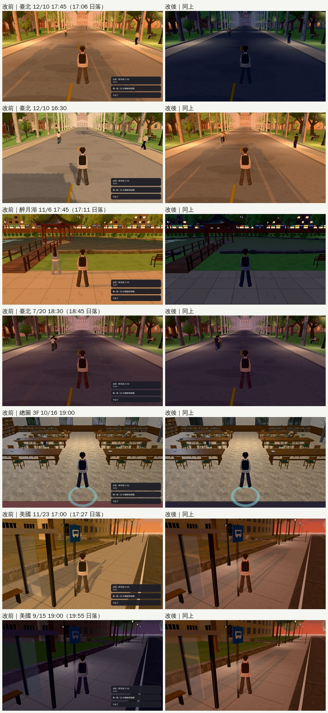
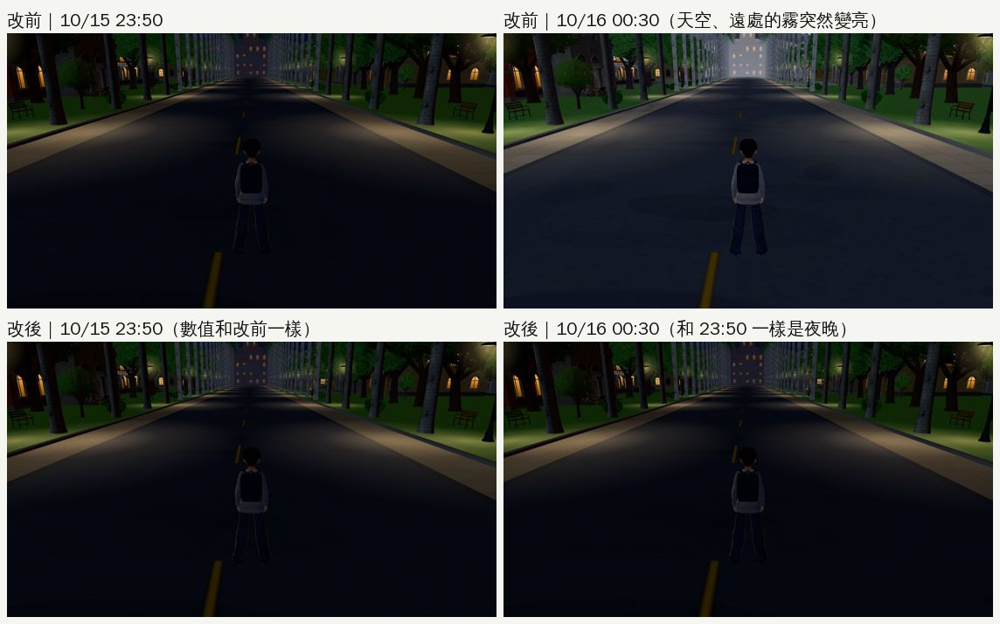

# ENGINE-SEASON-DUSK-1024：傍晚的光線照日期（2026-10-24，LAWWW2-B）

- **派工**：LAWWW-B 15:51。巡查③找到「傍晚的天色不分季節」，決定要做；`engine3d.js` 由我改（D108）。**等 v9.10.9 發布後才整合**。
- **對**：開發 `0d3125c88`。
- **環境**：Playwright＋SwiftShader 手機模擬（1280×720），不是 iPhone 實機。
- **狀態**：`READY_FOR_ART_REVIEW`。場景的 `ART_APPROVED` 只有使用者能標。

## 交件

| 檔案 | 內容 |
|---|---|
| `patches/engine_season_dusk_1024.patch` | **主要的（A）**：`src/engine3d.js`＋新測試 `tests/season_dusk_unit.js` |
| `patches/engine_after_midnight_1024.patch` | **另外一份（B），要不要收由 LAWWW-B 決定**：半夜不會突然變亮；疊在 A 上面套（`src/engine3d.js`＋新測試 `tests/after_midnight_unit.js`） |

- 兩份都對 `0d3125c88` 驗證過：先套 A、再套 B，結果和我測試的樹逐位元相同。
- 只套 A 也可以（A 自己的測試照樣 ALL PASS）。

## A. 傍晚的光線照日期

### 玩家看到的

- **冬天**：臺北 12/10 17:06 日落、17:30 天黑。
  - 改前：遊戲 17:45 還是金黃色的斜陽。
  - 改後：17:45 天已經黑了，路燈亮、星星出來。
- **秋天**：11/6 17:45 在醉月湖等可昕，改後是天剛黑；10/16 19:00 在總圖三樓，窗外換成夜景。
- **夏天**：7/20 幾乎不變（臺北 18:45 日落，原本的表就是照夏天排的）。
- **美國（布魯明頓）**：
  - 11/23 17:00：改前是下午（太陽 24°），改後是黃昏（9°）；當地 17:27 日落。
  - 8 月：當地 20:58 才日落，改前 20:30 已經是晚上，改後還是黃昏。

### 做法（`src/engine3d.js`）

1. **光線用的時刻**：`E.applyTime(hour)` 先算「光線用的時刻」`lightHour(hour%24, E.sunsetNow())`，再查 `KEY0`／`KEYG`。
   - 三點內插：
     - 15:00 → 15:00；
     - 當天的日落 → 18.95（表上太陽 0° 的時刻）；
     - 日落＋2.05 小時（不早於 21:00）→ 21:00；再線性接到 24:00。
   - 15:00 以前完全照舊。
2. **同一個值給所有看時間的光**：天空、太陽、雲、柏油調暗、路燈、黃昏輪廓光，還有各區的 `zone.applyTime`（窗景、亮著的窗）、`applyTimeOutdoor`、室內那一段，都用這個值。夜間影子（`E.nightShadow`）改用 `E.lightH`。
3. **不動的**：
   - `E.hour`、`G.hour`（時鐘）、作息、事件判斷、存檔都不改。
   - 光線用的時刻另外放在 `E.lightH`。
4. **日落時刻**：
   - 用 NOAA 的簡化公式，誤差幾分鐘。
   - 臺灣：臺北 25.03°N、121.56°E，UTC+8。
   - 美國：`us_` 開頭的區域（公寓、校園、法圖、超市、超市街、社區）用布魯明頓 39.17°N、86.53°W。
     - 2028-11-05 以前夏令時間（UTC−4），之後冬令時間（UTC−5）；遊戲裡 `us_life3d.js` 也是 11/5 換。
   - 日本：`jp_` 開頭的區域（關西的宿舍 `jp_room`、`jp_hub`）用大阪 34.69°N、135.50°E，UTC+9（3/25 18:14、7/1 19:15）。
   - 同一天、同一個地方只算一次（`E._ssK` 快取）。
   - `E.sunsetFix` 可以直接指定，給測試用。
   - 沒有日期（標題畫面、Node 測試）就照舊。

| 地方、日期 | 日落 | 時鐘 | 光線用的時刻 | 改前 |
|---|---|---|---|---|
| 臺北 12/10 | 17:06 | 17:45 | 19:17（天黑） | 17:45（太陽 15°） |
| 臺北 12/10 | 17:06 | 16:30 | 17:50 | 16:30 |
| 臺北 11/6 | 17:11 | 17:45 | 19:16 | 17:45 |
| 臺北 10/16 | 17:26 | 19:00 | 19:51（窗換夜景） | 19:00 |
| 臺北 7/20 | 18:45 | 18:30 | 18:41 | 18:30 |
| 布魯明頓 11/23 | 17:27 | 17:00 | 18:13 | 17:00 |
| 布魯明頓 8/2 | 20:58 | 20:30 | 18:39 | 20:30（已經是晚上） |

### 室內

- 室內照現在的做法，沒有另外一張表：室內那一段原本就看時刻（`h≥18` 開燈的暖色、`16.5～18.4` 黃昏），現在拿到的是光線用的時刻。
- 窗景和室內的光一起變，不會窗外天黑、屋裡還是下午的陽光。
- 例：12 月 16:40 左右屋裡就是開燈的樣子（外面天快黑了）。

### 知道、沒改的

- **載入正式模型那一刻的那一次 `z.applyTime(G.hour, …)`**：
  - 有 12 處，在 `us3d.js`、`library3d.js`、`gym3d.js`、`rooms_glb3d.js`、`linze_upper3d.js`、`library_b1_3d.js`、`l118_shops3d.js`、`jp_dorm3d.js`。
  - 它們傳的是時鐘，但引擎每 5 格就用光線用的時刻重新套一次，所以最多 5 格。
  - 要完全一致可以改成傳 `E.lightH`；不是我的檔案，這次沒動。
- **早上**沒改：12 月 06:29 才日出，遊戲 06:00 已經是清晨。派工只要傍晚。

### 測試

- **新測試 `tests/season_dusk_unit.js`**：修改前 FAIL 14，修改後 ALL PASS。
  1. 程式結構：`applyTime` 用 `lightHour`，`E.hour` 照舊；夜間影子用 `E.lightH`。
  2. 日落時刻：臺北 12/10、6/21、9/1；布魯明頓 11/23、8/2；11/5 換冬令時間那天早一小時；大阪 3/25、7/1。
  3. 派工指定的五個時刻：用遊戲自己的 `KEYG` 查太陽高度、路燈、夜晚係數。
     - 12/10 17:45、11/6 17:45 天黑；
     - 7/20 18:30 幾乎不變；
     - 10/16 19:00 總圖換夜景；
     - 美國 11/23 17:00 是黃昏。
  4. 12/10 17:00 路燈亮；15:00 以前完全照舊。
  5. 2024～2028 每一天（臺北、美國、大阪）連續、遞增、沒有 NaN。
  6. `E.sunsetNow` 分臺灣、美國、日本，有快取。

- **燈光、夜晚相關的 Node 測試**（套 A＋B 後）：以下 17 支都 ALL PASS。
  - `airport_cam`、`classes`、`linze_5f`、`shadow_snap`、`shadow_levels`、`campus_lamps`、`lamppost_nav`；
  - `us_lamp_pools`、`us_lawlib_sky`、`ui_night_bg`、`night_forget`、`date_overnight`、`bed_tonight_alarm`；
  - `jp_sleep_midnight`、`ground_zfight`、`season_dusk`、`after_midnight`。
- **瀏覽器測試**（套 A＋B 後）：<!-- BROWSER -->

### 改前、改後（同一個鏡頭）

- 改前：開發 `0d3125c88` 原樣；改後：套 A＋B。
- A 只影響 15:00 以後，B 只影響 05:30 以前，所以下面這幾張就是 A 的效果。
- 改前那幾張右下角的出遊選單，是截圖存檔跳日期留下的（巡查③說明過）；改後那一輪沒有跳出來。選單看的是時鐘 `G.hour`，這次沒動，和光線無關。

- **12/10 17:45**：金黃斜陽 → 天黑、路燈亮。
- **12/10 16:30**：白天 → 夕陽斜射（臺北這時候太陽約 7°）。
- **醉月湖 11/6 17:45**：金黃 → 天黑。改前左邊那個女生改後不在畫面裡：NPC 的位置看時鐘和走動的時間差，這次只改 `E.applyTime`、`E.nightShadow`，沒有碰 NPC。
- **7/20 18:30**：幾乎一樣。
- **總圖 3F 10/16 19:00**：窗外從白天的樹變成夜景。
- **美國 11/23 17:00**：下午 → 日落的橘紅天空、路燈亮。
- **美國 9/15 19:00**：改前已經是晚上（紫色），改後是日落前（當地 19:55 才日落）。

## B. 半夜不會突然變亮（另外一份，LAWWW-B 決定要不要收）

- **巡查截圖發現的**：
  - 原本 `applyTime` 在 `h<5.5` 時一律用 05:30 那一列（清晨的藍天、霧、路面）。
  - 所以 23:50 是夜晚，00:30（`G.hour` 24.5）天空、路面、遠處的霧就突然變亮。
- **改法**：
  - 表的前面加兩列：00:00、04:30 都等於 24:00 那一列，04:30～05:30 從夜晚接到清晨。
  - 這兩列的太陽方位用 70°（東北、在地平線下），不會從西邊繞過南邊。
  - 05:30 以後完全照舊。
- **測試 `tests/after_midnight_unit.js`**：只套 A 時 FAIL 6，套 A＋B 後 ALL PASS。
  1. 程式結構；
  2. 00:30、02:00、04:00 和 24:00 一樣；
  3. 23:59 → 00:00 接得上；
  4. 05:30 以後不變；
  5. 04:30～05:30 太陽亮度不倒退、方位在東北。

- **量到的數值**（遊戲內，椰林大道）：

  | | 太陽亮度 | 環境光 | 曝光 |
  |---|---|---|---|
  | 23:50（改前、改後一樣） | 0.052 | 0.615 | 1.044 |
  | 00:30 改前 | 0.35 | 0.663 | 1.105 |
  | 00:30 改後 | 0.05 | 0.613 | 1.04 |

- 第一輪截圖改後的 23:50 看起來比改前暗。量了數值：兩邊的光線完全一樣，重拍一次兩張也一樣（平均差 0.1／255）。是那一輪 NPC、陰影的時間差，不是改動造成的。上面這張用重拍的。
