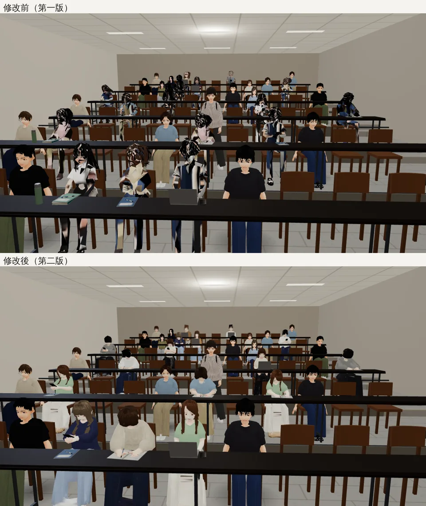
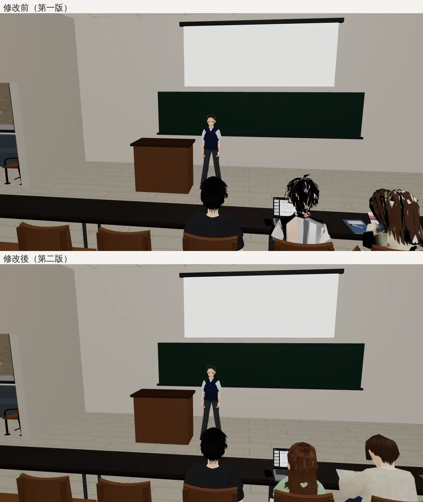
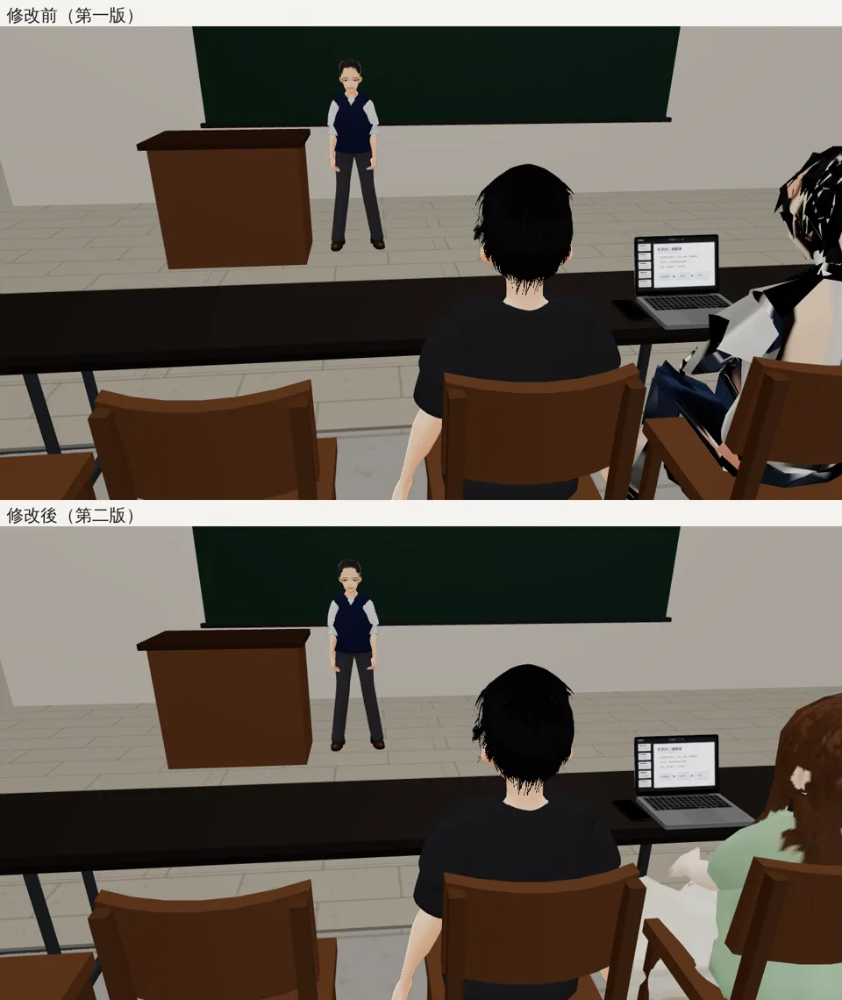

# 坐著的同學（講堂替身）第二版｜LAWWW2-C 2026-10-17｜MODEL_READY（遊戲端第一版就接好了，換檔即可）

**問題（ART-NPC-HAIR-STREAK）**：博雅 101 經濟系上課時，好幾位坐著的同學頭髮是黑白碎片。
- 那些不是會動的路人 VRM，是 `seated_figures.glb`：大講堂 16 個完整人物以外的座位用的靜態替身（`src/classes3d.js` 的 `figPlace`，一種外型一個 InstancedMesh）。
- 第一版（2026-10-13）用舊的 VRoid 樣本路人（`vroid_npc_f1/f2/m1/m2`），直接減面成 1,500 個三角形再展 UV。
  - 髮片減面後是很多細長的三角形，UV 島變成幾千個小點：貼圖集上面四分之三幾乎是黑的，只有零星的色點。
  - 遊戲裡不只頭髮，衣服、臉也是碎點；頭髮最明顯。
- 所以不是貼圖過濾、陰影、描邊的問題，要重做。

## 修改前／後（遊戲裡，開發分支 74a655e8 換上新的 GLB；博雅 101 經濟學原理第 4 週）
從講台往後看（大多是替身；前兩排有完整人物）：

原本回報的角度（玩家後面的座位）：

近看（玩家旁邊、7 m 內用 LOD0）：

## 第二版怎麼做（`tools/blender/env_second/seated_figures.py`）
1. **來源換成現在的路人**（`assets/models/char/second_ai/bl_npc_*.vrm`）：
   - 女生 nf1、nf2、nf3、nf6、nf13、nf15，男生 nm2、nm3、nm8、nm11、nm13、nm15；
   - 髮型、髮色、穿搭都不同，每位就是自己的穿搭，不再換色；
   - 坐著的同學和走在路上的路人是同一批人。
2. **女生只挑穿長褲的**：
   - 裙子只綁腰臀與大腿；
   - 長裙、中長裙坐下時被大腿撐成大三角形，前面裂開（nf9 試過，退件）。
3. **先做外殼**：
   - 整個人加厚 1 cm → 體素重建 1 cm → 一個封閉的表面，髮片合成實心的頭髮；
   - 再減面成 LOD0 約 2,400、LOD1 約 400 個三角形；
   - UV 是整塊的島；頭和頭髮的島放大 2.2 倍，腰以下（大多在桌子下面）縮成 0.7 倍。
4. **從原本的模型把顏色烤到外殼上**（站姿烤、烤完才擺姿勢）：
   - 髮片透明的地方換成頭髮的平均色；
   - 髮片底下墊一層「頭髮色的內層」：原本的長髮一束一束有縫，射線從縫裡穿過去會打到後面的毛衣（nf1 背上一塊一塊的綠色）；
   - 沒打到東西的像素用旁邊的顏色補：寬褲兩條褲管在站姿時貼在一起，兩腿之間那一片原本是一條黑帶（nf1 的白色寬褲）。
5. 姿勢、座位的原點、網格名字的格式（`fig_<底模>_<姿勢>_c0`、`_lod1`）都和第一版一樣，**遊戲端不用改**：
   - `figPlace` 照 `/^fig_/` 收集；
   - 照 `_(listen|write|phone)_` 配桌上小物；
   - 7 m 外用 `_lod1`。

## 規格
| | 第一版 | 第二版 |
|---|---|---|
| 外型 | 4 底模×3 姿勢×2 配色＝24 | 12 位×3 姿勢＝36 |
| 三角形 | LOD0 約 1,500／LOD1 約 350 | LOD0 2,400／LOD1 400 |
| 貼圖集 | 2048×1024（8 格） | 2048×1536（12 格，每格 512：上 3/4 LOD0、下 1/4 LOD1） |
| 檔案 | 2.3 MB | 3.26 MB（三個姿勢共用 UV；法線存成 8 位元，`KHR_mesh_quantization`） |
| 材質 | `seated_fig` 一個（貼圖＋自發光 0.3） | 同左 |

- 博雅 101 這一堂有 17 個替身，每個外型不同：每個外型一個 draw call，和第一版差不多。
- 法線 8 位元前後的畫面相同（逐張比過）；遊戲 console 沒有和這個檔案有關的錯誤（只有一個無關的 404，舊版也有）。
- `tools/blender/env_second/glb_share_geometry.py` 加了兩件事：資料相同的 accessor 自動合併、`--qnormals`。

## 還沒做到的
- 遠距離版（LOD1，400 個三角形）近看時頭髮會有幾塊淺色（貼圖只有 512×128），但遊戲裡只在 7 m 外用。
- nf1 背上靠後頸有一小塊領口色：頭髮在後頸自然分開、露出脖子和毛衣（原本的路人也是這樣）。
- 側面看得到耳朵（淺色一塊），是真的耳朵。
- 只有手機模擬（Playwright＋SwiftShader），沒有真機。
- 穿裙子的女生不在替身裡；要的話，得給替身另外做「坐姿的裙子」（裙子往前蓋住大腿、下襬垂在膝蓋前），不是現在的綁法。
