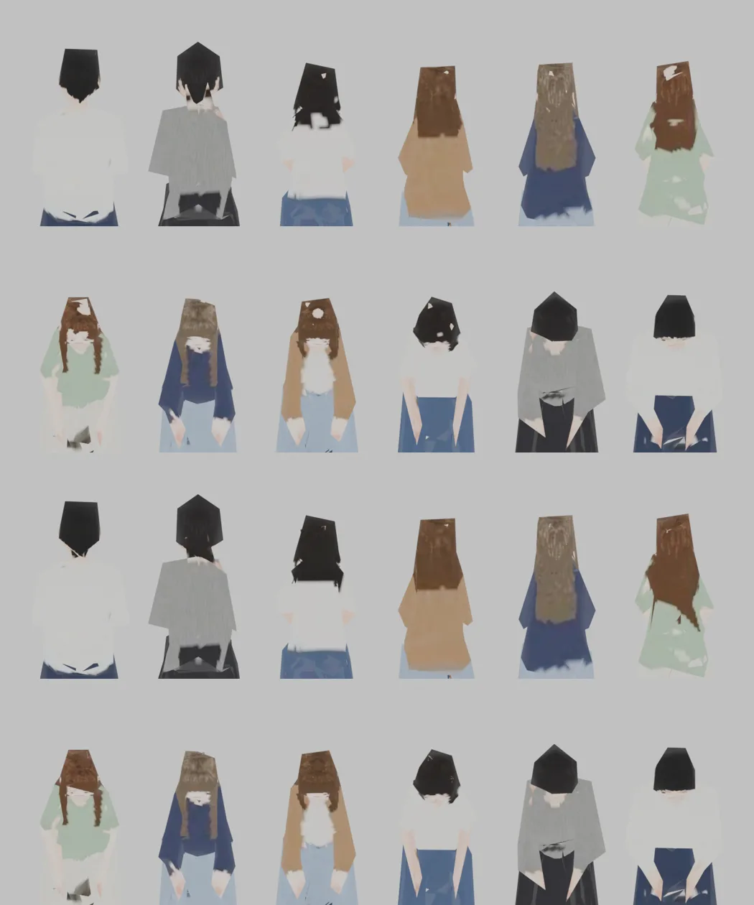
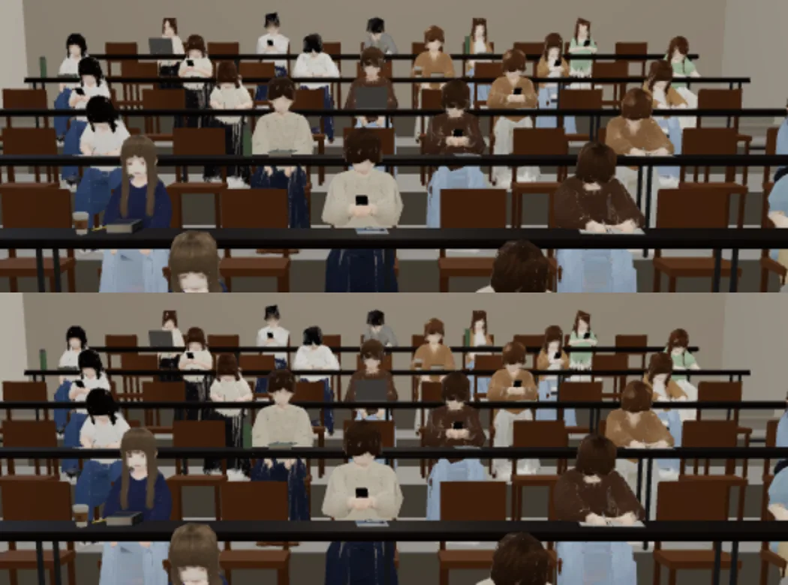
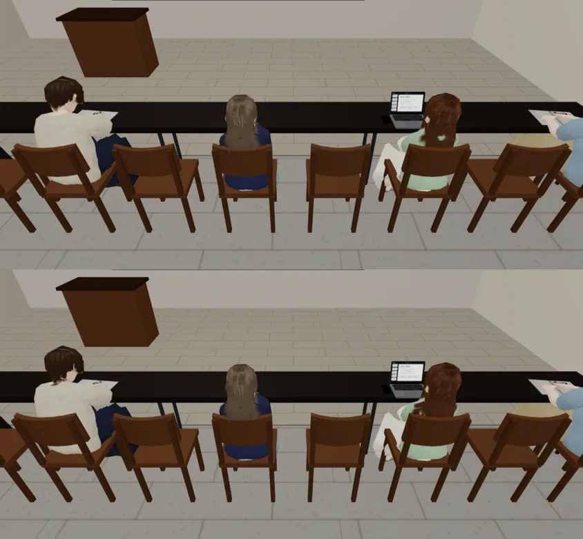
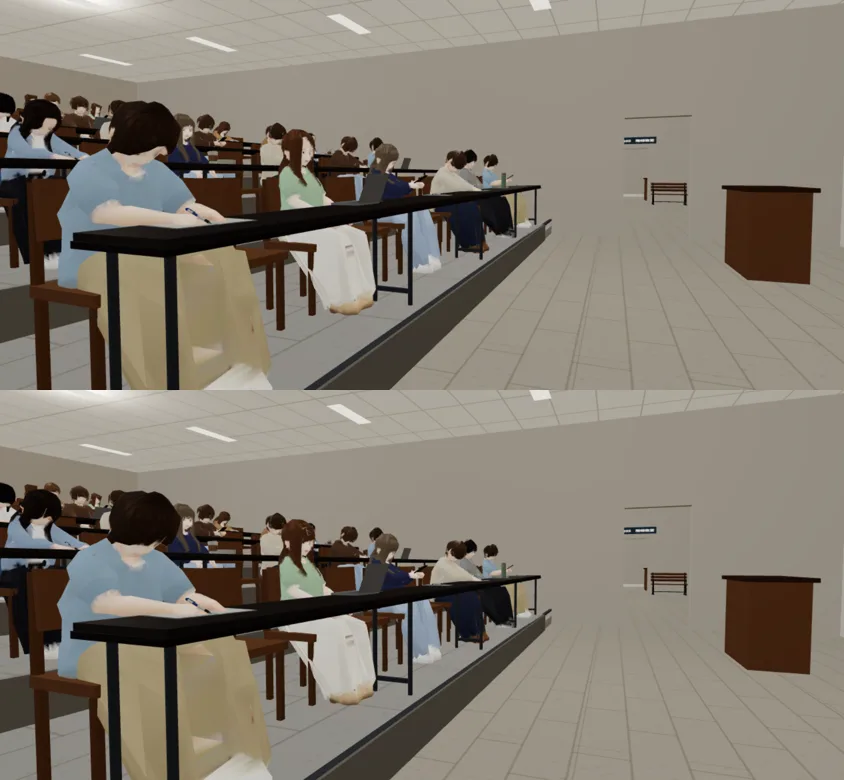
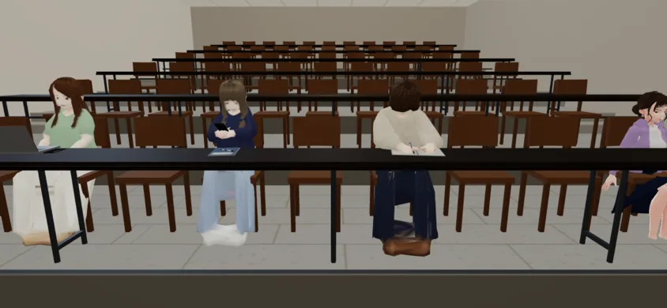
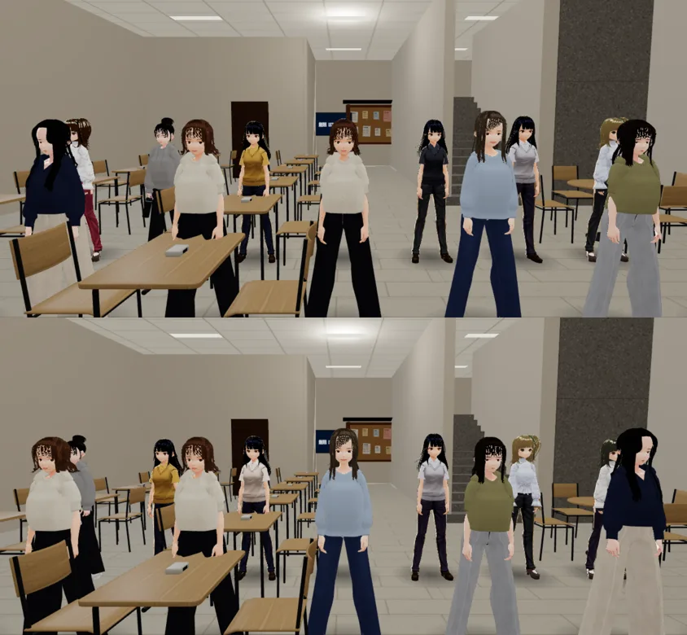

# ART-SEATFIG-1018：博雅 101「有人禿頭」、坐著的替身太小、臉很白

LAWWW2-C，2026-10-18。
- 誰派的：LAWWW-C 06:17（使用者回報「博雅101有人禿頭 有人看起來很可怕」）。
- BB-C 的截圖：`claude/wonderful-mayer-7fm9g6` @ `3ae0a956`，`docs/story_planning/test_shots/boya101_1018/`。

## 1. 頭頂白一塊（禿頭）：FIXED
- **原因**：坐著的替身（`seated_figures.glb`）在離玩家 7 m 以外換成低面數版本（`_lod1`，400 個三角形）。
  - 這個版本烤顏色時，頭頂、後腦勺的射線從髮束的縫穿過去，打到後面的白衣、淺藍襯衫。
  - 結果頭頂、後腦有一塊塊白色和淺藍色，遠看像禿頭。
  - 近的版本（`_lod0`）幾乎沒有，所以近拍看不到。
- **改法**：`tools/blender/env_second/seated_figures.py` 的 `hair_cleanup()`。
  - 站姿時頭頂（頭骨以上 7 cm）的面，加上在臉的另一邊、離原本頭髮 3 cm 以內的面（長髮披在背上的部分也算），一定是頭髮。
  - 這些面的像素裡，比頭髮平均色亮 0.18 以上、而且差 0.22 以上的，換成頭髮色。
  - 試做第一次用這一區的中位數當基準：有一位的中位數是皮膚色，頭髮被換成皮膚色，退件。
- 網格名字、姿勢、座位約定都沒變，遊戲端不用改。
- GLB 3.29 MB（原本 3.26 MB）。

低面數版本（Blender 算圖；上兩排改之前：背面、上面；下兩排改之後）：

遊戲內（Playwright 手機模擬 844×390，LAWWW-C 分支 `ba6e9aa4`；上：改之前，下：改之後）：
- **捷徑**：用 `CLS.figPlace` 在博雅 101 放替身。
- 後排是 7 m 以外的低面數版本：

- 從前排後面往下看：

- 從左前方低角度看：

## 2. 替身「比旁邊的 VRM 同學小很多」：不是比例問題，沒改
- 量過：替身坐著的頭頂離那一排的地面 1.26–1.36 m（女生 1.26–1.28）。
- 吳芯慈 VRM（1.60 m）坐在同一排：頭頂 1.17 m、頭骨 0.96 m、屁股 0.49 m。替身反而高 10 cm。
- 同一排、同一個鏡頭（左三個是替身，右邊是芯慈）：

- BB-C 的 b_ 是從前排側邊很低的角度拍的：
  - 靠鏡頭的是 1 m 外的 VRM，替身在 3–5 m 外，透視差很多；
  - 長桌在替身前面，桌面擋到胸口。
- 如果 LAWWW-C 實際比對後還是覺得小，請給我同一個鏡頭的數字，我再調。

## 3. 臉很白、發亮（e_）：FIXED（是 VRM，不是替身）
- **原因**：舊的路人底模 `assets/models/char/vroid_npc_f1.vrm`。
  - 有名字但沒有自己模型的女生，會用 `AMB` 換色：黃 xh、林、黃、蔡教授等。
  - 這個底模臉的 MToon 暗部顏色 `_ShadeColor` 是 (1, 0.94, 0.94)，幾乎是白的；她自己的身體、其他所有路人都是 0.84。
  - 所以臉的暗部比脖子、比別人亮，像戴了打光的面具。
- **改法**：只改這一個數字，臉的暗部改成和她自己的身體一樣 (1, 0.838, 0.835)。其他都沒動。
  - 這是 LAWWW 的檔案（`tools/vroid_build.py` 產生的）。我直接改了 VRM 的 JSON。
  - 以後重新產生這個檔案時，要在 `vroid_build.py` 一起改。
- 博雅大廳，同一組有名字的女生（上：改之前，下：改之後；站的順序不同，因為改之後小語有自己的模型）：

- 有光的大廳裡差別不大：差別在臉的暗部（背光、側光的時候）。

## 4. 七個人疊在一起（c_、d_）：沒做
- 那是走進教室的同學擠在一起，是遊戲程式（找路、走位），不是美術。LAWWW-C 沒有派給我。

## 測試
- 遊戲內 6 個鏡頭沒有 JS 錯誤。
- `node tests/seated_figures_unit.js`、`node tests/desk_furniture_unit.js` ALL PASS（LAWWW-C 分支 `ba6e9aa4`＋新的 GLB）。
- 沒測 iPhone 實機。
