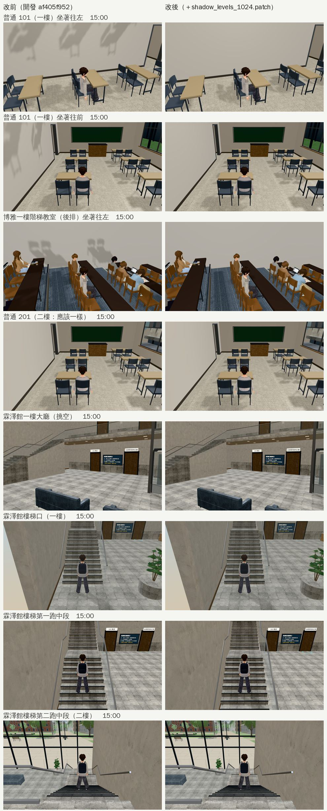

# BUG-SHADOW-UPPER-1024：一樓教室的牆上有二樓桌椅的影子

- **找到**：巡場景第 7 區（室內教室坐下看窗外，`test_shots/patrol_classrooms_1024/`）。
- **做法**：LAWWW-B 10:49 同意，要動 `engine3d.js`，D108。
- **做的人**：LAWWW2-B。
- **狀態**：已交付。patch 對開發 `af405f952`（`engine3d.js` 到 `b4a1d6e54` 都沒變）。

## 問題

坐在普通 101、博雅一樓階梯教室，下午一樓的牆上有一片片放大的桌椅影子，是正上方二樓的桌椅：

- 鏡頭比二樓地板低時，`updateLevelVis` 讓二樓整層顯示（從下面看得到天花板，是故意的）。
- 二樓的桌椅因此也進了陰影貼圖。
- 室內的太陽沒有被樓板擋住，影子就打在一樓的牆上。

## 改了什麼（`docs/art-rebuild/second_ai/patches/shadow_levels_1024.patch`）

- `src/engine3d.js`：
  - 新的 `shadowLevels(SM)`：在 `E.init` 建好 renderer 以後，包住 `renderer.shadowMap.render`。
  - 陰影那一輪把「玩家這一層以上」的 `levelGroups` 暫時藏起來（`visible=false`），畫完在 `finally` 裡還原：原本的 render 丟出錯誤也會還原，本來就藏著的層不會被打開。
  - 一般畫面不變；之後才載入的 GLB 也一樣有效（不用一個一個改 `castShadow`）。
  - 「玩家這一層」用導航的層 `player.lv`，沒有玩家時才用 `displayLv`。
    - 第一版用 `displayLv`：博雅一樓的階梯教室後排座位離地板超過 0.5 m，`displayLv` 會當成在樓梯上、算成二樓，那裡就沒效。
- `tests/shadow_levels_unit.js`（新的，不需要瀏覽器）：
  - 人在一樓、二樓；
  - 階梯教室後排（`displayLv` 1、導航 0）；
  - 沒有玩家；
  - 原本的 render 丟例外；
  - 沒有 `levelGroups`。
  - 修改前 FAIL 1，修改後 ALL PASS。

## 電梯、樓梯（LAWWW-B 要確認的）

- **電梯**：`B3.buildElevator` 的車廂掛在區域的群組（`g`），不在任何一層的 `levelGroups` 裡，這個改動碰不到。
- **樓梯**：玩家走在一樓的導航上時，掛在二樓那一層的樓梯段、平台不投影子；上到二樓（導航換層）以後照舊。
  - 霖澤館的樓梯口、第一跑中段、第二跑中段：前後截圖一樣（下圖最後三列）。

## 副作用（LAWWW-B 已接受）

人在一樓時，二樓的欄杆、走廊不再把影子投到挑空的一樓（霖澤館大廳、總圖大廳）；人上了二樓照舊。這次拍的霖澤館大廳前後看不出差別。

## 截圖（遊戲內，Playwright＋SwiftShader；不是 iPhone 實機）

開發 `af405f952`（測試樹加上博雅窗景，和開發的 `0a5835573` 相同），經濟系那一年 10/15（二）15:00。左邊改前，右邊改後。

- 普通 101：陰影那一輪少畫二樓，calls 115 → 109、120 → 114，三角形 158k → 146k。
- 博雅一樓（後排）：牆上的影子沒了，calls 263 → 259。
- 普通 201、霖澤館、總圖大廳：calls 一樣。

## 測試

- `shadow_levels_unit`（新）、`nav_levels_unit`、`nav_buildings_unit`、`stairs_cam_slab_unit`、`room_ceiling_unit`、`shadow_snap_unit`、`teach_perf_unit`：ALL PASS。
- **沒有跑**：瀏覽器的整套回歸。只拍了上面這些畫面。
