# ART-L118-FACADE-3D-1023＋ART-GG-FACADE-3D-1023：118 巷、公館店面做成立體

- **使用者原話**（2026-10-23，對 LAWWW2-B）：
  - 07:5x「118店面裡面做了 但外觀還是很2D」
  - 08:0x「公館店面外觀也一樣醜」
- **做的人**：LAWWW2-B。
- **狀態**：`READY_FOR_ART_REVIEW`。場景美術的 `ART_APPROVED` 只有使用者能標。

## 原因
- **118 巷**：九間店和填空的小店用的是舊版店面。玻璃後面是一張平面的店內圖（INTERIOR_FACE），招牌是平板。
  - `wz_street.py` 只有溫州街套用新版店面組件 `wz_shopkit`。
- **公館**：十五間騎樓店面裡，茶飲以外的十四間，玻璃後面也是平面店內圖。
  - 藥局、便利商店那張圖是一格一格的彩色方塊，最像貼紙。
  - 10-18 試過立體店內，但退回平面圖，原因是「騎樓下太暗、書店一片黑」。這次查到原因：店內是受光材質，騎樓底下只有環境光，所以店裡比騎樓還暗、像打烊。

## 做了什麼（`tools/blender/env_second/wz_shopkit.py`、`cvs_goods.py`、`wz_street.py`）
1. **118 巷**：九間店各自有門型、招牌、雨遮、地坪、燈、門口雜物、立體淺店內（`SF_L118`）；填空的小店照店種套用（`SF_L118_FILL`）。
2. **公館**：十四間改成立體淺店內（`SF_GG` 的 `inner=True`）。茶飲本來就是臨騎樓的立體櫃台，沒有改。新的店種：
   - 藥局（G04）：白色層架擺藥盒、綠十字燈箱、藥師櫃台（玻璃展示櫃）、雙面貨架、門邊的投幣血壓計。
   - 滷味・鹹酥雞（G05）：臨街三層不鏽鋼展示架（一盤盤滷味料）、紅色小籃子、後面的滷鍋和油鍋。
   - 腳踏車行（G06）：牆上掛車輪（有鋼圈、輻條）、工具板、零件層架、修車架。前面 1.2 m 留給遊戲擺的車。
   - 二手唱片（G12）：牆上兩排封面朝外的黑膠、CD 架、兩個木箱唱片櫃（唱片一張張立著）、唱盤。
   - 文具・畫材（G13）：洞洞板掛吊卡文具、畫材層架、中間的平台。
   - 書房（G02）：原本的店種名對不上，玻璃後面空的，改成書牆。
3. **便利商店的商品**：原本是單色小方塊，改用 `cvs_goods.py`（便利商店室內那一套）的包裝貼圖和形狀。
   - 冰箱裡是寶特瓶、鋁罐、紙盒。
   - 中間的貨架改成和玻璃平行、正面朝街，擺泡麵、零食、日用品。
   - 新加藥盒、黑膠封套、畫材的包裝（品牌虛構，D77）。
   - 整條街的商品是一個網格，貼圖 `textures/gen/wz_goods_atlas.jpg`（1024）。
   - 隔著玻璃看，用低面數版本：瓶罐六邊，不疊放。
4. **店內不受場景光（unlit）**：
   - 店內的牆、天花板、地板、櫃台、貨架、小道具都在一個頂點色網格裡，用 glTF `KHR_materials_unlit`，three.js 會用 MeshBasicMaterial。
   - 商品、書背、價目、黑板的貼圖也是 unlit。
   - 亮度＝頂點色：玻璃後面最亮，越裡面越暗（後牆約七成），天花板、牆角、貼地的地方再暗一點。
   - 麵店、咖啡、書店、定食這幾種是暖黃燈；便利商店、藥局、洗衣是白光。
   - 整體亮度：公館騎樓底下 0.85；曬得到太陽的街（118 巷、溫州街）0.62。調了三次（1.0 → 0.76 → 0.62），前兩次從大太陽的巷子看進去，白牆比外面還亮、像在發光。
   - 遊戲的曝光（×1.3）也會乘在 unlit 上，所以頂點色要比畫面上想要的顏色暗。
   - 白天、晚上店內一樣亮，就是開著燈的店。晚上的光暈照舊。
5. **材質名 `wz_in_` 開頭**（`wz_in_shop`、`wz_in_goods`、`wz_in_books_u`…）：遊戲的 `WZ_NO_SHADOW` 對這些不畫影子，店在室內，太陽照不到。

- **遊戲程式不用改**：區域、導航、店門互動點、碰撞都沒動。
  - 公館 `gongguan_shops.props.json`（門口雜物的腳印）和開發分支的位元組相同。
  - 118 巷第一次有 `lane118_street.props.json`：門口雜物都在店門退縮的門廊裡（建築的導航阻擋範圍內）。

## 交件的檔（分支 `claude/funny-albattani-iawshm`）
| 檔 | 說明 |
|---|---|
| `assets/models/env/second_ai/gongguan_shops.glb`（＋`.json`、`.props.json`） | 9.40 MB（原本 4.93 MB）；三角形 113,721（原本 48,059）；畫出來的 159,127（原本 93,465）；材質 122（原本 115） |
| `assets/models/env/second_ai/lane118_street.glb`（＋`.json`、`.props.json`） | 5.62 MB（原本 2.38 MB）；三角形 63,826；畫出來的 98,568；材質 129 |
| `tools/blender/env_second/wz_shopkit.py`、`cvs_goods.py`、`wz_street.py` | 店面組件、商品、建模腳本 |
| `tools/blender/env_second/textures/gen/wz_goods_atlas.jpg` 和地磚貼圖集 | 重建時產生 |

重建：
```
/opt/blenv/bin/python tools/blender/env_second/wz_street.py -- --set gongguan
/opt/blenv/bin/python tools/blender/env_second/wz_street.py -- --set lane118
```

## 效能（遊戲內量的 draw call／三角形；含陰影那一輪）
- 測試環境：Playwright＋SwiftShader，**不是 iPhone**。
- 修改前＝開發分支 `719cca3b` 原本的 GLB；修改後＝這次的 GLB；同一個鏡頭、同一個時段。
- 手機鏡頭（844×390、像素比 2）有路人，其他鏡頭把路人藏起來。

| 鏡頭 | 修改前 | 修改後 |
|---|---|---|
| 公館 手機鏡頭 14:00 | 135／251,243 | 141／316,091 |
| 公館 手機鏡頭 19:30 | 99／193,879 | 141／318,763 |
| 公館 從校門看整排 14:00 | 131／188,022 | 140／253,644 |
| 公館 藥局近看 14:00 | 101／183,799 | 109／249,419 |
| 公館 藥局近看 19:30 | 81／163,131 | 87／228,871 |
| 118 巷 手機鏡頭 14:00 | 136／228,592 | 164／318,826 |
| 118 巷 手機鏡頭 19:30 | 103／153,622 | 129／243,910 |
| 118 巷 往西 14:00 | 92／172,360 | 105／212,562 |
| 118 巷 往東 14:00 | 81／152,473 | 92／192,639 |
| 118 巷 慢讀咖啡近看 14:00 | 75／155,442 | 84／195,570 |
| 118 巷 慢讀咖啡近看 19:30 | 72／136,138 | 80／176,238 |

- 都在 42 萬三角形以內。
- 公館晚上的手機鏡頭 draw call 多了 42（99 → 141），是這批裡增加最多的。這兩張有路人，正在藏起路人重量（結果補在下面）。
- 上面的截圖是交件前一版（v7）。交件版（v8）只差一處：店內燈的光暈白天亮度從 0.1 改成 0（店內 unlit 本身就亮；白天有光暈，整個光暈網格白天也要多畫一次）。晚上一樣。

## 測試（交件版 v8；在開發分支 `719cca3b` 的測試樹，把 GLB 換成這次的）
- **`tests/gongguan_glb_integration.py`**：ALL PASS（套了 `patches/gg_integration_test_1023.patch`）。
  - 導航格、鏡頭碰撞方塊（33 個）、互動點（8 個）和 `?nobldg` 完全相同。
  - 效能（藏起路人、17:30、含陰影那一輪）：draw call 是 `?nobldg` 的 1.09～1.13 倍（上限 1.3），三角形 30.5 萬～34.1 萬（上限 42 萬）。
  - patch 改了三件事（設計改了，不是放寬標準）：
    1. 店內景深卡：本來 15 張，現在只剩 G15 巷口轉角一張。
    2. 店面光暈：86 → 114 個，多的是 14 間店內自己的燈；白天不畫、晚上畫、不投影，這些條件照舊。
    3. 新增一項：14 間立體淺店內的 `wz_in_shop`、`wz_in_goods` 各一個網格，unlit、看得到、不投影。
  - 反向檢查：同一份測試換回開發分支原本的 GLB，三項 FAIL（景深卡、立體店內、光暈數），測試抓得到差異。
  - 沒套 patch、用原本的測試跑這次的 GLB：兩項 FAIL（景深卡 15 張、光暈 86 個），就是上面改的那兩個數字。
- **`node tests/street_props_nav_unit.js`**：ALL PASS（套了 `patches/street_props_test_1023.patch`）。
  - 溫州街、公館、118 巷的門口雜物，人貼牆走都不會穿過去（重疊 ≤ 2 cm）。
  - 118 巷第一次有 `lane118_street.props.json`。28 件雜物全部在店門退縮的門廊裡（建築的導航阻擋範圍內），所以模型接上以後不用多擋。
  - 原本的測試要求「接上以後可走的格子一定變少」，118 巷這樣會 FAIL。patch 改成：有雜物在阻擋範圍外的才要求多擋（溫州街 5 件、公館 36 件照舊檢查）；全部在範圍內的，要求不多擋。
- **沒跑的**：
  - 118 巷的瀏覽器流程測試（`tests/flow_lane118.py`、`flow_l118_shops.py`）。這次 118 巷的程式、配置、互動點都沒改，只換模型。
  - 整套回歸測試。

## 遊戲內修改前後
- 上（或左）＝修改前，下（或右）＝修改後。
- 【捷徑】用讀檔把玩家放進區域。近看是自訂鏡頭。

### 公館
手機鏡頭 14:00（公館藥局、日日便利）：

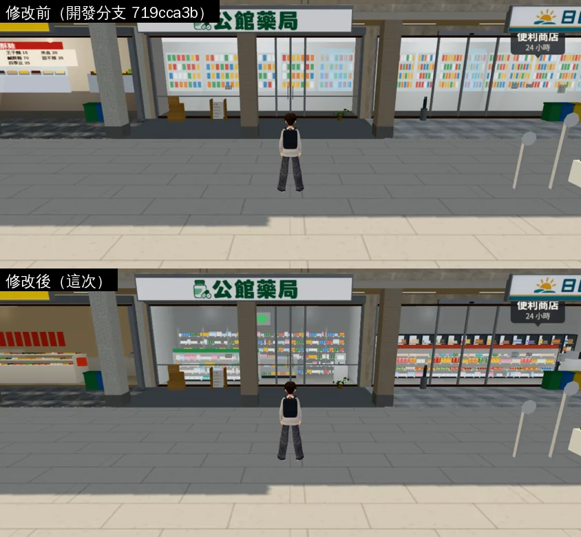

手機鏡頭 19:30：

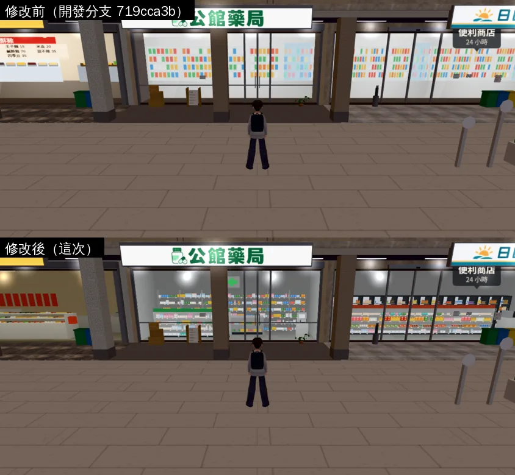

藥局 14:00、19:30：

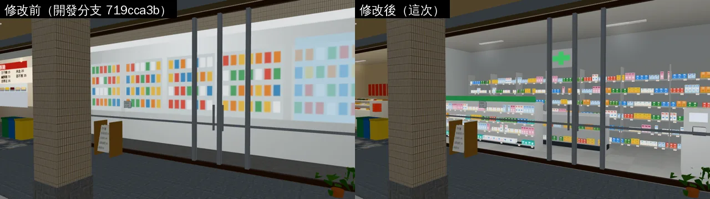
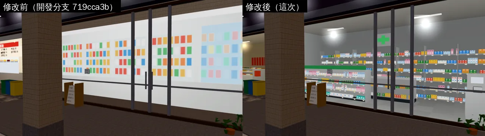

便利商店：

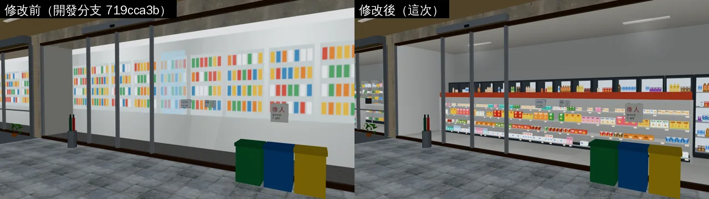

書房：

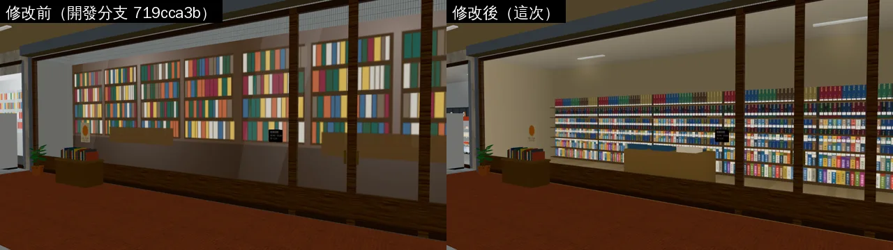

二手唱片 14:00、19:30：

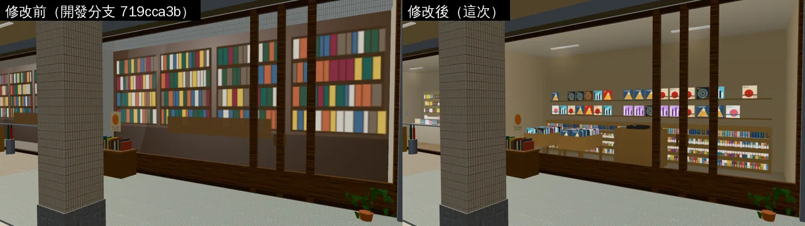
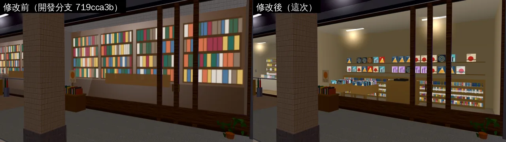

文具・畫材：

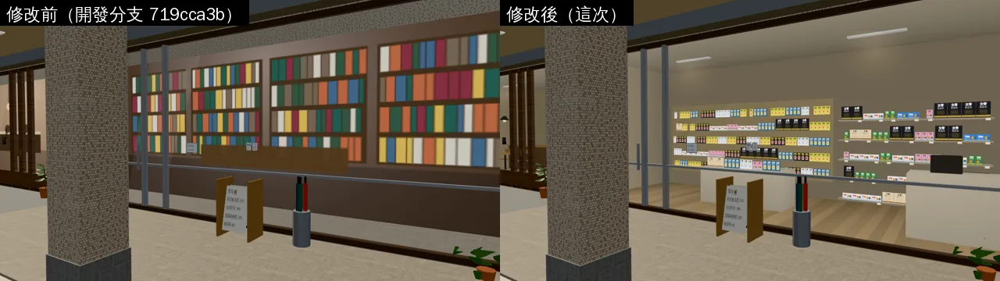

腳踏車行：

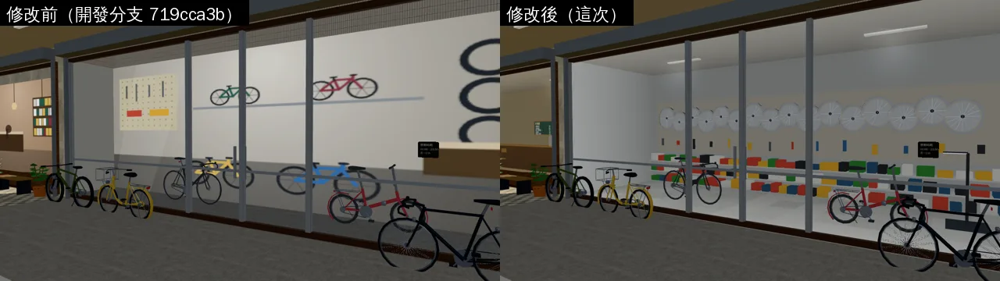

滷味・鹹酥雞：

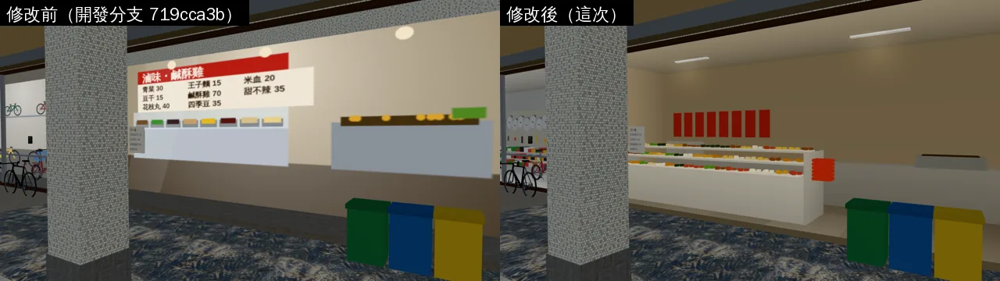

阿鳳麵店：

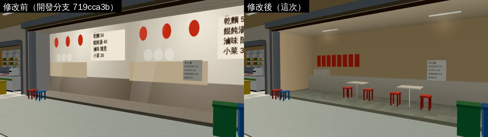

從校門看整排：

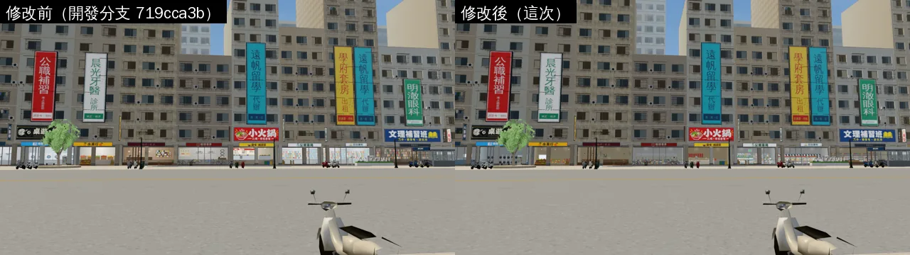

### 118 巷
手機鏡頭 14:00、19:30：

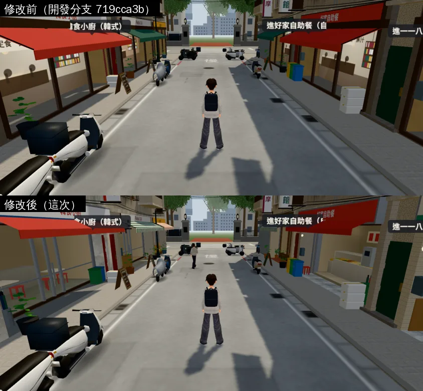
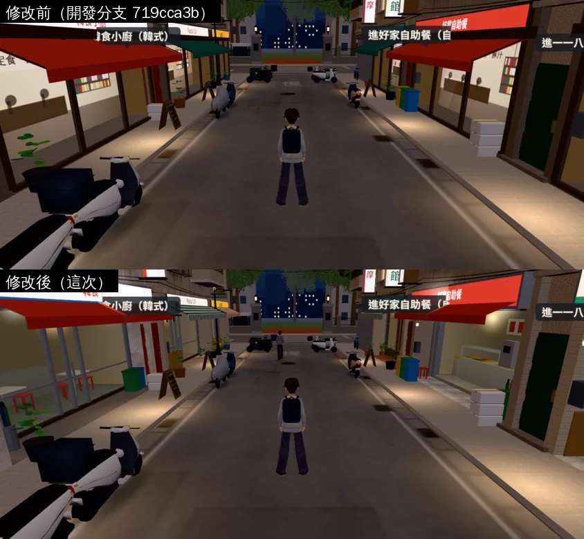

慢讀咖啡近看 14:00、19:30：

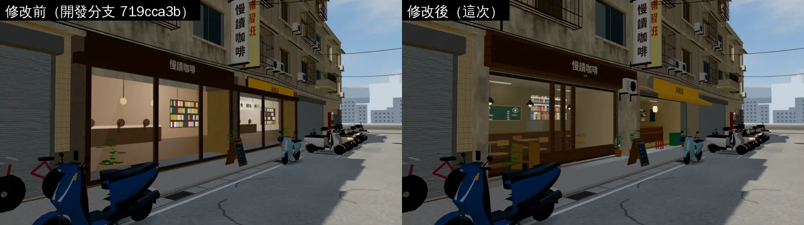
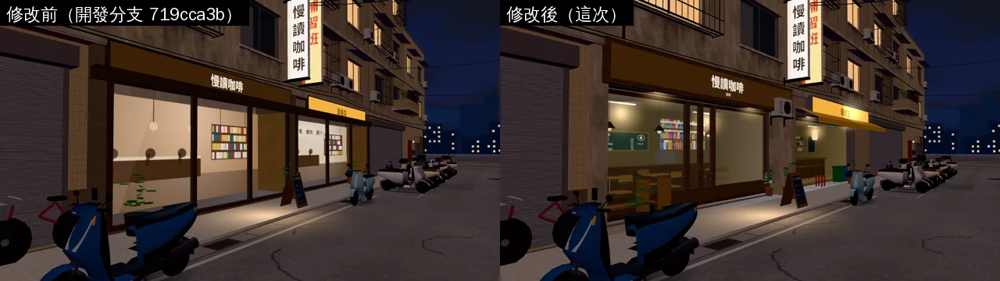

往西、往東：

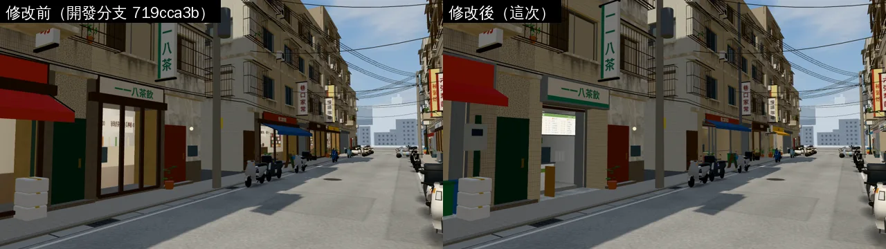
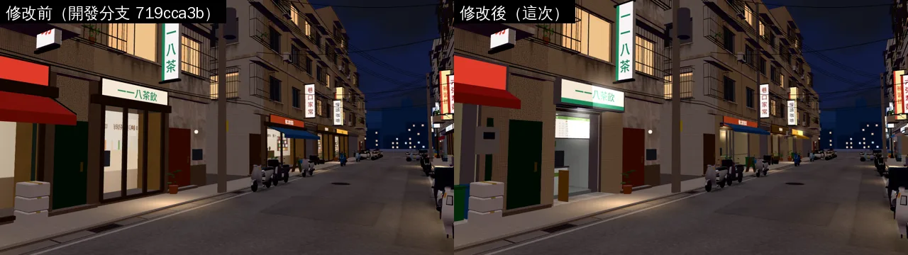
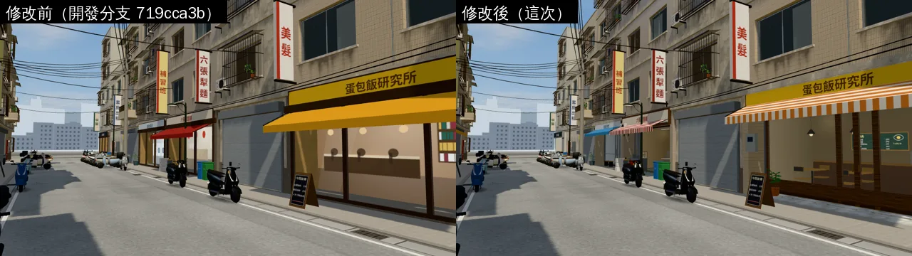

## 還沒做到、要注意的
1. **溫州街還沒重建**。它用的是同一套 `wz_shopkit`，下次重建溫州街，店內也會變成 unlit 的這一套（地板改淺色木頭也一起進去）。這次沒有重建，也沒有驗收溫州街。
2. 店內的燈是「畫在頂點色裡的亮度」，不是真的光：不會隨時段變化，也不會照到騎樓地上（騎樓地上的光照舊靠光暈）。
3. 商品是低面數，近看（貼著玻璃）看得出六邊形的瓶子。
4. 公館滷味店的展示架是簡單的方塊（一盤盤顏色），不是做得很細的食材。
5. 店內往外看的窗景（使用者 10-23「店面外看出去的景也都很假」）是另一項，下一步做（ART-SHOP-VIEWS-1023）。
6. iPhone 實機沒看過。
7. 檔案變大：公館 4.9 → 9.4 MB、118 巷 2.4 → 5.6 MB，主要是店內的頂點資料。
