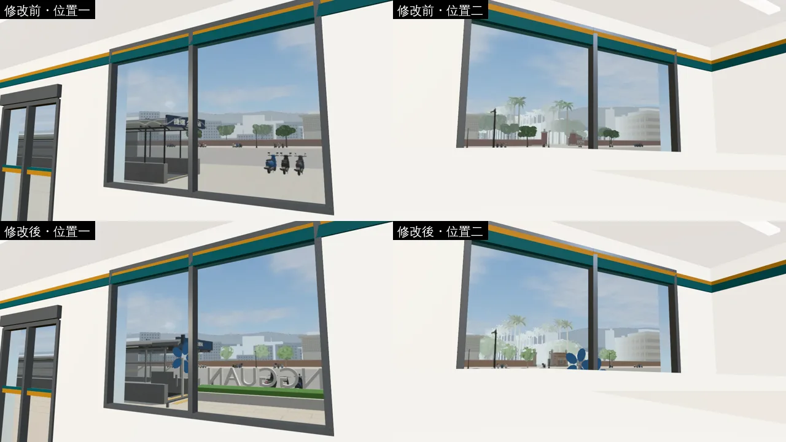
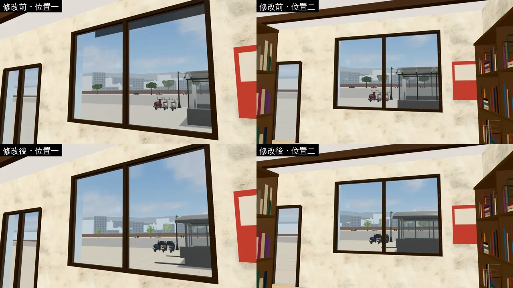
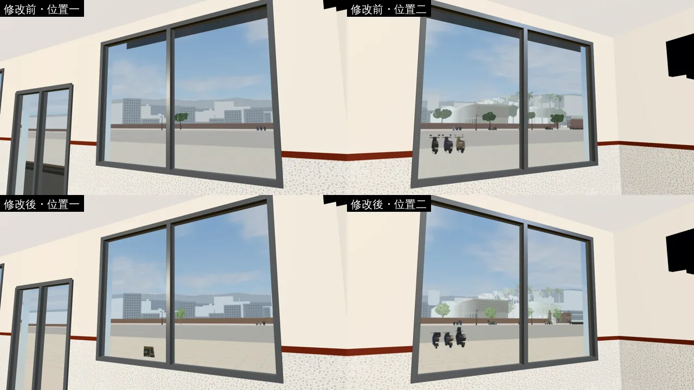
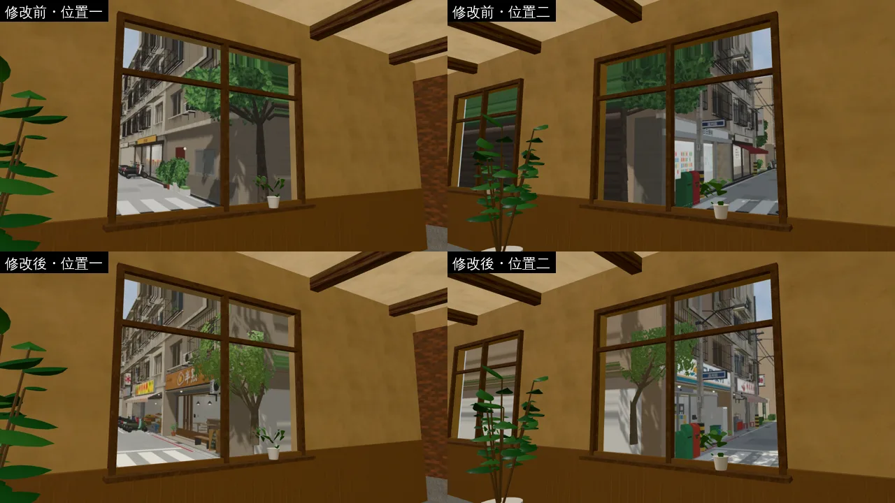
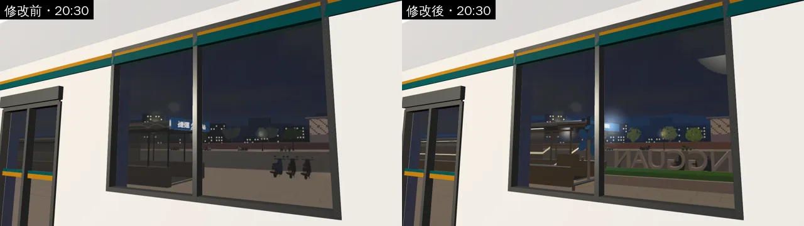
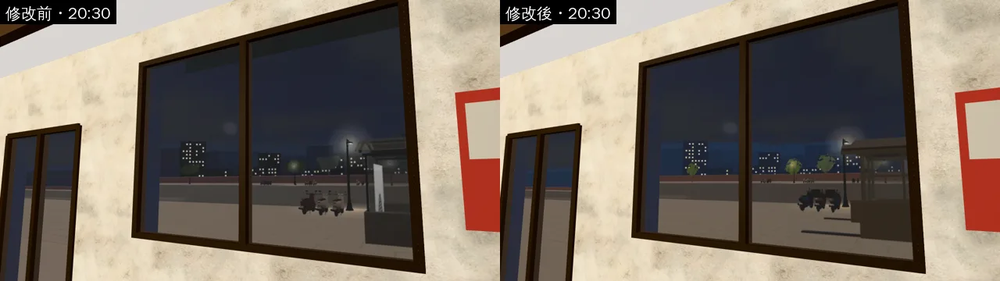
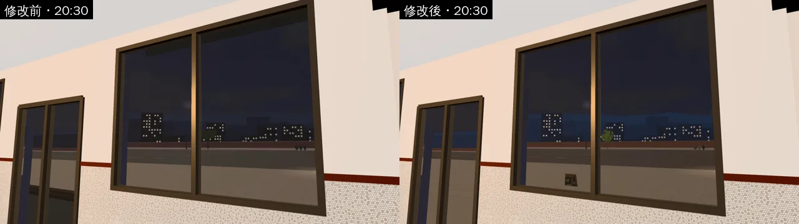
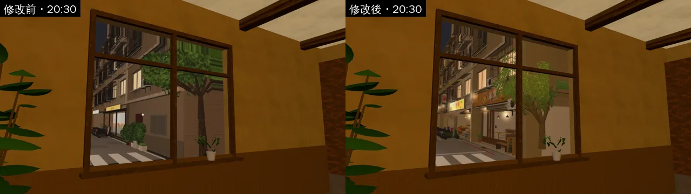
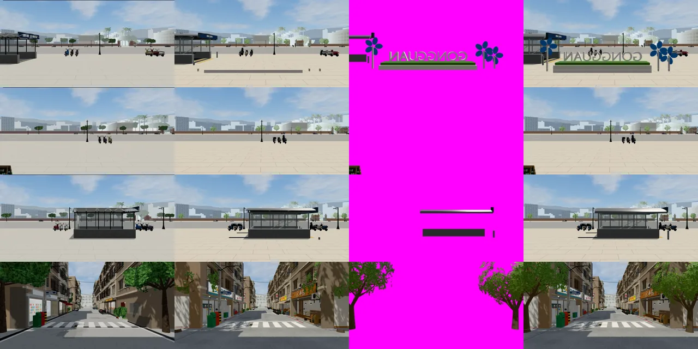

# ART-SHOP-VIEWS-1023：店內往外看的窗景（第一批：公館三家、溫州街 Café）

- **使用者原話**（2026-10-23，對 LAWWW2-B）：「店面外看出去的景也都很假」。
- **做的人**：LAWWW2-B。
- `W3.windowMat` 是場景程式，照 D108 由 LAWWW2 改；LAWWW-B 10-23 11:18 同意。
- **狀態**：`READY_FOR_ART_REVIEW`。場景美術的 `ART_APPROVED` 只有使用者能標。

## 原因
- 店裡的窗景是一張遊戲裡拍的照片，當成窗外 `viewDepth` 公尺的一面景（`W3.windowMat` 的視差）。
- 照片裡近的東西（廣場的立牌、捷運出口的遮棚、Café 門口的行道樹）和遠處的大樓在同一個平面上，走動時一起移動，看起來像貼在窗上的一張圖。
- 公館三家的照片是 10-22 拍的，那時的店面還是舊的。

## 做了什麼
1. **兩層窗景**（`world3d.js`，`patches/shop_views_two_layers_1023.patch`，對開發 `26d9efdb`）：
   - `W3.windowMat` 多一張近景貼圖 `nmap`（有透明度）和它的景深 `ndepth`，疊在遠景前面。兩層各自照景深做視差，走動時近的東西移動得比遠的快。
   - `VIEW_LAYERS` 表：有近景的窗和兩層的景深。`setWindowView` 照表載入 `<名稱>_near_<day|night>.webp`，遠景的景深也照表（取代區域給的 `viewDepth`）。
   - 不在表裡的窗（教室、圖書館、宿舍、林家乾麵、巷子裡定食…）完全照舊，不多載任何檔案。
   - 近景還沒載入，或沒有遠景照片時，只畫遠景（和原本一樣）。
2. **拍照工具** `tools/shots/shop_views_layers.py`。在遊戲裡拍，同一格畫面手動畫三張（遊戲迴圈先停畫，沒有動畫差）：
   - **遠景**：鏡頭 near 推到分界 D（公館 9 m、Café 7 m），比 D 近的都切掉。地面（y ≤ 0.22 m：路面、人行道、騎樓地坪）不管遠近都畫在遠景。
     - 第一次 D 以內的地面也切掉了，遠景底下一條白，走動時近景一偏就會露出來。
   - **近景**：D 以內、地面以上、0.8 m 以外的東西，天空和遠景剪影藏起來；黑底、白底各畫一次，兩張的差算出透明度。
     - 透明的地方填上旁邊的顏色：遊戲取樣時雙線性插值才不會有黑邊。
     - 公館的近景只收 3.4 m 以下：騎樓前緣的梁（2.7 m 外、3.85 m 高）照片只拍到下緣，放到近景的景深以後，變成窗上方一條飄在空中的線（第二次拍出來看到的）。
   - **景深**：從鏡頭打 32×16 條射線，近景（地面以上）和遠景各取中位數，寫進 `tools/shots/shop_views_layers.json`。
3. **照片**（`assets/models/env/views/`，1024×512、水平 90°；白天 11:00、晚上 20:30；路人、玩家藏起來）：
   - 公館三家用整合後的新店面（開發 `6b2827942` 起）重拍。

| 窗 | 遠景景深（原本） | 近景景深 | 近景是什麼 |
|---|---|---|---|
| 公館 便利商店 `cvs` | 22.4 m（24） | 6.5 m | 廣場的 GONGGUAN 字牌、風車 |
| 公館 書店 `bookstore` | 13.3 m（17） | 9.0 m | 捷運出口的遮棚邊 |
| 公館 麵店 `noodle` | 22.4 m（24） | 3.3 m | 幾乎沒有（從店中間往外 90°，看不到兩邊的騎樓柱子；近景只佔畫面 0.7%） |
| 溫州街 Café `cafe` | 12.1 m（11） | 5.3 m | 門口兩棵行道樹 |

- 林家乾麵、巷子裡定食：6 m 內沒有東西（近景是空的），維持一層、照片不換。

## 哪些窗會變
| 區域 | 會變 | 不會變 |
|---|---|---|
| 公館 | 便利商店、書店、麵店的窗（三家都是 `room()` 的 view） | 其他 |
| 溫州街 | 兩點半 Café 的窗 | 林家乾麵、巷子裡定食（照片、景深都不變） |
| 其他 | — | 教室、圖書館、宿舍、霖澤館、萬才館…（不在 `VIEW_LAYERS`） |
| 118 巷九間店 | 這批沒有（店裡的門外是模型裡的一張平面圖，下一批另外做） | — |

## 效能（遊戲內量的 draw call／三角形；1280×720；藏起路人和玩家）
- 修改前、修改後完全相同：

| 鏡頭 | 修改前 | 修改後 |
|---|---|---|
| 便利商店 | 31／50,334 | 31／50,334 |
| 麵店 | 34／3,236 | 34／3,236 |
| 書店 | 24／19,166 | 24／19,166 |
| Café | 49／23,802 | 49／23,802 |

- 窗景還是同一片平面、同一次 draw call，只多一張貼圖取樣。
- 多下載的檔：四家 × 白天晚上 × 近景一張，共 8 張 webp。

## 測試
- 在開發 `26d9efdb` 的測試樹，套 patch、換照片。
- `node tests/room_ceiling_unit.js`：ALL PASS。
- `tests/see_through.py`：2 項 FAIL（「演出鏡頭時不開透視」117.7、「室內不開透視」169.3）。
  - **不是這次造成的**：同一個測試樹拿掉 patch、換回原本的照片重跑，兩項 FAIL、數字完全一樣。開發分支本來就有，已告訴 LAWWW-B。
- 沒有 JS 錯誤。
- **沒跑**：整套回歸。

## 遊戲內修改前後（同一扇窗，從店裡兩個位置看；14:00）
- 測試環境：Playwright＋SwiftShader，**不是 iPhone**。
- 【捷徑】用讀檔把玩家放進店裡；自訂鏡頭。
- 上排＝修改前，下排＝修改後；左＝位置一，右＝位置二。比較同一排左右兩張：近景（字牌、遮棚、樹）和後面的街錯開的程度。

便利商店：

書店：

麵店：

Café：

20:30（左＝修改前，右＝修改後）：

窗景照片本身（每排：原本的照片｜這次的遠景｜這次的近景（洋紅＝透明）｜兩層合成）；由上到下：便利商店、麵店、書店、Café：

## 還沒做到、要注意的
1. **公館的窗外還是很空**：從店裡往外看，是一大片空的廣場加遠處的天際線。
   - 兩層窗景解決的是「像貼在窗上的一張圖」，解決不了「街上本來就沒東西」。
   - 真的公館騎樓外是一整排停好的機車、單車架、路人。要做的話是在公館的街景加東西，會動到導航（門口雜物阻擋），另外提案給 LAWWW。
2. **GONGGUAN 字牌從店裡看是反的**：字牌面向馬路，從店裡看到的是背面。遊戲世界裡是對的，但玩家可能以為是錯。
3. 遠景裡近處的地面（騎樓地坪、人行道）用的是遠景的景深：走動時地面的視差比真的小一點（地面是一整片，不容易看出來）。
4. 照片是 11:00 拍的，白天其他時段照舊用 `W3.photoTint` 調色；晚上換 20:30 的照片。
5. 118 巷九間店的窗景是下一批：要在每間店門口重拍，再把店裡模型的平面圖換成 `W3.windowMat`。
6. iPhone 實機沒看過。
