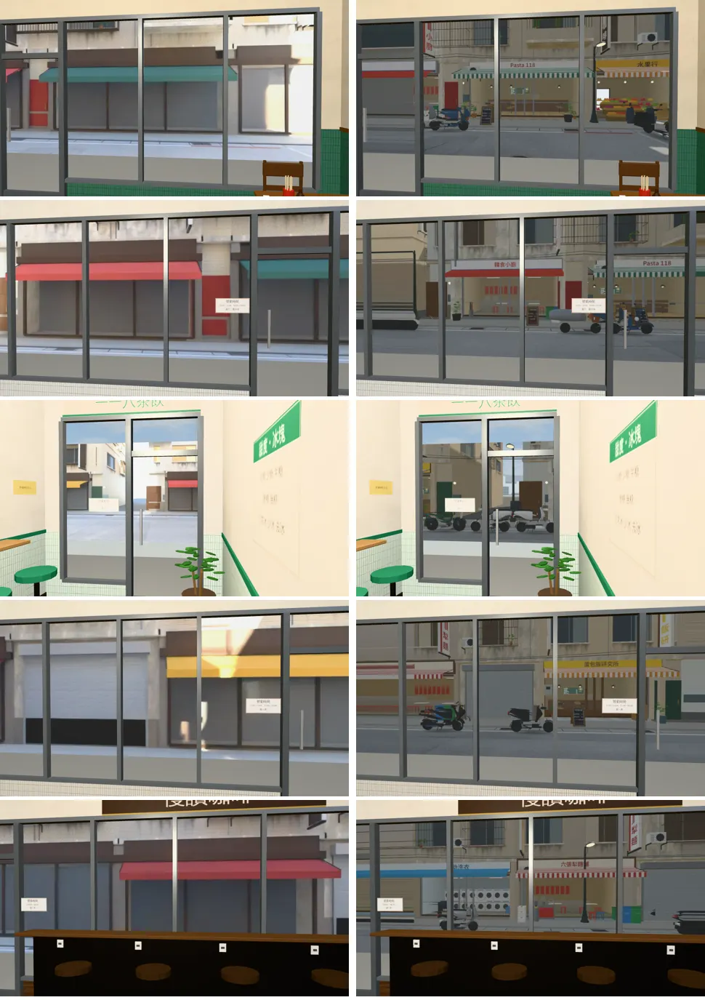
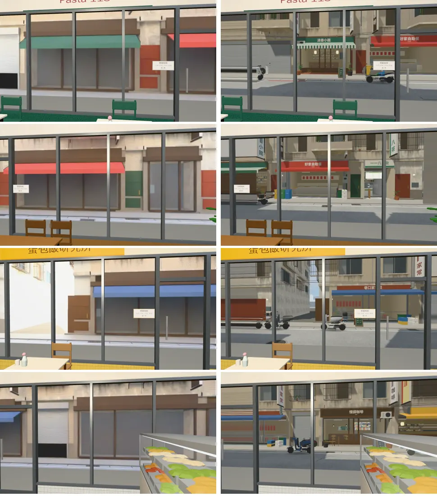
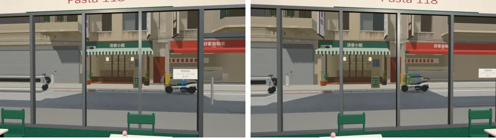

# ART-SHOP-VIEWS-1023 第二批：118 巷九間店的窗景

- **使用者原話**（2026-10-23，對 LAWWW2-B）：「店面外看出去的景也都很假」。
- **做的人**：LAWWW2-B。
- **狀態**：`READY_FOR_ART_REVIEW`。場景美術的 `ART_APPROVED` 只有使用者能標。
- 第一批（公館三家＋Café）：`test_shots/shop_views_1023/README.md`（`ecfe5a6a`）。

## 原因

- 118 巷九間店的室內（`l118_<id>.glb`）門外是模型裡的一張平面圖（`WALL_S_view`）：
  - 10-20 用 Cycles 從當時的 118 巷街景模型算的。
  - 那時對面的店是鐵捲門、沒有招牌、沒有機車。
  - 白天、晚上同一張，晚上只是調暗。
- 走動時那張圖和門框一起動，像貼在玻璃外的一張海報。

## 做了什麼

1. **在遊戲裡重拍**：`tools/shots/shop_views_layers.py` 加九間店。
   - 鏡頭的位置＝店裡那一片景的位置：立面外 2.4 m、高 1.6 m。窗景的視差是以那一片為準：照片＝從那一片的中心看出去 90°。
   - 看巷子對面：西側的店往 +x，東側往 −x。
   - 白天 11:00、晚上 20:30。
   - 遠景（對面的店，約 8 m）＋近景（5.5 m 以內：對面店門口的機車等，去背）。
   - 36 張 `assets/models/env/views/l118_<id>_{day,night}.webp`＋`_near_{day,night}.webp`。
   - 景深寫進 `tools/shots/shop_views_layers.json`。
2. **遊戲**：`patches/l118_views_1023.patch`，只改 `src/l118_shops3d.js`，對開發 `fb75d67ea`。
   - 九間店的景深登記到 `W3.VIEW_LAYERS`。在這個檔案裡加，不動 `world3d.js` 的表，免得和第一批的 patch 衝突。
   - 正式模型載入以後，門外那一片（只認 `WALL_S_view`，兩側的鄰居店面卡照舊）換成一片 `W3.windowMat`：位置、大小照原本那一片。
   - 原本那一片還留在牆的淡出清單裡，只是不畫。新的一片的 `visible` 跟著它：鏡頭退到店外時一起不見。
   - `applyTime`：白天照片＋`W3.photoTint`，晚上換夜景照片，和公館三家店一樣。照片還沒載好時，畫原本那張圖。
   - 第一次寫的時候用 `/_view/` 找那一片，找到的是左邊的鄰居店面卡（`WALL_E_nb_view`），結果畫面一樣。已經改成只認名字 `WALL_S_view`。

## 遊戲內修改前後

- 測試環境：Playwright＋SwiftShader，960×540，**不是 iPhone**。
- 【捷徑】直接進店、自訂鏡頭，14:00。
- 每一列：左＝修改前，右＝修改後。

西側五間（滇香小館、好家自助餐、一一八茶飲、巷口家常菜、慢讀咖啡）：

東側四間（Pasta 118、韓食小廚、蛋包飯研究所、六張犁麵舖）：

視差：Pasta 118 店裡，同一扇窗、左右兩個位置看（修改後）。近景的機車和對面的店錯開：

## 效能（每間店同一個鏡頭）

- draw call 多 1、三角形多 2：新的那一片。原本那一片還在淡出清單裡，照樣送出畫，但不寫顏色、不寫深度。
- 例：滇香 36／15,088 → 37／15,090，一一八茶飲 41／3,978 → 42／3,980。

## 測試（開發 `fb75d67ea`＋patch，開發分支的測試腳本）

| 測試 | 結果 |
|---|---|
| `node tests/l118_shops_unit.js` | ALL PASS |
| `node tests/l118_arcade_unit.js` | ALL PASS |
| `node tests/l118_bar_lift_unit.js` | ALL PASS |
| `node tests/lane118_unit.js` | ALL PASS |

- 九間店每一間進去，都讀到新的一片（`photo` 1、`near` 1、景深 8、`visible`）。
- **沒跑**：`flow_l118_shops.py`、`flow_lane118.py`（瀏覽器的真實流程）。

## 還沒做到、要注意的

1. 近景大多是空的：巷子中間通常沒東西，近景只有對面店門口的機車、招牌柱（佔畫面 1～3%）。主要還是遠景一層的視差，但景深和實際的距離（8 m）對得上。
2. 照片是 11:00 拍的，白天其他時段用 `photoTint` 調色。
3. 晚上 20:30 的照片沒有在店裡另外截圖看過，只確認檔案在、會換。
4. iPhone 實機沒看過。
