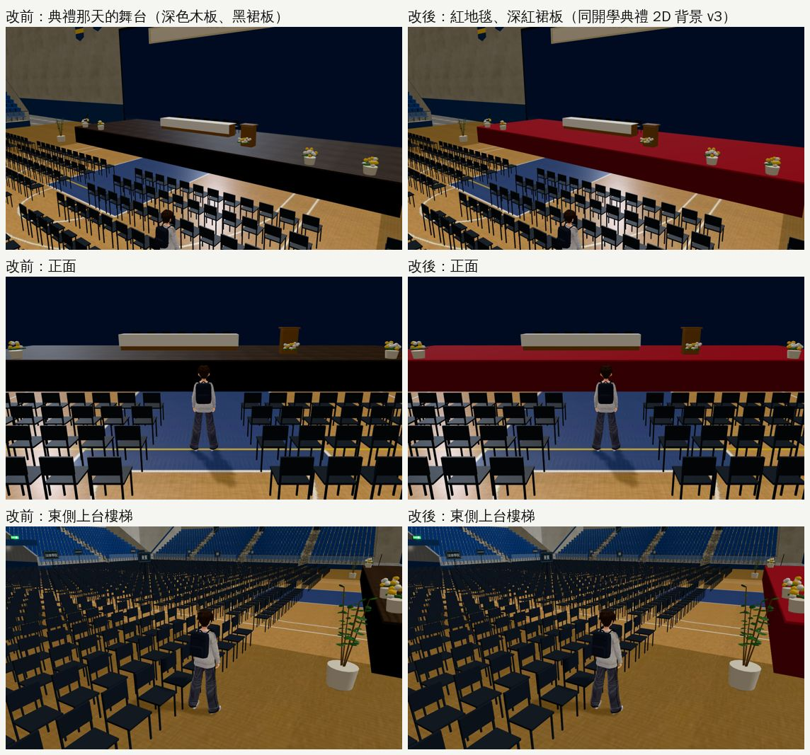
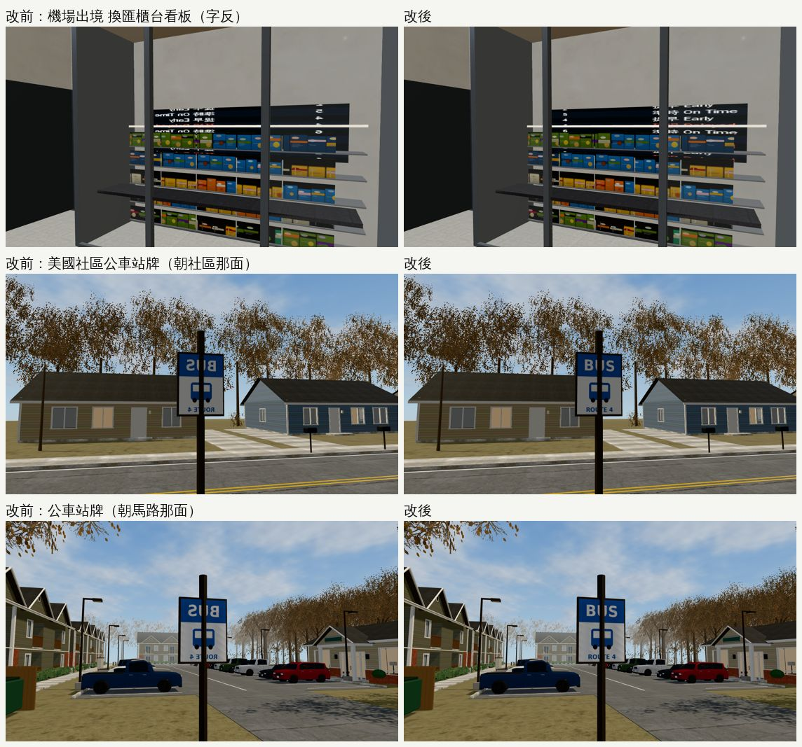

# SIGN-AUDIT-1025：有字的牌子掃一遍＋舞台的深色木地板（2026-10-25，LAWWW2-B）

- **起因**：
  - 做 B1 健身房（GYM-B1-FITNESS-1024）時，發現大廳的開館時間牌、公告欄貼在框和木板的**後面**，遊戲裡只看到一塊黑板、一塊空木板；頂點順序也反了，字會左右相反。
  - 同樣的錯可能在別的地方，所以把 128 個 GLB 裡「有字的牌子」都掃了一遍。
- **對**：開發 `5bcdd7e8e`（測試樹 `$SP/dv8`，只換這次的三個 GLB）。
- **環境**：Playwright＋SwiftShader（1280×720），不是 iPhone 實機。
- **狀態**：`READY_FOR_ART_REVIEW`。場景的 `ART_APPROVED` 只有使用者能標。
- **只換 GLB**：程式、版面、導航都不動。

## 找到、修好的

| | 哪裡 | 毛病 | 改法 |
|---|---|---|---|
| 1 | 機場出境大廳，換匯櫃台（E 牆那一間） | 看板的字左右相反（「On Time」「Delayed」、中文都是反的） | `airport_t2.py`：E 牆（看板朝 −x）那一間的 UV 左右對調；W 牆的照舊 |
| 2 | 美國社區（`us_outside`），出口外的公車站牌 | **兩面**的「BUS」「ROUTE 4」都左右相反 | `us_community.py`：UV 左右對調，幾何、法線不動 |
| 3 | 3F 主球場的舞台（典禮、演講、演唱會共用的 `SET_STAGE`） | **台面是深色木板**（`dark_planks`，目標色 `#3a2e26`）。違反使用者 10-23「不要出現這種深色木地板 整個遊戲都不要」（D112）。10-23 清查漏掉，因為舞台平常藏著 | `gym_arena.py`：台面改成紅地毯 `#9a1f26`、裙板深紅 `#5d1b20`，和開學典禮 2D 背景 v3（`bg_gym_ceremony.py`）一樣；演唱會帳篷頂照舊黑色 |
| — | B1 大廳開館時間牌、公告欄 | 貼在框後面、字反 | 已在 GYM-B1-FITNESS-1024 修好（`32ddad549` 已整合） |

- 第 3 項同時解決「3D 舞台和 2D 典禮背景不一樣」：2D 背景 v3 是紅地毯，3D 原本是深色木板。
- 三份 GLB 重匯以後，節點名稱、數量都一樣：
  - `airport_dep.glb`、`us_community.glb` 位元組數也一樣，只差 UV。
  - `gym_arena.glb` 多一個材質 `arena_stage_skirt_red`，3.46 MB → 3.46 MB。

## 交件

| 檔案 | 內容 |
|---|---|
| `assets/models/env/second_ai/airport_dep.glb` | 重匯（換匯看板 UV） |
| `assets/models/env/second_ai/us_community.glb` | 重匯（公車站牌 UV） |
| `assets/models/env/second_ai/gym_arena.glb`（＋`.json`） | 重匯（舞台材質）；`.json` 原本的輸出路徑寫成 scratchpad，順便改對 |
| `tools/blender/env_second/airport_t2.py`、`us_community.py`、`gym_arena.py` | 腳本 |
| `tools/blender/env_second/check_signs.py` | **新工具**：找有字的牌子被擋住、字左右相反（說明在檔案開頭） |
| `tests/sign_audit_1025_unit.js` | 新測試（讀 GLB，不需要瀏覽器）：改前 FAIL 5、改後 ALL PASS |

- 開發分支的 `airport_t2.py`、`gym_arena.py` 比我這份舊：GLB 一樣，腳本少了夜景平面、天花板單面、學院分區牌子那幾段。
  - 我這份包含開發那一份的全部內容。

## 怎麼找的（`check_signs.py`）

1. 只看材質或圖檔名稱像「有字」的：sign、board、fids、menu、notice、poster、screen、print、card……共 262 組。
2. 每個三角形中心往兩邊射 8 cm：
   - 兩邊都打到東西＝被擋住；
   - 玻璃不算擋住（貼在玻璃後面的海報、公告欄）；
   - 另一組互斥的布置也不算擋住：`SET_`、`SEASON_`、`COPY_`、`NAMETAG_`、年級組不會同時顯示。
3. 沒被擋的那一邊＝人站的那一邊。從那邊看，u 往右手邊變大才是正的。
4. 每一項標出來的，都把「玩家從正面看到的樣子」還原成圖確認，再拍遊戲內截圖。

- 第一輪有 34 組可疑。逐一確認以後：
  - **真的要修**：上表的機場、公車站牌，以及 B1 大廳（已修）。
  - **真的有問題但玩家很少看到，這次沒改**：118 巷七家（`l118_cafe2`、`dian`、`home`、`korea`、`omu`、`pasta`、`self`）和溫州街定食店（`wz_teishoku_interior`）的收銀機，**店員那一面**的螢幕被機身包住。
    - 原因：`lane118_shops.py` 的 `register()` 把螢幕放在 `z−0.13`，機身的面在 `z−0.16`，差 3 cm。
    - 這一面朝櫃台裡面，玩家要繞到櫃台後面才看得到。
    - 要修的話改一行，再重匯 8 份 GLB。
  - **不是問題**：
    - 宿舍 412 唐睿的名牌：擋住它的是唐睿的東西，第一晚那一組藏起來了；
    - 影印店「續約三年」的紙：擋住它的是搬走以後的鐵捲門，兩組不會同時出現；
    - 典禮背板：擋住它的是演講的布幕，不同組；
    - 公園公告欄、市場街櫥窗海報：在玻璃後面；
    - 疊在別張上面的公告、上緣被飾條蓋到一點的牌子：局部遮住；
    - 沒有字的圖（花紋、卡片、便利貼的波浪線）：反過來看不出來。
- 修正後再掃一次全部 GLB：結果見下面「最後一次全掃」。

## 最後一次全掃（修好以後，128 個 GLB、262 組有字的材質）

- 剩 25 組被標出來（8＋4＋7＋5＋下面那 1 組），逐一看過，**沒有需要改的**（118 巷收銀機那 8 組除外，上面說過，只記錄）：

| 類別 | 組數 | 說明 |
|---|---|---|
| 118 巷七家、定食店的收銀機螢幕 | 8 | 店員那一面被機身包住（見上面），只記錄 |
| 一張一張排著的東西 | 4 | 溫州街市集木箱裡的唱片封套、雜誌（只看得到最前面那張），宿舍大一、大二的紙箱（貼在一起的面）。本來就看不到 |
| 局部被蓋到 | 7 | 霖澤館公布欄（疊在別張公告下面）、總圖 3F 閱覽須知（上緣被飾條蓋到）、日本房間的海報（框）、亞洲超市招牌（窗框）、霖澤 5F 桌上的紙、公園土地公的對聯（香爐）、公館遠景招牌（遠處） |
| 沒有字、反過來看不出來 | 5 | 日本房間螢幕、美國臥室 A 的白板、臥室 C 的軟木板、定食店木牌的背面、宿舍筆記本 |

- 另外一組：溫州街影印店價目表（1 個三角形「反字」）。
  - 中心前面 3 cm 剛好有門的把手，工具把店裡那一邊當成人站的那一邊。
  - 字從街上看是正的（還原圖確認過）。

## 改前、改後（同一個鏡頭）

- 【捷徑】用讀檔把玩家放進區域。舞台用 JS 打開 `SET_STAGE`、`SET_CEREMONY`（遊戲只在典禮那天打開）；機場、公車站牌用固定鏡頭、藏起玩家。

## 測試

- **新測試 `node tests/sign_audit_1025_unit.js`**：改前 FAIL 5、改後 ALL PASS。檢查項目：
  1. 換匯看板的方向；
  2. 公車站牌兩面的方向；
  3. 舞台台面沒有木紋貼圖、是紅地毯；裙板是深紅。
- **相關的 Node 測試**（測試樹換上這三份 GLB）：`gym_arena_unit`、`gym_ceremony_unit`、`airport_cam_unit`、`us_lamp_pools_unit` 都 ALL PASS。
- **遊戲內截圖**：7 個鏡頭，errors 0，draw call 改前改後一樣（舞台 71／79／90、機場 26／27、社區 148／437）。
- **沒測**：
  - 手機實機；
  - 整套回歸；
  - 演講、演唱會那兩套布置打開時的舞台（台面同一個材質）。
