# PERF-SINGLESIDE-GLB-1025：環境 GLB 單面巡查（2026-10-25，LAWWW2-B）

LAWWW-B 09:1x 派工（順序照 D99）；11:0x 同意改成：**每棟先在同一頁切換單面量上限，10% 以上才做；室內先**（soclib → library → cvs → gym），街景後量。公館店面的結果見 `../perf_patrol_econ_1025/README.md` ④（量不出差別，不交）。

## 為什麼室內先

- three.js 的雙面材質不剔除背面；**雙面又半透明的要畫兩次**（先畫背面一輪、再畫正面一輪）。
- 室內的 `WALL_*` 牆為了擋住鏡頭時淡出，遊戲把材質設成 transparent（`B3.attachFormal`：總圖、博雅、普通；`Z3.attachRoomGLB`：社科圖、便利商店、體育館三個）——Blender 匯出的材質幾乎全是雙面（共用材質函式預設 `cull=False`），所以這些牆每一面都畫兩次。
- 街景外觀（不透明）只是多畫背面，公館量不出差別。

## 上限（同一頁、同一個鏡頭；路人拿掉；「原本 → 區域裡全部材質改單面」，每格 4×5 秒、切換兩輪）

全部改單面會讓葉片卡、十字薄片這些零件少一半（公館那樣），所以這是**上限**，不是交件的數字。工具：`$SCRATCH/econperf/toggles2.py` 的 `np_front_all`。

| 地點（區域） | 方向 1 | 方向 2 | draw call |
|---|---|---|---|
| 體育館 3F 主球場（`gym_arena`） | 1.55 → 2.3（+48%） | 1.7 → 2.4（+40%） | 61 → 60 |
| 總圖大廳（`library_hall`） | 1.9 → 2.95（+55%） | 3.8 → 5.25（+38%） | 204 → 166 |
| 社科圖（`soclib`） | 2.25 → 3.3（+45%） | 3.6 → 5.0（+40%） | 72 → 64 |
| 便利商店（`cvs`） | 3.5 → 4.8（+37%） | 4.65 → 6.0（+30%） | 100 → 83 |
| 體育館 1F 大廳（`gym`） | 3.6 → 4.6（+28%） | 6.5 → 6.9（+6%） | 94 → 78 |
| 體育館 B1（`gym_b1`） | 5.0 → 6.0（+20%） | 4.4 → 5.6（+27%） | 94 → 81 |
| 溫州街（`wenzhou`） | 1.25 → 1.65（+30%） | 1.6 → 2.1（+30%） | 249 → 242 |
| 118 巷（`lane118`） | 1.55 → 2.3（+48%） | 2.75 → 3.6（+31%） | 152 → 149 |
| 美國公寓（`us_apartment`） | 2.0 → 3.0（+50%） | 2.1 → 3.1（+48%） | 139 → 116 |
| C 棟 208（`us_shared`） | 1.85 → 2.9（+57%） | 1.8 → 2.85（+58%） | 174 → 142 |
| 美國法圖（`us_lawlib`） | 3.6 → 5.3（+47%） | 5.05 → 7.5（+48%） | 76 → 65 |
| 亞洲超市（`us_asian_market`） | 2.8 → 4.0（+43%） | 3.35 → 5.0（+50%） | 79 → 69 |
| C 棟臥室 C（`us_bed_c`） | 4.9 → 6.2（+27%） | 4.8 → 5.9（+22%） | 67 → 57 |
| 美國超市（`us_market`，牆不淡出） | 3.35 → 4.45（+33%） | 3.4 → 5.3（+56%） | 80 → 77 |
| 機場出境大廳（`airport_dep`，LAWWW2-C 10-27） | 2.62 → 4.01（+53%） | 3.7 → 5.98（+61%） | 73 → 71 |
| 美國校園（`us_campus`，LAWWW2-C 10-27） | 3.74 → 5.86（+57%） | 4.27 → 6.89（+61%） | 124 → 123 |

- 每一個都過 10%。室內 draw call 少很多（半透明雙面的第二輪不見了）。
- 溫州街、118 巷的上限也高，但公館的上限（同一頁 2.1 → 2.55）交件時全沒了（薄零件要補反面）。街景要先拆是哪些東西貴（行道樹、公園的葉片卡？），再決定。

## 做法（`tools/blender/env_second/lib2.py` 的 `single_side`）

- 封閉、方向一致的殼（方盒、圓柱、店內和房間的殼）直接單面——朝外的從外面看、朝內的從裡面看，影子形狀也一樣。
- 開口的零件（一片的牆面、葉片卡、十字薄片、薄板）把面複製一份反過來：兩面都看得到，和原本的雙面一樣；**只多頂點、不多像素**。
- `nodup`：開口但背面確定看不到的不補（要截圖確認）——社科圖的書（書背朝走道、後面是書架背板）、天花板（只從下面看）；便利商店架上的商品（正面朝走道、後面是層架）。
- `skip`：遊戲照名字接手的板面（`*_FACE_*`）不動網格（公館那次補了反面，遊戲的字牌合併失敗、整排店面退回套件）。
- 玻璃照舊雙面。
- 裡外相反的薄零件（封閉、體積是負的、有一邊 1 mm～1 m）翻成朝外（第二份加的；第一份三個 GLB 沒有這種零件，用新規則重匯，社科圖、總圖和交出去的一模一樣，便利商店三角形數一樣——它本來每次匯出位元組就不一樣）。

- 原本就單面的材質（作者故意的：室內的天花板朝下，鏡頭超過天花板高度時看得穿＝剖面視角）不補、照舊單面。第一次試便利商店，天花板補了朝上的那一面，從高處俯看整片擋住（04）；改了以後同一個鏡頭和原本一樣（03 的「高角度俯看」）。

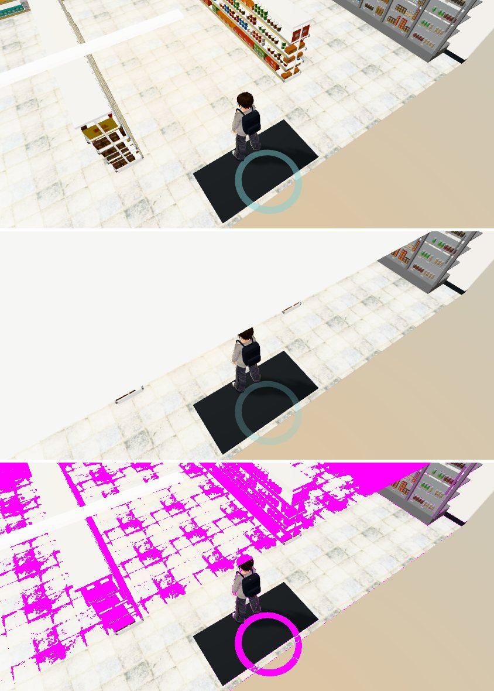

## 第一份：社科圖、總圖大廳、便利商店（10-25 12:xx 交）

檔案（我的分支）：
- `assets/models/env/second_ai/soclib_interior.glb`（＋`.json`）、`assets/models/env/library_interior.glb`、`assets/models/env/second_ai/cvs_interior.glb`（＋`.json`）；
- 腳本：`tools/blender/env_second/soclib_interior.py`、`tools/blender/library_interior.py`、`tools/blender/env_second/cvs_interior.py`（匯出前呼叫 `single_side`）、`tools/blender/env_second/lib2.py`；
  - `library_interior.py` 以開發的版本為底（我的分支原本那份比較舊，少了總圖 B1 的門），只加匯出前那一段；
- 測試：`docs/art-rebuild/second_ai/patches/singleside_interiors_1025.patch`（新 `tests/singleside_interiors_unit.js`，對開發 `01bab5952`）。

### fps（路人拿掉；每一份重新載入，每格 4×5 秒；最後再量一次改前）

| 地點 | 改前（開發的 GLB） | **改後** | 再量一次改前 |
|---|---|---|---|
| 社科圖 方向 1 | 2.35 | **3.4（+45%）** | 2.2 |
| 社科圖 方向 2 | 3.5 | **4.3（+23%）** | 3.35 |
| 總圖大廳 方向 1 | 1.8 | **2.55（+42%）** | 1.8 |
| 總圖大廳 方向 2 | 3.8 | **4.75（+25%）** | 3.75 |
| 便利商店 方向 1 | 3.25 | **4.95（+52%）** | 3.3 |
| 便利商店 方向 2 | 4.55 | **5.7（+25%）** | 4.85 |

draw call：社科圖 72 → 68、總圖 204 → 188、便利商店 100 → 85（半透明雙面的牆不用畫第二輪）。三角形：社科圖 85,540 → 89,756、總圖 48,394 → 60,098（葉片卡、樓梯補反面）、便利商店 50,268 → 50,620。

### 改前改後同角度（左＝改前、右＝改後；路人拿掉）

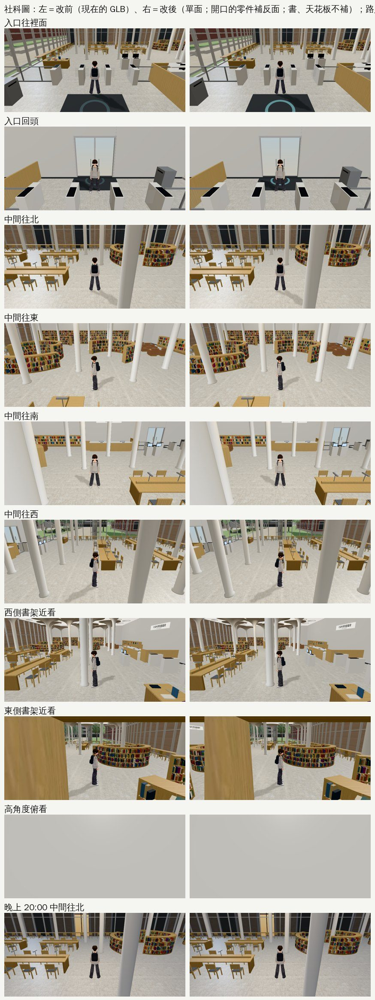

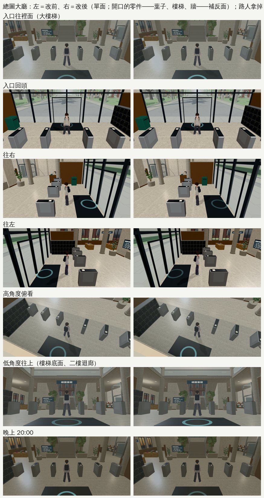

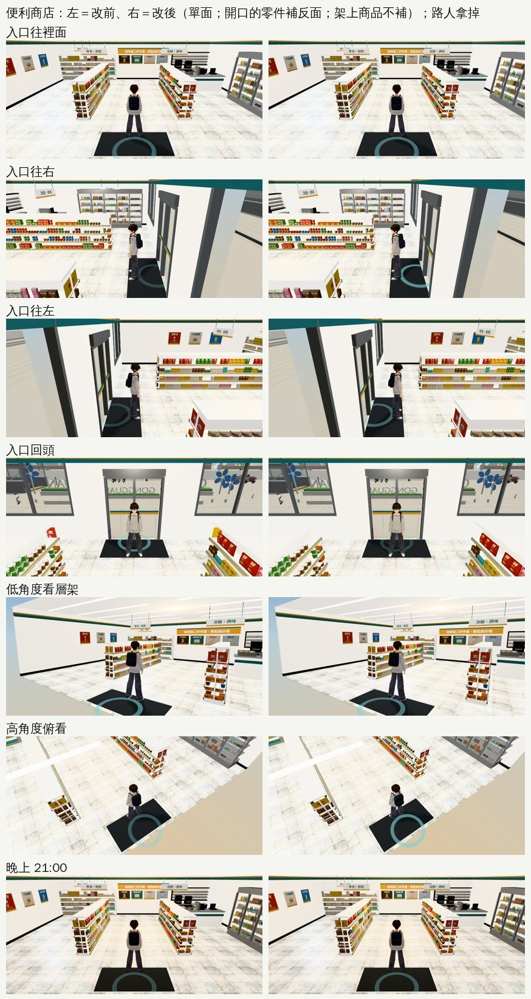

- 看得出的差別只有一個：**鏡頭跑進家具裡面**的時候（社科圖「東側書架近看」，我把人擺在書架旁邊、鏡頭插進書架）——改前看到書架內側（雙面，整片木頭擋住畫面），改後看得穿。正常走路的鏡頭不會這樣；鏡頭插進家具時看得穿反而比較不擋。
- 社科圖「高角度俯看」兩邊都是一片灰（鏡頭超過天花板），兩邊一樣，這個鏡頭沒用。
- 其他像素差異是人的待機動作、窗外的樹在動。

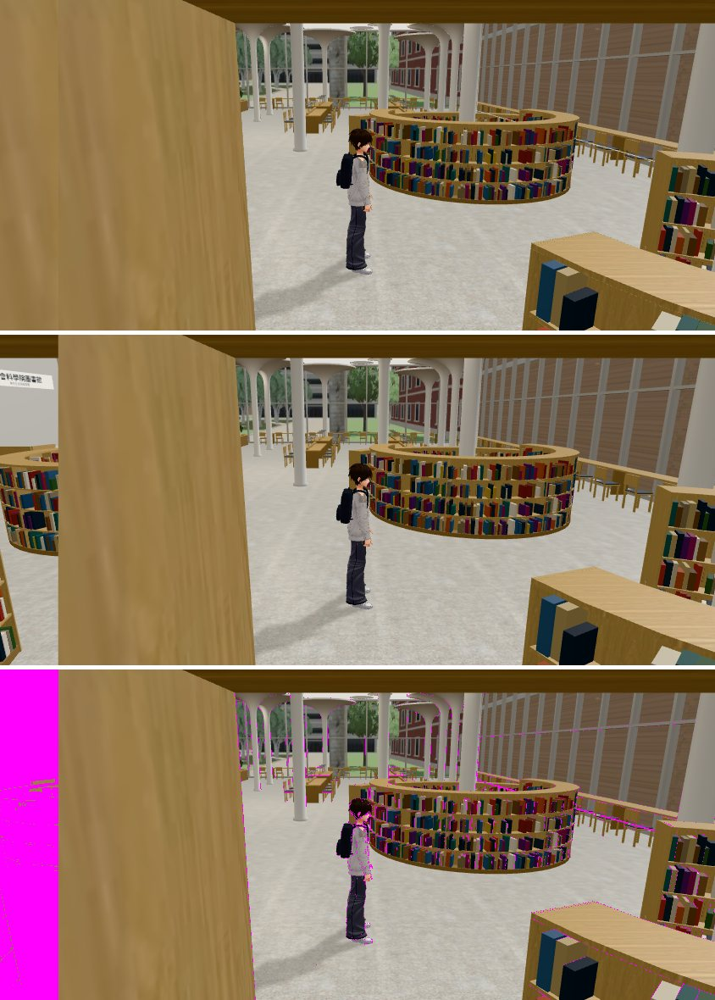

### 測試

- 新 `tests/singleside_interiors_unit.js`：1 三個 GLB 除了玻璃都單面、玻璃雙面；2 開口的零件有反面（總圖葉片卡 15,816／15,816、樓梯踏面、社科圖天井、便利商店牆面）；3 便利商店天花板沒有補朝上的面；4 社科圖的書、便利商店的商品三角形數和改前一樣。**開發的 GLB FAILED 4（1、2 失敗；3、4 是防退步的，改前也過）**，新的 ALL PASS。
- 讀這三個 GLB 的其他測試：`library_b1_unit`、`room_ceiling_unit` ALL PASS。
- 瀏覽器流程測試（乾淨的開發 `01bab5952` 換上這三個 GLB，跑完還原）：
  - `flow_library_scene.py` ALL PASS、`flow_library_floors.py` ALL PASS、`cvs_glb_integration.py` ALL PASS；
  - `flow_soclib.py` FAILED 2：「校園有『進入社科院圖書館』」「回到校園社科院圖書館門前、站得住」——**開發的 GLB 也一樣失敗**（同一支在乾淨的開發跑：FAILED 3，多一個「走到閱覽長桌的座位旁」）。兩個都是校園那一側的門口互動點，不是室內模型；社科圖裡面的檢查（走過閘門、天窗晚上變暗、離開圖書館）都過。**LAWWW-B 13:2x 查過：是測試舊了**（還寫死 10-20 社科院搬家以前的門口 (101,−69.3)；現在門在 `SOCSCI_LAYOUT.libDoor` (11,−65.7)），已開 TEST-FLOW-SOCLIB-X75-1025 給 BB 改。
- 沒跑：整套回歸、手機實機。

## 第二份：體育館 1F 大廳、B1、3F 主球場（10-25 15:xx 交）

檔案（我的分支）：`assets/models/env/second_ai/gym_interior.glb`、`gym_b1.glb`、`gym_arena.glb`（＋各自的 `.json`）；腳本 `gym_interior.py`、`gym_b1.py`、`gym_arena.py`（匯出前呼叫 `single_side`）、`lib2.py`；測試 `docs/art-rebuild/second_ai/patches/singleside_gym_1025.patch`（新 `tests/singleside_gym_unit.js`，對開發 `01bab5952`）。

### `single_side` 這一輪新加的規則：裡外相反的薄零件翻成朝外

- 主球場第一次匯出，「往右側看台」那個鏡頭，看台前緣、場邊欄杆那條深色收邊變細了（10）。原因：有些封閉的零件**裡外相反**（法線朝內；體積算出來是負的）——雙面時看不出來，單面以後從外面看到的是背面那幾片。
- 主球場：欄杆收邊 11、樓梯防滑條 240、門板 8、牆 2、鐵件 68 個零件；大廳：鐵盒子 24 個（第一份的社科圖、總圖、便利商店都沒有）。
- 規則：封閉、方向一致、體積是負的、有一邊在 1 mm～1 m 之間（板、條、小盒子）→ 翻成朝外。大的不動（可能是從裡面看的房間），扁的（< 1 mm）沒有裡外。翻了以後同一個鏡頭的差異 9,856 → 829 個像素（11）。
- B1 不翻（`flip=False`）：有 4 片 4 cm 的小鐵片在 Blender 裡算出來是反的、匯出的 GLB 卻是正的（instancing 的關係，沒查到底），翻了反而變反；B1 不翻的版本 GLB 沒有裡外相反的零件、同角度一樣。
- 匯出 B1 要有 `bb_support/gym_b1_props.glb`、`gym_b1_entry.glb`（器材、櫃台置物櫃）：少了腳本會安靜地跳過——第一次在測試樹匯出就少了 1.7 萬個三角形，測試第 4 項現在會擋。

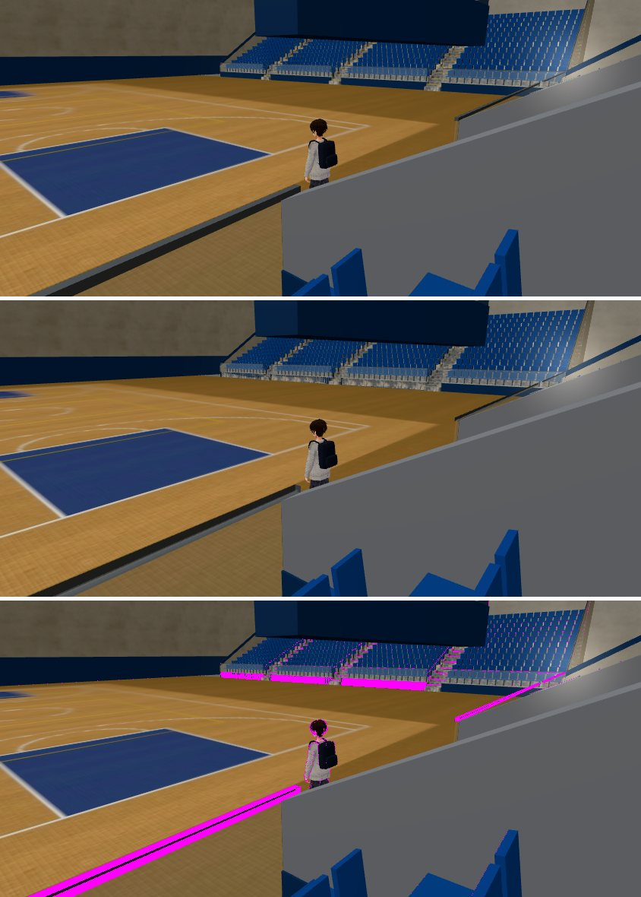

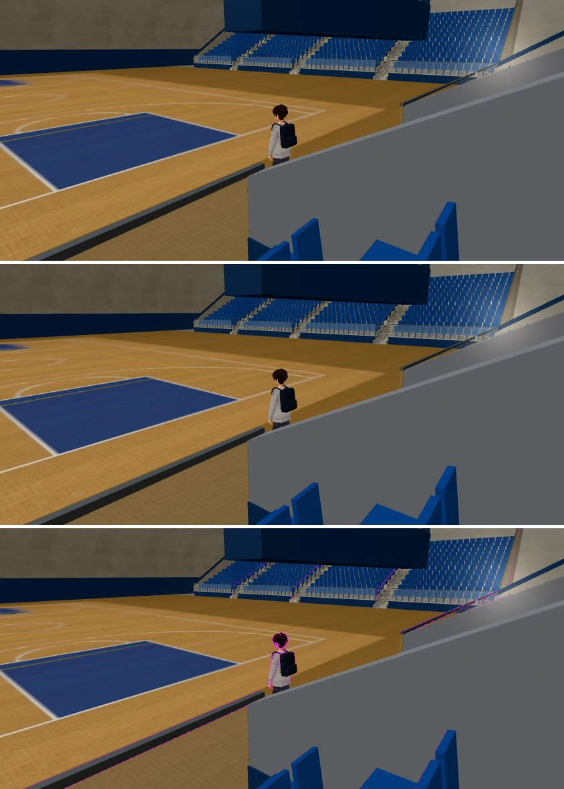

### fps（路人拿掉；每一份重新載入，每格 4～6×5 秒；最後再量一次改前）

| 地點 | 改前 | **改後** | 再量一次改前 |
|---|---|---|---|
| 1F 大廳 方向 1 | 3.5 | **4.6** | 3.75 |
| 1F 大廳 方向 2 | 6.05 | **7.0** | 6.85 |
| B1 方向 1 | 4.6 | **5.65** | 5.3 |
| B1 方向 2 | 3.95 | **5.45** | 4.6 |
| 主球場 入口通道 方向 1 | 1.5 | 1.65 | 1.65 |
| 主球場 入口通道 方向 2 | 1.6 | 1.75 | 1.75 |
| 主球場 看台上（「看主球場」那一點）往球場 | 3.13 | **3.43** | 3.23 |
| 主球場 看台上 往後 | 1.7 | 1.87 | — |

- 這一輪機器越量越快（兩次改前差 5～15%），所以和兩次改前都比：大廳 +2～31%、B1 +7～38%、**主球場只有 +6～10%**。
- 主球場同一頁全部改單面的上限是 +40～48%，但那是連「應該看得到的背面」也不畫：例如看台踢面的背面就是入口通道的天花板。交件版本補了反面（畫面一樣），省下的就只剩這些。主球場要不要換，你決定；畫面一樣、測試都過。
- 主球場的 fps 是翻面以前那一版量的；翻面只改面的方向，三角形數一樣（25.4 萬）。

### 改前改後同角度（左＝改前、右＝改後；路人拿掉）

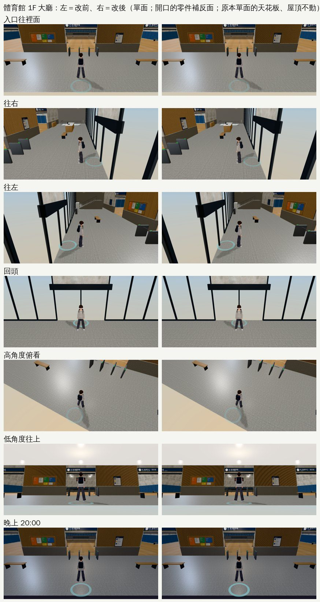

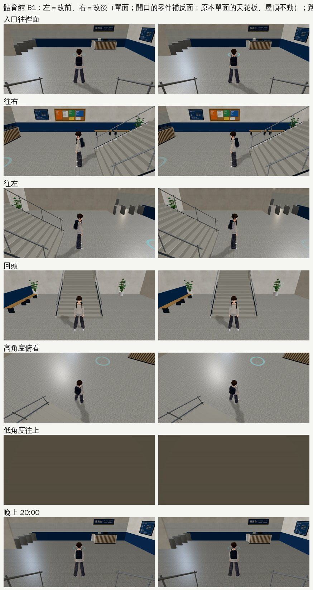

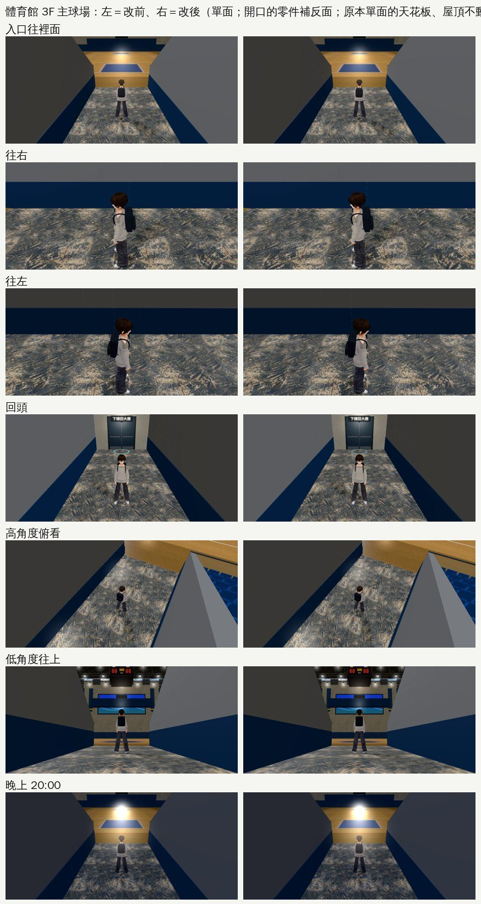

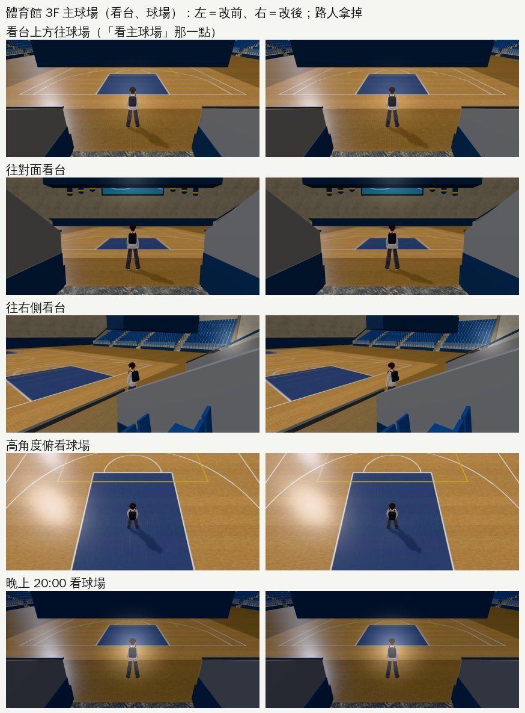

- 看得出的差別：**1F 大廳木格柵牆**（4.5 cm 寬、間隔 8 cm 的木條，在這個距離比一個像素還細）——雙面時木條的背面也會畫、多佔一些像素，條紋比較均勻；單面以後條紋的取樣不一樣，放大看有斜的波紋（12）。原尺寸的截圖看不太出來；木條都是封閉的盒子，沒有少東西。要不要因為這個不換大廳，你決定（也可以只把木條材質留雙面）。

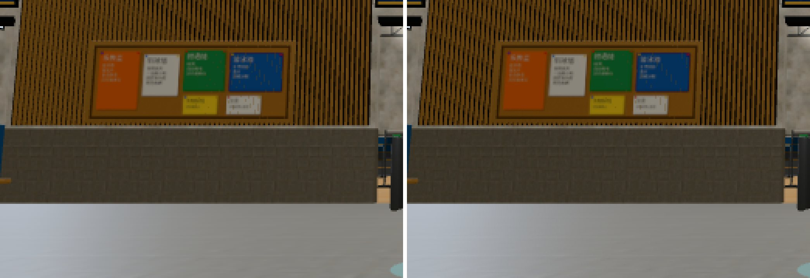

### 測試

- 新 `tests/singleside_gym_unit.js`：1 三個 GLB 除了玻璃都單面；2 開口的零件有反面（主球場看台踢面、葉片卡、B1 葉片卡、大廳石牆）；3 原本單面的天花板、屋頂沒補朝上的面；4 B1 器材 22 件、櫃台置物櫃 8 件都在；5 沒有裡外相反的薄零件。**開發的 GLB FAILED 5、沒翻面那一版 FAILED 1（第 5 項）、交件版本 ALL PASS**。
- 讀這三個 GLB 的其他 Node 測試 ALL PASS：gym_arena_unit、gym_b1_fitness_unit、gym_ceremony_unit、gym_unit、gymcer_unit、sign_audit_1025_unit、windowless_night_unit。
- 沒跑：體育館的瀏覽器流程測試、整套回歸、手機實機。

## 第三份：溫州街、118 巷（大面改單面）＋體育館 1F 大廳木格柵照舊雙面＋便利商店促銷牌補背面（10-25 17:xx 交）

LAWWW-B 15:0x 決定：①主球場用交出去的那一版（+6～10%）；②1F 大廳木格柵（`gym_wood`）照舊雙面，重匯 `gym_interior.glb`、fps 照實報。另外「街景拆成本」照我排的做。

檔案（我的分支）：
- GLB：`assets/models/env/second_ai/wenzhou_street.glb`、`lane118_street.glb`、`gym_interior.glb`、`cvs_interior.glb`（＋各自的 `.json`）；
- 腳本：`tools/blender/env_second/wz_street.py`（匯出前只關大面的雙面旗標）、`gym_interior.py`（`keep` 加 `^gym_wood$`）、`cvs_goods.py`＋`cvs_interior.py`（促銷牌補背面，下面）；
- 測試（都對開發 `e015b7c10`，`git apply --check` 過）：`patches/singleside_streets_1025.patch`（新）、`patches/singleside_gym_wood_1025.patch`、`patches/singleside_cvs_promo_1025.patch`（改開發已經有的兩支）。

### 街景為什麼不是整條街單面

- 公館 ④ 試過：開口的薄零件（鐵窗、招牌、遮雨棚、葉片卡、電線）補反面以後，三角形多了、好處就沒了（還要避開遊戲照名字接手的 `*_FACE_*`）。
- 所以這一份**不動幾何**，只把「大面、背面在遊戲裡看不到」的材質的雙面旗標關掉（`wz_street.py` 匯出前那一段，只對 `wenzhou`、`lane118`）：
  - 店內的貨（`wz_in_goods`）、店內的殼（`wz_in_shop`）、店內地磚（`wz_in_tiles_*`）、亮著的房間（`wz_room_lit`）；
  - 牆面（`wz_wall_mosaic`、`wz_wall_plaster`、`wz_wall_tile`）、騎樓柱（`wz_pillar_*`）、地面的牆腳（`wz_ground_wall`）。
- 其他（鐵窗、招牌、遮雨棚、葉片、電線、腳踏車…）照舊雙面。溫州街 9 個材質、118 巷 7 個；三角形數和改前一樣（93,881、63,826）。
- 公館同一招量不出差別（同一頁 2.25 → 2.05），不做。

### fps（路人拿掉；每一份重新載入，每格 4×5 秒；最後再量一次改前）

| 地點 | 改前 | **改後** | 再量一次改前 | 改後比兩次改前 |
|---|---|---|---|---|
| 溫州街 方向 1 | 1.2 | **1.35** | 1.25 | +8～13% |
| 溫州街 方向 2 | 1.5 | **1.75** | 1.35 | +17～30% |
| 118 巷 方向 1 | 1.55 | **1.85** | 1.6 | +16～19% |
| 118 巷 方向 2 | 2.45 | 2.5 | 2.65 | −6～+2%（沒差別） |
| 體育館 1F 大廳 方向 1 | 3.55 | **3.95** | 3.55 | +11% |
| 體育館 1F 大廳 方向 2 | 6.35 | 6.65 | 6.5 | +2～5% |

- 溫州街、118 巷（往巷子裡那個方向）有 +8～30%；118 巷另一個方向量不出差別（大面在那個方向本來就不多）。
- 體育館大廳木格柵照舊雙面以後，比第二份（木格柵也單面：+2～31%）少：+2～11%。draw call 94 → 79、62 → 60（第二份是 94 → 78）。照 LAWWW-B 的決定，畫面優先。
- SwiftShader 1–4 fps 的相對值，不是手機實機。

### 改前改後同角度（左＝改前、右＝改後；路人拿掉）

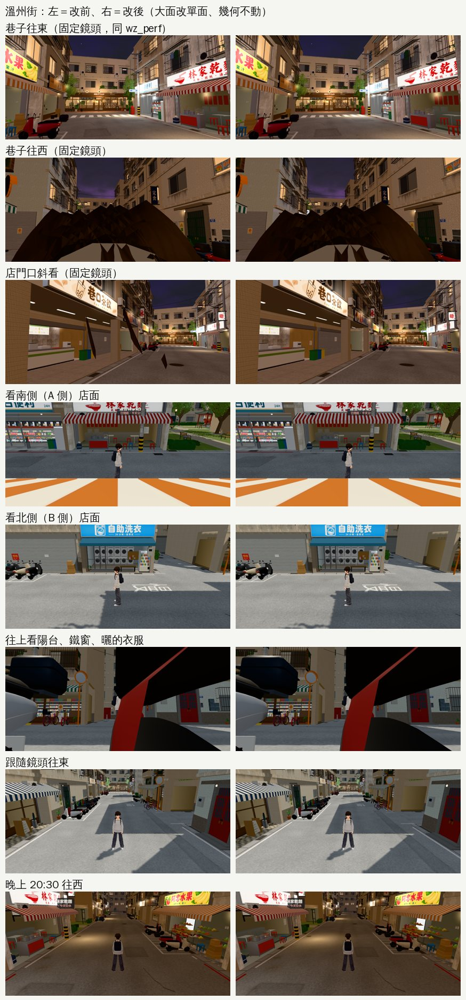

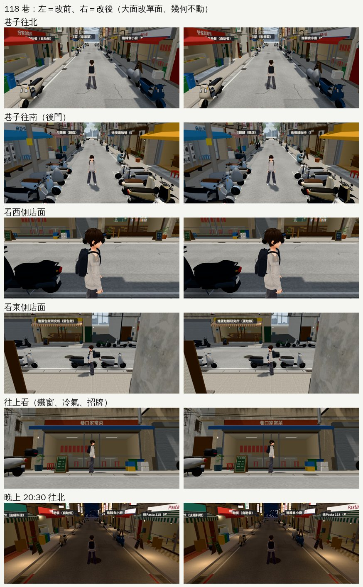

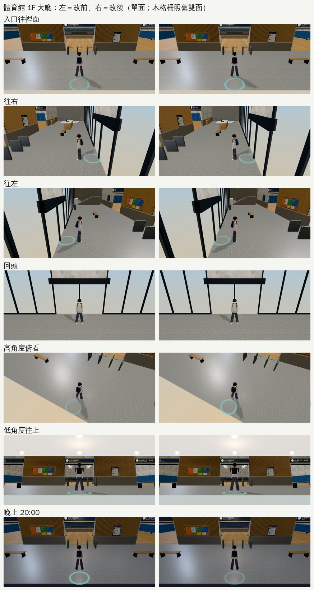

- 三組改前改後逐像素比：只有會動的東西不一樣——玩家的頭髮（溫州街「巷子往西」、118 巷「看西側店面」鏡頭貼著頭）、飄落的葉子（溫州街「店門口斜看」）、目的地光圈、人的待機動作。建築、店面、牆一樣。
- 木格柵放大比較（16）：第三份和開發一樣；第二份（木格柵也單面）的斜波紋沒了。

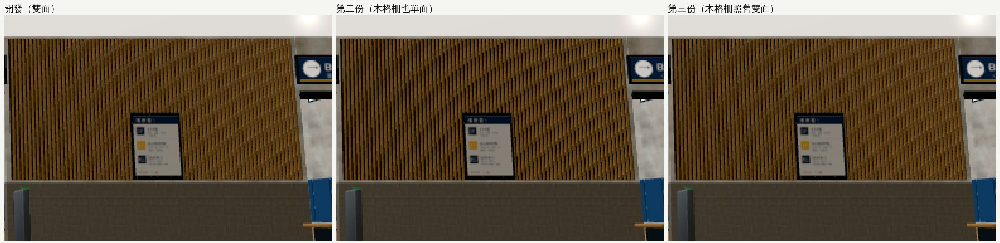

### 測試

- 新 `tests/singleside_streets_unit.js`（`patches/singleside_streets_1025.patch`）：1 大面的材質單面（9、7 個）；2 其他材質照舊雙面（原本就單面的 `wz_stain` 除外）；3 三角形數和改前一樣；4 FACE 節點（4、45 個）、材質數（44、33）一樣。**開發的 GLB FAILED 2（第 1 項）、交件版本 ALL PASS。**
- `tests/singleside_gym_unit.js` 第 1 項改成木格柵照舊雙面（`patches/singleside_gym_wood_1025.patch`，對開發 `e015b7c10` 已經有的那一份）：交件版本 ALL PASS。
- 沒跑：溫州街、118 巷、體育館的瀏覽器流程測試、整套回歸、手機實機。
- `lane118_street.json` 的 `materials` 129 → 136：那是 Blender 裡的材質數（含沒用到的），GLB 裡的材質一樣是 33 個；三角形數、截圖都一樣。

### 便利商店端架促銷牌補背面（BB-B 驗收回饋，LAWWW-B 16:2x 轉來）

- **BB-B 找到**：從店裡往門口看（入口地墊回頭，perf_route cvs 方向 1），兩排貨架靠門那一端頂上的紅、黃促銷牌整片不見。
- **原因**：促銷牌是商品貼圖集（`cvs_goods_atlas`）裡的一片平面；第一份為了不補商品的反面，整個貼圖集設成 `nodup`，材質改單面以後促銷牌背面被剔掉。我第一份的「入口回頭」截圖有拍到，但牌子小、在畫面邊緣，沒看出來。
- **改法**（照走道吊牌的做法，只給促銷牌補一片反面，貼圖集照舊單面）：
  - `cvs_goods.py` 的 `Goods.promo` 加 `back=True` 選項：另外補一片反過來的面，UV 一樣（背面看到的和原本雙面時一樣是反的字）；
  - `cvs_interior.py` 的四個端架用 `back=True`。`wz_shopkit.py` 也用 `cvs_goods`，沒加，不受影響。
- **結果**：三角形 50,618 → 50,626（四張牌各 2 個）。三版同角度：開發原本（雙面）｜第一份（單面）｜改後；放大圖（18）裡改後和開發一樣。

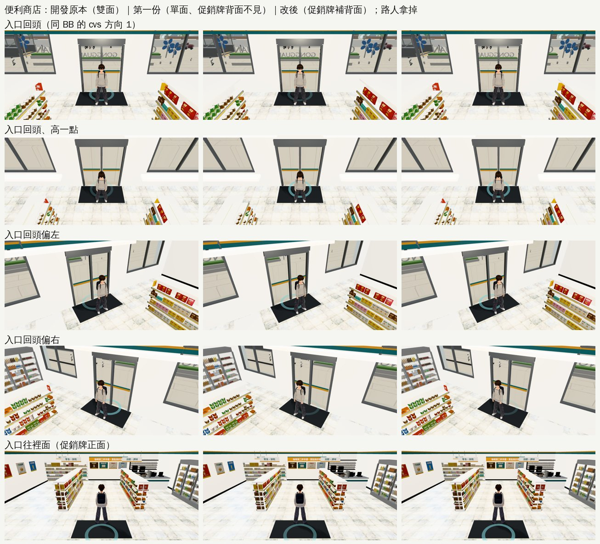

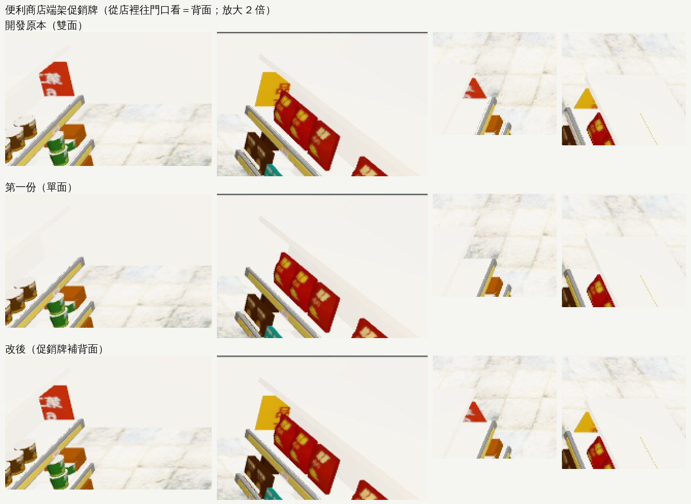

- 測試：`tests/singleside_interiors_unit.js`（`patches/singleside_cvs_promo_1025.patch`，對開發已經有的那一份）第 4 項的商品三角形數改成 47,172＋8；新第 5 項「4 張促銷牌前後的 16 個三角形互為反面、其他商品沒有」。**第一份的 GLB FAILED 2（第 4、5 項）、新的 ALL PASS**；`room_ceiling_unit` ALL PASS。
- 沒重量 fps（只多 8 個三角形）。

## 第四份：美國公寓、C 棟 208、法圖、亞洲超市、C 棟臥室（10-25 18:xx 做；10-27 LAWWW2-C 接班補完屋內對照、交件）

上限（表裡美國那幾列）都過 10%；美國超市（`us_market.py` 開發改過，要以開發的為底）下一份和機場出境大廳、美國校園一起做。

檔案（我的分支）：
- GLB：`assets/models/env/second_ai/us_apartment.glb`、`us_shared.glb`、`us_lawlib.glb`、`us_asian_market.glb`、`us_bed_c.glb`（＋各自的 `.json`）；
- 腳本：`us_apartment.py`（公寓和 C 棟 208 同一支）、`us_lawlib.py`、`us_asian_market.py`、`us_bed_c.py` 匯出前呼叫 `single_side`；`lib2.py`（下面新規則）；
- 測試：`patches/singleside_us_1025.patch`（新 `tests/singleside_us_unit.js`，對開發 `880b539bb`，`git apply --check` 過）。

### 匯出環境（這次踩到的）

- 第一次在舊的測試樹匯出：公寓找不到配置檔（開發分支把 `us_apartment_layout.js` 併進 `us_layouts.js`，腳本還讀舊檔名）；C 棟 208 少了家具（`aa_support/us_*_props.glb`、`bb_support/us_bedroom_props.glb` 開發分支沒有，腳本**安靜地跳過**，三角形 4.4 萬 → 1.2 萬）。
- 改在最新開發（`880b539bb`）的工作樹，從我的分支複製：配置檔（內容和 `us_layouts.js` 裡的一模一樣，比對過）、四組家具道具、`tools/blender/env_second/textures`（沒有它 `lib2.pbr` 會去共用資料夾找、找不到就失敗）。
- 匯出的物件數、家具數（公寓 33、C 棟 208 37）和原本一樣；新測試第 4 項守住家具。
- **開發分支現在重匯不了公寓、C 棟 208**（缺配置檔和道具組）。要的話：把 `us_apartment.py` 的預設 `--layout` 改成能讀 `us_layouts.js`，道具組併進開發——交 LAWWW-B 決定，這份沒動。

### `single_side` 新規則：只有 skip 的物件在用的材質照舊

- 亞洲超市第一次改單面：從店裡往外看，停車場對面的草原超市不見了，只剩天空（19）。
  - 原因：門外的景（`usam_view`）是一片、正面朝外。我用 `skip` 讓它的網格不動，但材質照樣改成單面，從店裡看到的是背面，被剔掉。
- 改成：只有 `skip` 的物件在用的材質，照原本的設定，不改單面；別的零件也在用的材質照樣改。這次留雙面的只有：
  - `usam_view`（門外的景）；
  - `usa_plate`（公寓、C 棟的門牌，`PLATE_FACE_*`）。
- 前三份的 GLB 不受影響（已經交了）；之後重匯社科圖、便利商店，只有 `*_FACE_*` 自己用的材質會留雙面。

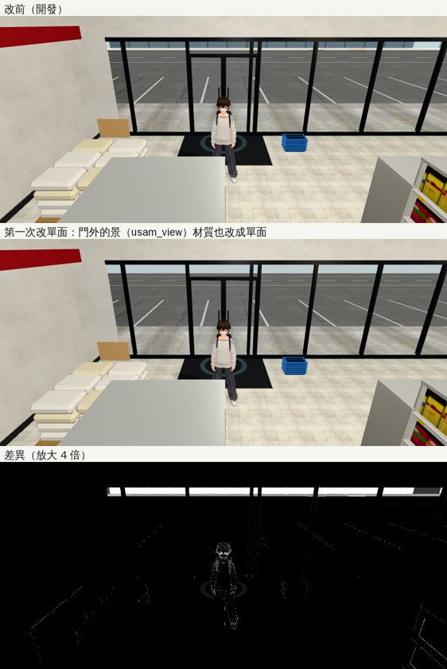

### fps（路人拿掉；每一份重新載入，每格 4×5 秒；最後再量一次改前）

| 地點 | 改前 | **改後** | 再量一次改前 | 改後比兩次改前 |
|---|---|---|---|---|
| 公寓 方向 1 | 1.8 | **2.25** | 1.75 | +25～29% |
| 公寓 方向 2 | 2.0 | **2.4** | 1.95 | +20～23% |
| C 棟 208 方向 1 | 1.8 | **2.1** | 1.7 | +17～24% |
| C 棟 208 方向 2 | 1.7 | **2.1** | 1.75 | +20～24% |
| 法圖 方向 1 | 3.6 | **4.7** | 3.8 | +24～31% |
| 法圖 方向 2 | 4.7 | **5.4** | 4.85 | +11～15% |
| 亞洲超市 方向 1 | 2.65 | **3.7** | 2.65 | +40% |
| 亞洲超市 方向 2 | 3.3 | **4.55** | 3.4 | +34～38% |
| C 棟臥室 方向 1 | 4.9 | **6.05** | 4.55 | +23～33% |
| C 棟臥室 方向 2 | 4.8 | **6.2** | 4.7 | +29～32% |

- 公寓、C 棟 208 離上限（3.0、2.9）還有一段：補反面多了 1.7 萬個三角形，大多是家具道具組（AA-B、BB-B 做的：沙發底部開口、燈罩等，整件算開口零件）。家具不補反面要一件一件確認背面看不到，留到之後再試。
- fps 是 `usam_view` 改之前那一版量的；改的只是一個材質的雙面旗標（一片），三角形一樣。

### 改前改後同角度（左＝改前、右＝改後；路人拿掉）

- 20～25：上一班（LAWWW2-B）拍的六區，鏡頭在門口和大空間；公寓、C 棟 208 那兩張是**門外走廊**（玩家出生在門口），屋內沒拍到。
- 26～29：接班以後（LAWWW2-C，10-27）補拍的**屋內**：開發分支 `5b6737cd3`（改前）對同一棵＋這五個新 GLB（改後），`tools/shots/singleside_us_interior_ab.py`；每一列一個位置，左＝改前、右＝改後。
  - 位置照順序：客廳往北、往南、往東、往西，廚房往西，走廊往北，臥室（公寓：往東、往北；C 棟 208：臥室 A、臥室 B 往東）。
  - [捷徑] 讀檔、把玩家直接放到位置（客廳往東那一格玩家站在茶几上，兩版一樣）；路人藏起來；跳出來的手機通知是拍的時刻差幾秒，不是模型的差別。
  - 結果：公寓 16 格改前改後一樣——沒有破面、沒有看穿；牆淡出的樣子也一樣。
  - C 棟 208：白天第 4、5 列（客廳往西、廚房往西）、晚上第 4 列兩版的**鏡頭位置不一樣**。那兩個位置兩版各重拍一次、等 8 秒才拍（30）：兩版一樣。差別是鏡頭還在移動時就拍了（等 3.5 秒不夠，從上一個位置移過來時鏡頭還在拉近拉遠），不是模型造成的。其他格兩版一樣。
  - 最後一格的 draw call：公寓 86 → 70、C 棟 208 92 → 74（三角形 5.7 → 6.1 萬、6.2 → 6.9 萬：開口零件補了反面）。

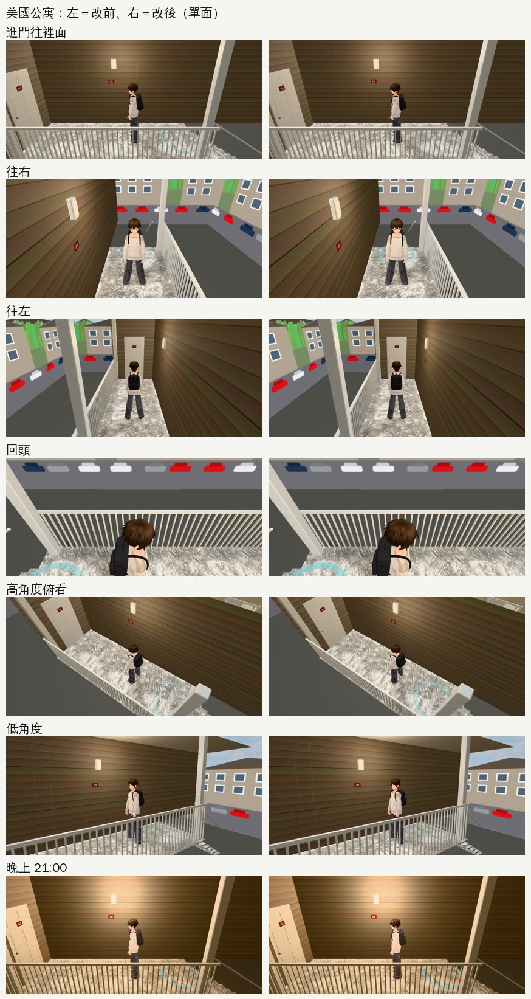
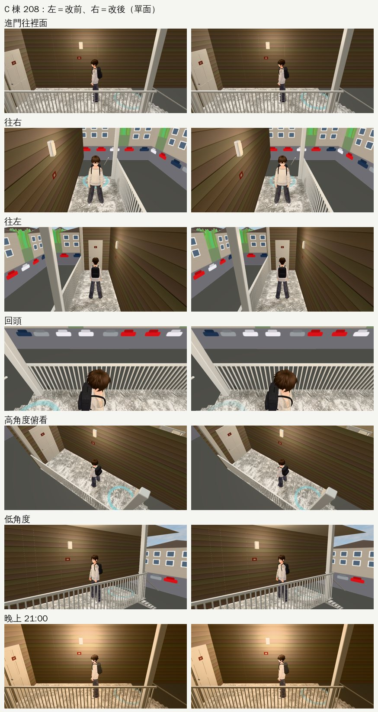
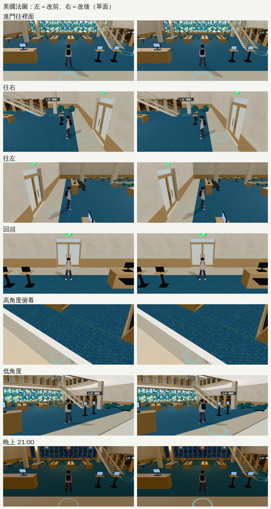
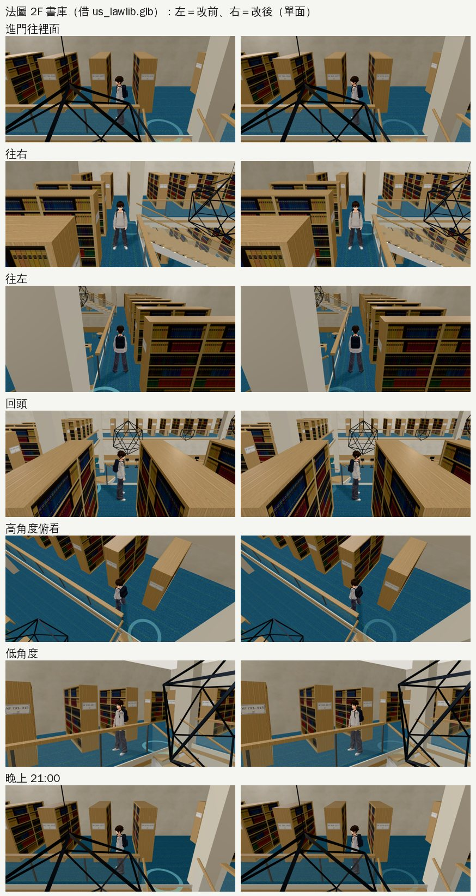
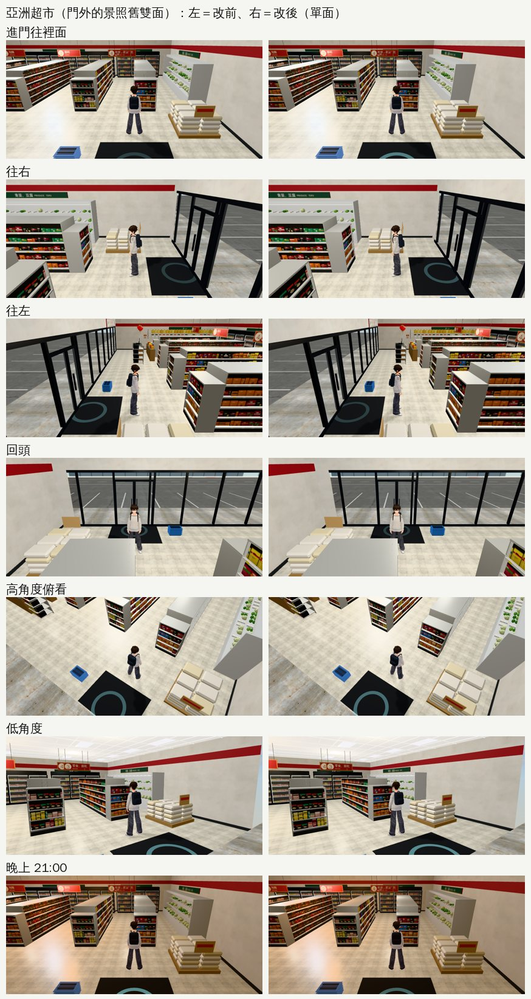
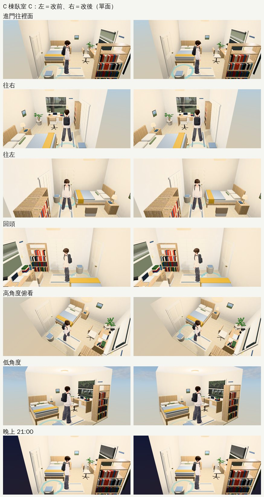
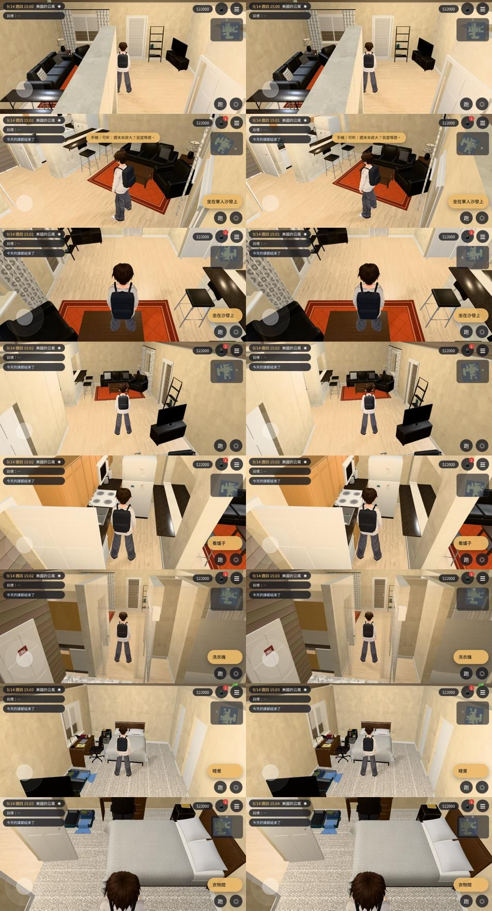
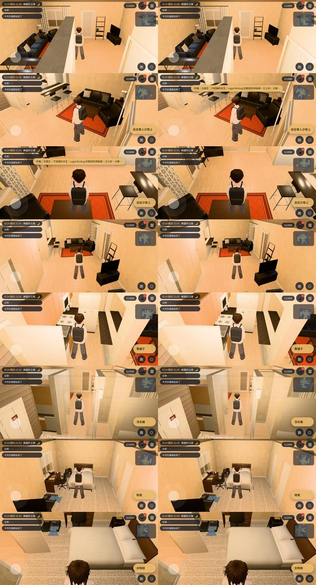
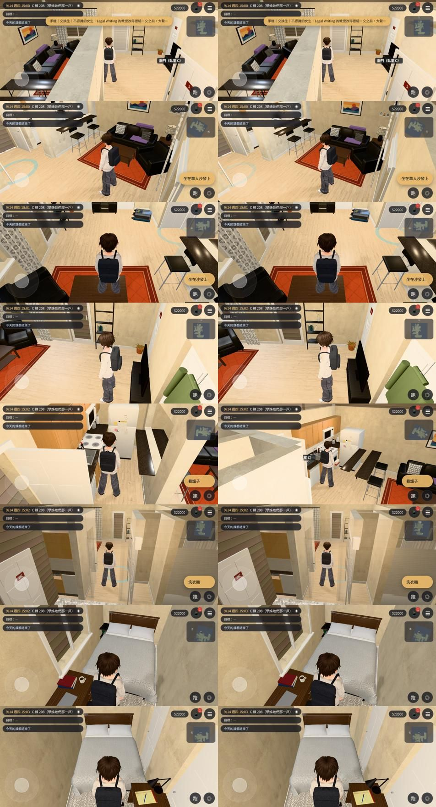
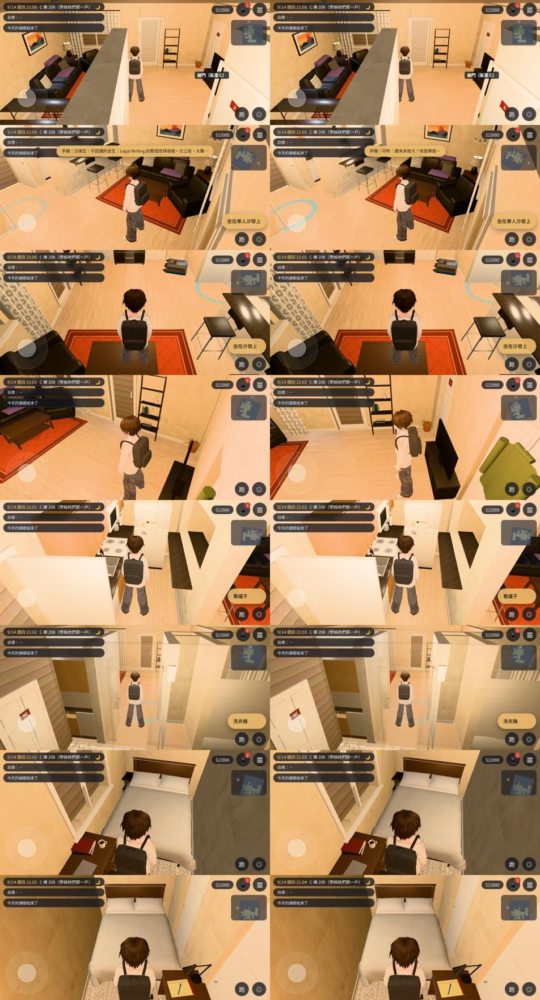
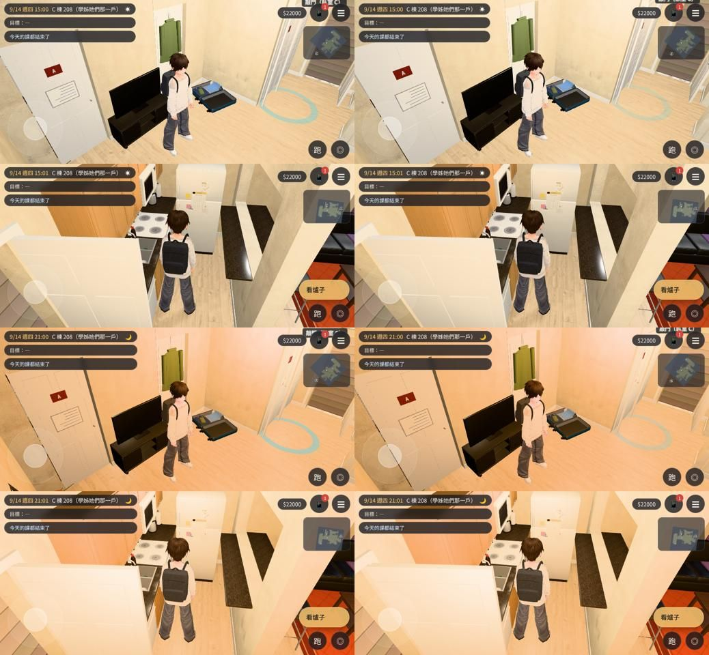

### 測試

- 新 `tests/singleside_us_unit.js`：
  1. 五個 GLB 除了玻璃都單面；`usam_view`、`usa_plate` 照舊雙面；門外的景還在；
  2. 開口的零件有反面：法圖鐵絲雕塑、亞洲超市層架、公寓窗簾、C 棟臥室版畫；
  3. 原本單面的天花板沒補朝上的面：公寓、C 棟 208、C 棟臥室；
  4. 家具 33／37 件都在；
  5. 沒有裡外相反的薄零件。開發的公寓、C 棟 208 門板有裡外相反的零件（39、52 個），單面會從外面看到背面，匯出時翻成朝外。
  - **結果**：開發的 GLB FAILED 7、交件版本 ALL PASS。
- 接班重驗（LAWWW2-C，10-27，開發 `5b6737cd3`；上一班是對 `880b539bb`）：
  - `singleside_us_unit.js`：開發的 GLB **FAILED 7**（第 5 項：公寓門板 39、C 棟 208 門板 52 個裡外相反的零件）、交件版本 **ALL PASS**；
  - 同一棵＋新 GLB，其他 18 支 ALL PASS：`nav_us_unit`、`room_ceiling_unit`、`us_bed_c_unit`、`us_cam_walls_unit`、`us_lawlib_2f_unit`、`us_lawlib_sky_unit`、`us_life_unit`、`us_season_unit`、`us_market_cam_unit`、`us_ms_seethru_unit`、`us_lamp_pools_unit`、`aa370_us_unit`、`aa412_us_unit`、`aa424_us_blank_unit`、`exch_min_unit`、`us_jp_nextclass_unit`、`us_wknd_stop_unit`、`singleside_interiors_unit`。
- 沒跑：美國區域的瀏覽器流程測試（BB 測）、整套回歸、手機實機。fps 是上一班量的（上面的表），接班以後沒有重量。

## 第五份：美國大超市（LAWWW2-C 10-27）

上限（表裡那一列）+33～56%。這一份只有大超市；機場出境大廳、美國校園先量上限再決定（工具 `tools/shots/singleside_upper.py`）。

檔案（我的分支）：
- GLB：`assets/models/env/second_ai/us_market.glb`（＋`.json`）；腳本 `us_market.py` 匯出前呼叫 `single_side`；
- 測試：`patches/singleside_us_market_1027.patch`（新 `tests/singleside_us_market_unit.js`；對開發 `5b6737cd3`、`830fd3d11` 都 `git apply --check` 過）；
- 截圖工具：`tools/shots/singleside_us_market_ab.py`。

### 以哪一份腳本為底
- 三個分支（我的、`adoring-meitner`、`modest-rubin`）的 `us_market.glb` 一樣；開發分支的 `us_market.py` 少了 10-22「天花板單面朝下」那兩行（GLB 已經是那一版）。所以用我分支的腳本。
- 先用沒改的腳本重匯一次對照：物件 46、三角形 98,732、材質 42、檔案大小和開發的 GLB 都一樣（位元組不同只在貼圖編碼）。

### 做法
- `single_side(root, keep=r'glass', nodup=r'^usm_fruit_', skip=…FACE…)`：玻璃照舊雙面；
- 水果堆（一片高低起伏的面）**不補反面**：只從上面、外面看。第一次全補是 134,626 個三角形（+36%，水果占 1.9 萬），不補是 115,382（+17%）。
- **第一次不補反面時，有幾箱水果整箱不見、後面的冷藏蔬菜牆變黑**（31，中間那張）：`fruit_bin` 的面方向照兩個邊的方向（s×t），有一半的箱子是朝下的，雙面材質看不出來。
  - 改成建面時朝下的那幾箱把頂點順序反過來（腳本 `fruit_bin` 的 `down`）；三角形數不變。修好以後和改前一樣（31，右邊）。
  - 新測試第 2 項守這件事：開發的 GLB 水果面有 13,182 個朝下（FAIL），交件版本 0 個（靠牆冷藏櫃最上緣幾乎直立、面朝走道，往下偏 1～2° 的 30 個算朝上）。

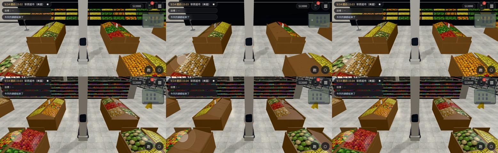

### fps（路人藏起來；每格 4×5 秒；開發 `5b6737cd3` 對 同一棵＋交件 GLB）

| 地點 | 改前 | **改後** | 再量一次改前 | 改後比兩次改前 |
|---|---|---|---|---|
| 入口往北 | 3.85 | **5.09** | 3.88 | +31～32% |
| 第 1 走道往北 | 1.50 | **2.16** | 1.51 | +43～44% |

- draw call 一樣（81、72）；畫面上的三角形 17.5 → 19.1 萬、15.5 → 17.2 萬（桁架、商品頂點色零件補了反面）。
- 第一次單面（水果有 bug）量到 5.07、2.18，和交件版本差不多。

### 改前改後同角度（左＝改前、右＝改後；15:00；路人藏起來）
- 位置照順序：入口往北、蔬果區往東、往西、第 1 走道往北、第 2 走道往南、冷凍櫃之間往北、熟食往北、結帳區往北、往南、乳品牆、肉品櫃。
- 11 格兩版一樣。

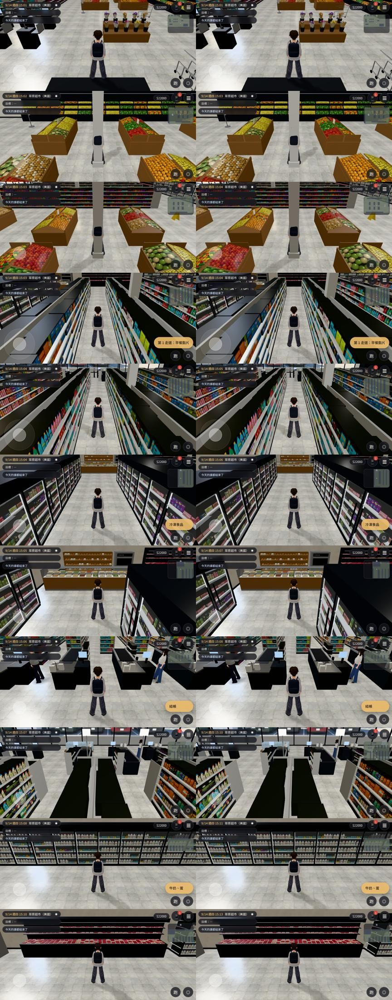

### 測試（開發 `5b6737cd3`＋交件 GLB）
- `singleside_us_market_unit.js`（新）：開發 FAILED 3、交件 ALL PASS；
- `us_market_cam_unit`、`us_market_street_unit`、`us_ms_seethru_unit`、`us_traffic_unit`、`us_life_unit`、`us_season_unit`、`nav_us_unit`、`room_ceiling_unit`、`singleside_us_unit`：ALL PASS。
- 沒跑：瀏覽器流程測試（BB 測）、整套回歸、手機實機。

## 第六份：桃園機場出境、入境大廳（LAWWW2-C 10-27）

上限（表裡那一列）出境 +53～61%。入境大廳小（1.8 萬個三角形），沒量上限，和出境同一支腳本、同一種做法一起交。

檔案（我的分支）：
- GLB：`assets/models/env/second_ai/airport_dep.glb`、`airport_arr.glb`（＋`.json`）；腳本 `airport_t2.py` 匯出前呼叫 `single_side`；
- `lib2.py`：`single_side` 判斷「裡外相反」的體積算法修好（下面「順便修好」）；
- 測試：`patches/singleside_airport_1027.patch`（新 `tests/singleside_airport_unit.js`；對開發 `5b6737cd3` `git apply --check` 過，`25be6f6ab` 也沒有這個檔，新檔直接套）；
- 截圖工具：`tools/shots/singleside_zone_ab.py`（通用：任何區域、任何位置，可以順便量 fps）。

### 做法
- `single_side(root, keep=r'glass|frosted', skip=…FACE…)`：玻璃（`ck_glass`）、霧面玻璃（`GLOW_ap_frosted`，半透明）照舊雙面；其他開口零件補反面（窗外的景 `GLOW_ap_outside_m`／`_night_m` 一片、盆栽葉片卡 `ap_leaf_small`、看板）。
- 三角形：出境 77,108 → 82,150（+6.5%）、入境 17,478 → 18,118（+3.7%）。葉子不多，全補。

### fps（出境大廳；路人藏起來；每格 4×5 秒；開發 `5b6737cd3` 對 同一棵＋交件 GLB）

| 地點 | 改前 | **改後** | 再量一次改前 | 改後比兩次改前 |
|---|---|---|---|---|
| 路邊往北（curb_n） | 2.60 | **3.38** | 2.59 | +30% |
| 報到島之間往北（islands_n） | 2.74 | **3.46** | 2.64 | +26～31% |

- draw call 一樣（73、72）；畫面上的三角形 15.3 → 15.8 萬。
- 上限是 +53～61%，剩下的差在玻璃、霧面玻璃（半透明，照舊雙面、畫兩次）。
- 入境大廳沒量 fps。

### 改前改後同角度（左＝改前、右＝改後；15:00；路人藏起來）
- 出境：路邊往北、大廳往北、報到島之間往北、往東、往西、往南看服務台；入境：海關出口往南、接機區往北、往東、往西。
- 10 格兩版一樣。入境海關出口往南那一格鏡頭貼牆、自動轉開，停的位置每次差一點：第一次拍新版離得遠一點，加一個暖身位置重拍，換成舊版遠一點；畫面上的東西一樣（表裡放重拍的）。

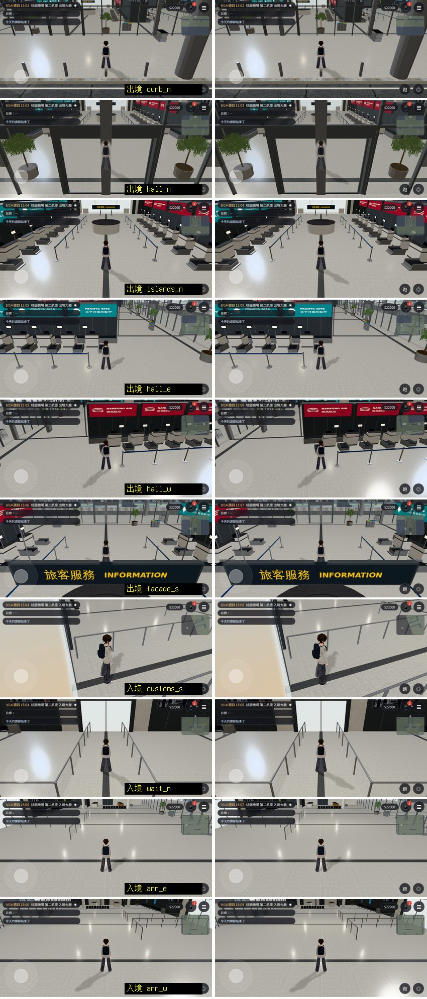

### 順便修好：`single_side` 判斷「裡外相反」會算錯（`lib2.py`）
- 零件體積原本用 Blender 的向量（32 位元）從原點算。離原點 20～130 m 的幾公分小零件，誤差比零件本身的體積還大，正負號會錯：做第七份（美國校園）時，公車站牌上 6 cm 的小方塊（本來是對的）被翻反、遠處一條石材收邊該翻沒翻——GLB 測試抓到（GLB 測試用 64 位元算）。
- 改成 64 位元、以零件自己的第一個頂點當原點。第二份體育館 B1「4 片小鐵片在 Blender 算出來相反、GLB 是正的」應該也是這個原因（B1 交件版用 `flip=False`，沒有重匯）。
- 機場用新算法重匯：網格和舊算法一樣（入境有 92 個三角形是同一個多邊形換了三角化方式：頂點一樣、沒有面翻反）。交件的是新算法匯出的。
- 前幾份交件的 GLB 用 64 位元檢查「裡外相反的薄零件」：社科圖、總圖大廳、便利商店、體育館三個、美國五個、美國超市都是 0（第四、五份和體育館的測試本來就有這一項）。
- **溫州街、118 巷不是 0**：吊燈燈罩 118 巷 9 個、溫州街 3 個（`wz_in_shop`，店裡天花板，30×16×29 cm）；開發 `5b6737cd3` 的版本材質就是單面、燈罩就是反的，不是這次造成的。隔著店面玻璃看，形狀不變、明暗反過來。另外兩邊各 1 個 `cafe_vc_wz_metal` 的小金屬件，材質照舊雙面、看不出來。記成已知問題（P3），這一份不動。

### 測試（開發 `5b6737cd3`＋交件 GLB）
- `singleside_airport_unit.js`（新）：開發 FAILED 6、交件 ALL PASS；
- `airport_cam_unit`、`exch_min_unit`、`nav_us_unit`、`us_life_unit`、`us_season_unit`、`singleside_gym／interiors／streets／us／us_market_unit`：ALL PASS。
- 沒跑：瀏覽器流程測試（BB 測）、整套回歸、手機實機。

## 第七份：美國校園（法學院前，`us_campus`；LAWWW2-C 10-27）

檔案（我的分支）：
- GLB：`assets/models/env/second_ai/us_campus.glb`（＋`.json`）；腳本 `us_campus.py` 匯出前呼叫 `single_side`（`56257299`）；
- 測試：`patches/singleside_us_campus_1027.patch`（新 `tests/singleside_us_campus_unit.js`；對開發 `de75d3106` `git apply --check` 過）。

### 做法
- `single_side(root, keep=r'glass|^usu_(leaf_tree_[abc]|leaf_small|twig_inner)')`：玻璃、樹葉、細枝（葉片卡，四季各一套）照舊雙面——第一次全補三角形 132,611 → 199,562，葉子占五萬，不划算；其他 61 個材質單面，開口零件補反面（法學院鋼構框 7,596、石材收邊、鋪面接縫…共 22,425 個三角形）。
- 地面也補反面：2,775 個地面三角形有 862 個朝下（雙面時看不出來），不補從上面看會不見。
- 三角形 132,611 → 155,036（+16.9%）。

### fps（路人藏起來；每格 4×5 秒；開發 `de75d3106` 對 同一棵＋交件 GLB；15:00）

| 地點 | 改前 | **改後** | 再量一次改前 | 改後比兩次改前 |
|---|---|---|---|---|
| 公車站往北（bus_n） | 3.46 | **3.83** | 3.51 | +9～11% |
| 法學院台階前往北（law_n） | 3.62 | **3.93** | 3.58 | +9～10% |

- draw call 一樣（124、119）；畫面上的三角形 32.4 萬 → 36.6 萬（+13%，補的反面）。
- **比上限（+57～61%）少很多**：上限是「同一頁全部改單面」，連樹葉卡也少畫一面；美國校園滿地都是樹，樹葉照舊雙面，補的反面又多了 13% 的三角形。這一份的收穫是 **+10% 左右**，比前幾份小。

### 改前改後同角度（左＝改前、右＝改後；15:00；路人藏起來）
- 公車站往北、法學院台階前往北、校門往東、人行道往西、車道往北、往南：六格兩版一樣（像素差 > 30 的點 0.04～0.4%；法學院那一格 2.1% 是兩次拍的時間差一分鐘，影子和樹葉擺動）。

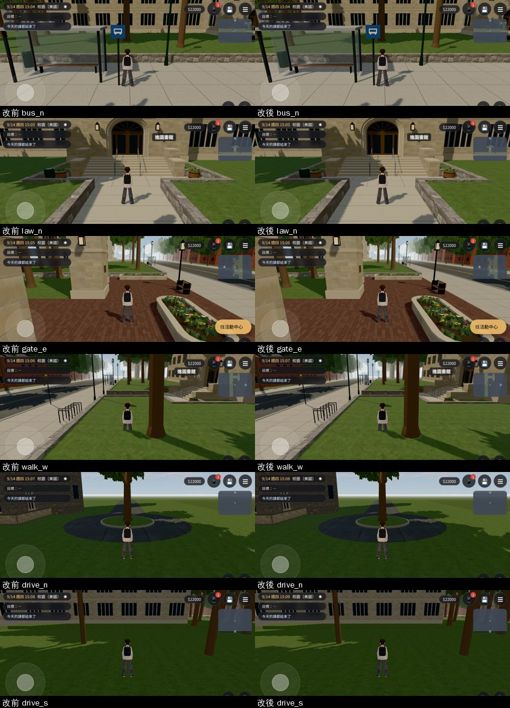

### 測試（開發 `de75d3106`＋交件 GLB）
- `singleside_us_campus_unit.js`（新）：開發 FAILED 4、交件 ALL PASS；
- `nav_us_unit`、`us_season_unit`、`us_life_unit`、`exch_min_unit`、`singleside_us_unit`、`us_cam_walls_unit`：ALL PASS。
- 沒跑：瀏覽器流程測試（BB 測）、整套回歸、手機實機。

## 已知問題：體育館 1F 大廳木格柵遠看有同心波紋（BB-B 10-25 回報；LAWWW2-B 10-30 決定先不處理）

- 改單面以前、以後兩版都有（第三份木格柵照舊雙面，和開發一樣），不是單面造成的。
- 原因：木條 4.5 cm 寬、間隔 8 cm，遠處一根木條比一個像素還細，一整片規則的細條在螢幕上取樣就會出現波紋（幾何本身的鋸齒，不是貼圖，調 mipmap、材質救不了）。
- 要根治得改做法：遠處那一片換成一張有條紋的貼圖（貼圖有 mipmap，遠看會平均成一塊木色），或近景木條＋遠景貼圖兩層。這會改到大廳的外觀，**排在體育館大廳輪到 INTERIOR-AAA-REVIEW-1028（室內提升）時一起做**，不單獨開。
- 現在記成已知、不擋發布。
