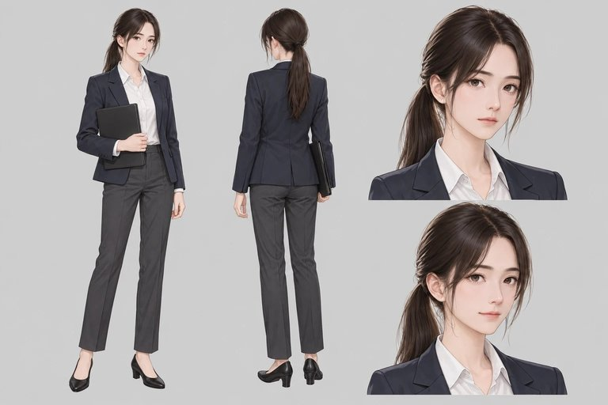
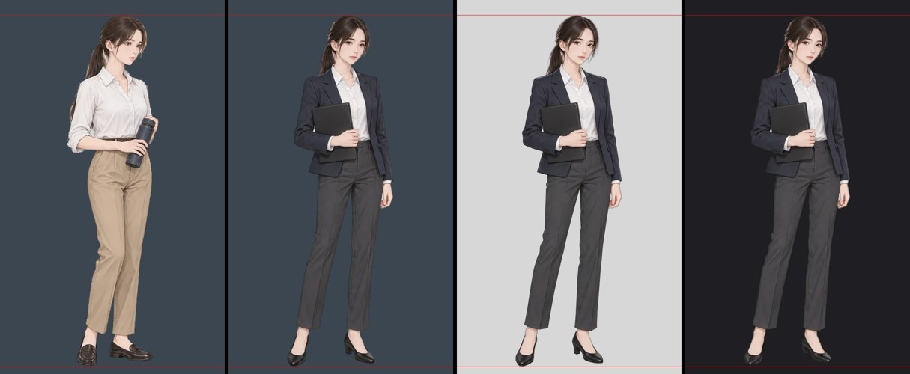
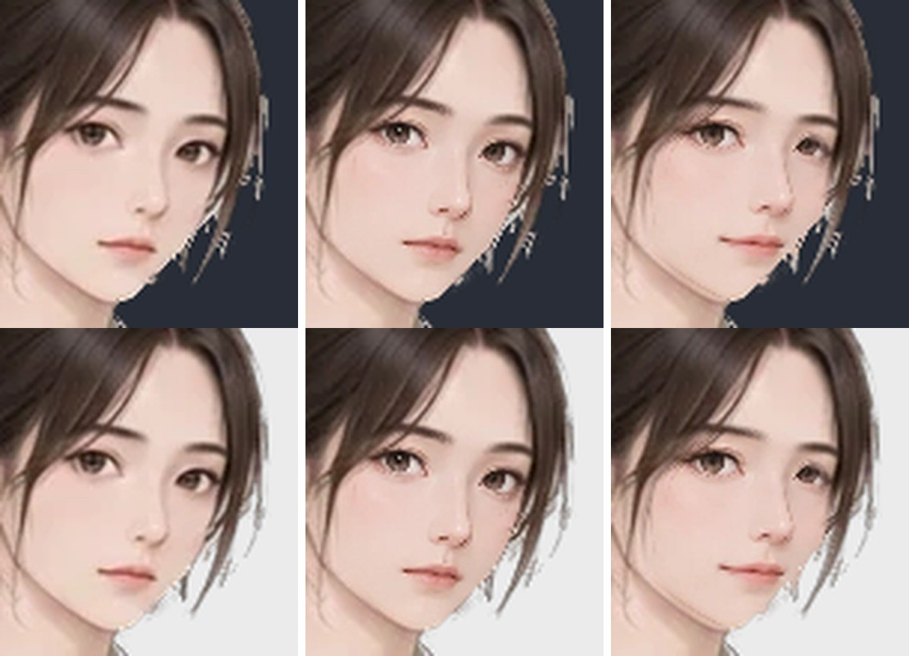
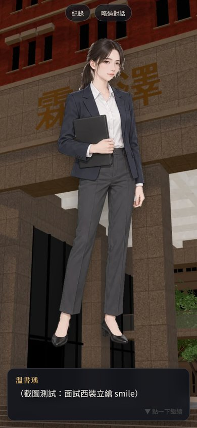
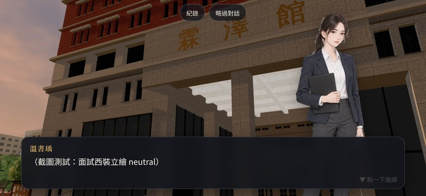
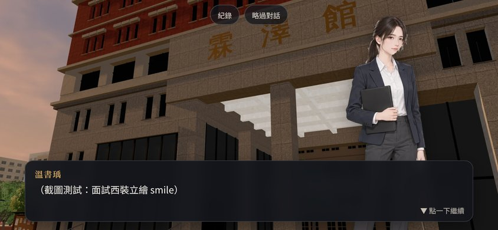

# ART-PT-SIS-FORMAL：學姊（heroine_05）面試西裝立繪 `formal`

- **用在哪裡**：
  - 學姊 W9「她沒有去面試」那一天（BB_97 2-4）。
  - 之後大四 M9 口試也會用。
  - LAWWW-B 在那幾句對白加 `outfit:'formal'`。
- **來源**：企劃線 `docs/story_planning/art_reference/heroine05_interview.webp`（ART-16，BB 已通過）。
  - 用到的部分：左邊的正面全身、右邊兩個頭像。
  - 不重畫、不重新生成，只做裁切、去背、對位。

## 交付的檔案
放在 `assets/portraits/heroine_05/formal/`，每張 600×1000，透明背景。

| 檔案 | 怎麼做 |
|---|---|
| `neutral.webp` | 正面全身去背（`tools/portraits/cut_reference_portraits.py --only heroine_05@formal`） |
| `serious.webp` | 右上頭像（平靜、直視）的臉換到全身圖上 |
| `smile.webp` | 右下頭像（微笑）的臉換到全身圖上 |

- **後兩張的做法**：`tools/portraits/overlay_expressions.py --id heroine_05_formal`。
  - 只換眉毛到下巴的橢圓，頭髮、耳朵、馬尾、下巴輪廓都保留全身圖的。
- **構圖和平常版 `campus` 相同**：頭頂留 4%，全身高佔畫布 94%，人物水平置中。
  - 實測不透明範圍：campus 是 y 40～980，formal 也是 y 40～980。
- `src/data/portrait_manifest.js` 沒有改（LAWWW-B 的檔案）。
  - LAWWW-B 跑 `python3 tools/gen_portrait_manifest.py`，或 `python3 build.py`，就會多出 `heroine_05: { formal: [neutral, serious, smile] }`。

**平常版（campus）和面試版（formal）並排**
- 紅線是頭頂和腳底。
- 底色依序是深藍灰、淺灰、近黑，用來看去背的邊。

**三個表情的臉部放大（4 倍）**
- 上排是深色底，下排是淺色底。
- 由左到右：neutral、serious、smile。

## 去背的做法（和其他人不同的地方）
- 這張圖的底色是完全一樣的灰（206，誤差 ≤2）。
- 先試了學姊平常版用的 alpha matting：右邊下巴和臉旁的髮絲被吃掉。
- 改用「最近的人物顏色」對底色做投影來算透明度。
  - 髮絲邊緣是半透明的，顏色可以還原。
  - 原圖輪廓外一圈比底色還亮的白邊（振鈴），投影是負的，會變成透明。
- 頭像的皮膚很白，接近底色。
  - 所以換臉時頭像不去背，只取臉中間的橢圓。
  - 新的臉只蓋在全身圖原本不透明的地方，所以下巴外面不會多出一道灰色月牙。

## 遊戲內 ADV 截圖
- 測試工作樹：開發分支 a17e9b6b，加上這三張圖，再重跑立繪清單。
- 用 `ADV.begin({right:{charId:'heroine_05', outfit:'formal', expression:…}})` 開 ADV。背景用霖澤館（`ntu_linze`），17:30。
- 手機模擬（dpr 2），截圖縮成一半存放。

| neutral 390×844 | serious 390×844 | smile 390×844 |
|---|---|---|
|  |  |  |

| neutral 844×390 | serious 844×390 | smile 844×390 |
|---|---|---|
|  |  |  |

- 對話框裡是截圖用的字，不是劇情文字。

## 還沒做到的
- 來源只有兩個頭像，所以只有 serious、smile 兩個表情。其他表情遊戲會用 formal 的 neutral。
- serious 是設定圖右上那個平靜、直視的頭，和 neutral 差別不大：眼睛稍微張大、看著前方。如果 BB-B 覺得不像 serious，可以不收這一張，遊戲會用 neutral。
- 右臉旁的髮絲放大 4 倍時，髮絲之間有幾個淺色小點。手機上的顯示大小（約 0.5 倍）看不到。
- smile 放大後，右下巴有一條很淡的雙層輪廓：頭像的下巴比全身圖略高。
- 真機沒有看過。

**狀態**：`READY_FOR_ART_REVIEW`。角色美術由 BB-B 驗收（D59）；BB-B 驗收通過才能標 `ART_APPROVED`。
