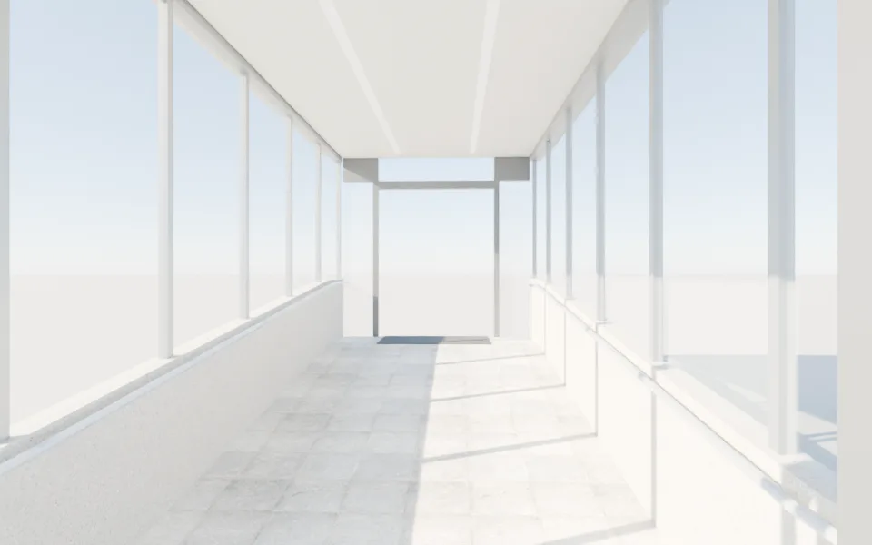
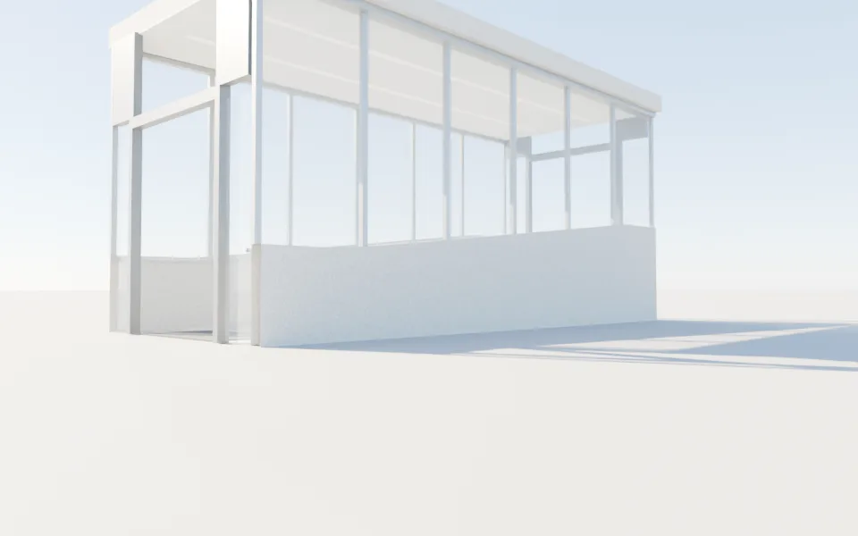
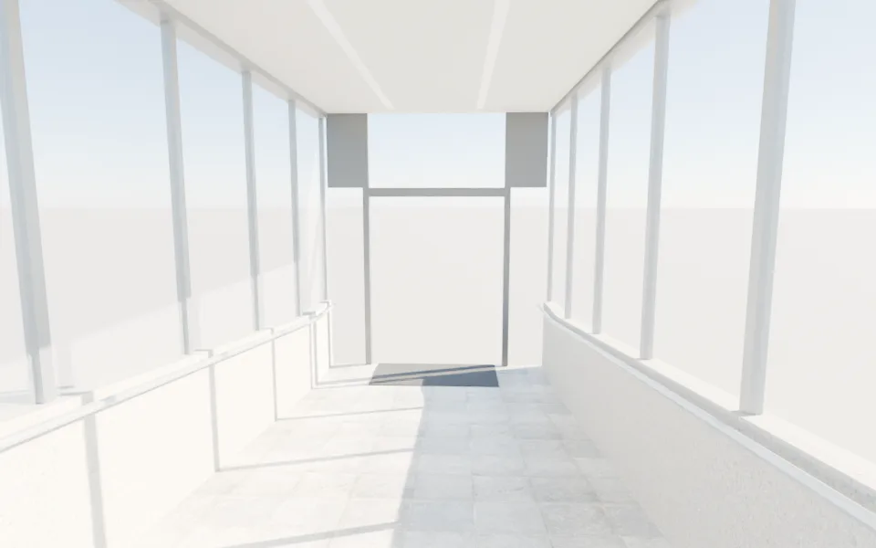

# 博雅 ⇄ 普通 二樓空橋（走得過去的版本）——MODEL_READY（LAWWW2-B 2026-10-16）

- 需求：使用者試玩 v9.7 第 18 項「博雅和普通教學館的空橋居然是一扇門」；LAWWW-B 佇列②（做成真的走得過去）。
- 檔案：
  - `assets/models/env/second_ai/skybridge.glb`：307 KB、1,388 個三角形、9 個材質。
  - `skybridge.json`：本地座標、門口、緩坡公式、可走範圍。
  - 腳本 `tools/blender/env_second/skybridge.py`（Blender 5.2）。
- 造型：玻璃走廊，外寬 3.2 m、長 7.5 m、淨高 2.8 m。兩側是 0.9 m 的清水混凝土矮牆，上面整片玻璃（鋁直框每 1.25 m）。
  - 兩側扶手跟著坡度。
  - 天花板兩條 LED 燈帶（自發光材質）。
  - 地板是大地磚（Poly Haven CC0）。
  - 兩端門洞 1.8 m（自動門開著，門片收在兩側），門口有地墊。
- 會淡出的牆照室內的約定：`WALL_east_*`、`WALL_west_*`，自訂屬性 `dir`＝往室內的法線。

## 座標（給遊戲接導航）

- **本地原點**：普通那一端門口中心的地板。往北（−z）7.5 m 到博雅那一端。x 東、y 上。
- **地板高度**：兩端各 1 m 平台，中間 5.5 m 是 11% 的緩坡（沒有台階）。
  - 公式：`y = 0.6 · clamp((−z − 1) / 5.5, 0, 1)`。
  - 高差 0.6 m：照室內 `putong_layout` 2F y=4.2、`boya_layout` 2F y=4.8。
- **可走範圍**：x −1.15～1.15、z −7.5～0。
- **門洞**：
  - 普通端：x −0.9～0.9、z 0、y 0。
  - 博雅端：x −0.9～0.9、z −7.5、y 0.6。
- **校園世界座標**（照 `zones3d.js` 第 193 行的外觀方塊）：
  - 中心線 x = −41.2；普通北牆 z = −66.5、博雅南牆 z = −74.0。
  - 原點放在 **(−41.2, Y0, −66.5)**。
  - 普通端門口＝(−41.2, Y0, −66.5)；博雅端門口＝(−41.2, Y0 + 0.6, −74.0)。
- **要 LAWWW-B 決定的一點（高度對不上）**：
  - 校園外觀套件的二樓：普通 `gfh 4.0`、博雅 `gfh 4.4`，差 0.4。
  - 室內 layout 的二樓：4.2／4.8，差 0.6。
  - 現在的外觀方塊在 y 5.6（頂面 5.85）。
  - 空橋照室內的 0.6 做。外觀擺在校園裡時，Y0 建議用普通外觀的二樓 4.0（或你要統一的值）。差值由空橋的坡度吸收，不用改模型；要改高差告訴我，改 `RISE` 一個數字重新匯出。

## 預覽（Blender Cycles，**不是遊戲畫面**；地面是預覽用的白色平面）

| 從普通端往博雅看 | 外面（東側） | 從博雅端往回看 |
|---|---|---|
|  |  |  |

## 還沒做到的（誠實寫）

- 還沒接進遊戲。導航、兩端和室內的門怎麼接，由 LAWWW-B 做。
- 外觀的玻璃在預覽裡偏白（天空反射）。遊戲沒有環境貼圖，看起來會比較透明。
- 沒有做夜景的燈光狀態，只有 LED 自發光材質（遊戲可以用 `WZ_NIGHT` 那套調亮度）。
- 屋頂沒有排水、設備等細節。
