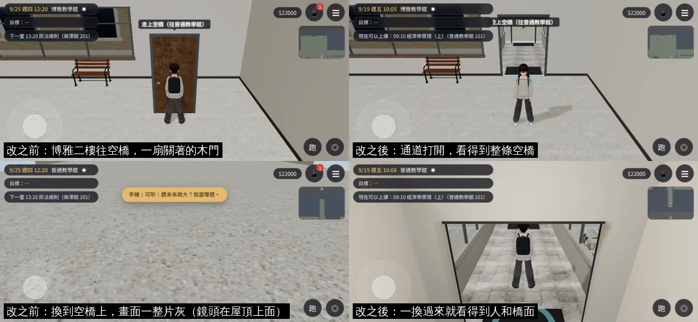
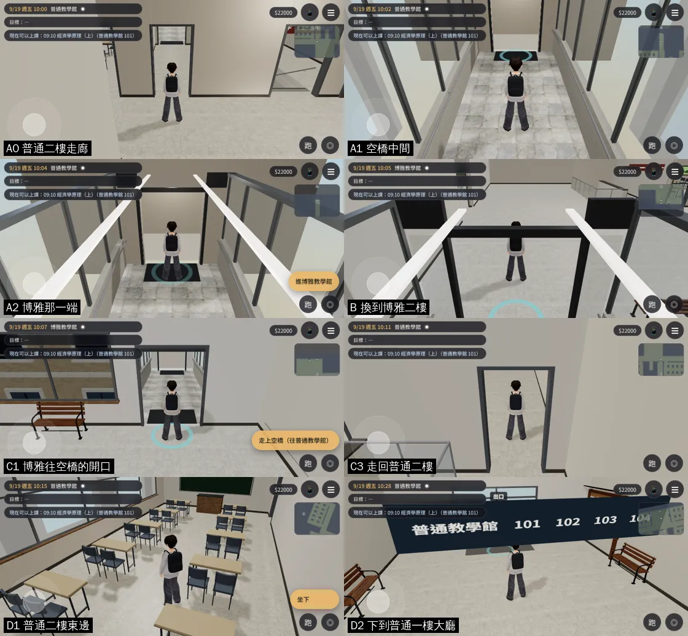

# BUG-BOYA-PUTONG-1020：博雅→普通的空橋要經過一扇門、到普通以後「被擋住」

LAWWW2-C，2026-10-20。
- 使用者 10-20 直接回報：
  - 「博雅走到普通的連通道還是有一個很醜的門欸不應該吧 而且走到普通之後被擋住無法到一樓或二樓其他地方」
  - 補充：「連通道可以走 只是要經過一個門 跟現實不符」
- 狀態：
  - **FIXED**（模型＋遊戲端 patch）；
  - 在開發分支 `0c20f632` 的測試工作樹套上，`tests/flow_skybridge.py` **ALL PASS**；
  - Playwright 手機模擬，不是 iPhone 實機；
  - 正式接線由 LAWWW-C 做。

## 原因
1. **木門**：`boya_interior.glb`、`putong_interior.glb` 是 10-18 用舊的配置建的。
   - 舊的 `boya_layout.js`、`putong_layout.js` 裡，往空橋那一間是 `kind: 'closed'`（關著的房間：模型會做門板）；
   - 博雅南牆也還沒有往空橋的開口；
   - 後來配置改成 `passage`＋`linkDoor`，模型沒有重建。
   - 所以站在博雅二樓走廊往南看，是一扇關著的木門，按門口的按鈕才換到空橋。
2. **「被擋住」**：從博雅換到普通的空橋上時，鏡頭跟在人物後面、比空橋的天花板高。
   - `skybridge.glb` 的天花板、屋頂是雙面的；
   - `teach3d.js` 博雅那一端門廳的天花板是一個方盒；
   - 從上面看是一整片灰，人物、橋面、普通的門都看不到。
   - 導航本身是通的（`E.simWalk` 走得到普通二樓東邊、一樓大廳），但玩家看不到路。

## 改了什麼
| 檔案 | 誰的 | 改了什麼 |
|---|---|---|
| `assets/models/env/second_ai/boya_interior.glb`、`putong_interior.glb`（＋`.json`） | LAWWW2 | 用開發分支現在的配置重建（`tools/blender/env_second/teach_interior.py --set boya｜putong`）： - 往空橋的通道沒有門板； - 博雅南牆、普通北牆開口＋門框。 三角形：博雅 11,384、普通 9,316 |
| `assets/models/env/second_ai/skybridge.glb` | LAWWW2 | 天花板只剩朝下的一面、屋頂沒有頂面，材質改單面（`tools/blender/env_second/skybridge.py`）。 從下面、從橋裡看一樣；鏡頭在上面時看得穿。 從校園地面看不到屋頂頂面，校園的空橋外觀不受影響 |
| `src/teach3d.js` | **LAWWW-C**（patch） | ① `buildLinkView`：博雅二樓往空橋的開口外面，放同一座 `skybridge.glb`（只看得到）。站在博雅往南看，就是整條空橋、盡頭是普通的門。 ② 空橋博雅那一端的門廳：天花板改成朝下的 plane |
| `tests/flow_skybridge.py` | 測試 | 加 C0、C2、D1、D2（下面） |

- patch：[`../../patches/skybridge_door_fix.diff`](../../patches/skybridge_door_fix.diff)（`teach3d.js`＋`flow_skybridge.py`），套在 `0c20f632`。
- 博雅、普通的室內配置（`src/data/*_layout.js`）沒有改：模型是照開發分支現在的配置建的。

## 測試（`tests/flow_skybridge.py`，套 patch 的 `0c20f632`，不用 turbo）
| # | 項目 | 修好的版本 | 有 bug 的版本 |
|---|---|---|---|
| A0–A2、B | 普通二樓 → 空橋 → 博雅那一端 → 換到博雅 | PASS | （原本就 PASS） |
| **C0** | 博雅二樓往南看：通道裡沒有門板，4 m 內沒有不透明的東西擋住 | PASS | **FAIL**（0.84 m 撞到 `L1_door`） |
| C1 | 博雅的開口：出現「走上空橋（往普通教學館）」 | PASS | PASS |
| **C2** | 落在空橋上時，鏡頭到人物頭部沒有不透明的東西擋住 | PASS | **FAIL**（鏡頭前 0.2 m 就被擋住） |
| C3 | 自己走過整條空橋回到普通二樓走廊 | PASS | — |
| **D1** | 走到普通二樓東邊的走廊 | PASS | — |
| **D2** | 走樓梯下到普通一樓大廳 | PASS | — |
| | 卡住保險 0 次、沒有 JS 例外 | PASS | — |

- 有 bug 的版本是用同一組檢查、讀檔直接量的（C0、C2），沒有整支流程重跑。

## 還沒做、已知
- 換區域照舊在開口那裡（按「走上空橋」）。開口外面的空橋是看得到的模型，不是同一個區域，玩家不能從博雅直接走上去。
- 換過來以後，鏡頭頭一下在門廳裡面，看得到門框的邊。
- 美術：READY_FOR_ART_REVIEW；iPhone 實機沒測過。
