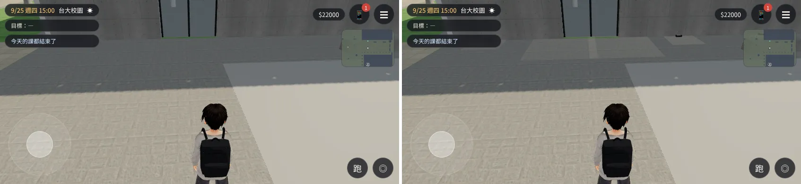
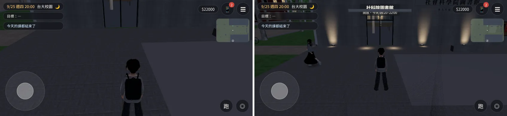
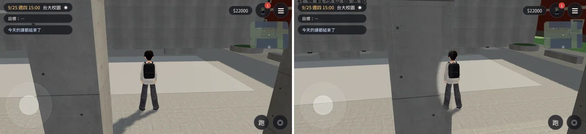
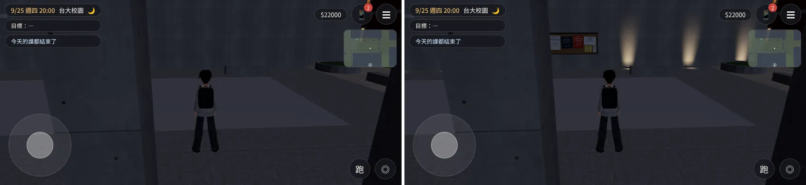
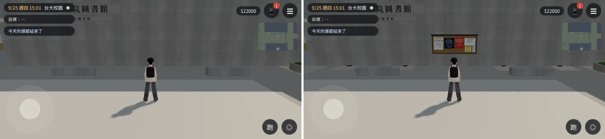
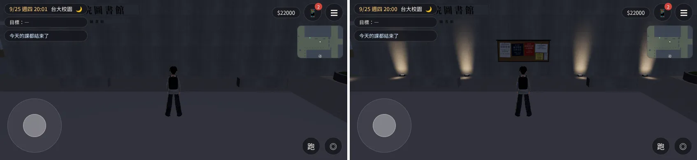

# SOC-COURT-1021 社科院中庭：夜間光＋院系公告欄——**已交件**（帳號 A 的 LAWWW2，2026-10-21 15:5x UTC）

> 狀態：`READY_FOR_ART_REVIEW`（場景美術只有使用者能標 ART_APPROVED）。交給 LAWWW 整合；資料夾名稱保留 `_wip`（C 的交接文件都指到這裡）。

## 交件內容與接法（LAWWW）
1. 換兩個檔：`assets/models/env/second_ai/campus_socsci.glb`、`campus_socsci.json`（這個分支的交件 commit）。
2. 套 `../../patches/soc_court_wire.diff`（＝`soc_court_wire_wip.diff`，同一個內容）：`zones3d.js` 的 `ck_bell_wash` 加 `mt.fog=false`。在開發分支 `5845667e` 上 `git apply` 乾淨。
3. 跑 `node tests/socsci_place_unit.js`、`node tests/nav_soclib_unit.js`——我在 `5845667e`＋新 GLB＋patch 跑過：**兩支 ALL PASS**。

## 這一班（帳號 A）做的
- C 交班時「還沒做完」的 1～3 都做完了：
  - 洗牆光離牆 3 cm，和招牌不再同一個平面。
  - 圖書館門洞兩側的白牆拿掉：和清水混凝土門洞內側同一個平面，原本會閃；白牆整片在混凝土那片裡面，拿掉不會破洞。
  - 重新匯出、疊面檢查、單元測試、同角度前後截圖都做了。
- 數字：三角形 14,014 → **14,140**、材質 13 → **15**、998,728 → **1,054,760 bytes**。
- 疊面檢查（`check_coplanar.py`）：
  - 「一定會閃」6 對 → 12 對。
  - 少了門洞那 4 對（0.23＋0.105 m² × 2）。
  - 多出的 10 對全是地上的光圈互相重疊（`ck_bell_wash`：加法混合、不寫深度，不會閃）。
  - 剩下 2 對各 0.014 m² 是原本就有的（x 95、z −84.7 的牆角，玩家看不到）。

## 遊戲內前後截圖（Playwright 手機橫向 844×390，不是 iPhone；左：開發分支 `5845667e`，右：這版；`patrol_campus.py` 同位置同鏡頭）
| | 15:00 | 20:00 |
|---|---|---|
| 圖書館門口 |  |  |
| 中庭往南 |  |  |
| 公告欄 |  |  |

- **玩家看到的差別**：
  - 晚上中庭不再一片黑：圖書館那面牆有一盞盞暖色洗牆光往上淡出，雨遮下面、柱廊地上有光圈。
  - 白天多了院系公告欄，牆面不再只有一塊招牌。
  - 白天看不到光圈、洗牆光，也沒有多出來的影子。
- **自評（還不到參考品質的地方，之後巡場景再處理）**：
  - 公告欄晚上沒有自己的燈，看得到但偏暗。
  - 光和光之間的地面還是很暗。
  - 牆上「社會科學院圖書館」大字晚上照不到。
  - 洗牆光的光錐偏「舞台感」。
  - 都不影響交件；記進巡場景清單。
- 第 1 組 20:00 的前圖鏡頭比較近：截圖當下鏡頭還在拉遠（兩版的鏡頭碰撞資料相同）。

---

# SOC-COURT-1021 社科院中庭：夜間光＋院系公告欄（**WIP，沒有交**；交班時停在這裡，2026-10-21 14:5x）

- 起因：巡場景第 1 區校園（`../../ART_DIRECTOR_PATROL.md` 第 1 節）：晚上中庭和柱廊一片黑；白天朝中庭的圖書館牆只有一塊招牌。
- **腳本已改（`tools/blender/env_second/campus_socsci.py` 第 ④ 段），GLB 沒換**：repo 裡的 `campus_socsci.glb`／`.json` 還是已交件的柱子版（`8e8d130e`）。要看新版就重跑腳本：
  `/opt/blenv/bin/python tools/blender/env_second/campus_socsci.py`（會重寫 GLB、json、`textures/gen/soc_wash.png`、`soc_posters.png`）。
- 加了什麼（都不動導航；json 的導航、鏡頭碰撞、門和柱子版完全一樣）：
  - 柱廊 10 盞嵌燈、圖書館門口雨遮 2 盞底下的地面光圈；
  - 圖書館朝中庭那面牆：牆腳 6 盞洗牆地燈＋牆面由下往上淡出的暖光；
  - 院系公告欄（鋁框＋軟木板＋虛構的活動海報；D77：沒有真實的社團、廠商名稱，沒有電話；日期不寫星期幾）。
  - 光用 `ck_bell_wash` 材質（傅鐘的柱面暖光同一套：遊戲改成加法混合、晚上 0.75、白天 0）。
  - 數字（交班前最後一次匯出）：三角形 14,014 → 14,144、材質 13 → 15、998 KB → 1,055 KB。
- 遊戲端一行 patch：`../../patches/soc_court_wire_wip.diff`（`zones3d.js` 的 `ck_bell_wash` 加 `mt.fog=false`：加法材質吃霧會在遠處多出一塊塊亮斑；傅鐘一起受惠）。套在開發分支 `96af1e54`。
- 截圖（Playwright 手機模擬，不是 iPhone；上：開發分支，下：這版；交班前一版，洗牆光還離牆 12 mm）：
  - 白天：`day_before_after.webp`（光圈、洗牆光白天看不到，沒有多出影子；看得到公告欄）
  - 晚上 20:00：`night_before_after.webp`（牆面一道道洗牆光、柱廊地上有光圈）

## 還沒做完（下一班從這裡接）
1. **洗牆光和牆上的招牌同一個平面**（都離牆 12 mm）→ 腳本已改成 3 cm（`zw = LZ1 + 0.03`），**還沒重新匯出、還沒跑疊面檢查**。
2. 原本就有的疊面：圖書館門洞兩側，清水混凝土門框側面和室內白牆轉角（`soc_misc` 的 `for s_ in (dx0, dx1)` 那一行）重複，0.23＋0.105 m² × 2。打算拿掉白牆那兩片（門框側面已經蓋住）；**還沒改**。
3. 重新匯出 → `check_coplanar.py` 只剩光圈互相重疊（加法、不寫深度，不會閃）→ `socsci_place_unit.js`、`nav_soclib_unit.js` → 同角度前後截圖 → 交 LAWWW-C（換 GLB＋json＋這個 patch）。
4. 可選：中庭東端的樹穴（「可以在中間種樹」）現在沒有樹；種樹要 `zones3d.js` 加一棵 `TK.tree`（世界座標約 (−10.8, −66.4)），LAWWW-C 決定。
