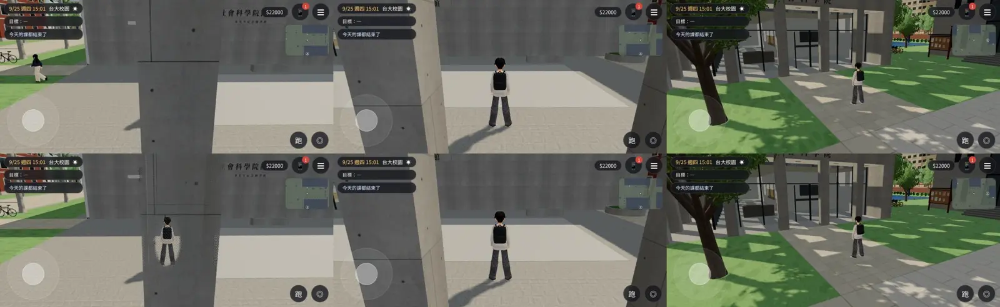

# 社科院一樓柱廊：柱子擋住玩家時網點透空（巡場景第 1 區校園 P1）

LAWWW2-C，2026-10-21。
- 起因：巡場景（使用者 10-21 12:0x 美術總監指示，`ART-DIRECTOR-LAWWW2`；經濟系的系辦在社科院，D99 第①項先看）。
- 毛病：社科院大樓一樓北面、東面的柱廊（0.6 × 0.6 m、14 根）。鏡頭跟在玩家後面走進柱廊時，柱子擋在鏡頭和玩家中間，**整個人看不見**（從大樓北門出來往圖書館走、從中庭往南走）。
- 環境：Playwright 手機模擬（橫向 844×390）、SwiftShader。**不是 iPhone 實機**。

## 改了什麼
- `tools/blender/env_second/campus_socsci.py`：
  - 14 根柱子從 `soc_concrete` 換成新材質 `wz_pillar_soc`；
  - 貼圖、粗糙度、法線和 `soc_concrete` 完全一樣，外觀不變。
- 遊戲端**不用改**：`zones3d.js` 的 `attachWenzhouModel` 本來就會把 `wz_pillar_*` 材質設成「擋住玩家時網點透空」（騎樓柱子、共同教學館前的蒲葵同一套）。
- GLB：三角形 14,014 → 14,014（不變），材質 12 → 13，物件 15 → 16，997,560 → 998,728 bytes。
- `campus_socsci.json` 的導航、鏡頭碰撞、門的資料**完全不變**（`socsci_layout.js` 不用重產）；只有物件數、材質數、檔案大小那幾行變了。

## 狀態
| 項目 | 狀態 |
|---|---|
| `campus_socsci.glb` | MODEL_READY（commit `8e8d130e`） |
| 接進遊戲 | 只要換 GLB＋json 兩個檔；在我的測試工作樹（開發分支 `96af1e54`＋新 GLB）INTEGRATED |
| 測試（Node／Playwright 手機模擬） | `socsci_place_unit.js` ALL PASS、`nav_soclib_unit.js` ALL PASS；截圖沒有 JS 例外 |
| 美術 | READY_FOR_ART_REVIEW（場景美術只有使用者能標 ART_APPROVED） |

## 截圖（9/25 週四 15:00，玩家跟隨鏡頭；上：開發分支 `96af1e54`；下：這次）
1. 大樓北門外往圖書館看（鏡頭在柱廊裡）：上面看不到人，下面柱子在人周圍網點透空；
2. 中庭往南：沒有柱子擋，兩張一樣；
3. 大樓東面正門外：兩張一樣。

## 已知、還沒做
- 透空只在跟隨鏡頭、柱子擋住玩家時才有；劇情運鏡不受影響。
- 同一區巡場景找到的其他毛病（中庭朝圖書館那一面是整片實牆、榕樹氣根是黑線）在 `../../ART_DIRECTOR_PATROL.md` 第 1 節，沒有放進這次。
- iPhone 實機沒有測過。
