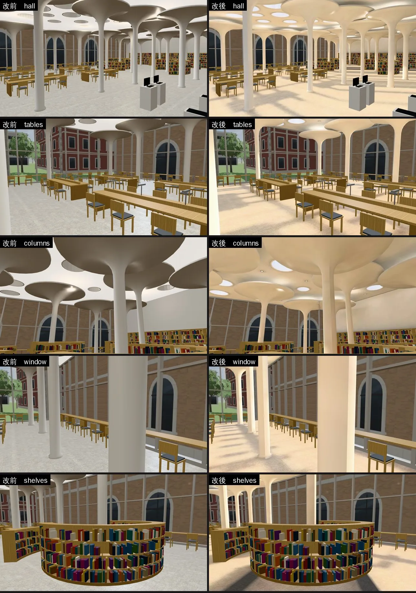
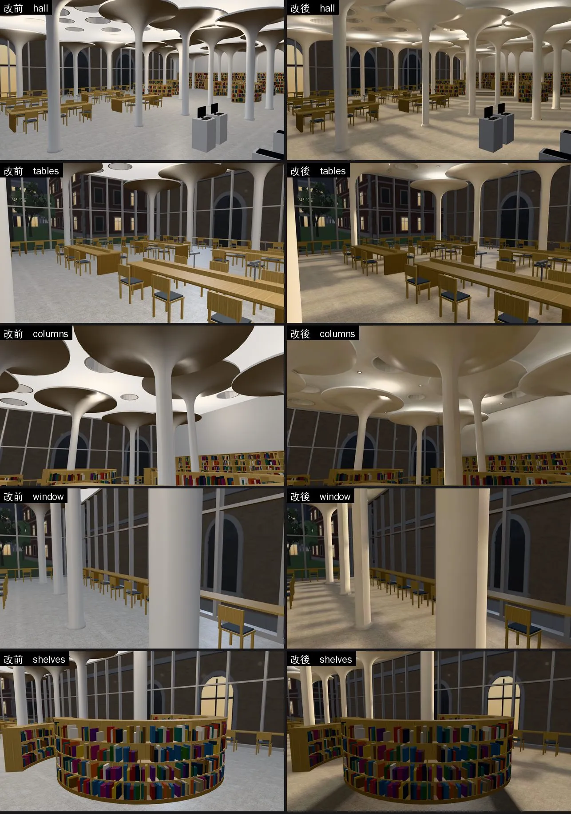

# 社科院圖書館（辜先生紀念圖書館一樓開架閱覽室）：燈具＋光照烘焙（SOCLIB-LM-1030；LAWWW2-B 2026-10-30）

- **起因**：
  - LAWWW-B 10-30 派工：D99 第一優先＝經濟系那一年，這裡是經濟系那一年念書的地方，法律系以後也會在這裡遇到經濟系朋友。
  - `INTERIOR_AAA_REVIEW_1028.md` 第 5 節：P1 光照＋P5 燈具。
- **狀態**：`READY_FOR_ART_REVIEW`。建築、場景的 `ART_APPROVED` 只有使用者能標。
- **截圖條件**：
  - 遊戲內固定鏡頭（藏玩家、NPC），1280×720。
  - Playwright＋SwiftShader 模擬，**不是 iPhone 實機**。讀檔放位置是 [捷徑]。
  - 改前＝開發 `753e32cd3` 原樣；改後＝開發 `753e32cd3`＋這一包。

## 一、交付

| 檔案 | 內容 |
|---|---|
| `assets/models/env/second_ai/soclib_interior.glb` | 新增燈具（荷葉上照燈帶、天花板小筒燈）；多一套 UV（TEXCOORD_1）、`extras.lightmap`。5.72 → 7.08 MB |
| `assets/models/env/second_ai/soclib_interior_lm_day.webp`、`_night.webp` | 光照貼圖 1024，151 KB＋117 KB |
| `assets/models/env/second_ai/soclib_interior.json` | 統計（三角形 89,756 → 91,256）＋燈的位置（`lights`） |
| `tools/blender/env_second/soclib_interior.py` | 產生器：加燈具，燈位寫進統計 JSON |
| `tools/blender/env_second/lightbake/bake_soclib.sh`、`soclib_interior_lm.json` | 建模＋烘焙＋WebP（512 取樣）、這次的參數紀錄 |
| `tools/blender/env_second/lightbake/bake_room.py` | `--points` 可以多給第 8 個數＝光源半徑（預設照舊 0.06 m，其他房間不受影響）；**`collapse_black` 改成看整面**（第二節第 3 點） |
| `docs/art-rebuild/second_ai/patches/soclib_lm_test_1030.patch` | **要套**：`tests/singleside_interiors_unit.js`（第二節第 4 點）。對開發 `753e32cd3`，`git apply --check` 通過 |
| `tools/blender/env_second/lightbake/lm_squash_scan.py` | 新：掃烘焙好的 GLB，找光照被壓扁、朝室內看得到的大面（不用 Blender） |
| `tools/blender/env_second/shots/soclib_lm_shots.py`、`interior_perf.py` | 截圖鏡頭、效能量測（通用版） |

- **不用改程式**：
  - `soclib3d.js` 用 `Z3.attachRoomGLB` 接正式模型，看到 `extras.lightmap` 就接，和 Café 同一套。
  - 天窗只在白天那一張發光（`dayEmit`），晚上由 `Z3.roomLightmap` 調暗（RT-NIGHT-1028）。
- **配置、座位、導航**：都不動。
- **要套的只有測試 patch**（二進位換掉＋套 patch；程式不用改）。

## 二、改了什麼

### 1. 燈具（原本天花板上沒有燈）

- **原本**：
  - 晚上只有遊戲的 8 盞即時點光源，整間一樣亮，看不出光從哪裡來。
  - 白天天窗和玻璃帷幕也沒有進光的感覺。
- **荷葉上照燈（20 圈）**：
  - 每片荷葉頂面一圈暖白燈帶，從下面看不到燈。
  - 晚上天花板在每片荷葉上方亮一圈，像一片片發亮的樹冠。
- **天花板小筒燈（18 盞）**：
  - 3 m 一格，避開天窗、荷葉上方、牆邊。
  - 從下面看是一個個小亮點，閱覽桌、走道上一圈光。
- **閱覽長桌的檯燈（12 盞，原本就有）**：烘焙時燈頭下面加小面光源，桌面上一圈暖光。

### 2. 光照烘焙（512 取樣）

- **白天**：
  - 天光＋下午的太陽（方位 200°）從西面、北面兩整面玻璃帷幕進來，地上有窗框的影子。
  - 圓形天窗發光（只在白天那一張）。
  - 白天燈照樣開（圖書館）。
- **晚上**：燈具＋檯燈；荷葉上方的天花板亮、荷葉底下和柱子之間暗。
- **照舊即時光**：竹書架、長桌、椅子、書（幾千本）、金屬、白色小零件、窗框、發光面、螢幕、招牌板面。
- **試烘焙（64 取樣，兩次）**：
  - 第一次：天光 0.6、太陽 2.0、天窗 1.0。兩整面 5.6 m 高的玻璃帷幕讓白天平均亮度 1.73（其他室內約 0.2），遊戲裡整片過曝。
  - 第二次：天光 0.12、太陽 0.9、天窗 0.4，白天平均 0.48；晚上偏咖啡色，白平衡調冷。
  - 正式版：白天 0.48、晚上 0.16。

### 3. 烘焙工具的 bug：大的面整面被當成「全黑」（第一次正式烘焙後找到，已重烘）

- **看到的**：第一次正式烘焙（`07d99d960` 檢查點）的入口鏡頭，地板右半邊一整片平平的米色，沒有柱子的影子。
- **原因**：`bake_room.py` 烘完以後，會把「夾在零件中間、烘成全黑」的面收成一點（男一舍門框上方那種點狀黑線的修法）。
  - 原本只看面的中心那一個像素。
  - 地板是兩個大三角形（各 330 m²），其中一個的中心剛好在閱覽桌、書架底下（被擋住、黑的），整個三角形被收掉。
  - 後處理 `lm_fix_hidden.py` 再把它接到共用的那條邊（對角線）上：那一半地板的光，變成對角線那一條光往旁邊拉開。
  - 博思 101、102 講台那面牆也是同一個原因（BB-B n19「講台前一塊深藍色的影子」，見 `boya_lm_1030/README.md` 第六節）。
- **改法**：判斷「全黑」改成看整面（中心、角、邊的中點，大的面再加一張格子，取最亮的），和 `lm_fix_hidden.py` 判斷全黑的方法一樣。
- **結果**：
  - 被收掉的面 934 → 878（少的 56 面是看得到、被誤收的）。
  - `lm_squash_scan.py`：朝室內、看得到、光照被壓扁的大面 **330 m²（地板）→ 0**。
  - 光照貼圖本身完全一樣（烘焙的結果沒變，只改烘完以後怎麼接）。
- **其他已經交的房間也有這個問題**（`lm_squash_scan.py` 掃開發分支 753e32cd3，朝室內、看得到的）：

| 房間 | 被壓扁的面積 | 最大的幾面 |
|---|---|---|
| 法律學院圖書館 | 91 m² | 一樓、二樓東牆（各 28 m²）、一樓兩道隔間牆 |
| 總圖大廳 | 83 m² | 二樓樓板底面 31 m²、一樓灰泥牆兩面各 20 m² |
| 宿舍四人房 | 21 m² | 左右兩面牆各 10.5 m² |
| 法律系館A 201 | 6 m² | 西牆下面兩小塊 |
| Café、霖澤館大廳、202、宿舍大廳、萬才館、萬才館多功能教室 | 0 | — |

  - 只要用新的 `bake_room.py` 重烘就會好（每間 20～40 分鐘、模型和貼圖大小不變）。排不排、什麼時候排，等 LAWWW-B 決定。

### 4. 測試：天井、招牌板面（`tests/singleside_interiors_unit.js`）

- **全部 Node 第一次跑 771 過、1 FAIL**：這支的第 2 項「開口的零件有反面」，社科圖天井 0／2912。
  - 不是畫錯：有光照貼圖的物件，烘焙前本來就拿掉反面（`drop_backfaces`：反面的光照是黑的；總圖大廳的樓梯踏面也是這樣從這一項拿掉的）。
  - 量過留下來的是看得到的那一面：井壁朝井裡 1,456 個三角形、朝外 0；井口收邊朝下 1,456、朝上 0。
  - 拿掉的是朝外、朝上的那一面，在天花板上面，看不到。
- **patch**：天井從第 2 項拿出來，新的第 2b 項檢查「沒有反面、留下來的是看得到的那一面」——拿錯一面（從下面看天窗整圈井壁不見）會 FAIL。
  - 開發分支原樣（還沒烘焙、有反面）第 2b 項 FAIL；這一包 PASS。
- **招牌板面**（`soclib_sign_face`）：重匯以後變成雙面。
  - 原因：lib2 10-27 起「只有 skip 物件在用的材質照舊雙面」。
  - 10-25 交的是單面（板面朝閱覽室，從室內看）。照舊單面：`soclib_interior.py` 加一行。第 1 項「除了玻璃都單面」PASS。

## 三、改前改後（同鏡頭；左＝改前、右＝改後）

五個鏡頭：
- 入口往東北看整個閱覽室；
- 閱覽長桌；
- 荷葉柱、天窗（往上看）；
- 北面窗邊長桌；
- 弧形書架。

- **白天**：
  - 西面玻璃帷幕的陽光在地上打出一格一格的窗框影子；荷葉底下、書架旁邊暗。
  - 天窗是亮的；看得到天花板上的筒燈。
  - 原本整間一樣亮、荷葉底下是一片灰。
- **晚上**：
  - 荷葉上方的天花板亮一圈，筒燈在地上一圈一圈的光，柱子有影子。
  - 原本晚上和白天差不多，只是整片暗一點。
- **色溫**：
  - 比改前暖一點：地板從淺灰變成暖白，暖色燈和竹家具、地板的反光造成的。
  - 光照貼圖的色溫和法律學院圖書館一樣（紅 1.08、藍 0.91）。

## 四、測試、效能

- **效能**（`interior_perf.py`，玩家鏡頭，前、左、右、後四個方向，14:00）：SwiftShader 量的，**手機實機沒有量**。

| 位置 | draw call（改前 → 改後） | 三角形（改前 → 改後） |
|---|---|---|
| 入口 | 100／71／103／86 → 102／70／88／72 | 23.6／17.2／23.4／21.5 萬 → 23.4／16.4／18.3／16.4 萬 |
| 閱覽長桌 | 130／119／95／138 → 132／121／97／106 | 34.7／31.2／24.1／33.6 萬 → 34.6／31.0／23.9／24.0 萬 |
| 荷葉柱 | 63／79／79／72 → 63／79／60／75 | 17.7／17.8／23.5／17.8 萬 → 16.9／17.0／16.3／17.6 萬 |
| 北面窗邊 | 90／95／115／109 → 93／98／118／103 | 23.5／26.7／27.4／29.9 萬 → 23.4／26.6／27.2／27.2 萬 |

- draw call 差不多（±3；有兩個方向少 15～30）；三角形差不多或變少（烘焙工具收掉看不到的面）。
- 檔案 5.72 → 7.08 MB：荷葉柱（2 萬三角形的曲面）多一套光照貼圖 UV。

## 五、還沒做到的

- 人物、家具、書照即時光：晚上人物、桌子會比旁邊的地板亮一點（和其他烘焙過的室內一樣）。
- 烘焙的太陽不會動：白天都是下午的位置。
- 荷葉上照燈只在光照貼圖裡；遊戲的 8 盞即時燈照舊在原本的位置。
- 生活感擺設（檢討報告 P4）這一輪沒做。
