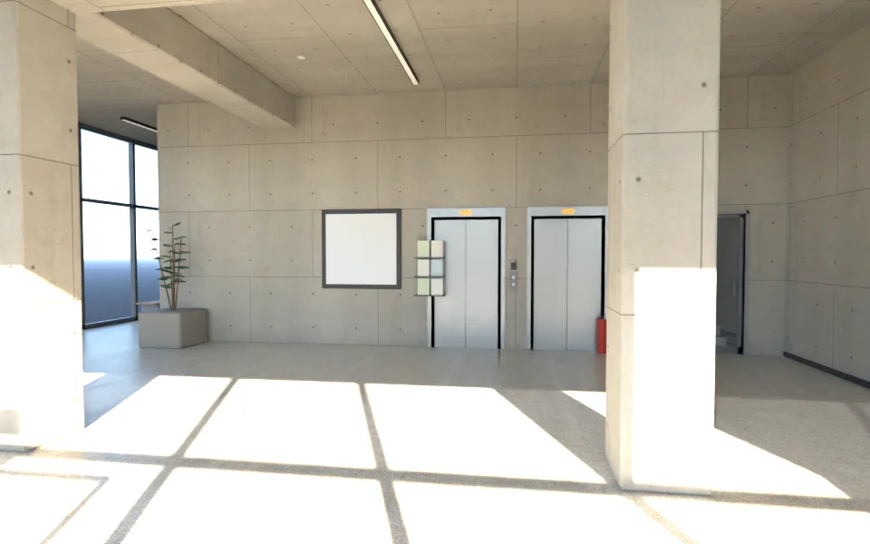
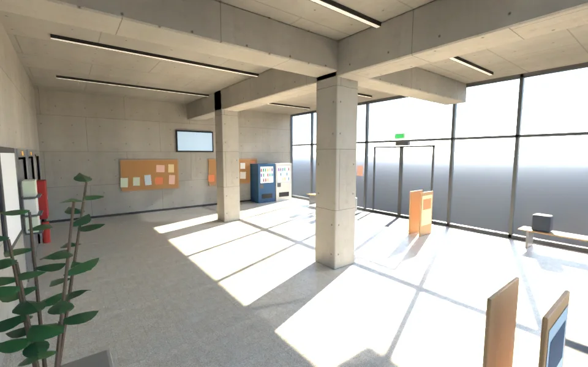
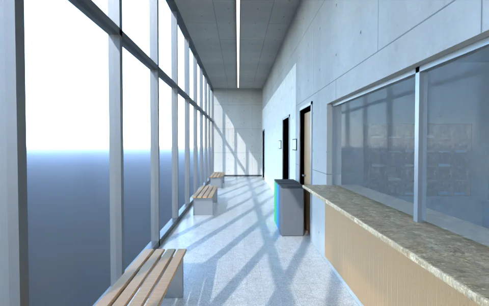
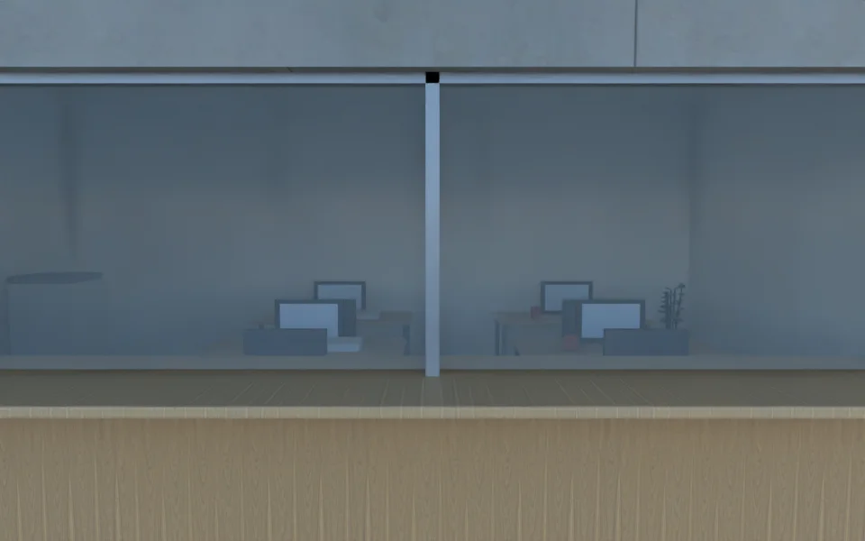
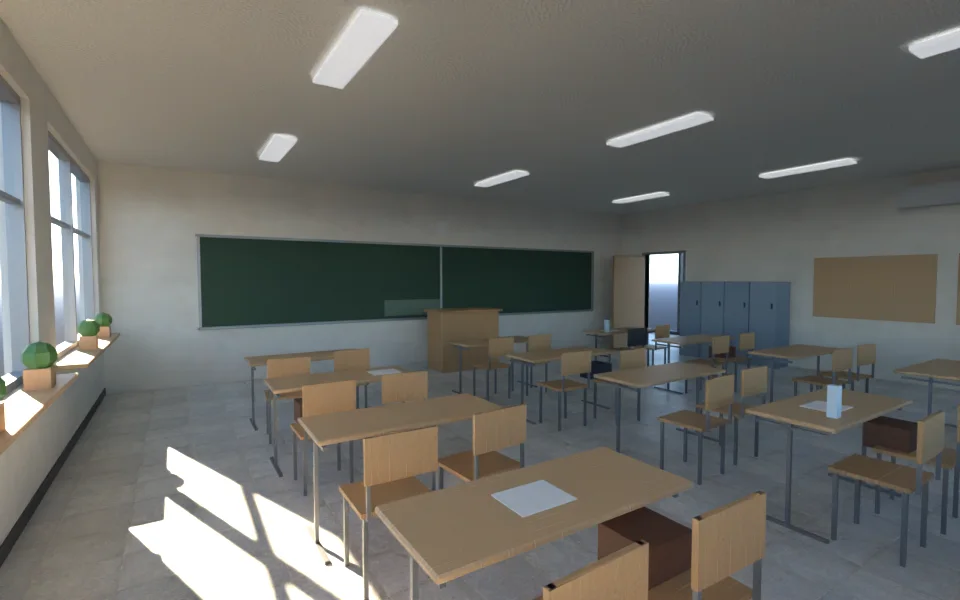
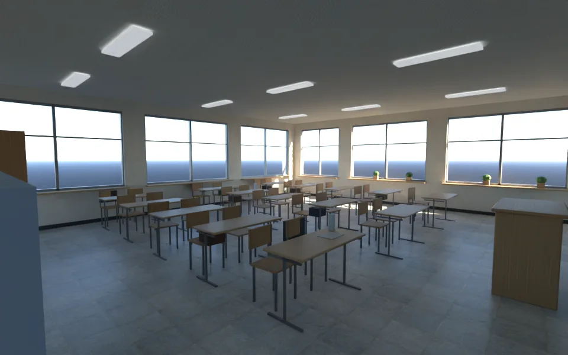

# SCN-V0-01 社會科學院大樓 一樓室內（LAWWW2-C 2026-10-17；狀態 MODEL_READY → READY_FOR_ART_REVIEW）

SOCSCI_PLAN 第 3 節第③步（大樓室內）。經濟系那一年第 1 週起用（迎新、系辦、上課）。**房間的劇情用途（哪個事件、哪一週）等 AA-C 確認（D79）**；這一件只決定空間與美術。
場景美術的 `ART_APPROVED` 只有使用者能標（D38／D59）。

## 交件
- 模型：`assets/models/env/second_ai/socsci_bldg1f.glb`（1.44 MB、17,396 三角形、69 個物件、31 個材質；合併後的 draw call 估計 60～70）。
- 配置（遊戲和 Blender 共用）：`assets/models/env/second_ai/socsci_bldg1f.layout.json`（`tools/blender/env_second/socbldg_layout_gen.py` 產生，有自我檢查：出生點、互動點不在家具或封閉房間裡、座位不在家具裡）。
- 腳本：`python3 tools/blender/env_second/socbldg_layout_gen.py` → `/opt/blenv/bin/python tools/blender/env_second/socbldg_interior.py`。
- 座標：區域座標，原點＝大樓中心；世界＝(110＋x, −50＋z)（campus_socsci.py 的大樓 x 95–125、z −58～−42）。

## 空間（layout.json）
| 區 | 範圍 | 說明 |
|---|---|---|
| 大廳 | x −12.6～−2.2、z −5.6～7.8 | 西、北兩面玻璃帷幕（外面是一樓退縮的柱廊）；西面主入口、北面次入口＝**自動門（關著，出口互動點在門前）**；兩根倒角清水混凝土柱 |
| 電梯＋樓梯核心 | x −2.2～2.4、z 1.6～7.8 | 兩部電梯（髮絲紋門、呼叫按鈕、樓層顯示、**刷卡機：2F 以上按不亮**）；樓梯間玻璃門關著＋刷卡機，**門後看得到樓梯往上**（D36：看得懂的「關著」，不是隱形牆、也不是假樓梯） |
| 北側走廊 | x −2.2～14.8、z −5.6～−3.0 | 沿北面玻璃，三張長椅、資源回收桶 |
| 經濟學系辦公室 | x −2.2～5.2、z −3.0～1.6 | 職員區、不能進去；走廊這邊是**木作櫃台＋玻璃窗口**（互動點 `counter`）；裡面四張辦公桌、螢幕、公文、信箱格、影印機、盆栽（對應 2D `soc_office`） |
| 101 教室 | x 5.2～14.8、z −3.0～7.8 | 東、南兩面外牆開窗；黑板、講桌、兩人一桌 15 張＋30 張椅子（座位 30 個）、置物櫃、北牆軟木公告板、冷氣、時鐘（對應 2D `soc_classroom`） |

- **出口**：`entrances`（west：世界 (95.6, −48.8)、往法學院廣場；north：世界 (102.4, −56.8)、往中庭），每個有 `spawn`（進來站的位置）。
- **互動點**：`interact`（系辦櫃台、樓層指引、公告欄、電梯、樓梯間）。電梯、樓梯間的文字照萬才館電梯的做法（「2F 以上請刷卡」）。
- **座位**：`seats`（大廳長椅 6、走廊長椅 9、教室 30）。
- **遊戲要找的節點**：`PLATE_FACE_dir`（樓層指引，字由遊戲畫）、`PLATE_FACE_101`、`PLATE_FACE_office`（門牌）；`DOOR_*`、`ELEV_*`；會淡出的牆 `WALL_<id>_*`（鏡頭擋到時淡出）；發光材質 `GLOW_*`（燈、出口燈、販賣機、資訊螢幕、電梯樓層顯示：晚上由遊戲調亮度）。

## 圖（Blender Cycles，Standard、曝光 −1；**不是遊戲內截圖**——遊戲內截圖要等 LAWWW 接成區域）
大廳（主入口往電梯看；第二版加了傳單架、滅火器、消防栓箱、出口燈）：

大廳全景（資訊螢幕、公告欄、販賣機、立牌、傘架、長椅）：

北側走廊：

系辦櫃台（Cycles 只有燈管的光，比遊戲暗；遊戲的室內光由遊戲打）：

101 教室（從後門看黑板／從前門看後面）：

2D 參考（同一個空間的事件背景）：`ref2d_soc_office.webp`、`ref2d_soc_classroom.webp`。

### 版本（自己退件的）
- 第一版（`v1_lobby_in.webp`、`v1_class_back.webp`）：大廳空得像樣品屋（ART_SOP 退件理由 3）、教室黑白棋盤格地磚、桌面像粒片板、公告板和置物櫃擋到窗、漆牆灰灰髒髒。
- 第二版：系辦白牆內襯和牆面同一平面（疊面閃爍）、桌面木紋拉長像稻草。
- 第三版（這一版）：上面都改掉；同材質合併（111 → 16 個物件）。

## 八項（ART_SOP 3-2）
| 項目 | 結果 | 說明 |
|---|---|---|
| 輪廓與倒角 | 通過 | 柱子、櫃台、桌面、講桌、門扇、長椅木條、販賣機、信箱都是倒角（`rbox`／`crbox`）；混凝土梁從天花板下來 |
| 材質 | 通過 | 清水混凝土＝大樓外觀同一張板模貼圖（`socsci_formwork`：分割線、螺栓孔）；水磨石（Poly Haven `terrazzo_tiles`）；教室漆牆 `white_plaster_02`、地磚 `large_floor_tiles_02`、木 `walnut_veneer`、軟木＝`granular_concrete` 調色；金屬度都 ≤0.45 |
| AO | 部分 | 牆腳深色踢腳線；家具腳、販賣機下緣用頂點色壓暗（ART_SOP 2-5 的 2）；沒有烘焙 AO |
| 磨損 | 部分 | 販賣機下緣、黑板上擦過的粉筆灰；地面沒有磨損 |
| 生活痕跡 | 通過 | 公告欄斜釘的海報（色塊、沒有字）、玻璃上貼的社團海報、立牌、傘架和傘、長椅上的背包紙杯傳單、教室椅子轉一點／拉出來、椅背的外套、椅子上的背包、桌上的講義和保特瓶、粉筆槽的粉筆 |
| 比例 | 通過 | 一樓樓高 4.4 m（教室天花板 3.3）、門 2.25 m、桌面 0.74、椅面 0.44～0.47、櫃台 1.05、黑板 0.9～2.3 |
| 效能 | 通過 | 17,396 三角形、69 物件、1.44 MB |
| 遊戲截圖 | **沒有** | 要等 LAWWW 接成區域；接好後我拍白天、晚上、手機直向 |

## 還沒做／已知
- 二樓以上不開放（照 SOCSCI_PLAN：研究室樓層刷卡）。
- 大講堂 `soc_hall`（開學典禮）只有 2D，沒有 3D。
- 教室窗外的景（窗景平面）要遊戲接：照 `W3.windowMat`，可以用 `tools/shots/window_views.py` 從社科院的位置拍。
