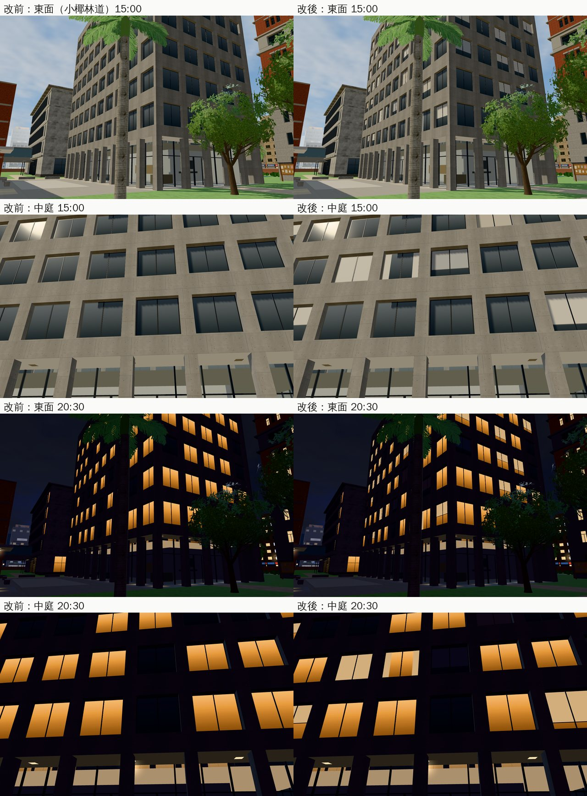

# 社科院大樓：窗戶加捲簾、布簾（清查 B9「大樓窗戶單調」；#61 ART-ECON-3D-GAP-1021）

- **來源**：
  - 清查 B9（`docs/handoff/audit_1018/LAWWW2_停住的工作.md`）：「新社科院夜景發白、窗戶單調」。夜景發白（蓮花柱）已經修了（7e84496c）。
  - 經濟系那一年每天經過社科院（D99 第一優先）。LAWWW-B 08:50：盤點完直接做。
- **做的人**：LAWWW2-B。
- **狀態**：`READY_FOR_ART_REVIEW`。場景美術的 `ART_APPROVED` 只有使用者能標。
- **沒有程式 patch**：只換 `assets/models/env/second_ai/campus_socsci.glb`（＋`campus_socsci.json` 的三角形數）。導航、鏡頭碰撞、門都沒變，`gen_socsci_layout.py --check` 照舊。

## 問題

8 層清水混凝土大樓，每一扇窗都是一樣的深色玻璃（白天）。

## 做了什麼

`tools/blender/env_second/campus_socsci.py` 的 `band()`：每一扇窗照一個雜湊值決定窗簾。

- **捲簾**：近五成的窗拉下捲簾。
  - 高度不一：拉下 22%～84%，少數拉到底；
  - 下緣一條深色壓條。
- **布簾**：約一成的窗兩側拉著布簾。
- **顏色**：
  - 沒亮燈的窗：白、米、淺灰、淺藍（頂點色，`soc_misc`）；
  - 亮燈的窗：用 `ck_glass_lit`（遊戲晚上會亮），亮著的房間拉下的簾子是透光的淺色。
- **深度**：簾子在玻璃前 2 cm、左右上縮在鋁框裡面。正面看不壓到框，直櫺在簾子前面，不和玻璃疊面。
- **沒有新的節點、材質**：只有 `soc_misc`、`soc_ceilL` 兩個網格多了面。
  - 14,140 → 14,616 個三角形；
  - 繪製呼叫照舊（遊戲內量：東面白天 240、中庭白天 176，改前改後一樣）。

## 模型的差別（照網格名稱比對）

- 先用沒改的腳本重新匯出：和現在的 `campus_socsci.glb` 一模一樣（18 個網格、0 個差別）。
- 改了以後：16 個不變，`soc_misc`、`soc_ceilL` 兩個變。
- **注意**：開發分支的 `campus_socsci.py` 是舊的。現在的 GLB（有中庭的洗牆燈 `ck_bell_wash`、公告欄 `soc_posters`、柱子 `wz_pillar_soc`）是我分支這一份腳本做的。整合的時候腳本請用我這一份。

## 截圖（遊戲內，Playwright＋SwiftShader；不是 iPhone 實機）

開發 `bcc821fe0`＋這個 GLB（測試樹），10/15（三）15:00、20:30。左邊改前、右邊改後。

## 測試

- `socsci_place_unit`、`nav_soclib_unit`、`nav_buildings_unit`、`room_ceiling_unit`、`campus_*`、`crowd_unit`、`classes_unit` 等：ALL PASS。
- 導航沒有改。

## 還沒做／已知

- 圖書館（玻璃帷幕）沒改：從外面看得到裡面的長桌和樹狀柱，本來就不單調。
- 窗戶裡面沒有室內（看不到桌子、人），只有簾子。
- 手機效能沒實測（多 476 個三角形）。
