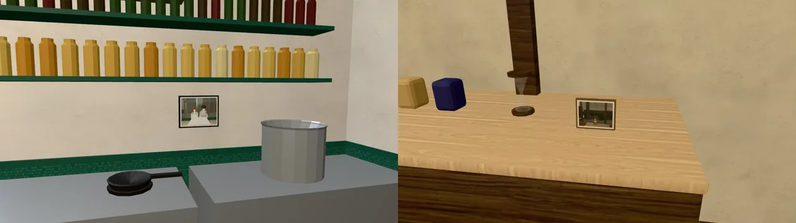
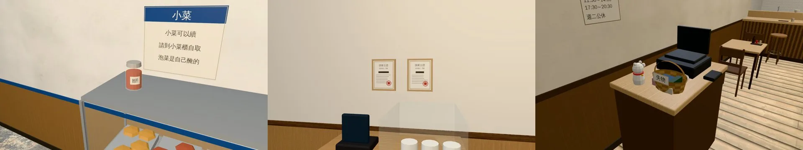
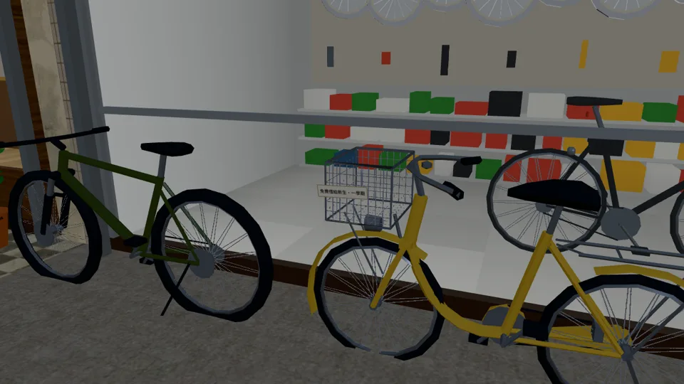
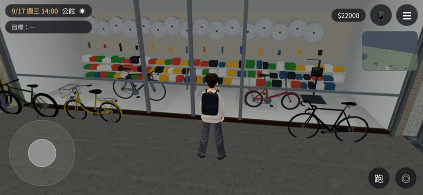
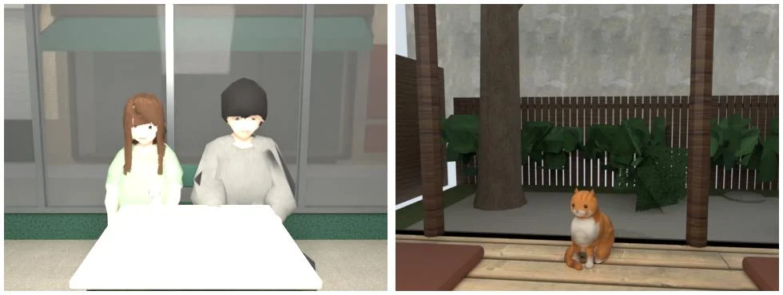

# SQ-TRACES-1023：店員支線做完以後店裡多的東西＋SQ16 輪轉單車的店門口

- **誰要的**：
  - 使用者 10-23 08:1x（店員要有支線）。
  - 企劃：AA_404（SQ10～SQ15）、AA_405（SQ16～SQ20），企劃線 `cool-heisenberg`。
  - LAWWW-B 10-23：
    - SQ16 輪轉單車要一個店門口互動點，和公館其他櫃台一樣。
    - 痕跡道具可選：茶屋貓照片、韓食「她的」玻璃罐、半熟兩張證書、定食失物籃、Pasta 118 吧檯照片。
- **做的人**：LAWWW2-B。
- **狀態**：`READY_FOR_ART_REVIEW`。場景美術的 `ART_APPROVED` 只有使用者能標。

## 做了什麼

| 支線 | 店 | 痕跡（AA 原文） | 做法 | 節點 |
|---|---|---|---|---|
| SQ12 | Pasta 118 | 吧檯後面的牆多一張照片（兩個人，後面是窗邊那一桌） | 開放式廚房後牆、大鍋左邊；32×25 cm 白邊黑框。照片在這間店的模型裡拍：路人坐姿替身兩位，坐在窗邊那一桌 | `TRACE_SQ12_photo_WALL_N` |
| SQ13 | 韓食小廚 | 小菜櫃多一個玻璃罐，貼著手寫的標籤「她的」 | 小菜櫃頂上靠北那一端（旁邊就是「泡菜是自己醃的」的告示）；泡菜罐＋標籤朝店裡 | `TRACE_SQ13_jar` |
| SQ14 | 一盞茶屋 | 茶屋櫃台多一張貓的照片，照片很舊，背景是茶屋的院子 | 水屋檯面上、沙漏旁邊，立著的木框照片。照片在茶屋模型的緣側拍：公園的貓坐姿、沒有項圈，背景是院子的樟樹和矮木牆；再做舊（褪色、偏黃、四角暗） | `TRACE_SQ14_catphoto` |
| SQ19 | 巷子裡定食 | 定食店的櫃台多一個小籃子，寫著「失物」 | 結帳台客人那一端（收銀機旁邊），竹籃（四圈深淺交錯＋提把）。裡面一本筆記本、一把摺傘、一個筆袋；前面插紙牌「失物」 | `TRACE_SQ19_basket` |
| SQ20 | 半熟早午餐 | 櫃台後面的牆上多兩張證書，並排掛著 | 結帳櫃台後面的東牆，A4 直式兩張、淺木框；名字那一行是一條粗字，遠看讀不出來 | `TRACE_SQ20_certs_WALL_E` |
| SQ16 | 輪轉單車（公館） | 車行門口那台車掛一張紙「免費借給新生，一學期」 | 騎樓那台黃色淑女車的前籃，掛一張紙「免費借給新生・一學期」，朝騎樓走道 | `TRACE_SQ16_note`（程式畫的，不在 GLB 裡） |

- **SQ16 店門口互動點**：
  - 位置 (−0.3, 21)，r 2.2，label「找車行老闆」，`shop:'bike'`。和麵店、茶行、書店、便利商店同一排、同一個距離。
  - `SIDEQ.bikeShop` 存在才顯示，不出一個按了沒反應的按鈕。
  - 店門口的三台車照舊停在門的兩側，門口 x −2.1～1.7 是空的。

## 怎麼接（`patches/sideq_shops_1023.patch`，只改 `src/zones3d.js`，對開發 `c42228351`）

- `traceVis(o, id)`：節點的 `visible` 改成 getter，`SIDEQ.traceOn(G, id)` 是 true 才顯示。
  - 每一格看：在店裡剛做完那一則，東西馬上出現。
  - setter 照舊能用（牆淡出的 `hideFaded` 會設 visible）。
- `attachRoomGLB`：正式模型裡名字是 `TRACE_SQxx…` 的節點都接上 `traceVis`。
  - 這樣五家店都不用各自改，以後別的店照同一個命名就會動。
- 掛在牆上的兩樣（SQ12、SQ20）名字裡有 `_WALL_N`／`_WALL_E`，也帶 `dir`。
  - 會跟著那面牆淡出：鏡頭退到牆外時，不會變成飄在空中的相框。
  - 相框和照片做成一張貼圖、一個材質，才是單一網格（牆淡出要單一材質）。
- 公館：
  - 「找車行老闆」的互動點。
  - SQ16 的紙條（`userData.dyn`：不參加整區合併）。
- **LAWWW-B 要接的**：
  - `SIDEQ.traceOn(G, 'SQ12')`：那一則做完、有痕跡的時候回傳 true。哪一則什麼時候算完成，照 AA_404／405 的「結果」。
  - `SIDEQ.bikeShop(GM)`：車行老闆的招呼、SQ16。
  - `story3d.js` 互動的分派加 `if(it.shop==='bike'&&SIDEQ.bikeShop){ await SIDEQ.bikeShop(GM); return true; }`。

## 模型（重建五個店的 GLB；只多了痕跡節點，其他和開發分支的一樣）

- 腳本：
  - `tools/blender/env_second/aa_support/sq_traces.py`（做道具）。
  - `aa_support/sq_trace_photos.py`（在店的模型裡拍照片：Cycles）。
  - 五個店腳本加一行呼叫，合併時 `TRACE_` 不合併。
- 先用原本的腳本、不加痕跡重建一次：五個 GLB 和 repo 裡的位元組數完全相同，確認腳本沒有漂移。

| GLB | 大小 | 三角形 | 痕跡顯示時多的 draw call |
|---|---|---|---|
| `l118_pasta.glb` | 1,507,212 → 1,518,072 | 17,412 → 17,424 | 1 |
| `l118_korea.glb` | 1,459,672 → 1,475,252 | 15,594 → 15,758 | 4（玻璃、泡菜、蓋子、標籤） |
| `wz_teahouse_interior.glb` | 1,676,436 → 1,691,244 | 14,162 → 14,178 | 1 |
| `wz_brunch_interior.glb` | 1,018,688 → 1,031,500 | 17,958 → 17,982 | 1 |
| `wz_teishoku_interior.glb` | 1,588,976 → 1,613,012 | 19,488 → 19,724 | 6（籃子兩色、筆記本、傘、筆袋、紙牌） |

- 沒做完支線的時候這些節點不畫，畫面上的量和原本一樣。

## 遊戲內畫面

- 測試環境：Playwright＋SwiftShader，1280×720，**不是 iPhone**。
- 【捷徑】`SIDEQ.traceOn=()=>true`（假裝支線都做完了）；自訂鏡頭；藏起路人和玩家。
- 每一張拍完，再把 `traceOn` 換成 false 讀一次 `visible`：六樣東西 on 都是 true、off 都是 false。

| 店 | 顯示（traceOn true） | 不顯示（false） | 這個鏡頭的 draw call／三角形 |
|---|---|---|---|
| Pasta 118 | ✔ | ✔ | 22／25,674 |
| 韓食小廚 | ✔ | ✔ | 37／18,856 |
| 一盞茶屋 | ✔ | ✔ | 22／8,532 |
| 半熟早午餐 | ✔ | ✔ | 27／12,094 |
| 巷子裡定食 | ✔ | ✔ | 45／23,650 |
| 公館（SQ16 紙條） | ✔ | ✔ | 108／233,781 |

Pasta 118 的照片（左）、一盞的舊照片（右）：

韓食的罐子、半熟的證書、定食的失物籃（修正後重拍）：

公館：輪轉單車騎樓那台淑女車的紙條：

店門口：玩家站在門口時，最近的互動點是「找車行老闆」（`nearestInteractable()`）。
- 這張截圖看不到按鈕：截圖工具為了凍結時鐘，把玩家設成 busy，按鈕會藏起來。
- 按鈕沒有實際顯示在畫面上的截圖，這一版沒有。

照片是在店的模型裡拍的（左：SQ12 窗邊那一桌；右：SQ14 做舊前）：

## 導航

- SQ16 店門口互動點的檢查在開發 `c42228351` 的公館，Node，用引擎的導航格：ALL PASS。
  - 範圍內站得住的點 822 個，全部是它最近、全部從公館的出生點走得到。
  - 互動點在騎樓裡：柱子線以內、店面玻璃以外。
- 痕跡道具都在櫃台、牆上，不加導航阻擋。

## 第一輪發現、已修正

1. 韓食的罐子放在 1.05 m：其實是小菜櫃玻璃箱的中間，罐子浮在箱子裡。改放在箱頂 1.50 m。
2. 半熟的證書看不到：溫州街這幾間的牆是 0.12 m 厚、往屋裡長，證書埋在牆裡。改貼在牆的內面。
3. 定食的籃子像紙箱。改成竹籃：橢圓、四圈深淺交錯、有提把。
4. 「她的」標籤的字是反的：圓柱面的 U 方向。已修正。

## 還沒做的、要注意的

- SQ10 滇香的手寫菜單「炸乳扇（限量）」、SQ11 家常菜的發票紙盒、SQ15 學姊的民法總則（房間物品）、SQ17 一一八茶飲的京都照片、SQ18 清葉茶行：這一批沒做。
  - LAWWW-B 這次列的是上面五樣＋SQ16。要做的話照同一個 `TRACE_` 命名加。
- SQ16 紙條上的名字「每學期換一個新生」：紙條讀不出名字，這一版沒有名字。
- 照片裡的兩個人是路人的坐姿替身，不是有名字的人物（老闆和他女朋友本來就是背景人物）。
- iPhone 實機沒看過。
