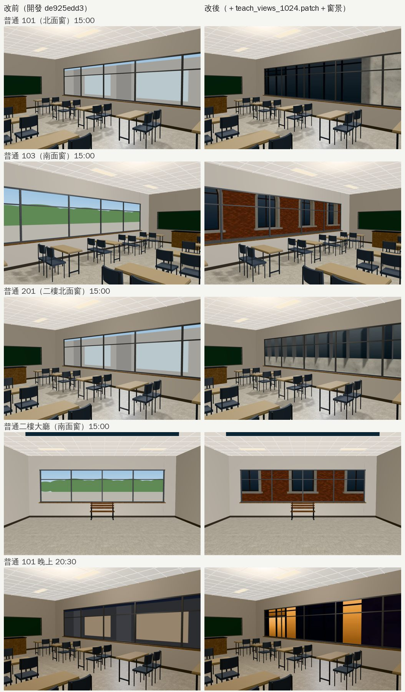
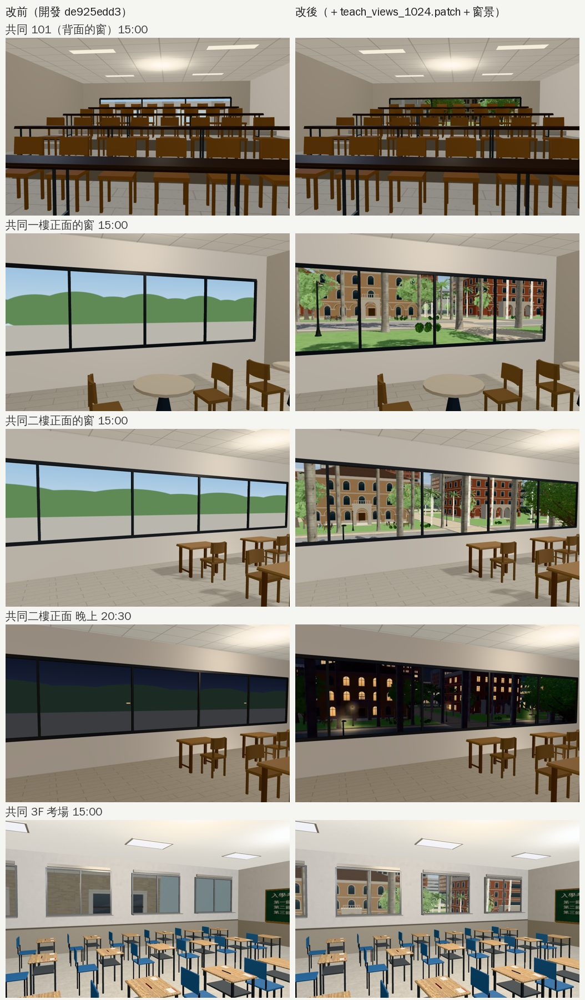
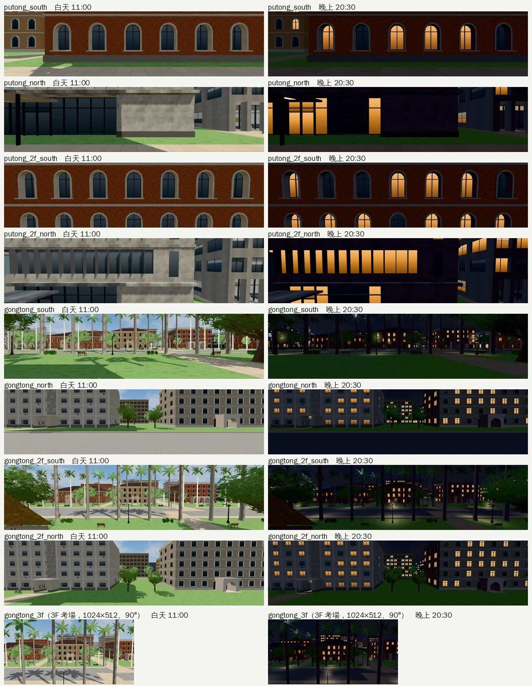

# 普通教學館、共同教學館：教室的窗外景（#61 ART-ECON-3D-GAP-1021）

- **來源**：
  - 經濟系那一年在普通教學館上課（D99 第一優先）。
  - LAWWW-B 08:50：「盤點完告訴我要做哪一件就直接做」。
  - LAWWW-B 09:15：「拍一輪經濟系那一年的路線，找到方盒、黑塊、穿模就直接做」。
- **做的人**：LAWWW2-B。
- **狀態**：`READY_FOR_ART_REVIEW`。場景美術的 `ART_APPROVED` 只有使用者能標。

## 問題

普通、共同教學館的配置（`src/data/{putong,gongtong}_layout.js`）裡，窗戶的 `photo` 全是 `null`：

- 窗外是程序化的「綠色山丘＋藍天」；
- 普通 101 是一片灰白。

共同 3F 考場（`gongtong_3f`）則借用博雅的窗景，看出去是另一棟樓。

## 做了什麼

1. **在遊戲的校園拍實際畫面**（`tools/blender/env_second/shots/teach_views.py`）：
   - 規格和 `boya_views.py`、`tools/shots/window_views.py` 一樣：白天 11:00、晚上 20:30，藏起路人和玩家，是遊戲畫面，不是照片。
   - 鏡頭放在外牆外 0.8 m、窗中心的高度，往外看。
   - 名稱的 south／north＝**室內配置**的 S／N 牆。共同轉了 180°，所以 `gongtong_south` 在校園上是朝北（椰林大道那一側）。

| 名稱 | 窗 | 看出去 |
|---|---|---|
| `putong_south` | 普通 1F 103、104 | 文學院的紅磚背面（約 10 m） |
| `putong_north` | 普通 1F 101、102 | 博雅的南面（隔 7.5 m） |
| `putong_2f_south` | 普通 2F 大廳 | 文學院二樓 |
| `putong_2f_north` | 普通 2F 201、202 | 博雅二樓 |
| `gongtong_south` | 共同 1F 正面 | 椰林大道的椰子樹、對面的文學院 |
| `gongtong_north` | 共同 1F 101（背面） | 後面的系館、路 |
| `gongtong_2f_south` | 共同 2F 正面 | 椰林大道（高一點） |
| `gongtong_2f_north` | 共同 2F 背面 | 後面的系館 |
| `gongtong_3f` | 共同 3F 考場 | 三樓往北看椰林大道 |

2. **寬照片**：
   - 普通、共同的教室窗是 7～14 m 的長窗。
   - `W3.windowMat` 原本只涵蓋水平 90°：斜著看時，視線跑出照片的左右邊，被夾在邊緣那一欄，變成一條條橫紋（第一版就是這樣，見下面「第一版的問題」）。
   - 改成 2048×512、垂直 53.13°、水平約 127°（tan 半角＝2）。
   - 配置加 `photoWide: true`，`teach3d.js` 的窗景看到它就把 `sxy` 設成 `(0.5, 1)`（和 `library3d.js` 設 `sxy` 的做法一樣）。
   - 3F 考場的窗小、分開，照舊 1024×512、90°。
3. **共同 3F 考場**：窗景從 `boya_2f_south` 改成 `gongtong_3f`。
   - `gongtong_3f.py` 和 `gongtong_3f.layout.json` 都改了。
   - 重新匯出的模型照網格名稱比對 0 個差別，GLB 沒換。

## 交付

- **照片**：`assets/models/env/views/putong_*`、`gongtong_*`（含 `gongtong_3f`），共 18 張 webp，約 1.1 MB。
- **patch**：`docs/art-rebuild/second_ai/patches/teach_views_1024.patch`，對開發 `de925edd3`：
  - `tools/layout/{putong,gongtong}_layout_gen.py`：`photo` 填名稱、加 `photoWide`；
  - 重新產生 `src/data/{putong,gongtong}_layout.js`（只有 `windows` 變）；
  - `src/teach3d.js` 一行：`photoWide` → `sxy`；
  - `src/data/room_glb_layouts.js` 的 `gongtong_3f`：只改 `view` 和 `windows.note`。
- **產生器**：先用沒改的產生器重跑，和開發分支的 `*_layout.js` 一模一樣，然後才改。

## 截圖（遊戲內，Playwright＋SwiftShader；不是 iPhone 實機）

開發 `de925edd3`，經濟系那一年 10/15（二）。左邊改前，右邊改後。

窗景照片：

## 測試

套上 patch 以後：

- `gongtong_3f_unit`、`boya_203_unit`、`boya_lecture_unit`、`classes_unit`、`crowd_unit`、`indoor_crowd_unit`、`nav_teach_unit`、`teach_cam_walls_unit`、`teach_class_unit`、`teach_doors_unit`、`teach_perf_unit`：ALL PASS。
- 導航、碰撞、門沒改。
- 繪製呼叫和三角形數和改前一樣（同一個鏡頭）。

## 還沒做／已知

- **普通的窗景只看得到牆**：北面是博雅、南面是文學院的背面，是遊戲裡兩棟樓的真實距離；比較單調，但不是假的。
- **博雅的窗景照舊是 90° 的照片**：斜著看長窗一樣有橫紋，沒有一起重拍。要的話用 `boya_views.py` 照這裡的做法重拍＋配置加 `photoWide`。
- **還有其他地方會出現橫紋**：照片窗景都是同一個材質，非常斜看的時候（貼著牆往旁邊看）一樣會碰到照片邊緣。
- **手機效能沒實測**：照片從 1024 寬變 2048 寬，一個區域多約 1 MB 的貼圖記憶體。
