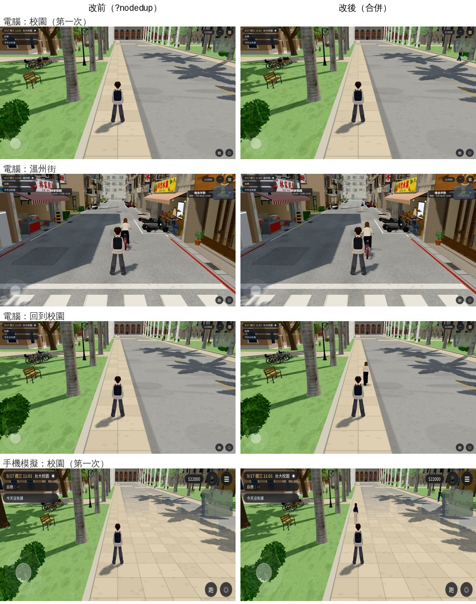
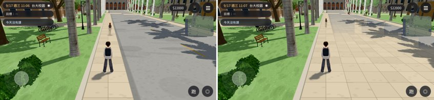

# PERF-TEX-DEDUP-1027：各棟 GLB 重複的貼圖合併（LAWWW2-C 2026-10-27）

- **來源**：X79 交件時的建議（`perf_campus_day_1027/README.md`「還沒做」）；LAWWW-C 19:30 同意做法，加五點注意。跟 iPhone 被踢回標題（記憶體）有關。
- **對**：開發 `fb8d27888` 做、最新開發 `6c65b866f`（`claude/adoring-meitner-mqzst8`）`git apply --check` 過。只改 `src/assets3d.js`＋新測試。
- **環境**：Playwright＋SwiftShader，手機模擬（844×390，貼圖上限 1024／512）和電腦模式（1280×720，不縮貼圖）。**沒有在 iPhone、真的電腦上量過。**

## 為什麼

- 同一張 Poly Haven 材質（磚、花崗石、木紋、法線圖…）每棟 GLB 各帶一份，載入時每一份各自解碼成一張 ImageBitmap、畫到時各自傳上 GPU。
- 離線盤點（`tools/shots/glb_tex_dups.py`，原始資料 `data/glb_tex_dups.json`）：遊戲裡 **89 個建築 GLB 的 924 份貼圖只有 554 張不同的圖**；**178 張圖在不同 GLB 重複，共 370 份是多的（約 153 百萬像素原尺寸）**。
- 路面那 5 張圖（`wz_road*`、`l118_road_*`）沒有別的 GLB 在用——`zones3d.js` 把它們標成柏油（入夜變暗）不會傳到別的東西上（LAWWW-C 注意 ②）。

## 做法（`src/assets3d.js`）

- 建築（manifest `type:'building'`）改用 `bldgLoader`（一個註冊了 `texDedup` 外掛的 GLTFLoader）；人物、動畫、VRM、路人遠距離版本照舊用原本的 loader（不碰）。
- `texDedup.afterRoot`：GLB 解析完、縮手機貼圖（`capTextures`）**之前**，每個貼圖算 key＝**原始圖片位元組的 SHA-1**＋位元組數＋寬高＋取樣（wrap、filter、mipmap）＋色彩空間＋flipY＋UV 通道＋offset／repeat／rotation／center。之前載過的 GLB 已經有同一個 key → 材質那一格換成那一個 Texture（共用＝GPU 只傳一次）。
- 換掉的那份 `dispose()`；它的 ImageBitmap 在**這個模型裡沒有別的貼圖還在用**才 `close()`（GLTFLoader 同一張圖、不同取樣的兩個貼圖共用一個 ImageBitmap，只換掉其中一個時不能 close）。**共用的那一份的圖片從來不 close**（注意 ③）。
- 只合併從圖片來的貼圖（ImageBitmap、``）；KTX2、DataTexture、CanvasTexture、有 userData 的（GLTFLoader 自己放的 `mimeType` 以外）不碰（注意 ①）。
- 不做參照計數：建築模型一直留在 `ASSETS.cache`（不卸載）；換區域時 `engine3d.js` 的 `disposeGroup` 只放掉 GPU 那份，下次畫到用圖片重新上傳——和原本一樣（注意 ⑤：A→B→A 回來沒有變黑，見下面）。
- 執行中改貼圖屬性的程式（注意 ②）：全專案只有 `zones3d.js` 兩處（溫州街、118 巷路面的 `userData.asphalt`、`anisotropy`），那幾張圖沒有共用。building3d.js 的 `fm.map.clone()` 是程式畫的地板，不是 GLB。沒有程式靠貼圖名字找東西。
- 沒有 `crypto.subtle`（不是 https／localhost）就不合併；網址 `?nodedup` 關掉（比較用）。`ASSETS.texDedup` 記結果：看了幾個、合併幾個、close 幾張、省幾百萬像素、雜湊花多久。

## 量測（`tools/shots/tex_dedup_probe.py`：校園椰林大道 → 溫州街 → 回校園；原始數字 `data/*.json`）

| | 改前（`?nodedup`） | 改後 |
|---|---|---|
| 校園：場景裡的 Texture 物件 | 682 | **631**（−51） |
| 校園：場景貼圖的百萬像素（電腦，原尺寸） | 105.8 | **92.6（−12.5%）** |
| 校園：場景貼圖的百萬像素（手機，縮過） | 79.8 | **71.4（−10.5%）** |
| 溫州街：場景裡的 Texture 物件 | 589 | 579 |
| 合併的貼圖（到溫州街累計） | 0 | 電腦 74、手機 63（原尺寸 16.8／15.1 百萬像素） |
| close 的重複 ImageBitmap | 0 | 和合併的一樣多（74／63） |
| 手機要縮的貼圖（校園） | 76 | 70（共用的只縮一次） |
| 雜湊的時間（SwiftShader） | — | 校園 25～30 ms；到溫州街累計 48～74 ms |
| JS 例外 | 0 | 0 |

- **GPU 上的貼圖數（`renderer.info.memory.textures`）不拿來比**：隨機的路人底模每次不同、X79 的 warmup 在電腦上會先傳貼圖，同一個設定兩次差幾十張。上表用「場景裡的 Texture 物件」和百萬像素（建築的部分每次一樣）。
- 省下來的是：重複的 ImageBitmap（解碼後的記憶體）載完就 close；GPU 不再為同一張圖各傳一份；手機少縮幾張。下載量不變（GLB 檔裡還是各帶一份）。
- 畫面：改前改後同角度幾乎一樣（差異是路人、樹的風動）；**回到校園沒有變黑**（電腦、手機都是）。

## 另外發現：原本就有的問題（和這次無關）

- 手機模擬：**校園 → 溫州街 → 回校園，約 15 秒後椰林大道中間的柏油路不見，變成人行道地磚＋直條紋**（左：回來 3 秒；右：回來 15 秒）。
- `?nodedup`（不合併）、`?nodedup&nowarmup`（也不做 X79 warmup）**一樣會發生**——不是這次的改動、也不是 X79。電腦模式沒有發生（同一個流程）。
- 路面那個網格（`PlaneGeometry(12,196)`，y 0.024）本身沒變：看得見、同一個材質、同一張 Canvas 貼圖（256×256、version 3）。像是被畫在上面的東西蓋住，或 GPU 上的貼圖被別的東西釋放。重現工具：`tools/shots/road_probe.py`。已另外通報 LAWWW-C，要我查的話排在羽球短片之後。

## 測試

- 新 `tests/tex_dedup_unit.js`（Node，真的 GLTFLoader 解析手工組的小 GLB，EXT_texture_webp 和正式模型一樣；ImageBitmap、createImageBitmap 是假的）：**改前（沒有合併的 assets3d.js）FAIL 7 項後丟例外、改後 ALL PASS（15 項）**——同圖同取樣換成第一棟那個、重複的 bitmap close、共用的不 close；圖片不同／取樣不同（CLAMP）／色彩空間不同（一棟當顏色一棟當法線）不合併；同一張圖兩個貼圖只換掉一個時不 close；非建築不合併；`?nodedup`、沒有 crypto.subtle 不合併；計數；合併後手機縮圖只縮一次；VRM 的 loader 沒註冊。
- 第一版這支測試抓到一個錯：GLTFLoader 自己在貼圖 `userData` 放 `mimeType`，「有 userData 不碰」把全部都排除了（等於沒合併）——已修。
- `tex_cap_close_unit`、`zone_prewarm_unit`、`zone_warmup_unit`、`anon_pool_unit`、`l118_arcade_unit`、`dorm_seethru_unit`、`dorm_y3_items_unit` ALL PASS。
- 沒跑：整套 Node／回歸、BB 的瀏覽器流程、真機（iPhone 記憶體有沒有比較不會被踢回標題要真機看）。

## 檔案（我的分支 `claude/focused-cray-c9uwvw`）

- `docs/art-rebuild/second_ai/patches/tex_dedup_1027.patch`（`src/assets3d.js`、新 `tests/tex_dedup_unit.js`）。
- 工具：`tools/shots/glb_tex_dups.py`（離線盤點）、`tools/shots/tex_dedup_probe.py`（瀏覽器量測）、`tools/shots/road_probe.py`（路面問題重現）。
