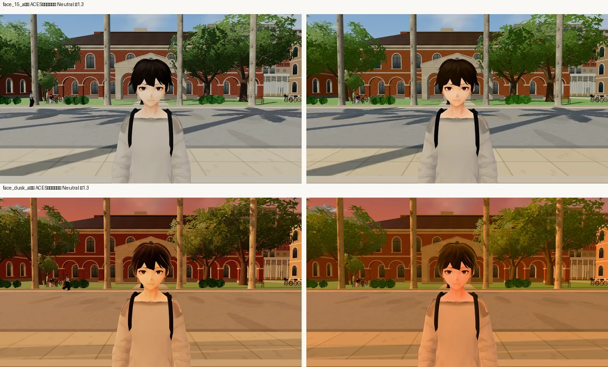
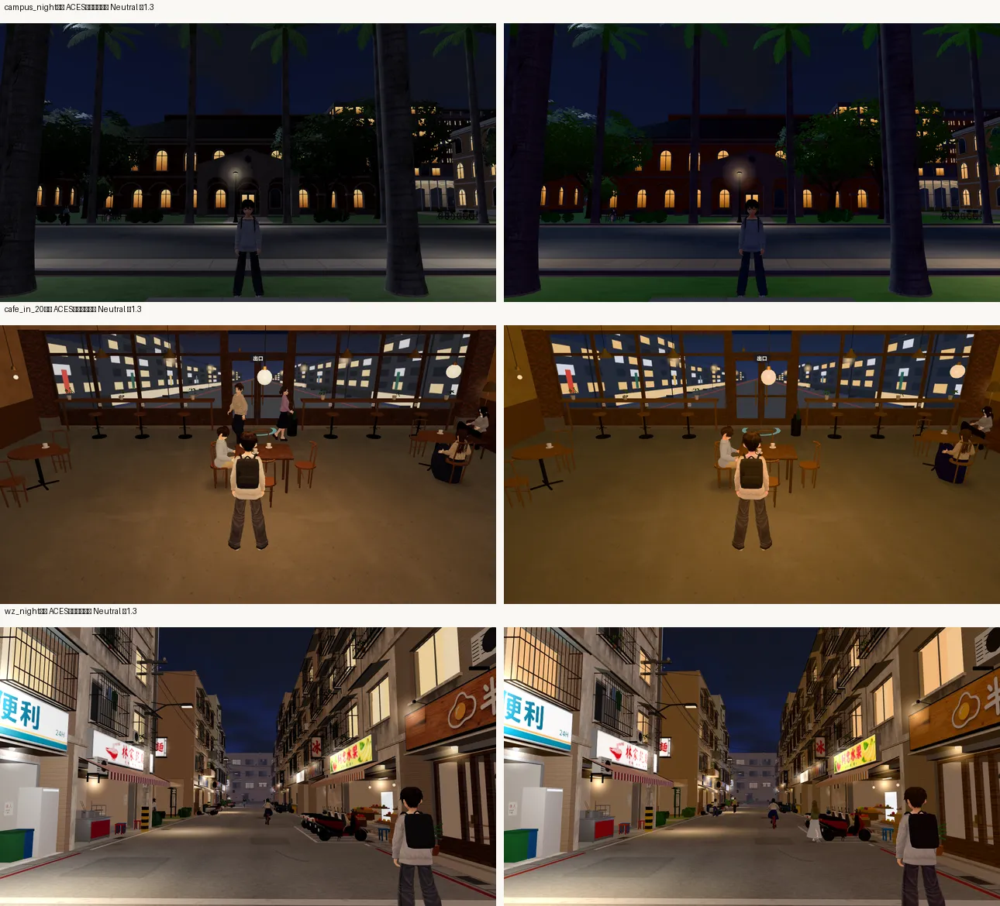
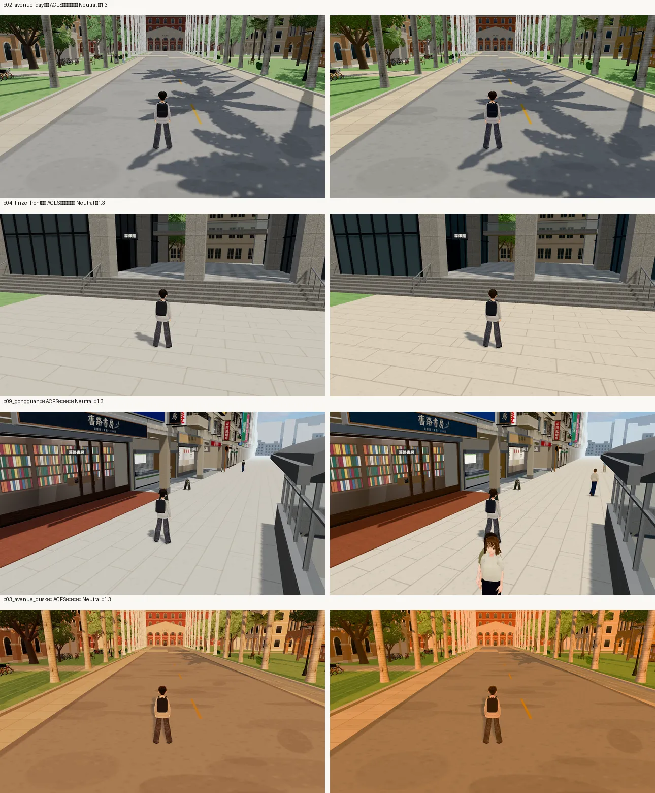
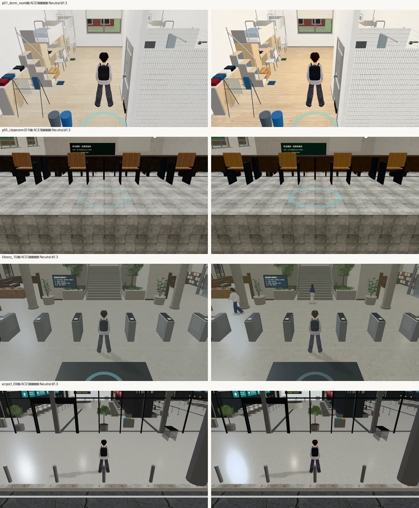

# 色調映射：ACES 對 Khronos PBR Neutral（ART-POLISH 第 2 批「全域光影」）

帳號 A 的 LAWWW2，2026-10-22 03:4x～05:0x UTC。狀態：**已交付**（美術總監的決定：建議改成預設；`engine3d.js` 是 LAWWW 的檔，交 patch）。

- 任務：總表 ART-POLISH（P1）「LAWWW2 先做第 2 批全域光影同鏡頭前後比較＋patch 交 LAWWW（使用者 10-21 要 LAWWW2 清查燈光、效能）」；人物、溫州街的部分照使用者暫停，**這一批不動人物材質（`C.LOOK`）**。
- 10-16 帳號 B 試過（ld1，沒留截圖）：Neutral 白天人物膚色、背景比較好，但室內變暗——因為 three.js 的 ACES 在曲線前先乘 1/0.6，直接換掉會整體變暗，要和曝光一起調。

## 曲線換算（`tone_curves.py`，照 three.js 的 shader 算）

| 線性輸入 | ACES（現在） | Neutral 曝光 ×1.0 | Neutral ×1.3 |
|---|---|---|---|
| 0.03（暗部） | 31 | 17 | 25 |
| 0.18（中灰） | 127 | 105 | 122 |
| 0.5 | 197 | 181 | 205 |
| 1.0（亮面） | 226 | 240 | 246 |

（sRGB 8 位元。）曝光 ×1.3 時 0.03～0.8 的灰平均差 −0.2，所以 patch 用 1.3。

彩度（HSV 的 S，ACES → Neutral ×1.3）：陽光下的臉 0.15 → 0.27、暖色燈 0.11 → 0.30、天空 0.17 → 0.33；陰影裡的臉、紅磚、草地差不多。**ACES 把亮的顏色洗成灰白**——這就是 10-16 看到「人物膚色比較好」的原因。

## patch（`patches/tone_neutral.diff`，`src/engine3d.js` 3 行，對開發分支 `c617b2e0` 乾淨）

- 網址加 `?tone=neutral`：`NeutralToneMapping`、曝光 ×1.3（白天表格的曝光、室內的 1.0 都乘）。
- **沒有加參數就和現在完全一樣**（ACES、曝光照表）。
- `nav_levels_unit`、`nav_buildings_unit` ALL PASS（Node；只是確認沒有語法錯）。

## 同鏡頭 A/B（佇列 j27）

21 個位置：10-16 帳號 B 第 0 批的 10 個遊戲鏡頭（宿舍 203 早上、椰林大道白天／黃昏、霖澤館前、201 教室、溫州街巷子、Café 門口黃昏、Café 室內、公館、總圖前）＋溫州街晚上、椰林大道晚上、臉的近景（15:00、黃昏，正反兩面）、Café 室內晚上、宿舍 203 晚上、總圖大廳、機場出境大廳、美國校園。

- 拍法：開發分支 `c617b2e0`＋`tone_neutral.diff`，同一支 `fast_shots.py`、同一份鏡頭表，先拍 ACES（不加參數）、再拍 `?tone=neutral`。
- 環境：Playwright＋SwiftShader，**不是 iPhone**；手機螢幕的色域、亮度和桌機不同，實機還沒看過。
- 量的方式：整張圖的平均亮度（Rec.709）、幾乎全白（三個通道都 > 0.96）的像素比例、平均彩度（HSV 的 S）。

| 鏡頭 | 亮度 ACES → Neutral | 全白 % | 彩度 ACES → Neutral |
|---|---|---|---|
| 臉 15:00（正面） | 0.480 → 0.478 | 0 → 0 | 0.30 → 0.37 |
| 臉 黃昏（正面） | 0.403 → 0.407 | 0 → 0 | 0.65 → 0.72 |
| 椰林大道 晚上 | 0.099 → 0.096 | 0 → 0 | 0.43 → 0.65 |
| Café 室內 晚上 | 0.233 → 0.246 | 0 → 0 | 0.56 → 0.70 |
| 溫州街 晚上 | 0.330 → 0.329 | 0.77 → 1.42 | 0.39 → 0.48 |
| 椰林大道 白天 | 0.496 → 0.487 | 0 → 0 | 0.16 → 0.20 |
| 椰林大道 黃昏 | 0.483 → 0.468 | 0 → 0 | 0.56 → 0.64 |
| 霖澤館前 | 0.548 → 0.560 | 0 → 0 | 0.12 → 0.20 |
| 公館 | 0.520 → 0.524 | 0 → 0 | 0.20 → 0.27 |
| 宿舍 203 早上 | 0.729 → 0.760 | 0 → 0 | 0.10 → 0.15 |
| 201 教室 | 0.426 → 0.419 | 0 → 0 | 0.20 → 0.27 |
| 總圖大廳 | 0.477 → 0.471 | 0 → 0 | 0.08 → 0.11 |
| 機場出境 | 0.471 → 0.458 | 0 → 0 | 0.06 → 0.09 |

（其他 8 張同樣：亮度差在 ±0.03 以內、沒有變白。）

### 看到什麼

- **人物（最大的差別）**：陽光下的臉、衣服不再洗成灰白，膚色有血色（彩度 0.30 → 0.37）。黃昏的臉更暖。

- **晚上**：亮度一樣，暗的地方深一點，燈是暖黃色、不是淡黃。椰林大道晚上的紅磚和窗燈分得出來（ACES 整片灰濛濛）。Café 晚上更橘，是比較溫暖的那一邊。溫州街招牌的白色多一點點（0.77 → 1.42%）。

- **白天戶外**：樹更綠、磚更紅、天空更藍，亮度一樣。淺色地面（霖澤館前廣場、公館人行道）偏暖、偏亮一點，沒有變白。黃昏更金黃。

- **室內**：幾乎一樣，白牆偏暖一點。機場地上的燈光亮斑大一點。

## 結論（美術總監的決定）

**建議改成預設：Neutral、曝光 ×1.3。**

- 亮度、對比和現在一樣，所以不用重調燈光表、不影響已經調好的室內。
- 改善的是 ACES 洗掉的顏色：人物的膚色（陽光下的臉又白又平）、晚上的燈、植物和磚。
- 風險：已經很暖的場景（Café 晚上、椰林大道黃昏）再暖一級。看起來還是好的；如果之後覺得太橘，調黃昏那幾格的燈光顏色就好，不用回到 ACES。

給 LAWWW 兩個 patch，挑一個（都對開發分支 `7e00ad05`、`c617b2e0` 乾淨，`src/engine3d.js` 3 行）：

1. `patches/tone_neutral_default.diff`：**預設 Neutral**（建議用這個）；網址加 `?tone=aces` 回到舊的。
2. `patches/tone_neutral.diff`：預設照舊 ACES，網址加 `?tone=neutral` 才換（只想先比較時用）。

接法：`git apply` 其中一個 → `node tests/nav_levels_unit.js`、`node tests/nav_buildings_unit.js`（只確認沒有語法錯）→ 發布前的畫面測試照平常跑。人物材質（`C.LOOK`）、燈光表都沒動。

還沒做的：
- iPhone 實機的顏色。
- 雨天、陰天沒拍。
