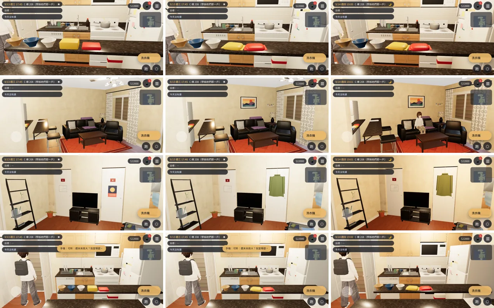
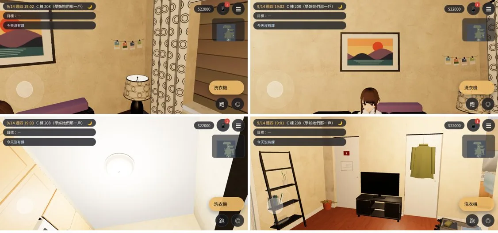

# ART-US2-FIX-1018 美術那一半：C 棟 208（BB_217 第 7 節）

LAWWW2-C，2026-10-21。
- 起因：LAWWW-C 09:29Z 派工（BB_217 §7）。
- 冰箱、鏡頭那一半 10-18 已經整合（248cf684）。
- 環境：Playwright 手機模擬（橫向 844×390）、SwiftShader。**不是 iPhone 實機**。

## BB_217 §7 逐點
| # | BB-C 10-17 寫的 | 現在的開發分支（382236a5） | 這次 |
|---|---|---|---|
| 1 | 兩包泡麵像兩塊方塊 | 還是圓角方塊 | **改**：鼓鼓的軟袋（上面圓、底比較平、四邊收薄）、兩端壓邊，放得有點歪；沒有字 |
| 2 | 傍晚廚房沒有開燈的感覺 | 廚房天花板沒有燈具（燈光是 us3d.js 的 PointLight，看不到燈） | **改**：廚房加吸頂燈，和臥室同一款（BB-B 的 `US_CEILINGLIGHT`），位置對準 PointLight (−3.2, 2.0)；18:12 以後燈罩發光（`US_glow`，us3d.js 本來的規則）。整體光線是遊戲的時段，沒改 |
| 3 | 生活痕跡少、客廳牆面空 | 毯子、快乾的盆栽、米、三種碗、行李箱已經有（10-18 補的）；牆是空的 | **改**：沙發上方掛一幅裱框的風景版畫（虛構、沒有字）；西牆北端、檯燈上方，麻繩夾四張拍立得（照片是色塊，沒有人臉）。都跟著西牆淡出 |
| 4 | 三扇門：一扇貼便條、一扇掛外套、一扇什麼都沒有 | A 小白板、B 海報、C 空 | **改**：B 的海報換成門後掛勾掛一件橄欖綠外套（掛勾跨過門板上緣）。A 小白板＝貼便條，C 照舊空 |
| 5 | 輪值表要手寫 | 已經是手寫（10-17 第二版） | 不用改 |
| 6 | 一間臥室兩張床 | 已經是一間一張 | 不用改 |

## 狀態
| 項目 | 狀態 |
|---|---|
| `us_shared.glb` | **MODEL_READY**：三角形 42,194 → 43,806；2.87 → 2.92 MB；材質 54 → 58 |
| 接進遊戲 | **INTEGRATED（只在我的測試工作樹）**：開發分支 `382236a5`＋換 GLB＋patch [`../../patches/us2_c208_1021.diff`](../../patches/us2_c208_1021.diff)（只有 `src/data/us_layouts.js` 的 `US_SHARED_LAYOUT` 那一行） |
| 測試（Playwright 手機模擬） | `nav_us_unit.js` ALL PASS；`reachability_all.py --zones us_shared` **ALL PASS**（12 個互動點）；截圖沒有 JS 例外 |
| 美術 | **READY_FOR_ART_REVIEW**；BB-C 畫面驗收待做 |

- 導航不變：新加的三種家具（`ceilingLight`、`lifeWallArt`、`lifePhotoString`）`aptNav` 都不擋。
- 用我的分支 HEAD 的腳本（改之前）重匯一次對照：物件數、三角形、材質數、檔案大小和開發分支的 GLB 完全一樣。
  - 不是逐位元相同：二進位區有幾個位元組不同，應該是貼圖編碼。
  - 所以這次 GLB 的差別只有上面這幾樣。

## 截圖（左：開發分支 9/13 17:45；中：這次 9/13 17:45；右：這次 9/14 19:00 燈亮；[捷徑] 讀檔、電影鏡頭、US2 的道具打開）
1. 泡麵；
2. 客廳西牆；
3. 臥室門；
4. 從吧台看廚房。

- 晚上的近景：
  - 拍立得；
  - 版畫；
  - 廚房的吸頂燈；
  - 門後的外套。

## 順手修的
- 牆上的畫、照片放進牆的群組以後，收尾時被 `uv=True` 照世界座標重算 UV，貼圖一格一格重複（第一版畫上出現一塊淺色的「T」）。
- 改成這兩種保留自己的 UV。

## 已知、還沒做
- 9/13 18:30 US2 演出那一段的光是遊戲時段的光。廚房「開了燈」的感覺靠吸頂燈發光和原本的 PointLight，沒有另外打光。
- 外套是一片布＋兩隻袖子，近看比較平。
- iPhone 實機沒有測過。
