# ART-US2-FIX-1018：公寓窄廚房——冰箱點得到、鏡頭看得到人

LAWWW2-C，2026-10-18。LAWWW-C 00:50 派：BB-C 跑 `flow_us_exchange` 抓到兩個問題。照 LAWWW-C 01:01：v9.10 發布以後再整合，冰箱這一項不擋發布。

## 問題
1. **冰箱點不到**：站在冰箱前，互動鍵出來的是「看爐子」。
   - 原因：窄廚房裡站得住的只有 z 1.8～2.2 一條（0.4 m 寬），爐子就在冰箱旁邊。
   - 冰箱的點 (−3.45, 1.8) 和爐子的點 (−2.95, 1.95) 只差 0.5 m，半徑都是 0.8。
   - 站得住的格子裡，冰箱只在最西邊兩三格最近，其他全是爐子。
2. **窄廚房看不到人**（截圖 10_apt_kitchen）：
   - 廚房朝客廳的牆（`kit_n`，有吧台窗口）、朝走道的牆（`kit_e`，廚房的門口）不是會淡出的牆。
   - 玩家在廚房、鏡頭退到客廳或走道時，整面牆擋在中間。

## 改法
- **冰箱、爐子的互動點**（`src/us3d.js` 的 `aptZone`，公寓和合租戶共用）：
  - 冰箱 → 冰箱門前 (x+0.7, z)、半徑 0.7；
  - 爐子 → 爐子東緣、水槽旁 (x+0.75, z−0.65)、半徑 0.75。
  - 分界在 x≈−3.05：站在冰箱門前的都出冰箱，往東走到爐子東半邊、水槽前出爐子。
  - 已知的取捨：站在爐子西半邊前面（同時也是冰箱門前）出的是冰箱。這條廚房太窄，同一個位置兩樣都在面前，只能選一個。
- **廚房的兩面隔間牆會淡出**（`src/data/us_apartment_layout.js`、`src/data/us_shared_layout.js` 的 `kit_n`、`kit_e` 加 `fade` 和 `dir`）：
  - Blender 匯出成 `WALL_kit_n_*`、`WALL_kit_e_*`，props `partition`＝1。
  - 遊戲已有的隔間牆規則：鏡頭和玩家在牆的不同邊才淡出（`Z3.room` 的 `fadeWalls`）。玩家在客廳、鏡頭也在客廳時，牆照舊在。
  - 重新匯出 `us_apartment.glb`、`us_shared.glb`。
- **測試**（`tests/nav_us_unit.js`）：新增「站在冰箱門前（77 個站得住的位置）出冰箱；爐子東緣、水槽前（121 個）出爐子」，公寓、合租戶各一條。
  - **改之前的點跑這條會 FAIL**：冰箱前 (−3.27, 2.12)、(−3.23, 1.96)… → 看爐子。
  - 改之後 PASS，整支 ALL PASS。

## 追加：合租戶臥室 A 門口走不到（LAWWW-C 02:50 派，併進同一包）
- **問題**：LAWWW-C 跑 `tests/reachability_all.py --zones us_shared`，臥室 A 的門口（門關著的那個互動點）走不到。
  - 原因：電視櫃第一版斜放在客廳東南角 (0.8, −2.4)，正好在臥室 A 門口；和行李箱 (0.75, −1.05) 中間的縫比人窄。
- **改法**（`src/data/us_shared_layout.js`，重新匯出 `us_shared.glb`）：
  - 電視櫃 → 東牆、兩扇臥室門中間 (1.12, −1.2)，靠牆擺正（ry −90°），面向沙發；
  - 行李箱 → 客廳東北角、臥室 B 門的北邊 (0.9, 0.55)，不擋門。
  - patch 裡 `src/data/us_layouts.js` 的 `US_SHARED_LAYOUT` 那一行一起換新。
- **測試**：
  - `python3 tests/reachability_all.py <url> --zones us_shared`：**ALL PASS**（12 個互動點都站得到、走得到；坐下的點都走得到；沒有 JS 例外）。
  - `node tests/nav_us_unit.js`：ALL PASS。
  - 改之前的失敗是 LAWWW-C 02:50 跑出來的，我沒有在舊版重跑。
- 前後截圖（11:00；左邊改之前，右邊改之後）：

| 站在客廳往東看 | 從上面看 |
|---|---|
| 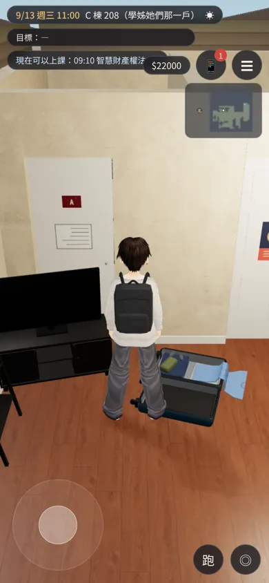 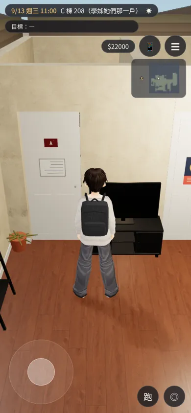 | 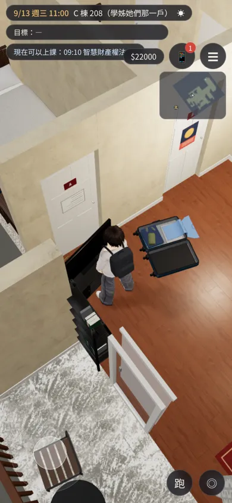 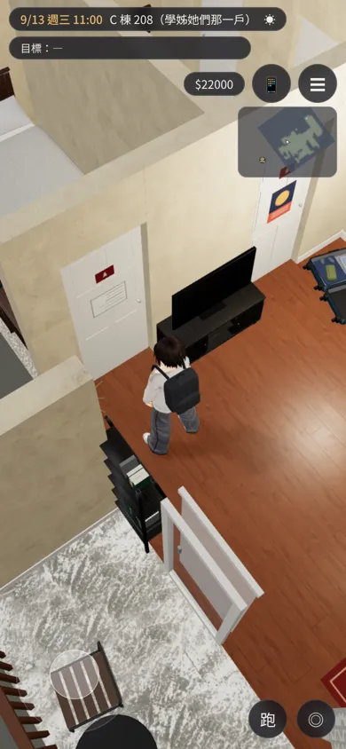 |

## 交付
- 我的分支（`claude/focused-cray-c9uwvw`）：`src/data/us_apartment_layout.js`、`src/data/us_shared_layout.js`、`assets/models/env/second_ai/us_apartment.glb`、`us_shared.glb`（＋`.json`）。
- patch：`docs/art-rebuild/second_ai/patches/us2_fix_1018.diff`，對 LAWWW-C 分支 `5fd81da5` 做的；在最新的 `5ecab8b8` 上 `git apply --check` 也乾淨。
  - `src/us3d.js`：冰箱、爐子的點；
  - `src/data/us_layouts.js`：只有 `US_APARTMENT_LAYOUT`、`US_SHARED_LAYOUT` 兩行：`kit_n`、`kit_e` 的 fade、dir、note；合租戶另外是電視櫃、行李箱的位置；
  - `tests/nav_us_unit.js`：新的檢查。
- GLB 從我的分支拿（同檔名換新）。

## 前後截圖（Playwright、iPhone 直向 390×844 模擬；玩家站在廚房 (−3.0, 1.95)、18:00）
上一排改之前（LAWWW-C 分支原本的 GLB），下一排改之後（新 GLB）。

| 公寓：鏡頭在客廳 | 公寓：鏡頭在走道 | 合租戶：鏡頭在客廳 | 合租戶：鏡頭在走道 |
|---|---|---|---|
| 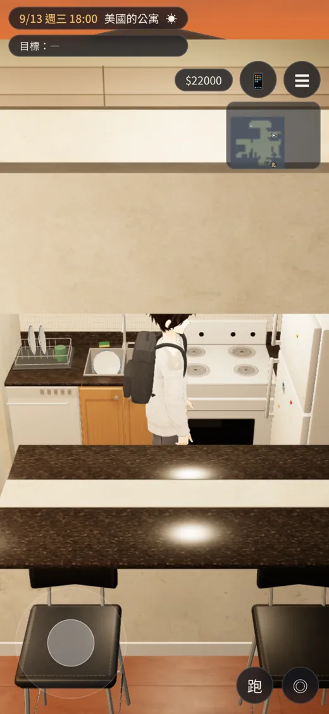 | 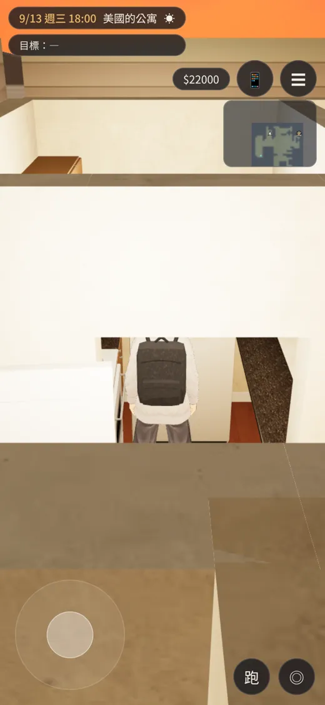 | 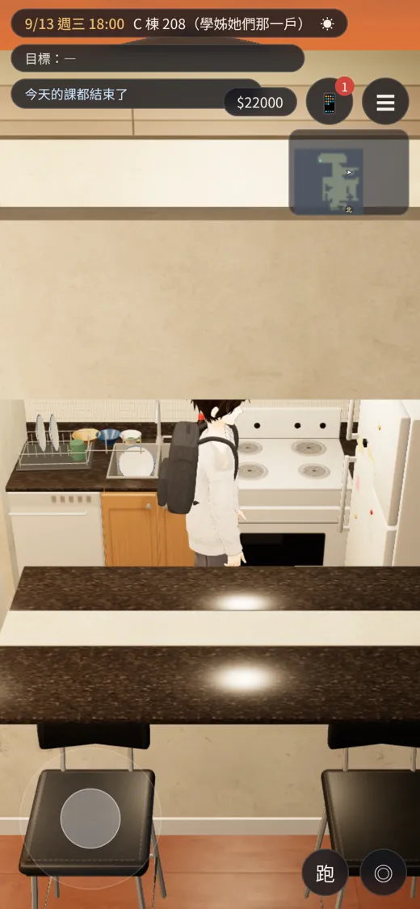 | 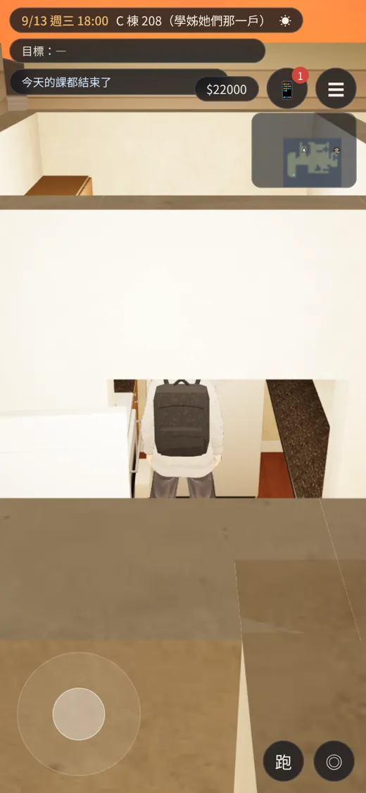 |
| 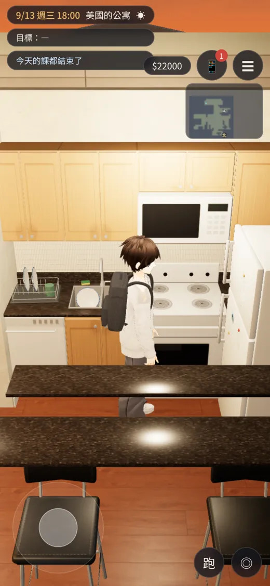 | 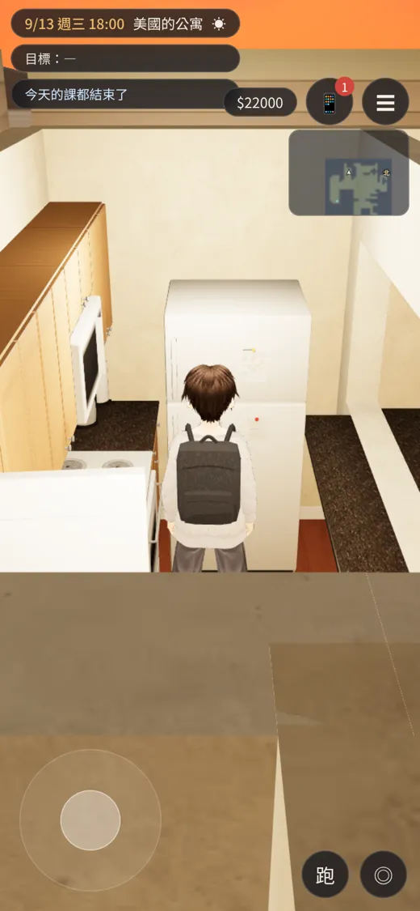 | 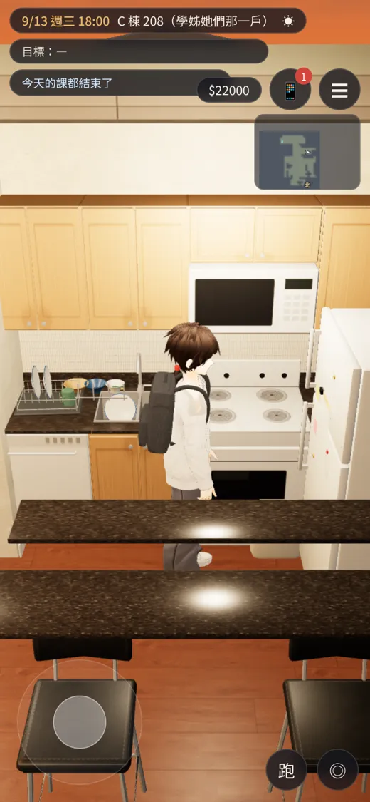 | 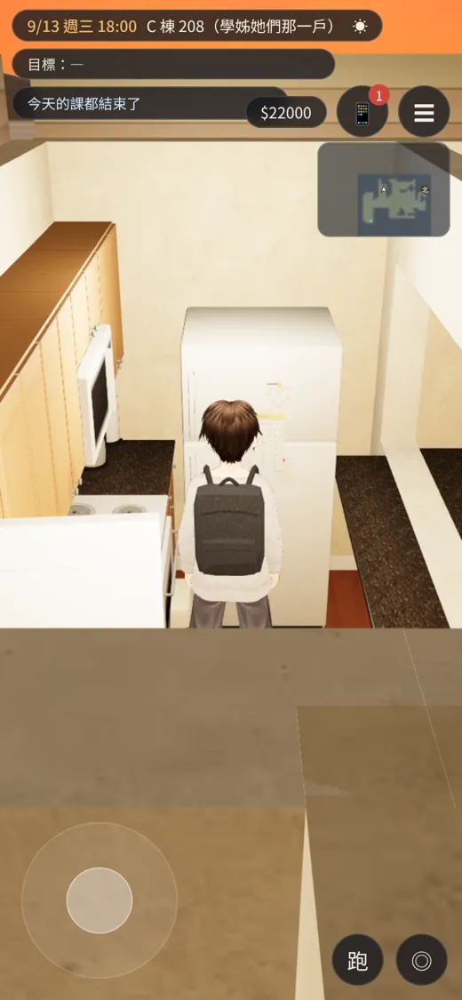 |

- 改之前：
  - 鏡頭在客廳：窗口上面那一截牆擋住一半，看不到吊櫃、微波爐。
  - 鏡頭在走道：整面牆，只從門口看得到人的一部分。
- 改之後：牆淡出，冰箱、吊櫃、微波爐、人都看得到。

## 沒測
- iPhone 實機；
- BB-C 的 `flow_us_exchange` 真實流程（給 BB-C 重跑）；
- 鏡頭在廚房、玩家在客廳的反方向：隔間規則一樣會淡出，沒有截圖。
