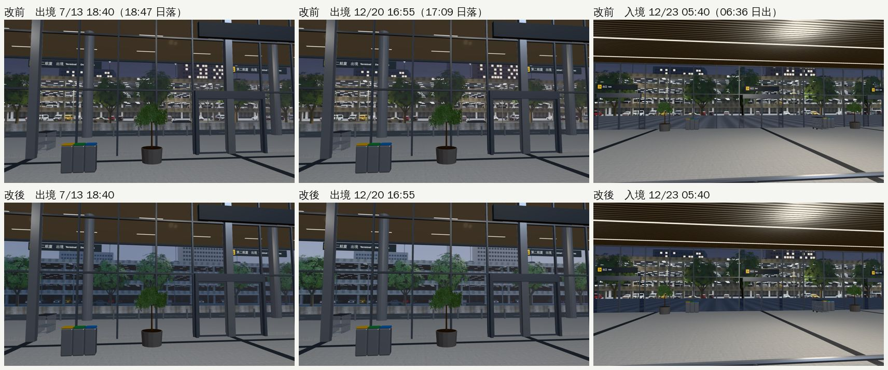
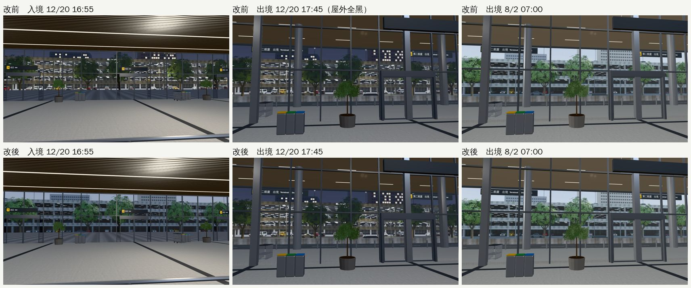

# US-AIRPORT-DUSK-1025：桃園機場窗外的遠景和屋外同一刻天黑（2026-10-25，LAWWW2-B）

- **派工**：LAWWW-B 10-25 02:0x。路線巡查⑤記下的「機場窗外遠景光線 18.3 就換夜景（日落前）」。
- **對**：開發 `b8a6934e7`（測試樹 `$SP/dv8`）。
- **環境**：Playwright＋SwiftShader（1280×720），不是 iPhone 實機。
- **狀態**：`READY_FOR_ART_REVIEW`。場景的 `ART_APPROVED` 只有使用者能標。
- **只動 `src/us3d.js` 的 `apOutside`**，沒動 `engine3d.js`。

## 原本哪裡不對

- `apOutside`（出境、入境大廳窗外的遠景，和入境門外的地面）收到的時刻**本來就是光線用的時刻**（區域的 `applyTime` 收到的就是 `E.lightH`），問題在它自己寫死的表：
  - 光線 7～17 白天；17～19、5～7 慢慢變暗；
  - 亮度剩 35% 以下就換成夜景平面（亮著燈的停車大樓），也就是**光線 18.3 就換**。
- 引擎的日落是光線 18.95、屋外完全天黑是 19.2（夜晚係數 `nk`＝1）。所以：
  - 冬天 12/20 16:55（臺北 17:09 日落）太陽還沒下山，機場窗外已經是夜景；
  - 夏天 7/13 18:40（18:47 日落）也一樣；
  - 臺灣七棟大樓大廳的窗景是屋外完全天黑才換（`window_night_sync_v2_1025` 已整合）；機場比它們早。
- 早上 12/23 05:40（桃園入境，臺北 06:36 日出）原本已經是夜景，但亮度還剩 42%；屋外這時幾乎全黑（`nk`＝0.92）。

## 改法（`src/us3d.js` 的 `apOutside`）

1. **亮度跟著屋外**：`d＝1−nk`，`nk` 和 `engine3d.js` `applyTime` 的夜晚係數同一個公式（光線 17.6 開始變暗、19.2 全黑；早上 5.6～6.4 變亮）。
2. **換夜景和臺灣大樓大廳的窗景同一刻**：光線 ≥ 19.2（屋外完全天黑）或早上 6 點以前。
   - 傍晚換的那一刻，白天那塊已經調到最暗，看不出跳一下。
   - 早上 6:00 換回白天那塊時，亮度是一半（和屋外那一刻一樣），會跳一下。原本 5:42 換、亮度 35%，也會跳；大廳的窗景同樣是 6:00 換。

## 交件

| 檔案 | 內容 |
|---|---|
| `patches/us_airport_dusk_1025.patch`（對 `b8a6934e7`） | `src/us3d.js`、`tests/airport_cam_unit.js`、新測試 `tests/us_airport_dusk_unit.js` |

- `tests/airport_cam_unit.js` 原本有一項寫「18:30 是夜景」，就是這次要修的舊規則（比日落早）。
  - 改成「18:30（日落前）還是白天那塊、19:12（屋外完全天黑）是夜景」，其他檢查不動。

## 測試

- **新測試 `node tests/us_airport_dusk_unit.js`**：改前 FAIL 6、改後 ALL PASS。檢查項目：
  1. 遠景的亮度＝屋外的亮度（`1−nk`），一整天每 3 分鐘比一次；
  2. 換夜景的時刻＝臺灣大廳的窗景（規則從 `building3d.js` 讀）；光線 15～19.2 都是白天那塊；
  3. 派工指定的時刻（用引擎自己的 `lightHour`、臺北的日落）：
     - 12/23 05:40 桃園入境：暗的、夜景；
     - 8/2 07:00 出境：亮的、白天；
     - 12/20 16:55、7/13 18:40（日落前）：白天那塊；
     - 12/20 17:45（屋外已經完全天黑）：夜景。
- **`tests/airport_cam_unit.js`**：新版對改前的程式 2 FAIL，改後 ALL PASS。
- **相關的 Node 測試**（改後）ALL PASS：`window_night_sync`、`season_dusk`、`after_midnight`、`us_lawlib_sky`、`us_lamp_pools`、`sign_audit_1025`、`windowless_night`。

## 改前、改後（同一個鏡頭）

- 【捷徑】讀檔直接設日期、時刻；固定鏡頭、藏起玩家和路人。
- 12 張都拍成功，JS 錯誤 0；draw call 改前改後一樣（入境 23、出境 31）。

- **日落前**（7/13 18:40、12/20 16:55）：
  - 改前：窗外已經是夜景（亮著燈的停車大樓、深藍的天）。
  - 改後：還是白天的停車大樓和樹，照屋外的亮度調暗、偏藍灰。
- **清晨 12/23 05:40**：兩邊都是夜景；改後的入境門外地面更暗（屋外這時幾乎全黑）。

- **12/20 17:45**（屋外已經完全天黑）：兩邊都是夜景。
- **8/2 07:00**：兩邊一樣，白天。

## 還沒做到的

- 日落前那一段，調暗的白天景偏藍灰，不像屋外天空那樣偏暖橘。這是原本的調色（`AP_NIGHT`），這次沒改。
  - 美國公寓窗景的色調表（`VT`）在光線 18.2 有一列暖色；要的話可以照那樣加，請 LAWWW-B 決定。
- **沒測**：手機實機、整套回歸。
