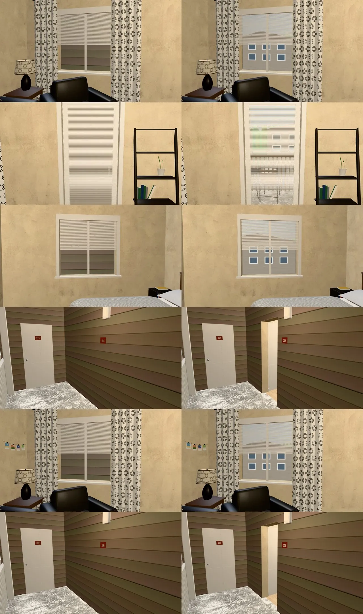
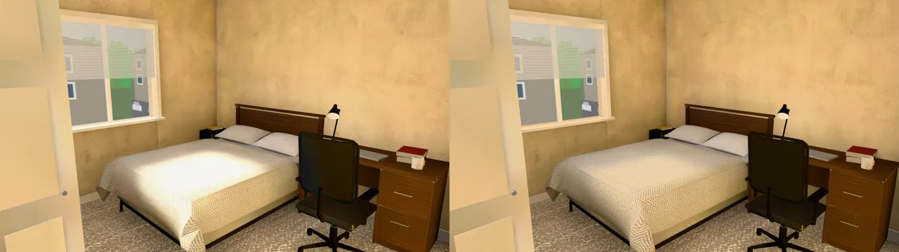
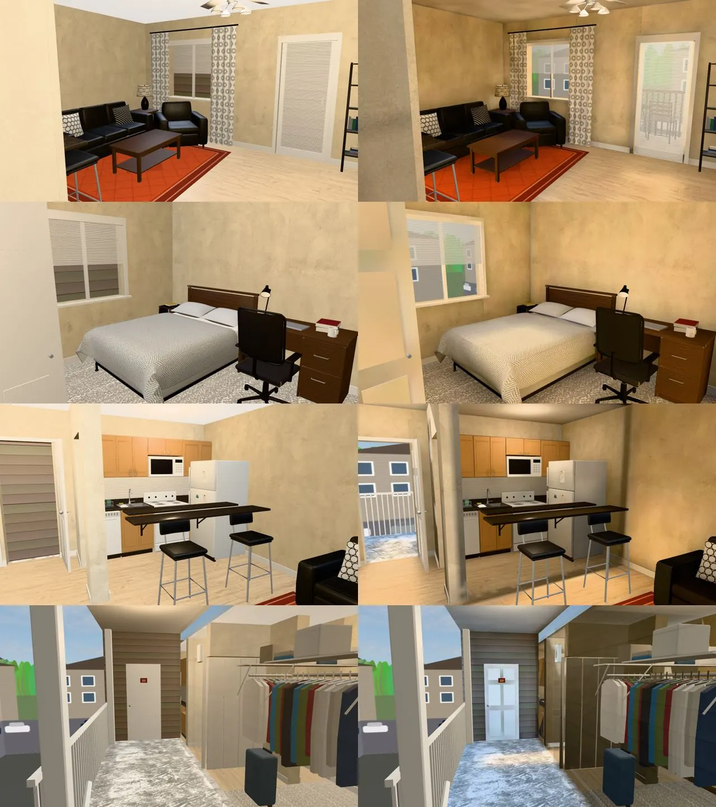
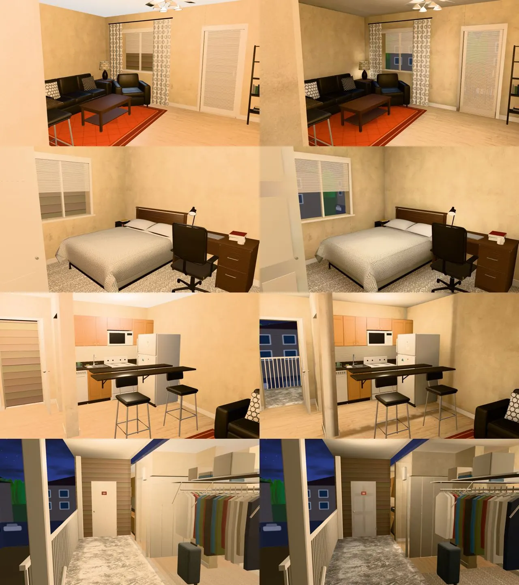

# 美國公寓（祐廷的單人戶 us_apartment）室內光照烘焙＋外牆壁板挖洞（INTERIOR-AAA-REVIEW-1028 美國那一批；LAWWW2-B 2026-10-31）

- **起因**：INTERIOR-AAA-REVIEW-1028 第 5 節 P1（光照）。LAWWW-B 19:1x 佇列第 6 件「美國室內光照」，照 D99 排在舊序章、寒暑假之後；順序：公寓 → 法學院圖書館 → 亞洲超市。
- **狀態**：`READY_FOR_ART_REVIEW`。建築、場景只有使用者能標 `ART_APPROVED`。
  - 截圖是 Playwright＋SwiftShader（電腦 1280×720），不是實機。
  - 讀檔放位置、藏玩家和 NPC 是 [捷徑]。
- **兩件事一起交**：
  1. **外牆壁板挖洞**（模型的 bug，烘焙時找到；單人戶和學姊她們的 C 棟合租戶都有）——第一節。
  2. **單人戶的光照烘焙**——第二節以後。

## 一、外牆壁板沒有挖洞（遊戲裡看得到的 bug）

- **現象**（開發分支、main 都是）：
  - 客廳、臥室的窗、陽台玻璃門，從屋裡看出去是一條一條的色帶——那是**自己外牆壁板的背面**；做好的窗外景（對面的公寓、樹林、停車場，`usa_view_*`）整個被擋住。
  - 南牆的大門從門外的平台看是一片壁板，只有門牌，看不到門；玩家照樣走得進去（等於穿牆）。
- **原因**：`us_apartment.py` 外牆外面那一層灰褐色壁板（`WALL_<面>_siding`）是整面一片，沒有照牆的開口挖洞。
  - 單面化（PERF-SINGLESIDE-GLB-1025）以後壁板多了反面，從屋裡就看得到；單面化以前材質是雙面，一樣擋。
  - 烘焙時也擋：第一版白天屋裡幾乎沒有天光（白天的光照貼圖減掉燈的部分是 0）。
- **修法**：壁板照牆的開口分段（窗 0.9～2.1 m、門 0～2.05 m），開口的地方不做。
  - 重匯以後**只有 `WALL_N_siding`（4→36 個三角形）、`WALL_S_siding`（4→12）變**，其他節點、材質、三角形數都一樣（兩個 GLB 都比對過）。
  - C 棟合租戶（`us_shared.glb`）同一支腳本、同樣的開口：一起重匯（**只修壁板，沒有烘焙**）。
- 大門：門板本來就是開著的（往屋裡開 90°），挖洞以後從平台看得到開著的門和屋裡的走道；之前看起來是牆。

## 二、怎麼套（給 LAWWW-B）

1. **換二進位**（從我的分支 `claude/funny-albattani-iawshm` 拿）：
   - `assets/models/env/second_ai/us_apartment.glb`（壁板挖洞＋光照烘焙）、新的 `us_apartment_lm_day.webp`、`us_apartment_lm_night.webp`；
   - `assets/models/env/second_ai/us_shared.glb`、`us_shared.json`（C 棟合租戶：**只修壁板**，沒有烘焙）；
   - `us_apartment.json` 不用換。
2. **不用改程式**：us3d.js 的公寓區域（aptZone）走 `Z3.attachRoomGLB`，看到 GLB 的 `extras.lightmap` 就接；接完照舊 `aptSouthView`、`aptSeason`（窗外景、雪景的節點名字、群組都沒變）。
   - 窗外景（`usa_view_*`）照舊由 `viewTint` 照時段調；GLB 裡沒有 `dayEmit`（不會被 roomLightmap 再調一次）。
3. **patch**：`docs/art-rebuild/second_ai/patches/us_interiors_lm_1031.patch`（只有測試；三間一包）。
   - 新 `tests/us_apartment_lm_unit.js`：開發分支原樣 FAIL 2，改後 ALL PASS。
   - 新 `tests/us_apt_siding_unit.js`：開發分支原樣 FAIL 2（兩戶），改後 ALL PASS。
4. **工具**（只在我的分支）：`bake_us.sh apartment`、`bake_room.py`（`--knee`、留哪一面的判斷）、鏡頭 `shots/us_apartment_lm_shots.py`、烘焙紀錄 `us_apartment_lm.json`、`us_apartment.py`（壁板挖洞）。

## 三、做法與參數（試了十版）

- **窗都在北牆**（客廳窗、陽台玻璃門、臥室窗；北邊沒有太陽直射），大門在南牆，外面是有屋簷的走廊平台。烘焙時北、南兩邊不包外殼（`--shell N,S`），其他包黑殼。
- **燈**（照 us3d.js 公寓區域的燈位置和模型的燈具；暖白）：
  - 客廳吊扇燈、臥室吸頂燈：燈具下緣往下照的面光源＋燈罩旁一顆柔和的點光源（天花板也照得到）；
  - 廚房、走道、衣物間、衛浴：天花板下往下照的小面光源（遊戲是看不到的點光源）；
  - 書桌檯燈、邊桌燈：燈罩裡各一顆小點光源（遊戲只有光暈）；門外平台：壁燈旁一顆點光源。
  - 模型本身發光的燈泡（`usa_sconce`）烘焙時不發光：小發光面取樣很吵，光改用上面的燈。
- **白天**：房間的燈開一部分（`--daylights 0.4`），天光 0.8，不放太陽；窗外景春天那一組（對面的公寓、停車場）留著擋低角度的天空、只在白天發光；白天那張超過 0.9 的亮度平滑壓到最多 1.4（`--knee 0.9,1.4`）。
- **不烘的**（照舊即時光）：陽台椅、吧檯椅（GPU instancing）、百葉（半透明：照舊擋光、透光）、黑色小零件、鍍鉻、壁燈、門牌、廚房檯面的小東西、毛巾架、梯子書架、衣物間的衣服和鐵線層架、欄杆、窗外景。
- 貼圖 1024²、256 取樣；烘一次約 8 分鐘。

| 版本 | 改了什麼 | 結果 |
|---|---|---|
| 1 | 天光 1.0、白天燈 0.2 | 白天屋裡幾乎沒有天光（減掉燈的部分是 0）→ 查到外牆壁板沒挖洞（第一節） |
| 2 | 壁板挖洞；天光 1.5、白天燈 0.3、太陽 3 | 床中間、陽台過曝（2.0） |
| 3 | 天光 0.7、白天燈 0.4、太陽 1.5 | 大門開著，太陽從門照進走道一塊 2.0（烘進去的太陽整天同一個位置，早上八點、下午五點都在那裡） |
| 4 | 不放太陽 | 走道、床面照舊 2.0：不是太陽 |
| 5 | 天光 0.45、白天燈 0.5 | 床面截到 2.0 的比例 30%→28%，幾乎沒變 |
| 6 | 窗外景春天那一組留著擋低角度的天空；天光 0.8、白天燈 0.4 | 照舊 30%：光是從窗戶上半 25～36° 的天空進來，對面的樓擋不到——物理上靠窗的白床單本來就亮好幾倍 |
| 7 | 白天那張 `--knee 0.9,1.4` | 床面最大 2.0→1.43、超過 1.35 的 35%→12%；看得到床單的人字紋 |
| 8～10（定案 10） | 烘焙工具「留哪一面」的判斷改了三次（見法學院圖書館 README：第七版東西壁板被翻成朝內、第九版牆頂被翻成朝下） | 光照同第七版；定案沒有任何一面改留反面 |

- 遊戲沒有曝光調整：光照貼圖 × 底色超過 1 就是一片白。第七版的壓縮只動 0.9 以上那一段，靠窗那塊照樣是房間最亮的地方。

| 光照貼圖（`lm_probe.py`；白天／晚上） | 定案 |
|---|---|
| 客廳木地板（陽台門前） | 0.88／1.03 |
| 客廳窗前地板 | 0.43／0.57 |
| 客廳沙發前 | 0.66／0.73 |
| 臥室地毯 | 0.50／0.61 |
| 廚房地板 | 0.32／0.68 |
| 走道地板（大門內） | 1.31／0.65 |
| 衛浴地磚 | 0.31／0.60 |
| 客廳／臥室／廚房天花板 | 0.38／0.28、0.62／0.37、0.25／0.48 |
| 門外平台、陽台（屋外） | 0.85／0.09、1.36／0.12 |
| 床面（白天平均／最大；晚上平均／最大） | 第四版 1.05／2.0（3 成到 2.0）→ 定案 0.78／1.40；晚上 0.82／1.46 |

## 四、改前改後（同角度；左＝開發分支原樣，右＝定案）

- 鏡頭：`us_apartment_lm_shots.py`。①客廳（從走道往北：沙發、吊扇、窗、陽台門）②臥室（從門口往東北：床、書桌、窗）③廚房（從客廳往南：吧檯、爐子、冰箱；左邊是大門）④門外平台（從平台東端往西）。
- 截圖的「改前」是壁板沒挖洞的版本：窗外是自己壁板的背面、大門是一片壁板。

### 看得到的差別

- 改前整戶一樣亮，牆、天花板一片平均。
- 現在白天光從北窗、陽台門進來：靠窗那邊亮、房間裡面暗一點；吊扇燈、吸頂燈底下有亮圈。
- 晚上是燈的暖光：客廳、臥室的燈底下最亮，牆角、天花板暗一點。
- 窗外看得到對面的公寓、樹林（第一節）；從廚房往左看得到開著的大門和外面的平台。

### 還不夠的（照實寫）

- **門外平台、陽台（屋外）白天很亮**（0.85、1.36）：屋外本來就比屋裡亮好幾倍，遊戲沒有曝光調整；平台的水泥地看起來偏白。
- 大門內的走道白天 1.31：南邊的天空從開著的大門照進來。
- 床尾靠窗那塊照舊是房間最亮的地方（壓縮後 1.4）。
- 白天、晚上整天同一張光照貼圖（白天那張）：早上、傍晚的光從哪邊來沒有變（和其他烘焙過的房間一樣）。
- **C 棟合租戶（us_shared）只修了壁板，沒有烘光照**：同一支腳本，要烘的話 `bake_us.sh` 加一個 case 就好（排在之後）。

## 五、測試

- `tests/us_apartment_lm_unit.js`：開發分支原樣 FAIL 2，定案 ALL PASS。
- `tests/us_apt_siding_unit.js`：開發分支原樣 FAIL 2（兩戶），定案 ALL PASS。
- `tests/singleside_us_unit.js`：開發分支原樣、定案都 ALL PASS（窗簾烘過以後改到 2b）。
- **全部 Node（三間定案 GLB 一起放進測試樹）：797 支、0 失敗。**
- **效能**（`interior_perf.py`，藏路人，14:00，手機橫向模擬；draw call／三角形）：

| 位置、方向 | 改前 | 定案 |
|---|---|---|
| 客廳 (−1, 0) 前 | 108／124,432 | 108／113,262 |
| 客廳 左 | 108／115,096 | 108／107,202 |
| 客廳 右 | 129／128,186 | 107／99,216 |
| 客廳 後 | 126／115,230 | 126／107,374 |
| 臥室 (2.4, −1.75) 前 | 86／98,174 | 86／92,068 |
| 臥室 左 | 94／105,958 | 94／100,466 |
| 臥室 右 | 111／114,382 | 111／106,270 |
| 臥室 後 | 124／128,074 | 124／115,782 |

  - draw call 七個方向一樣；客廳「右」少 22 次（改前那一張鏡頭看到的東西比較多：可能是牆淡出、吊扇藏起來的時機不同，沒有再追）。
  - 三角形少 6 千～2.2 萬（疊在一起的反面拿掉了）。多兩張 1024² 的 WebP（白天 126 KB、晚上 113 KB）。
- 沒跑：手機實機、導航（模型只改壁板，導航格不讀 GLB）。
