# US-APT-CLOSET-1027（X104）：美國公寓——走得進去的小衣物間、床→書桌→洗手間（LAWWW2-C 2026-10-27）

- **使用者 2026-10-27 19:4x（P0）**：「美國交換學生我租的地方 有一個小的WALKIN CLOSET 不是衣櫃 然後床旁邊是書桌再旁邊是洗手間 洗手間有浴缸」。
- **我的理解（LAWWW-C 19:58Z 同意）**：祐廷的單人戶 `us_apartment`——①衣物間是走得進去的小房間，不是關著的門（衣櫃）；②臥室同一面牆照順序：床 → 書桌（緊貼著床）→ 洗手間的門；③洗手間保留浴缸，門開著看得到。學姊她們的 C 棟合租戶 `us_shared` 不動。
- **對**：開發 `ff6f10d1e` 做、最新開發 `0969b1028`（`claude/adoring-meitner-mqzst8`）`git apply` 過、測試重跑過。
- **工具**：Blender bpy（`tools/blender/env_second/us_apartment.py`，讀同一份配置）→ GLB；遊戲端 `src/us3d.js` 讀配置建導航、互動點、牆。材質沿用原本（Poly Haven CC0 地毯、磁磚、木紋，和 v2 同一組）。

## 一眼看

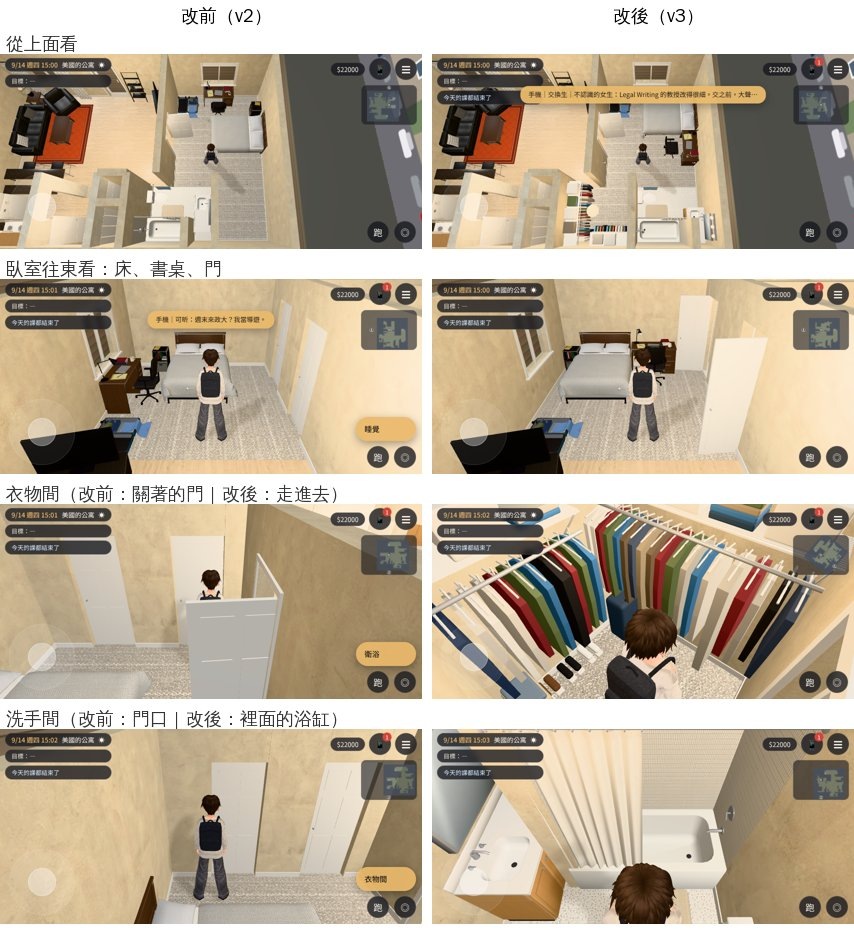

| | 改前（v2） | 改後（v3） |
|---|---|---|
| 衣物間 | 關著的門，按了只看一句「衣物間。」 | 門開著、走得進去（2.0 m × 2.0 m）：西牆、南牆兩排吊衣桿掛滿衣服（帶衣架），層架上摺好的衣服、地上幾雙鞋、最裡面站著行李箱、髒衣籃；天花板一盞燈（晚上暖光） |
| 書桌 | 北邊窗下，離床 1 m 多 | 東牆，緊貼著床的南邊（中間 3 cm）；椅子在西邊、坐下面向牆 |
| 洗手間 | 西南角，關著的門 | 搬到書桌再往南（東南角），門開著；浴缸靠南牆（浴簾）、馬桶在西、洗手台＋鏡子在東；晚上鏡子上方一條燈 |
| 衛浴、衣物間的位置 | 衛浴 x 0.6～2.6、衣物間 x 2.6～5.0 | 對調：衣物間 x 0.6～2.6、衛浴 x 2.6～5.0 |
| 「看」的字 | AA_287 那幾句 | **照舊**（互動點還是「看」：衣物間、衛浴的那幾句不動，只是門開著走得進去） |

截圖（`before_*`、`after_*`；15:00、21:00；[捷徑] 讀檔、直接放玩家位置、路人藏起來；`tools/shots/us_apt_closet_shots.py`）：

| 角度 | 改前 | 改後 15:00 | 改後 21:00 |
|---|---|---|---|
| 從上面看 | 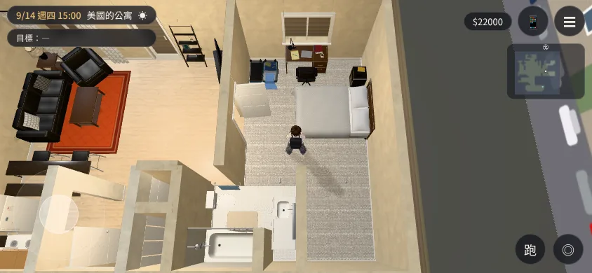 | 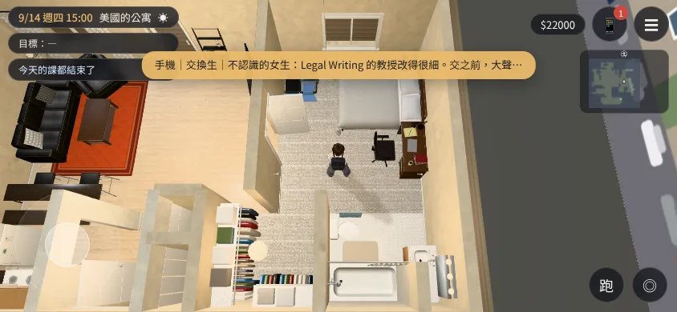 | 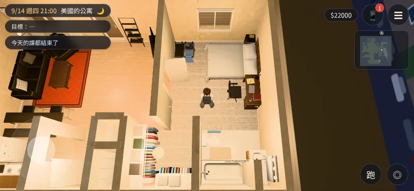 |
| 臥室往東看 | 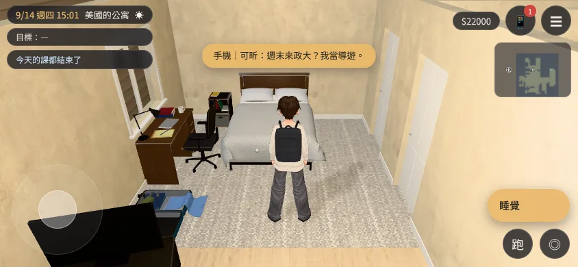 | 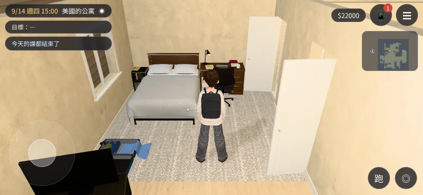 | 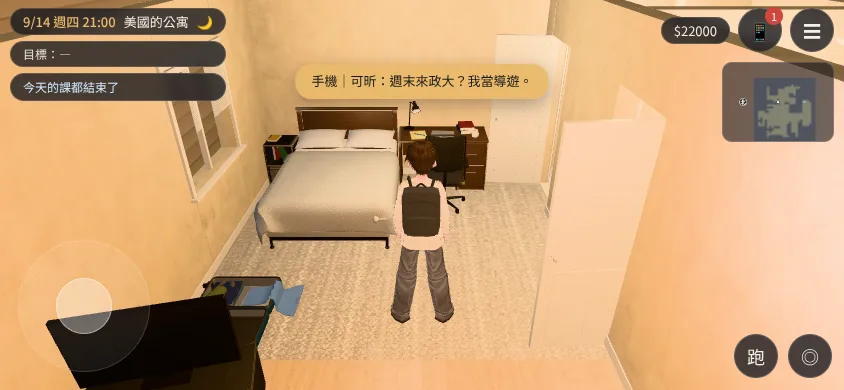 |
| 床尾往東南 | 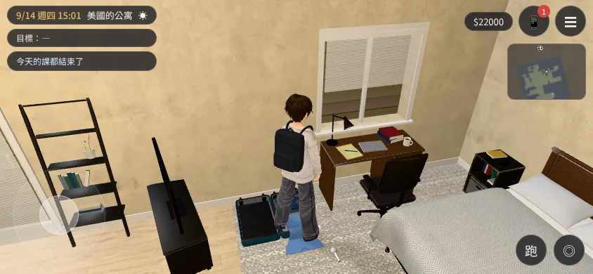 | 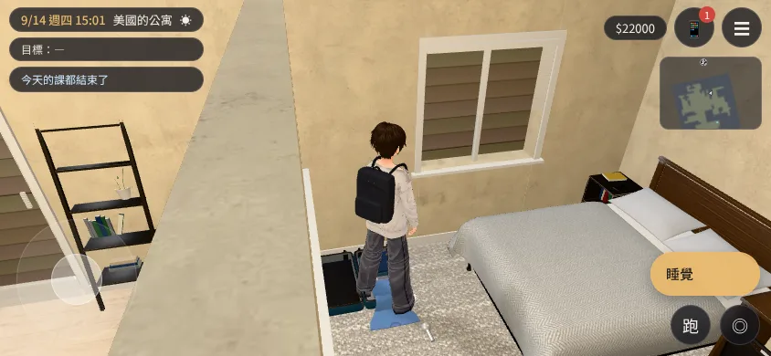 | 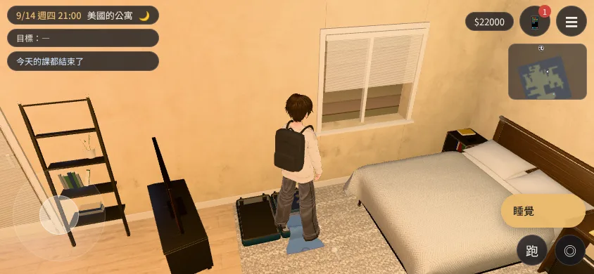 |
| 衣物間門口往南 | 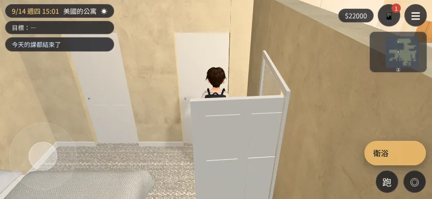 | 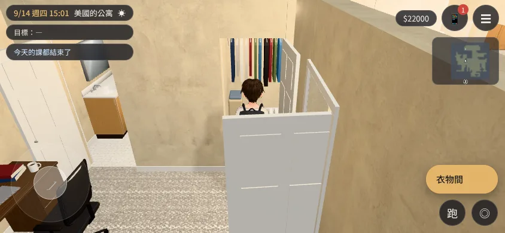 | 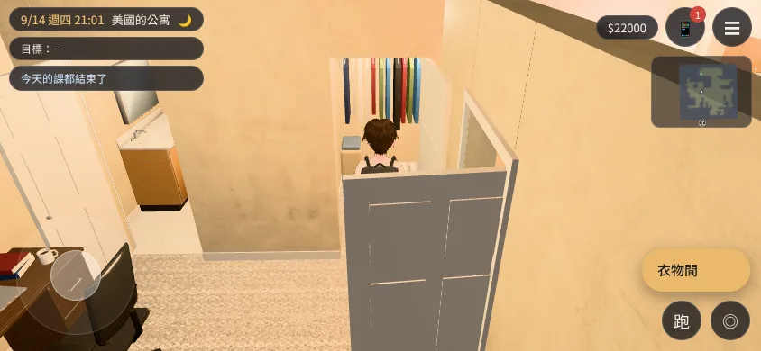 |
| 衣物間裡面 | 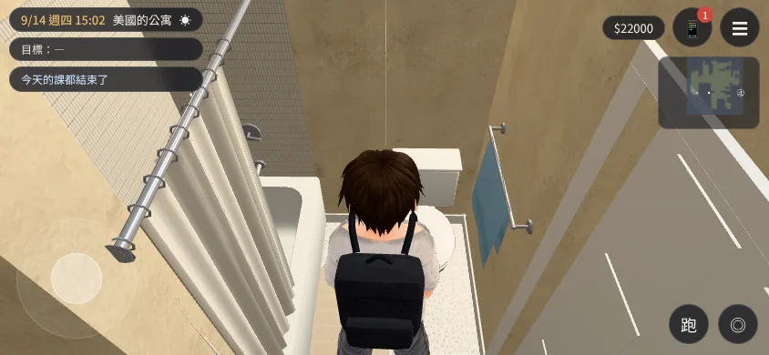（進不去，鏡頭撞牆） | 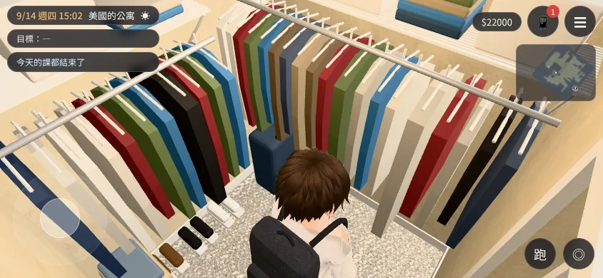 | 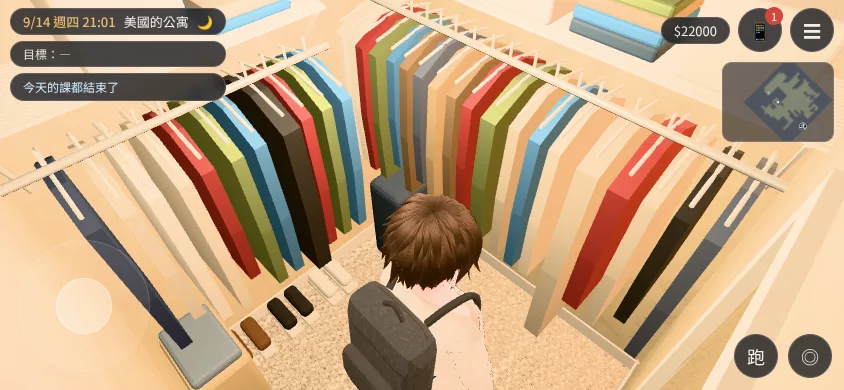 |
| 洗手間門口往南 | 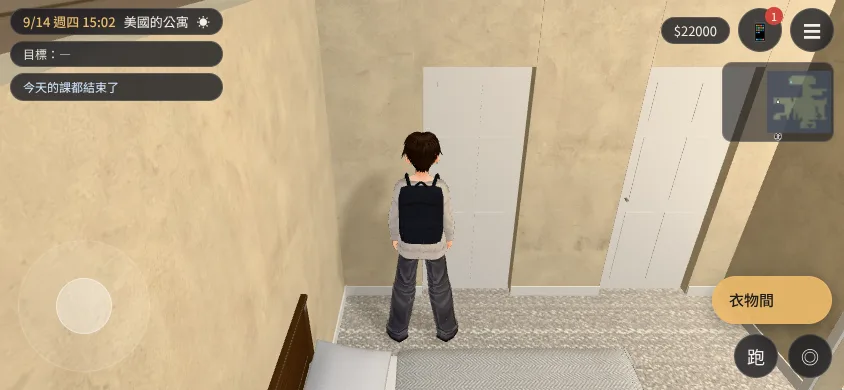 | 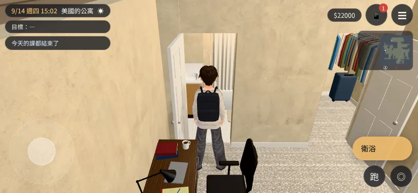 | 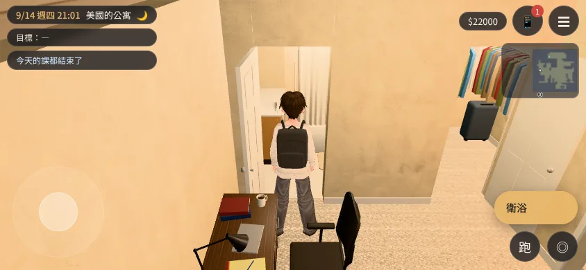 |
| 洗手間裡面 | 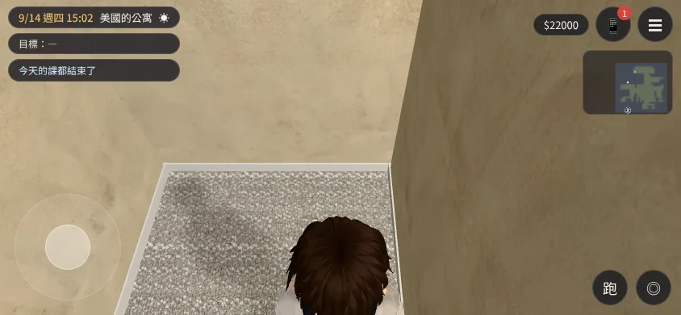 | 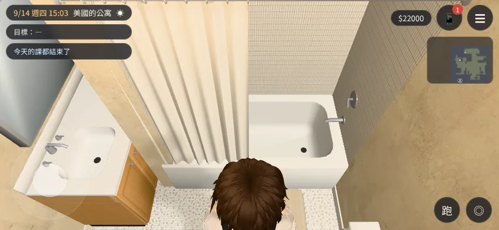 | 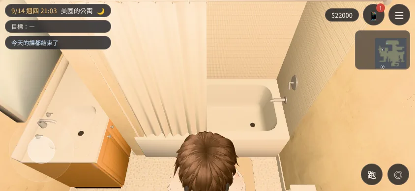 |

## 檔案（我的分支 `claude/focused-cray-c9uwvw`）

- 配置（手寫，Blender 和遊戲共用）：`src/data/us_apartment_layout.js`（version 3；開頭的平面圖已更新）。
- Blender：`tools/blender/env_second/us_apartment.py`（衣物間：吊衣桿、衣服、層架、鞋、行李箱、髒衣籃、燈；洗手間的鏡子、磁磚、毛巾桿、腳踏墊改跟著配置的衛浴位置；門可以往東開 `hinge:"E"`）。
- 正式模型：`assets/models/env/second_ai/us_apartment.glb`＋`.json`（63,776 三角形，v2 56,348；3.9 MB，v2 3.4 MB；貼圖 512）。
- 遊戲端 patch：`docs/art-rebuild/second_ai/patches/us_apt_closet_1027.patch`
  - `src/us3d.js`：①配置的房間寫 `open:true` 就不關（原本衛浴、衣物間寫死關著）；②門寫 `openDoor:true` 的：鏡頭穿得過、牆照樣有門洞（原本有 `closed` 字就當牆）——`closed` 的字留著給「看」用（`us_life3d.js` 照門的 label 找 AA_287 那幾句）；③配置的 `navBands`、`navBlocks`（衣物間吊衣桿、浴缸、馬桶、洗手台、洗手間門板）、`lamps`（衣物間、洗手間的燈）；④書桌椅的走近點用配置的 `ap`（原本寫死 `[2.55,-2.0]`）。
  - `src/data/us_layouts.js`：`US_APARTMENT_LAYOUT` 那一行換成 v3（`gen_us_layouts.py` 產生的，只動這一行）。
  - `tests/us_cam_walls_unit.js`：門的規則跟著改（`openDoor` 的門鏡頭穿得過）。
  - 新 `tests/us_apt_closet_unit.js`。
- 截圖工具：`tools/shots/us_apt_closet_shots.py`。

## 寫死座標的程式（LAWWW-C 要的清單）

| 位置 | 內容 | 處理 |
|---|---|---|
| `src/us3d.js` aptZone 的 deskChair | 書桌椅走近點 `ap:[2.55,-2.0]`（舊書桌位置） | patch 改成讀配置 `f.ap`（v3 是 `[3.42,-0.42]`），沒寫的照舊 |
| `src/us3d.js` aptNav | 衛浴、衣物間寫死關著（`APT_CLOSED`） | patch：配置寫 `open:true` 的不關（合租戶 `us_shared` 沒寫，照舊關著） |
| `src/us_life3d.js` SPAWN0.us_apartment | (2.4, −1)，面向東 | **不用改**：v3 站得住，面向床和書桌；新測試第 6 項檢查 |
| `src/r2y4a3d.js` SPAWN0.us_apartment、`us_life3d.js`「去上課」 | (0.4, 4) 門口 | **不用改**（門口沒動）；新測試第 6 項檢查 |
| `src/r2y4a3d.js` pc2Place（第二輪明信片） | 放在書桌椅旁邊、自己找走得到的點 | **不用改**（照「坐在書桌前」的位置算）；`postcard_reach_unit` 過 |
| `src/exchange3d.js` SPAWN.us_apartment | (0, 2) | 被 `us3d.js` 用配置的 `spawns` 蓋掉，不影響 |
| 劇情文字 | `us_life_events.js` 的 closet、bath「看」的字；「（你把公寓的書桌擦了兩次…）」 | 不動；**沒找到**寫「書桌在窗下」「浴室在…」的句子——AA-C 也在查美國稿 |

## 測試

- 新 `tests/us_apt_closet_unit.js`（Node，建出遊戲真正的 `us_apartment`，用引擎的找路＋移動碰撞 `E.simWalk`）：**改前（v2）FAILED 11、改後 ALL PASS（22 項）**——衣物間站得住、從床尾走得進去、門開著、有吊衣桿；床頭和書桌同一面東牆、書桌貼著床、洗手間門在書桌旁邊；浴缸在衛浴裡、門開著、門口站得住、走得到、站在門口看得到浴缸；坐書桌、睡覺、看衣物間、看衛浴的互動點走得到；合租戶照舊關著；GLB 的衣服在衣物間裡；別的檔案寫死的公寓座標站得住、走得到床邊和書桌。
- 最新開發 `0969b1028`＋patch＋新 GLB：`us_apt_closet_unit`、`nav_us_unit`、`us_cam_walls_unit`、`singleside_us_unit`、`room_ceiling_unit`、`us_life_unit`、`us_season_unit`、`exch_min_unit`、`postcard_reach_unit`、`jetlag_unit`、`r2y4a_events_unit`、`aa424_us_blank_unit`、`placemap_unit` **ALL PASS**。
- 開發 `ff6f10d1e`＋patch：會載入美國公寓的 26 支 Node 測試，25 支 ALL PASS；`aa388_sis_qixi_unit` 1 項沒過，是我這個 clone 沒有企劃線的 commit（`02428913b`，`fatal: invalid object name`），**沒改過的開發版一樣失敗**，和這次無關。
- 瀏覽器 `tests/reachability_all.py --zones us_apartment,us_shared`（最新開發＋patch）：**ALL PASS**（公寓 14 個、合租戶 12 個互動點都站得到、按鈕會出現、走得到；坐下的走近點走得到；沒有 JS 例外）。
- 沒跑：BB 的瀏覽器流程（進門、床、書桌、洗手間、衣物間、睡覺起床、舊存檔在公寓讀檔）、整套回歸、手機實機。

## 還沒達到的地方（誠實）

- 衣服是「帶衣架的平板」：遠看是一排吊著的衣服，**走進衣物間近看偏平、沒有袖子和肩線**。下一輪可以改成有肩線、袖子的輪廓（同一支 Blender 腳本，不動導航）。
- 開著的門板（衣物間、洗手間）往臥室開、貼著牆站著；從臥室西邊往東看時，衣物間的門板在畫面前面，有一點擋。
- 洗手間門口往南看，浴缸被浴簾擋住一半（要走進去才看到整個）；`bath_in` 那張是走進去的樣子。
- 舊存檔：v2 的衛浴、衣物間是關著的（站不進去），所以舊存檔不會存在那兩間裡；臥室裡舊的書桌位置現在是空地，站得住。**沒有實際用舊存檔讀過**（BB 會測）。
- 美術狀態：`READY_FOR_ART_REVIEW`（建築、室內要使用者看過才能標 ART_APPROVED）。
