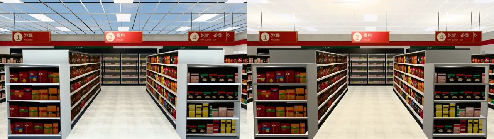
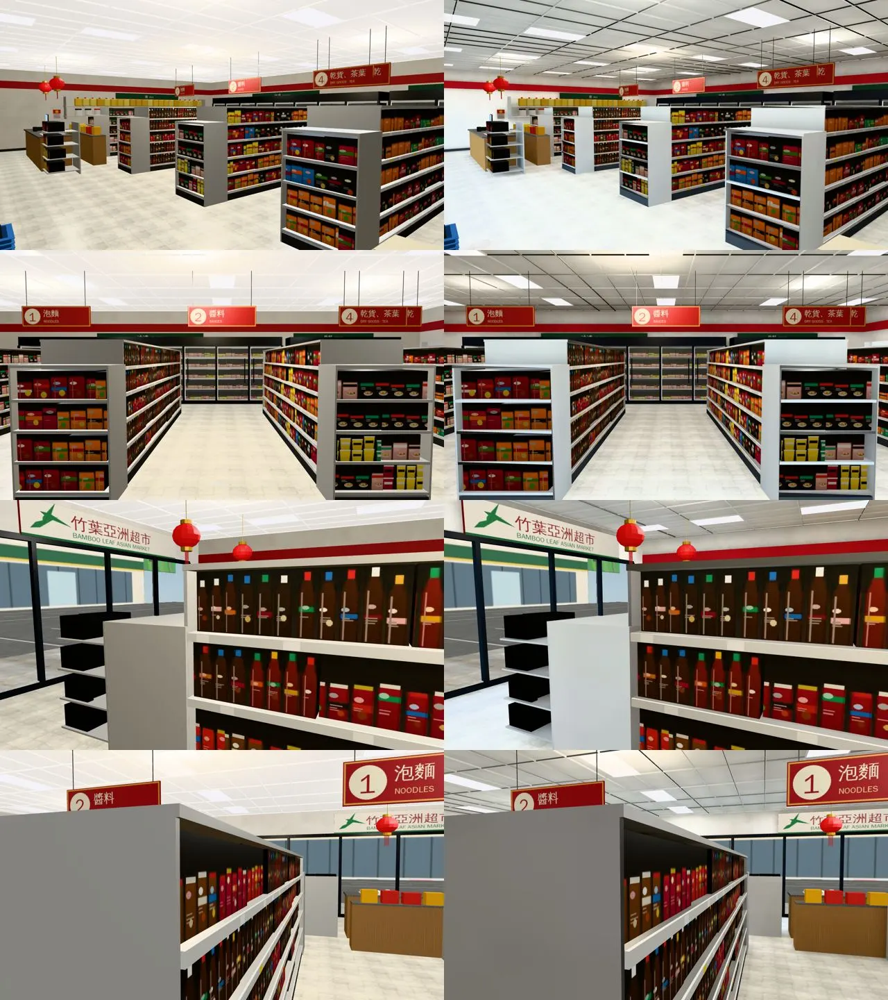
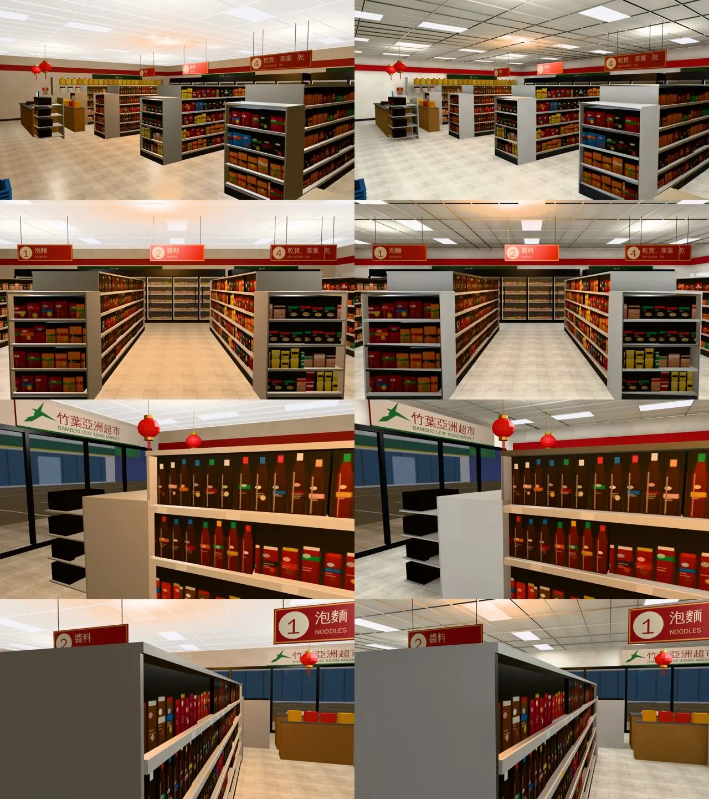

# 美國竹葉亞洲超市（us_asian_market）室內光照烘焙＋天花板方向（INTERIOR-AAA-REVIEW-1028 美國那一批；LAWWW2-B 2026-10-31）

- **起因**：INTERIOR-AAA-REVIEW-1028 第 5 節 P1（光照）。美國室內第三間（公寓 → 法學院圖書館 → 亞洲超市）。
- **狀態**：`READY_FOR_ART_REVIEW`。建築、場景只有使用者能標 `ART_APPROVED`。
  - 截圖是 Playwright＋SwiftShader（電腦 1280×720），不是實機。
  - 讀檔放位置、藏玩家和 NPC 是 [捷徑]。

## 一、怎麼套（給 LAWWW-B）

1. **換二進位**（從我的分支 `claude/funny-albattani-iawshm` 拿）：
   - `assets/models/env/second_ai/us_asian_market.glb`；
   - 新的 `us_asian_market_lm_day.webp`、`us_asian_market_lm_night.webp`。
   - `us_asian_market.json` 不用換。
2. **不用改程式**：us3d.js 的 us_asian_market 區域走 `Z3.attachRoomGLB`，看到 GLB 的 `extras.lightmap` 就接。
   - 鏡頭比天花板高時藏的天花板、輕鋼架、燈盤（`usam_ceiling`、`usam_grid`、`GLOW_usam_troffers`）照舊在；門外的景（`usam_view`）照舊由 `viewTint` 照時段調。
3. **patch**：`docs/art-rebuild/second_ai/patches/us_interiors_lm_1031.patch`（只有測試；三間一包）。
   - 新 `tests/us_asian_market_lm_unit.js`：開發分支原樣 FAIL 2，改後 ALL PASS。
   - `tests/singleside_us_unit.js` 第 2 項：有光照貼圖的開口零件（亞洲超市的層架、公寓的窗簾）改到 2b「烘過、沒有反面」（和 singleside_gym_unit 的 2b 同一個做法）。開發分支原樣、改後都 ALL PASS。
4. **工具**（只在我的分支）：`bake_us.sh market`、`bake_room.py`、鏡頭 `shots/us_rooms_lm_shots.py`、烘焙紀錄 `us_asian_market_lm.json`、`us_asian_market.py`（天花板方向）。

## 二、天花板方向（模型的問題，烘焙時找到）

- `us_asian_market.py` 的天花板（`usam_ceiling`）那一片原本**正面朝上**；遊戲裡看得到，是靠單面化（PERF-SINGLESIDE-GLB-1025）補的朝下的反面。
- 光照烘焙會拿掉疊在一起的反面（不拿掉的話光一出去就打到反面，整面烘成全黑），當時的工具留原本那一面 → **第一版烘完，從店裡往上看天花板整片不見**，直接看到天空（下圖左）。
- 修法兩邊都做了：
  - `us_asian_market.py` 天花板改朝下（只改那一片的頂點順序；重匯的三角形數、檔案大小都一樣）；
  - `bake_room.py` 留哪一面改成射線判斷（見法學院圖書館 README：同一個問題在那裡是四面牆）。
- 新測試第 ⑥ 項抓這個：第一版 FAIL、原本 PASS、定案 PASS。

## 三、做法與參數（試了五版）

- **燈**：輕鋼架天花板的燈盤（`us_asian_market.py`：三排貨架走道上方＋東西兩側，每排五盞，0.58×1.16 m）→ 每盞一個往下照的面光源（22 W、冷白），位置照 `us_asian_market.layout.json` 算，共 25 盞。超市白天燈照樣開（`--daylights 1.0`）。
- **白天**：正面（南）整片玻璃不包外殼（`--shell S`），天光 0.8；太陽在南邊，從玻璃照進門口那一帶（強度 1.0）。
- **不烘的**（照舊即時光）：玻璃（正面、門、冷藏櫃的門）、門外的景、發光面（燈盤、冷藏櫃的燈、燈籠、螢幕）、店外的停車場和人行道、貨架上的商品、價格條、小東西（頂點色）、招牌、金色和黑色小零件、月曆。
- 貼圖 1024²、256 取樣；烘一次約 5～6 分鐘。

| 版本 | 改了什麼 | 結果 |
|---|---|---|
| 1 | 太陽 2.5 | 天花板不見（上一節）；門口地板 1.8～2.0 |
| 2 | 天花板改朝下（模型）；太陽 1.0 | 天花板回來了 |
| 3～5（定案 5） | 烘焙工具「留哪一面」的判斷定案 | 定案沒有任何一面改留反面（層架、踢腳板第三版改了 2 m²，定案的規則不改） |

| 光照貼圖（`lm_probe.py`；白天／晚上） | 定案 |
|---|---|
| 門口地板 | 1.72／0.92 |
| 收銀台前（靠正面玻璃） | 1.65／0.58 |
| 中間走道 | 0.79／0.58 |
| 西、東走道 | 0.63、0.66／0.58 |
| 北邊冷藏櫃前 | 0.58／0.54 |
| 天花板 | 0.33／0.30 |
| 北牆 | 0.33／0.28 |

## 四、改前改後（同角度；左＝開發分支原樣，右＝定案）

- 鏡頭：`us_rooms_lm_shots.py market`。①門口往西北（整間店）②中間走道往北 ③收銀台 ④店裡往南看正面玻璃。

### 看得到的差別

- 超市本來就是燈盤整片均勻照明，差別不大：貨架端板、層板底下、冷藏櫃上方有影子，地板有一點明暗；晚上是燈盤的中性白（改前偏黃）。
- 門口靠玻璃那一帶白天比較亮（太陽、天光）。

### 還不夠的（照實寫）

- 門口地板白天 1.7：看截圖沒有過曝（淺色地磚），沒有另外壓。
- 商品、價格條、小東西照舊即時光（幾千個小盒子不烘），和烘過的層板放在一起看不太出來。

## 五、測試

- `tests/us_asian_market_lm_unit.js`：開發分支原樣 FAIL 2，第一版 FAIL（第 ⑥ 項天花板），定案 ALL PASS。
- `tests/singleside_us_unit.js`：開發分支原樣、定案都 ALL PASS（層架烘過以後改到 2b）。
- **全部 Node（三間定案 GLB 一起放進測試樹）：797 支、0 失敗。**
- **效能**（`interior_perf.py`，藏路人，14:00，手機橫向模擬；draw call／三角形）：

| 位置、方向 | 改前 | 定案 |
|---|---|---|
| 門口 前 | 71／101,022 | 71／100,072 |
| 門口 左 | 82／101,942 | 82／100,990 |
| 門口 右 | 74／101,290 | 74／100,338 |
| 門口 後 | 73／101,278 | 73／100,326 |
| 中間走道 前 | 71／101,130 | 71／100,174 |
| 中間走道 左 | 79／101,770 | 79／100,814 |
| 中間走道 右 | 78／101,324 | 78／100,368 |
| 中間走道 後 | 83／101,936 | 83／100,980 |

  - draw call 一樣；三角形少約 950。多兩張 1024² 的 WebP（白天 93 KB、晚上 82 KB）。
- 沒跑：手機實機、導航（模型只改天花板頂點順序）。
