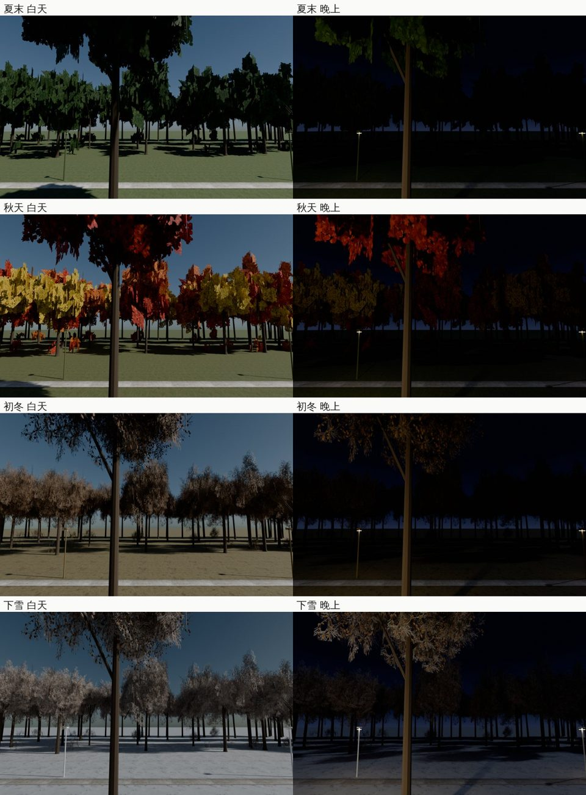
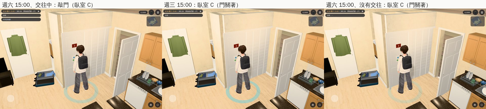
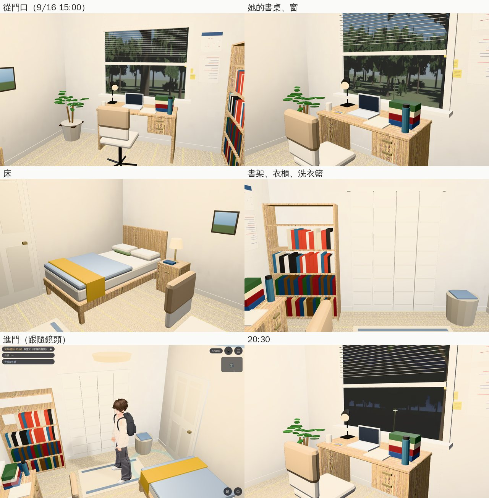
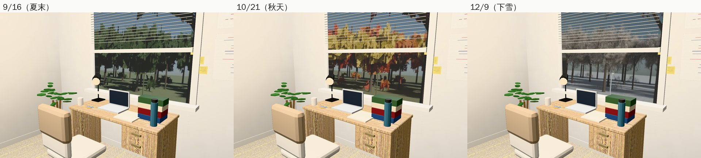

# 美國 C 棟 208：臥室 C＝學姊的房間（AA_399 第 8 節；任務 #82 第七間的一半）

- **企劃**：AA_399 第 8 節（AA-B，企劃線 `5d09bb725`）。
  - C 是學姊的：最裡面那間，窗戶對著一棵樹，和她臺灣研究室的位子一樣。
  - 只有交往中、週末 14～21 她在房間的時候可以敲門進去。進去以後她坐在書桌前，找她說話照美國版的 `talkSis`。
  - 其他人：門關著。
- **派工**：LAWWW-B 10-24 03:53（P2）任務 #82 第七間；07:20 同意做法（她在不在房間的作息由 LAWWW-B 加）。
- **做的人**：LAWWW2-B。
- **狀態**：`READY_FOR_ART_REVIEW`。場景美術的 `ART_APPROVED` 只有使用者能標。
- **Patch**：`docs/art-rebuild/second_ai/patches/us_bed_c_1024.patch`，對開發 `bcc821fe0` 做的（多媒體中心已經整合在裡面）。模型、窗景圖在我的分支。

## 做了什麼

- **模型**（Blender bpy，`tools/blender/env_second/us_bed_c.py` → `assets/models/env/second_ai/us_bed_c.{glb,json,layout.json}`）：
  - 4,822 個三角形；房間 3.6 × 3.4 m、天花板 2.6 m（和公寓一樣）。
  - 材質和公寓一致：米色地毯、白牆、白色六片式房門、白色百葉。木頭都是淺色（沒有深色木地板）。
  - **門在西牆**，進門就看到東牆的窗。
  - **書桌在窗下、對著窗**（她坐的位子）：
    - 桌上：筆電、一疊很厚的判例教科書、攤開的筆記、螢光筆、馬克杯、檯燈、霧藍色水壺；
    - 窗台旁一小盆多肉；
    - 椅背上一件駝色開襟衫；
    - 牆上：手寫的讀書計畫（字是糊的）、小月曆、三張便利貼。
  - **西北角**：一張 1.2 m 的床（灰白床單、灰藍被子、床尾一條芥末黃的毯子、一個橄欖綠抱枕），床頭櫃（檯燈、一本書），牆上一個小相框（照片只有顏色）。
  - **南牆**：雙門百摺衣櫃、書架（判例彙編、筆記本、幾本中文書）、衣櫃旁一個洗衣籃。
  - **其他**：米白小地毯、一盆植物、吸頂燈。
  - 字、書名都是虛構的（沒有真實出版社、品牌）。
- **窗景**（`tools/blender/env_second/us_bed_c_view.py` → `assets/models/env/views/us_bed_c_<季節>_{day,night}.webp`，八張）：
  - 用遊戲的社區戶外（`us_community.glb`）渲染，從 C 棟背面二樓往東看。C 棟背面朝東，和房間的窗同一個方向。
  - 窗前 7.4 m 一棵大樹（從社區的大樹複製，葉子四季照換），後面是草地、步道、兩盞路燈、樹林。
  - 四季照美國篇的季節換（`us3d.js` 的 `usSeasonKey`）：夏末、秋天、初冬、下雪。
  - C 棟背面遊戲裡哪裡都看不到：配置裡那條東邊的樹帶在窗前那一段，渲染時拿掉了（鏡頭本來在樹帶裡，窗前全是暗的樹幹）。

## 配置（`room_glb_layouts.js` 的 `us_bed_c`）

- **`open`**：`{wd:[6,7], h0:14, h1:21, dating:'heroine_05'}`＝交往中、週六日 14～21。`calendar.js` 的 `wd` 是 1＝週一…7＝週日。
- **`spots`**：
  - `sis`：學姊坐在書桌前（面向窗）；
  - `player`：玩家站在房間中間。
- **`interact`**：她的書桌、窗外、書架。三個都是「看」，字等 AA 寫。
- **`back_spawn`**：合租戶走道、臥室 C 門前面（−0.65, 1.4）＝`us3d.js` 門的互動點。
- **`view`／`view_season`**：`us_bed_c`、`'us'`（窗景照季節換）。

## 程式

- **`rooms_glb3d.js`**：
  - `openNow` 多認 `dating`（角色 id）：`flags['dating_'+id]===true`，或 `romance[id].status==='dating'`。和各支線的 `S.dating` 同一個判斷。LAWWW-B 07:20 說「多認 flags」，我做成 `dating`：交往紀錄存在 `romance` 裡的存檔也算。
  - `view_season:'us'`：窗景名稱加上 `US3.usSeasonKey()`。
- **`us3d.js`**：合租戶關著的門那一段，門有正式房間（`host_door` 的 `zone`＝這一戶、`id`＝門的 id）就照 `teach3d.js` 的做法放兩個互動點：
  - 開的時候：「敲門（臥室 C）」，進房間；
  - 其他時間：照舊「臥室 C」（門關著）。
  - 臥室 A、B 的門不受影響。
- **`room_glb_layouts.js`**：加 `us_bed_c`。

## 給 LAWWW-B

- **她在不在房間的作息**（週末 14～21）由 LAWWW-B 加。在房間的時候坐在 `spots.sis`，找她說話照美國版的 `talkSis`。
- **門上的字**：AA_399 寫「其他人：門關著，『看』→『（門上貼著一張手寫的課表。）』」。現在 `US_SHARED_LAYOUT` 的 bedC 是「臥室 C。門關著。」，我沒有改（門口的字歸 LAWWW-B）。
- **「看」的字**等 AA。

## 截圖（遊戲內，Playwright＋SwiftShader；不是 iPhone 實機）

開發 `bcc821fe0`＋這份 patch（測試樹），2028-09-16（六）15:00、交往中。每張的 `post` 都確認：區域、正式模型載入、最近的互動點。

### 合租戶走道：門

### 房間

### 季節、晚上

## 測試

- **`tests/us_bed_c_unit.js`**（新，16 項；改之前第 1 項就失敗）：
  - 區域、正式模型；
  - 開放：交往中週六日 14～21 開，13:30、21:00、週三、沒有交往都關，交往紀錄也算；
  - 走道的門：開的時候只有「敲門（臥室 C）」，其他時間只有「臥室 C」（門關著）；臥室 A、B 照舊；
  - 進去的落點＝spawn；回走道的落點＝門的互動點、站得住；
  - 引擎的 `simWalk`：書桌、窗外、書架、出口都從門口走得到；玩家的位置走得到；她坐在書桌前、面向窗；
  - 窗景照季節換、八張圖都在。
- **相關單元測試**（開發 `bcc821fe0`＋這份 patch）：用到 `rooms_glb3d`／`room_glb_layouts`／`us3d`／`us_layouts` 的，加上讀 `index.html` 的，共 106 個：
  - 103 個 ALL PASS（`us_bed_c_unit` 在窗景圖算好以後重跑也 ALL PASS）；
  - 3 個失敗：`aa393_sis_jp_unit`、`aa441_practice_unit`、`date_wish_unit`。在沒有 patch 的開發 `bcc821fe0` 一樣失敗，原因是這份 clone 裡沒有它們要比對的企劃線 commit（`d94d259ec` 等），和這份 patch 無關。

## 還沒做／已知

- 人（學姊）沒有放：位置在 `spots.sis`（LAWWW-B）。
- 窗景是渲染好的照片，加上視差；樹不會動。
- 房間的牆、門是固定的，門沒有開關的動畫。
- 手機效能沒實測（4,822 個三角形）。
- 第七間的另一半（法學院圖書館 2F 書庫）下一個 commit 交。
