# SCN-US-02 美國校園（區域 `us_campus`）第二版：照使用者給的法學院、校門照片改

LAWWW2-C，2026-10-18。狀態：`MODEL_READY`。場景標 **PROPOSAL／READY_FOR_ART_REVIEW**（使用者看過才算數，D59／D100）。

## 使用者的指示（2026-10-18 01:0x，直接給 LAWWW2-C）
- 「我剛剛有給你我的美國法學院的建築，你已經完成了建築不需要全部刪掉，但是可以照他的外觀去改」
- 「校區門口，其實在法學院的左邊我們可以直接從馬路進去法學院通常不會走校門口，除非我們要去活動中心」
- 另外給了法學院圖書館室內照片兩張（LAWWW-C 排成 SCN-US-LIB，下一項做）。

**照片不放進 repo**：第三方照片有版權，repo 公開，也會讓人認出是哪一間學校（CLAUDE.md 第 2 條）。照片的文字描述在 `docs/art-rebuild/second_ai/HANDOFF.md` 的「★ 使用者 2026-10-18 01:0x」。D77 照舊：不放校名、校徽、銅牌文字、公司名；浮雕板是抽象花紋。

## 玩家會看到什麼
- **路線**：公車到站（字卡）→ 站在法學院前的人行道 → 沿人行道走到走道口 → 走道穿過亂石矮牆 → 台階前的小廣場 → 台階下「進教室」（教室是 2D）。
- **法學院**：
  - 淺米色石灰岩的方塔，約六層樓高，頂上往內收一層。
  - 塔正面是三層樓高的多邊形凸窗；凸窗下面是往下一階一階收的托座和浮雕板。
  - 托座下面是略扁的圓弧拱門，線腳一圈圈往裡收，木框玻璃雙開門上面有扇形氣窗，兩側各一盞黑色壁燈。
  - 門前七階寬台階，兩條不鏽鋼扶手，兩側石砌矮牆。
  - 東翼兩層：一樓方窗、二樓挑高長窗，城垛女兒牆，後面是緩坡的石板瓦屋頂。西翼三層。
- **街邊**：
  - 人行道邊一道亂石矮擋土牆，後面是高 0.5 m 的草坪和大樹，走不上去。
  - 深綠色高路燈、黃色菱形行人標誌。
  - 人行道是水泥板，每 1.5 m 一條伸縮縫。
- **校門**：在法學院西邊，也就是站在街上面對法學院的左邊。
  - 兩座對稱的門樓：方塔頂上是八角小亭（長圓拱窗、八角尖頂、石頭尖飾），外側各一道尖拱側門和一根石柱。
  - 塔面有黑色壁燈；銅牌留白。
  - 門前紅磚廣場，三個石灰岩矮花台（灌木和花）。
  - 門後是老校區：陡屋頂的哥德式老系館（`us_campus_kit.gothic_hall`，第一版做的系館改當背景）、大樹、紅磚步道。
- **四周**：馬路（雙黃線），東西兩個路口有斑馬線（人行道走到路緣為止），對街是兩層的磚造房子和行道樹。

## 同角度比對（Blender 算圖；使用者的照片在對話裡，不放 repo）
| 街角看方塔（照片一的角度） | 正面入口（照片三的角度） | 校門（照片五的角度） |
|---|---|---|
| 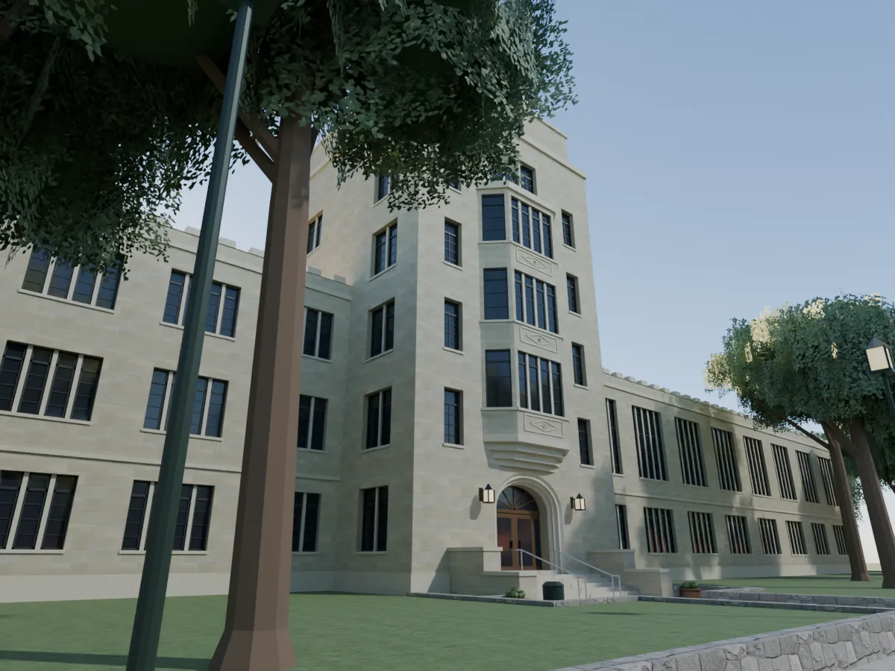 | 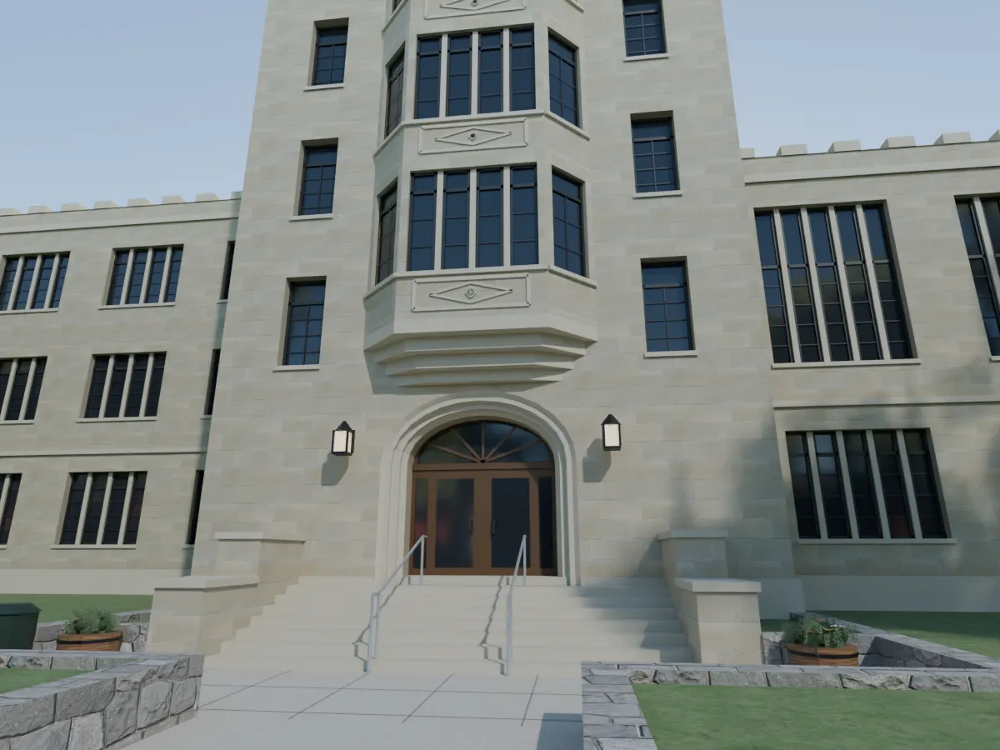 | 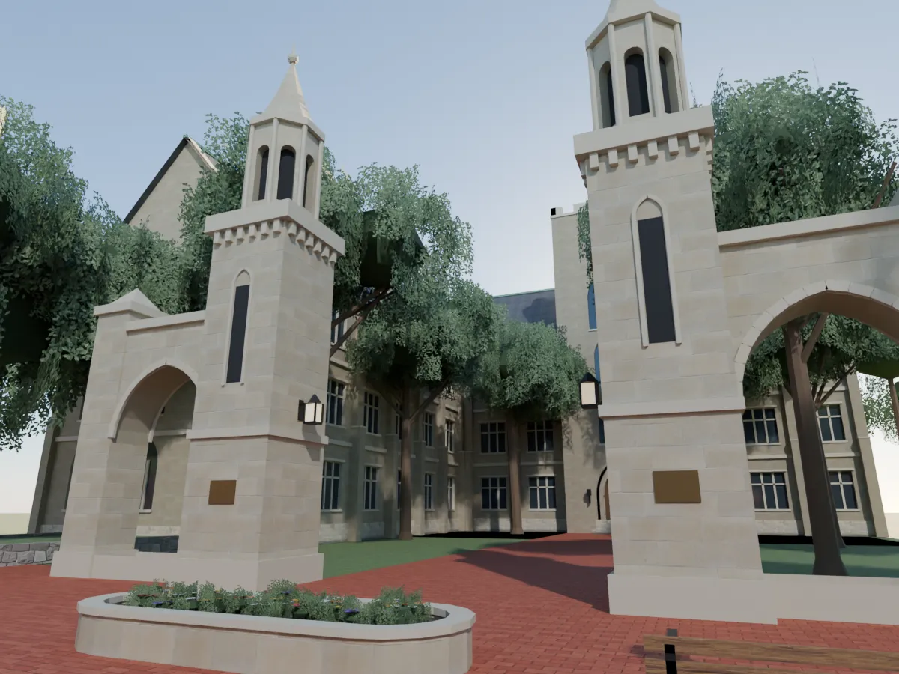 |

整區鳥瞰：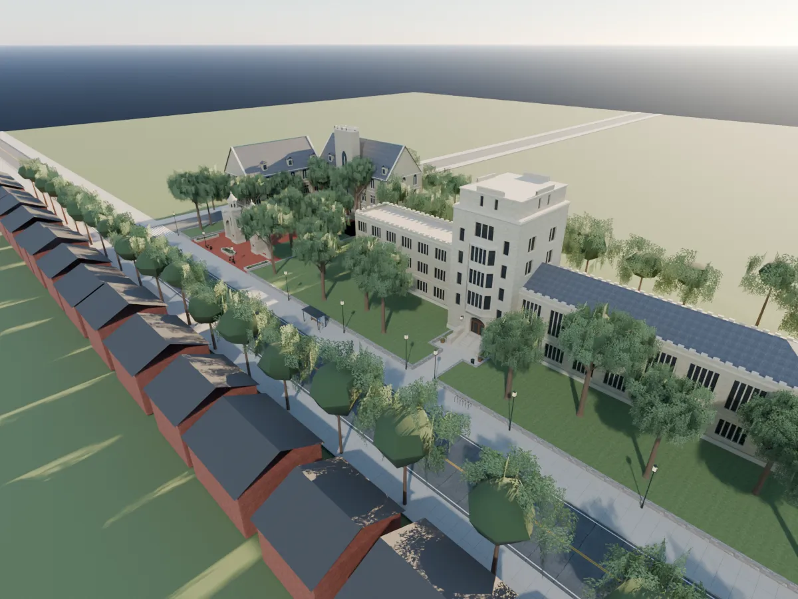

## 遊戲內截圖（Playwright、iPhone 直向 390×844 模擬、SwiftShader；不是實機）
做法：在 scratchpad 的測試工作樹（LAWWW-C 分支 `0cd6d028`）用 `us3d.js` 的 `outdoorZone` 臨時接一個 `us_campus` 區域，讀這份 GLB 和配置。這個工作樹**不 commit**，正式接線由 LAWWW-C 做。

| 公車到站 | 人行道 | 走道 | 台階下 |
|---|---|---|---|
| 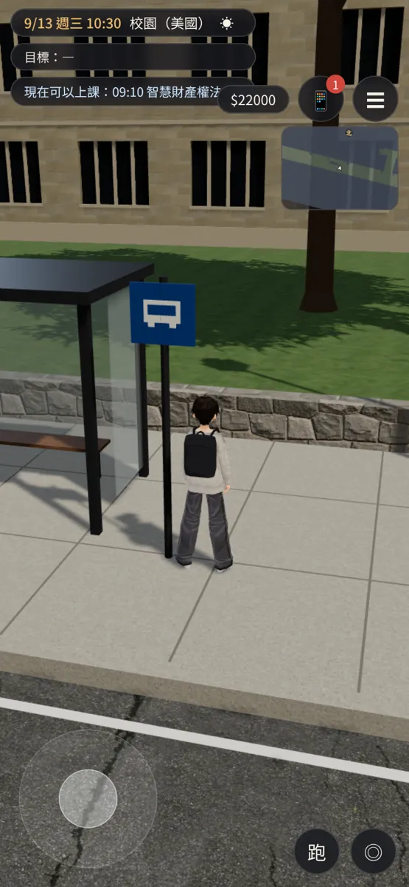 | 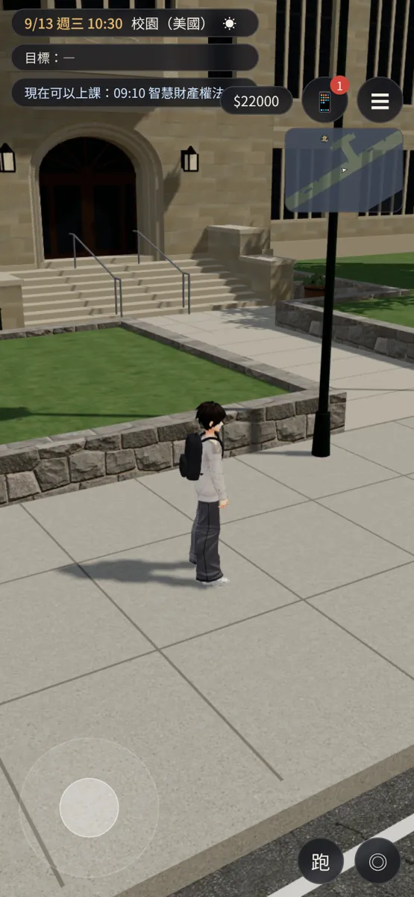 | 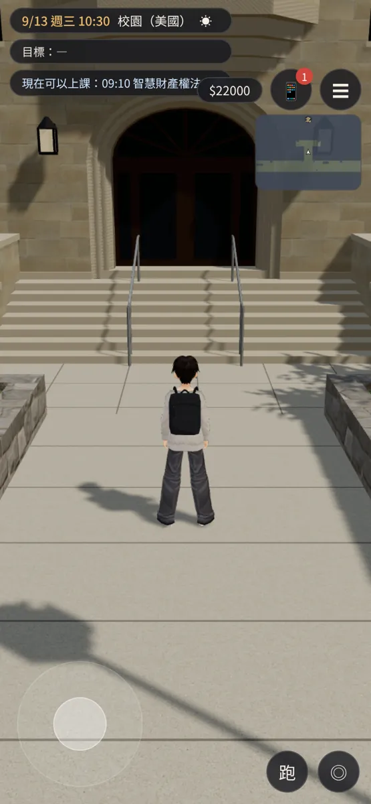 | 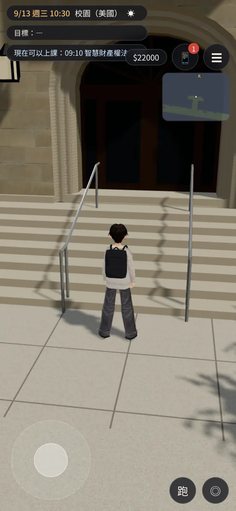 |

| 校門廣場 | 晚上 20:36 走道 |
|---|---|
| 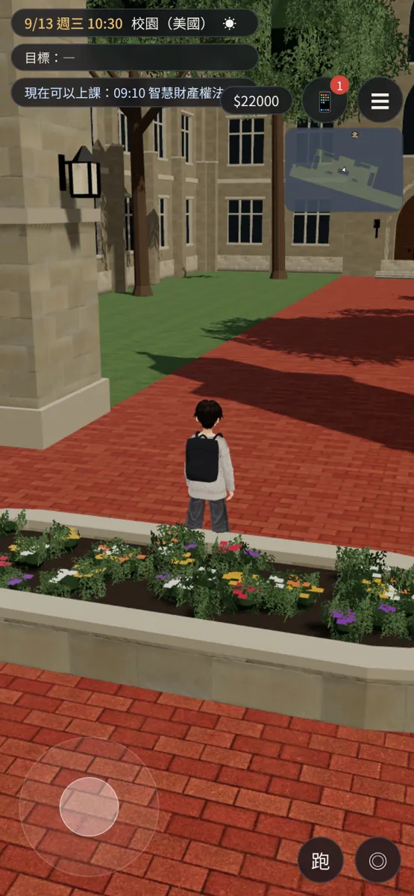 | 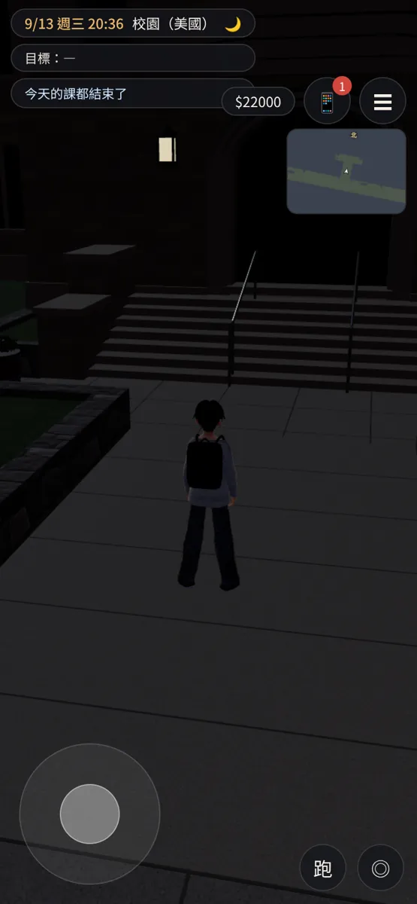 |

橫向：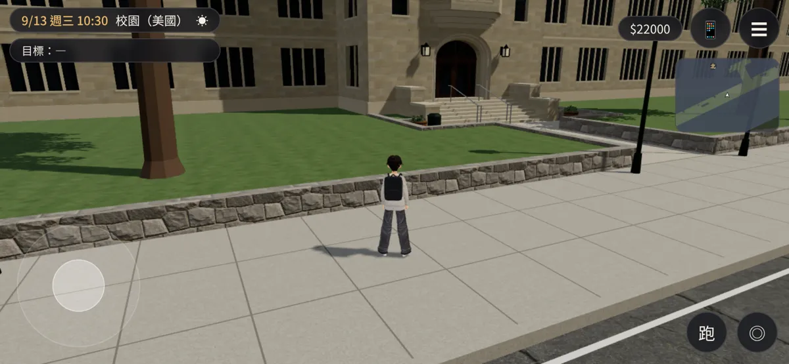 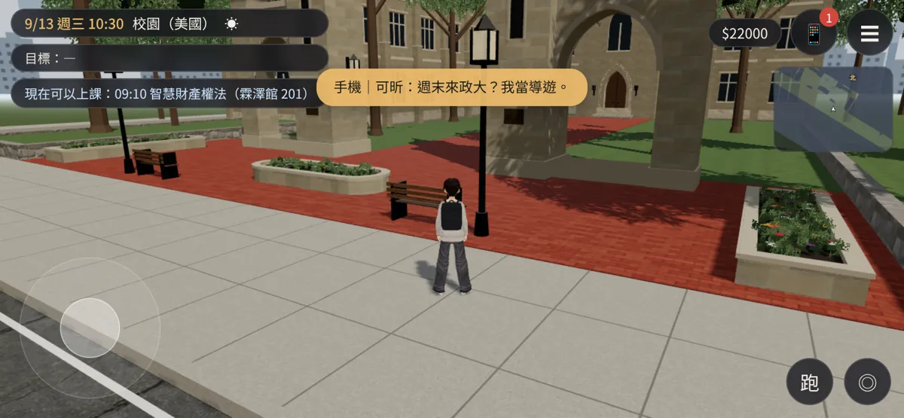

## 交付檔案
- `assets/models/env/second_ai/us_campus.glb`：8.4 萬三角形、5.9 MB（和 `us_community` 8.9 萬／5.5 MB、`us_market` 9.9 萬／6.5 MB 同一級）。規格在 `us_campus.json`。
- `assets/models/env/second_ai/us_campus.layout.json`：配置第 2 版，由 `tools/blender/env_second/us_campus_layout_gen.py` 產生。
  - `bounds` x −110～70、z −46～40。
  - `spawn_bus` (−20.6, 20.6) 朝北：公車到站。
  - `spawn_class_out` (0, 8.42) 朝南：下課出來。
  - `spawn_gate` (−66, 11.4) 朝南：之後從活動中心回來用。
  - `interact`：
    - `class`「進教室」(0, 7.72) r 1.4；
    - `bus`「搭公車（回社區）」(−24, 21.0) r 1.4；
    - `gate`「往活動中心」(−66, 10.6) r 1.8。活動中心還沒做，LAWWW-C 接成關著的出口、用通用提示。
  - `blocks`：44 個。建築的 `why` 以 `building` 開頭，`outdoorZone` 會自動加鏡頭碰撞。
  - 高起來的草坪整片擋住（走不上去，有亂石矮牆，看得懂）。
  - 門後擋住，當成區域出口；東西兩邊的路口和馬路都擋住。
  - `--check`：出生點、互動點都不在阻擋裡；從 `spawn_bus` 用 0.5 m 格子找得到全部的出生點和互動點。
- 腳本：
  - `tools/blender/env_second/us_law_kit.py`：法學院 `law_school()`、校門 `campus_gate()`；`--preview` 單獨算圖。
  - `tools/blender/env_second/us_campus.py`：整區；`--preview --cam law|door|gate|walk|bus|aerial`、`--stats`。
  - `us_campus_kit.py`：`gothic_hall` 多了 `detail=0`，背景用，不做花窗和鉛條。
- 材質（Poly Haven CC0，本機已有）：
  - `sandstone_blocks_08`：石灰岩；
  - `japanese_stone_wall`：亂石矮牆；
  - `brick_pavement_04`：紅磚；
  - `granular_concrete`：人行道；
  - `grass_ground`、`asphalt_02`、`dark_wood`、`red_brick_03`、`grey_roof_tiles`；
  - 葉片卡：`plants.py`。

## 測試結果
- 通過：
  - 配置 `--check`：沒有問題，走得到的格子 3544 個。
  - Blender 匯出成功；算圖檢查疊面變黑：第一版亂石矮牆埋在草坪裡、側門門框和塔面疊在一起會變黑，都已改掉，現在看不到黑塊。
  - 遊戲內 8 張截圖沒有 JS 錯誤；白天、晚上路燈的 `GLOW_*lamp` 都正常。
- 沒測：
  - iPhone 實機；
  - 正式接線以後的「進教室 → 2D 課堂 → 下課」流程（LAWWW-C 接，BB-C 測）；
  - 真的走一遍的移動測試（只用配置的格子檢查過走得到）。

## 還沒做到照片的地方（誠實列出）
- 照片是秋天（紅葉、菊花）；這版是夏天的綠樹和夏天的花（8 月出發）。季節版本另外排（ART-US-SEASON）。
- 石灰岩的顏色、石塊比照片整齊；照片的石面有更多深淺斑駁。
- 八角小亭比照片簡單：照片的尖頂有線腳和更細的尖飾。塔身的細節（小盲窗、托石）也比較少。
- 法學院塔頂只做了往內收一層；照片的塔頂轉角還有更細的退台。凸窗每一層的浮雕板是抽象花紋，照片有刻字和校徽，依 D77 不刻。
- 法學院的另一翼、門後的老校區、活動中心是配角或背景，不照真的建築。
- 遠處的城市剪影（灰色方塊）是遊戲引擎戶外區域的預設背景，不是這份 GLB 的。
