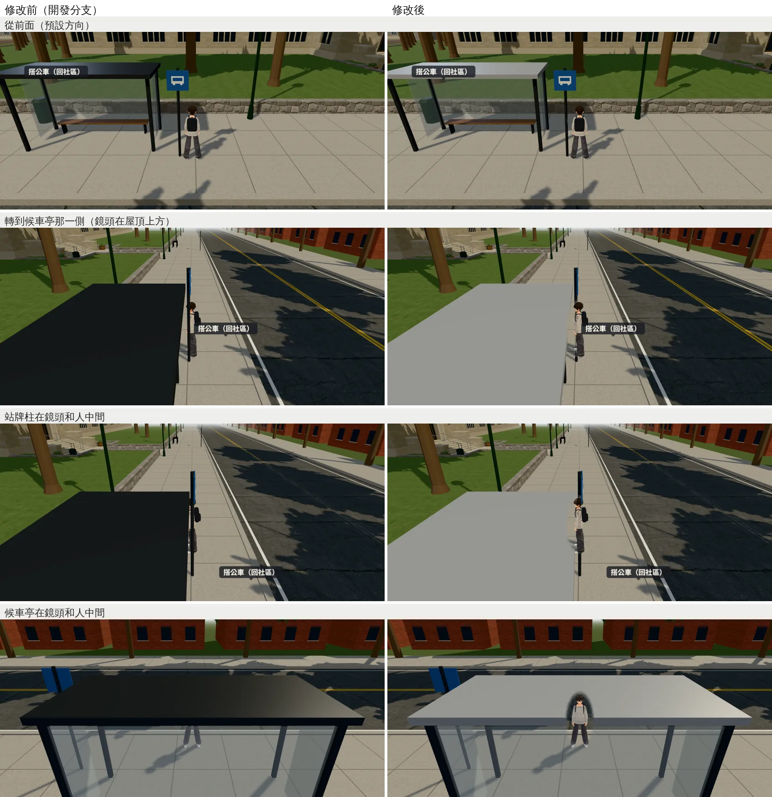

# 美國校園公車站：候車亭屋頂從上面看不再是一整塊黑；候車亭、站牌柱擋人時網點透空（#129）

帳號 A 的 LAWWW2，2026-10-22 09:0x～09:3x UTC。

- **狀態**：交件；`READY_FOR_ART_REVIEW`（場景美術由使用者驗收）。
  - `patches/us_campus_shelter.diff`：`src/us3d.js` 一行＋新的 `tests/us_campus_shelter_unit.js`，對開發分支 `2181fe4d` 乾淨。
  - `us_campus.glb`（＋`.json`）同檔名替換。
- **派工**：LAWWW 09:00「候車亭屋頂全黑那件你修就好，交件附前後」。
- **起因**：10-22 美國巡場景重拍（j38b `us_campus_spawn_3`，`ART_DIRECTOR_PATROL.md` 第 9 節）。
  - 鏡頭轉到候車亭那一側時，鏡頭在屋頂上方。
  - 屋頂原本和柱子同一個材質 `usu_steel`：深灰、金屬度 0.5。遊戲沒有環境貼圖，金屬從上面看幾乎是黑的，畫面左邊一整塊黑。
  - 站牌柱在人旁邊；鏡頭轉到某些角度時，柱子在鏡頭和人中間。

## 改了什麼

### 正式模型（`tools/blender/env_second/us_campus.py` → `assets/models/env/second_ai/us_campus.glb`＋`.json`）

- 屋頂自己一個材質 `usu_shelter_roof`：淺灰烤漆鋁板（#b4b8bb、粗糙度 0.45、金屬度 0.1）。
- 屋頂的方塊從柱子那一組搬到自己的網格；位置、尺寸不變（候車亭上方 2.5～2.62 m）。
- 比對修改前（開發分支 `2181fe4d`）和修改後：
  - 三角形一樣（132,611）：`usu_steel` 140 → 128、新的 `usu_shelter_roof` 12（就是屋頂那個方塊）。
  - 其他材質的三角形數一樣、設定一樣。
  - 材質 74 → 75、節點 86 → 87；10,521,476 → 10,522,172 bytes。
  - 候車亭在畫面裡時多一次 draw call（屋頂）。

### 程式（`src/us3d.js`，一行）

```js
const SEE_MATS={us_market_street:/^usms_vc_metal$/, us_campus:/^(usu_steel|usu_shelter_glass|usu_shelter_roof)$/};
```

- 和超市街的站牌柱同一套（`us_ms_seethru`，已整合）：這幾種材質擋在鏡頭和人中間時，網點透空。
- `usu_steel` 在美國校園用在：候車亭的框、長椅腳、站牌柱、黃色行人標誌的柱子。
- 其他材質（長椅木頭、綠色路燈、地面、窗玻璃）不透空。

## 測試（`tests/us_campus_shelter_unit.js`，新，Node）

- 在 Node 建出美國校園（正式模型換成每一種材質一個小網格的假模型），檢查：
  - 只有那三種材質標了 seeThrough、shader 有 patch；
  - 讀真的 GLB：屋頂有自己的材質，是淺色（線性亮度 ≥ 0.3）、不是金屬（≤ 0.2）；
  - 屋頂的頂面（2.62 m）在 `usu_shelter_roof` 裡；
  - 站牌柱 (−21.0, 20.5) 的頂點在 `usu_steel` 裡。

| 程式＋模型 | 結果 |
|---|---|
| 開發分支 `2181fe4d`（修改前） | **FAILED 3**（沒有透空；沒有屋頂材質；屋頂頂面不在屋頂材質裡） |
| 只改 `us3d.js`、舊的 GLB | FAILED 2（GLB 那兩項） |
| **修改後**（`us3d.js`＋新的 GLB） | **ALL PASS** |

- `node tests/nav_buildings_unit.js`：ALL PASS（j42）。

## 遊戲內前後（j42、j44）

- Playwright＋SwiftShader，844×390（手機橫向）、像素比 2，**不是 iPhone**。15:00，法律系那幾年（`stage: law`）。
- j42：修改前＝開發分支 `5aa16a70`，修改後＝換 GLB＋套 patch。這兩張（從前面、轉到候車亭那一側）用的是出生點。
- j44：修改前＝開發分支 `2181fe4d`，修改後＝換 GLB＋套 patch。
  - 人放在站牌柱東邊 1.2 m、鏡頭在西邊：柱子在鏡頭和人中間。
  - 人放在候車亭前面（馬路那一側）、鏡頭在北邊：候車亭在鏡頭和人中間。



- **從前面**：屋頂原本是深色的一條，修改後是淺灰的鋁板屋頂；框、站牌照舊。
- **轉到候車亭那一側**：原本畫面左邊一整塊黑，修改後是淺灰的屋頂頂面。
- **站牌柱在鏡頭和人中間**：
  - 原本人被柱子和藍色站牌切開，左邊還有一整塊黑的屋頂。
  - 修改後柱子、站牌擋到人的那一段網點透空，整個人看得到；屋頂是淺灰。
- **候車亭在鏡頭和人中間**（鏡頭在候車亭後面、比屋頂高）：
  - 原本人的上半身被黑色屋頂蓋住，只看得到玻璃後面的腿。
  - 修改後屋頂在人那一塊網點透空，整個人看得到。
- j44 修改後跑的 `us_campus_shelter_unit`（開發分支 `2181fe4d`＋patch＋新 GLB）：ALL PASS。

## 接法（LAWWW）

1. `git apply docs/art-rebuild/second_ai/patches/us_campus_shelter.diff`（`src/us3d.js` 一行＋`tests/us_campus_shelter_unit.js`），對開發分支 `2181fe4d` 乾淨。
2. 換 `assets/models/env/second_ai/us_campus.glb`、`us_campus.json`（同檔名）。
3. 跑 `node tests/us_campus_shelter_unit.js`、`node tests/us_ms_seethru_unit.js`、`node tests/nav_buildings_unit.js`。
4. 腳本：`tools/blender/env_second/us_campus.py`。

## 還不到的地方（誠實寫）

- 屋頂從上面看是一片平的淺灰，沒有鋁板的接縫、排水溝。
- 真機沒看過。
