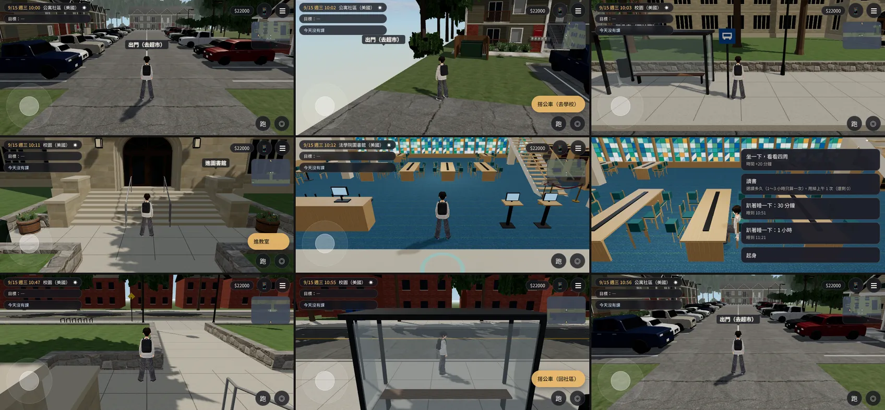

# US-CAMPUS-WIRE-1018：美國校園、法學院圖書館接成區域

LAWWW2-C，2026-10-18。
- 誰派的：LAWWW-C 11:47。LAWWW-C 審過再套，排在 v9.10.1 發布後。
- patch：`docs/art-rebuild/second_ai/patches/us_campus_wire.diff`。
  - 對 LAWWW-C 開發分支 `40c3ed4f`（cd2453bb 以後）。
  - **先套 `us_season.diff`，再套這個**：兩個依序 `git apply --check` 都乾淨。
- 資產在我的分支（同一個 commit）：
  - `assets/models/env/second_ai/us_campus.glb`（四季、新紅磚）、`us_campus.layout.json`（第 3 版）；
  - `us_lawlib.glb`、`us_lawlib.layout.json`；
  - 新的 `us_community.glb`（四季；`us_season.diff` 要配它）。

## 玩家會看到
1. 社區入口旁邊多一個「**搭公車（去學校）**」：和「出門（去超市）」相距 3.6 m，範圍不重疊。
   - → 美國校園的公車站，站牌旁邊、面向法學院。
2. 校園：公車站 → 人行道 → 穿過亂石矮牆的走道 → 法學院台階下：
   - 「**進教室**」：`usClass:'law'`，交換系統接 2D 課堂。沒有接的時候只說一句「教室在台階上去的走廊裡。」
   - 「**進圖書館**」→ 法學院圖書館。
   - 校門「往活動中心」：`usGate:'union'`，關著，說「這一版還沒開放」。
   - 公車站「**搭公車（回社區）**」→ 社區入口（和登機抵達、從超市回來同一個點）。
3. 圖書館：
   - 從門進來；
   - 中庭長桌、窗前短桌、圓桌「坐下來讀書」：坐下的選單有「讀書」，和總圖一樣（`study`）；
   - 軟椅「坐在軟椅上」；
   - 服務台、書架、查詢電腦、彩色玻璃窗「看」；樓梯口紅絨繩「上不去」；
   - 「離開圖書館」→ 台階下。
4. **美國的戶外區域（校園、社區）不畫遠景剪影**：原本看得到台北的山和城市大樓。
5. 四季：兩個戶外區域都走 `outdoorZone`，照 `us_season` 換。

## 改了什麼（程式）
- `src/us3d.js`：
  - `us_campus`（`outdoorZone`）、`us_lawlib`（照 `us_asian_market` 的做法：`Z3.room`＋`attachRoomGLB`）；
  - 社區的「搭公車（去學校）」；
  - `outdoorZone` 預設 `noSkyline`；
  - `SPAWN.us_campus`（公車到站）、`us_campus_class_out`（下課出來）、`us_lawlib`；
  - `Z3.ZONES` 註冊兩個區域。
- `src/engine3d.js`：每格設遠景剪影的那一行加上 `zone.def.noSkyline`。
  - 只改一行：原本每格都設 `visible=!E.indoor`。
  - 在 `loadZone` 設沒用，下一格又被設回去，第一次測試就是這樣失敗的。
- `src/exchange3d.js`：`US_ZONES` 加 `us_campus`、`us_lawlib`（`inUS`：當地時間、手機地點等等）。
- `src/assets3d.js`：`bldg.us_campus`、`bldg.us_lawlib`（lazy）。
- `src/data/us_layouts.js`：`US_CAMPUS_LAYOUT`、`US_LAWLIB_LAYOUT`。
  - `tools/blender/env_second/gen_us_layouts.py` 產生；其他配置和開發分支逐字相同。
- 交換系統可以攔的旗標：`usBus:'campus'`（社區）、`usClass:'law'`、`usGate:'union'`、`usLib:<id>`。

## 配置的小修（測試抓到的）
- 校園：下課、出圖書館的出生點 z 8.42 → 9.02。
  - 原本在「進教室」「進圖書館」的範圍裡，一出來就站在入口上。
- 圖書館：進門的出生點 z 8.4 → 7.8，「離開圖書館」半徑 1.2 → 0.9。
  - 原本一進門就站在出口上。
- 圖書館：中庭西邊長桌最北那一張椅子後面是方柱，遊戲的走近點都站不住。
  - 配置給它一個走近點 `ap`（側後方、遠離柱子）。
  - `us_lawlib_layout_gen.py` 照方柱自動算。

## 測試（套兩個 patch 的開發分支 `40c3ed4f`）
- `node tests/nav_us_unit.js` **ALL PASS**（74 項，新加 17 項）：
  - 校園：出生點、三個到達點、互動點全部走得到；草坪、老校區、馬路、西邊路口走不上去；公車站 → 台階下、→ 校門廣場走得到；`noSkyline`；`US_ZONES`。
  - 圖書館：出生點、53 個座位（走近點也是）、互動點走得到；書架、長桌、樓梯擋住。
  - 社區：「搭公車（去學校）」。
  - 出入口的 16 個到達點都站得住，不會一到就在另一個出口上。
- `node tests/us_season_unit.js` **ALL PASS**：要我分支的新 `us_community.glb`，舊的 GLB 會有 2 項 FAIL（沒有季節材質）。
- `node tests/exch_min_unit.js`、`node tests/nav_buildings_unit.js` **ALL PASS**。
- **真實玩家流程** `python3 tests/flow_us_campus.py`（新）**ALL PASS**：
  - 不用 turbo、不瞬移；手機模擬，iPhone 橫向；
  - [前置] 只有讀檔到 2028/9/15 10:00 社區入口；
  - 社區 → 搭公車 → 公車站（正式模型、沒有遠景剪影）→ 走到台階下「進教室」有說明 → 進圖書館 → 走到長桌坐下（選單有「讀書」）、站起來 → 離開圖書館（回到台階下）→ 走回公車站 → 搭公車回社區；
  - 沒有 JS 例外，walkFallbacks＝0。

## 遊戲內截圖（`flow_us_campus.py` 拍的，844×390 橫向手機模擬，9/15 10:00）
左到右、上到下：
1. 社區入口；
2. 「搭公車（去學校）」；
3. 校園公車站；
4. 台階下「進教室」「進圖書館」；
5. 圖書館門口；
6. 長桌坐下（選單）；
7. 出圖書館；
8. 公車站「搭公車（回社區）」；
9. 回到社區。

## 沒做、沒測
- 美國的課（2D 課堂）、公車的字卡和時間：交換系統接（`usClass`、`usBus`）；這版只有說明或直接換區域。
- 活動中心：沒做，校門關著。
- 圖書館樓上：關著，紅絨繩。
- iPhone 實機；直向的流程（只拍了橫向）；晚上的圖書館燈光。
