# SCN-US-01 美國公寓社區「Linden Grove」戶外（區域 `us_outside`）＋美式汽車五款（LAWWW2-C 2026-10-17；狀態 MODEL_READY → READY_FOR_ART_REVIEW）

美國交換（大三下）住的校外公寓社區的戶外：祐廷那棟（B 棟）二樓 213 的樓梯平台（`us_apartment` 的 breezeway）走下樓就是這裡。
照使用者 2026-10-16、10-17 給的社區照片做（`research/us_apartment_photos.md` 照片二；10-17 又給一張停車場那一側的）。
社區名 Linden Grove（AA_144 5-4，虛構，D77）：**模型上不放社區名、門牌號碼、車牌**（紅色社區牌、門牌都是空白；要寫字由遊戲畫）。
場景美術的 `ART_APPROVED` 只有使用者能標（D38／D59）。季節（8 月出發、12 月回來）等 AA_213（ART-US-SEASON）：這一版是夏末、草地和樹都是綠的。

## 交件
- 社區：`assets/models/env/second_ai/us_community.glb`（5.4 MB、88,361 三角形、25 個物件、30 個材質；同材質合併。三角形大半是樹：樹冠＝芯＋葉片卡）。
- 配置（遊戲和 Blender 共用）：`assets/models/env/second_ai/us_community.layout.json`（`tools/blender/env_second/us_community_layout_gen.py` 產生；有自我檢查：出生點、上樓點、出口不在阻擋裡、出生點附近沒有車）。
- 汽車：`assets/models/env/second_ai/us_cars.glb`（五款：`car_sedan` 轎車、`car_suv` 休旅車、`car_pickup` 皮卡、`car_hatch` 掀背、`car_minivan` 廂型車；每款一個節點、原點＝車底中心、車頭朝 +z；尺寸 `us_cars.json` 的 `dims`＝[車長、車寬、軸距、輪徑]）。社區停車場、之後的美國校園街道（SCN-US-02）、超市停車場共用。
- 腳本：`python3 tools/blender/env_second/us_community_layout_gen.py` → `/opt/blenv/bin/python tools/blender/env_second/us_cars.py` → `/opt/blenv/bin/python tools/blender/env_second/us_community.py`（`-- --preview <out.glb>`：另外輸出一份把車停進去、上好色的版本，只給驗收渲染用）。

## 空間（layout.json；區域座標 x 往東、z 往南、y 往上；範圍 x −42～42、z −32～32）
| 東西 | 位置 | 說明 |
|---|---|---|
| A 棟 | 中心 (−25, −22.5)，長 28、深 13，正面朝南 | 一個樓梯間（正面局部 u＝−4） |
| B 棟（祐廷住的） | 中心 (8, −22.5)，長 32、深 13，正面朝南 | 兩個樓梯間（u＝−8、6）；**東邊那個（世界 x＝14）就是 213 那一個** |
| C 棟 | 中心 (33.5, 6)，長 26、深 13，正面朝西 | 一個樓梯間（u＝2）；壁板是淺米色（照片裡有幾棟是淺色的） |
| 停車場 | x −34～24、z −10～10 | 兩排車位（40 格，`stalls`）、中間車道；`cars` 28 台（停七成，空位給玩家走） |
| 出口 | (−40, 0) | 往西的車道出社區，`exit_west` → `us_bus_stop`（之後的區域） |
| 樹林 | 外圍一圈（南邊最厚） | 走不到；北邊在建築背後（從停車場看得到屋頂後面的樹，照片） |

- **建築**：兩層樓（每層 2.9 m；照片）、山牆朝前（每一戶一個、樓梯間入口上面一個）、山牆上白色圓形通風口；灰橄欖色橫向壁板（法線貼圖做出一片一片的唇）、白色轉角飾條、封簷板、簷溝、落水管；一樓轉角與樓梯間兩側紅磚柱；每戶一個內凹陽台（咖啡色木欄杆、落地玻璃門、有的放椅子或盆栽）＋一扇白框窗（半透明玻璃後面看得到白色百葉）；牆上一排電錶、冷氣室外機。
- **樓梯間（breezeway）**：凹進去 6 m、寬 4.4 m；中間一跑直上二樓（18 階、級高 0.161、級深 0.25；水泥踏板、深色鋼梯梁、白鐵扶手）；二樓後段是平台（後牆兩戶的門，門上紅色門牌空白）、一樓兩側牆後段各一戶的門；壁燈每層兩盞；入口走道兩側白鐵欄杆（照片）。細節在 layout 的 `breezeway_geom`。
- **地面**：草地、深灰柏油（Poly Haven asphalt_02）、白色車位線、水泥路緣與人行道（建築正面一條、接到每個樓梯間）、灌木帶（每叢＝深色芯＋葉片卡）。
- **小東西**（`props`）：集中信箱、垃圾子母車＋木圍籬、腳踏車架、長椅、美式路燈（深古銅色、鞋盒燈頭）。

## 接法（給 LAWWW）
- **出生點／上樓**：`spawn_home`（從 213 下樓出來站的位置：B 棟東邊樓梯間入口欄杆外、面向停車場）、`to_home`（樓梯腳，互動「上樓（213）」→ `us_apartment`）。`us_apartment_layout.js` 的 exit（平台東端的樓梯）對到這裡。
- **導航阻擋**：`blocks`（78 個長方形，區域座標，每個有 `why`）：建築本體（樓梯間凹進去的地方走得進去，只擋中間的樓梯）、入口欄杆、灌木帶、路燈與小東西、樹幹、外圍樹林。車的阻擋照 `cars`（車長×車寬轉 yaw）。
- **車**：遊戲照 `cars` 的 kind／x／z／yaw 放 `us_cars.glb` 的節點，`car_paint` 材質是白色、照 `color` 上色（和公館的機車、腳踏車同一個做法）。同款可以用 InstancedMesh。
- **發光**：`GLOW_usc_lamp`（路燈燈頭、樓梯間壁燈：晚上調亮）；車的 `GLOW_car_head`／`GLOW_car_tail`（停著的車晚上不亮，可以關掉發光）。
- **葉子**：`usc_leaf_small`（葉片卡，透明貼圖、雙面）——樹冠、灌木都是同一個材質。樹冠和灌木的芯是 `usc_tree_core`、`usc_shrub_core`（很暗、不反光）。
- **天空與太陽**：戶外區域照 D29 設 `sunYaw`（區域 x 往東、−z 往北就不用轉）。
- **鏡頭碰撞**：建築本體（`blocks` 裡 why＝building 的那幾個加高到屋簷 6.0 m）。

## 圖（Blender Cycles，Standard、曝光 −1.6；**不是遊戲內截圖**——遊戲內截圖要等 LAWWW 接成區域）
車是驗收用的 `--preview` 版本（照 layout 的 cars 停進去、上色）。
從停車場西邊看（照片的角度：兩層樓、山牆、樓梯間、後面的樹林；中間淺色那棟是 C 棟，被西曬照得很亮）：
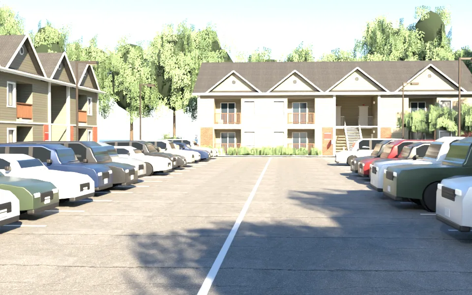
俯瞰 B 棟（祐廷住的那棟）：
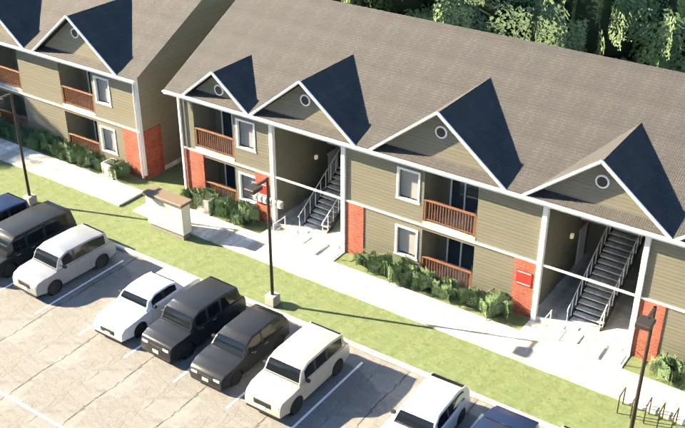
B 棟正面（陽台、白框窗與百葉、紅磚柱、紅色社區牌、樓梯間）：
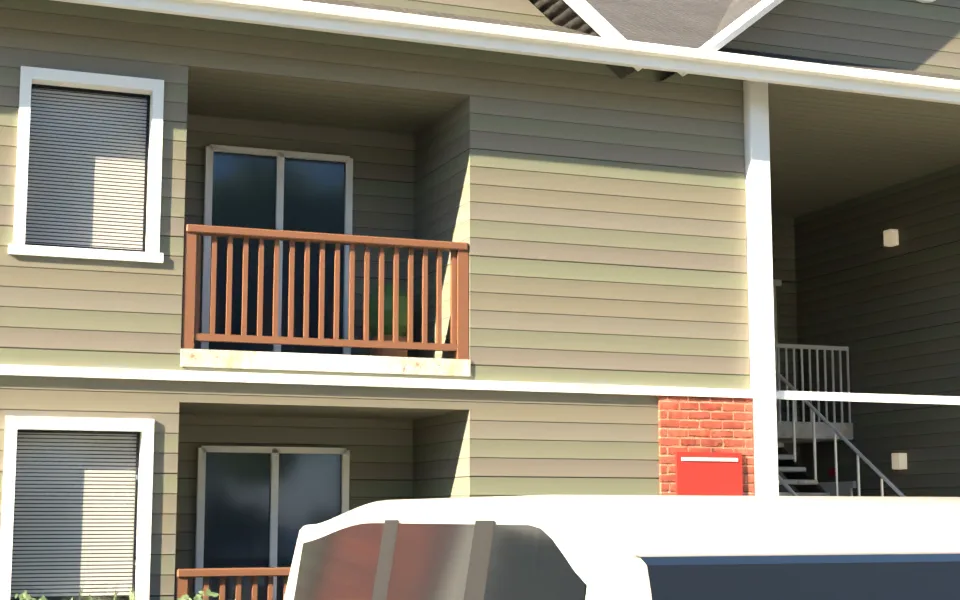
樓梯間裡面（中間一跑直上二樓、二樓平台兩戶的門、一樓兩側的門、壁燈）：
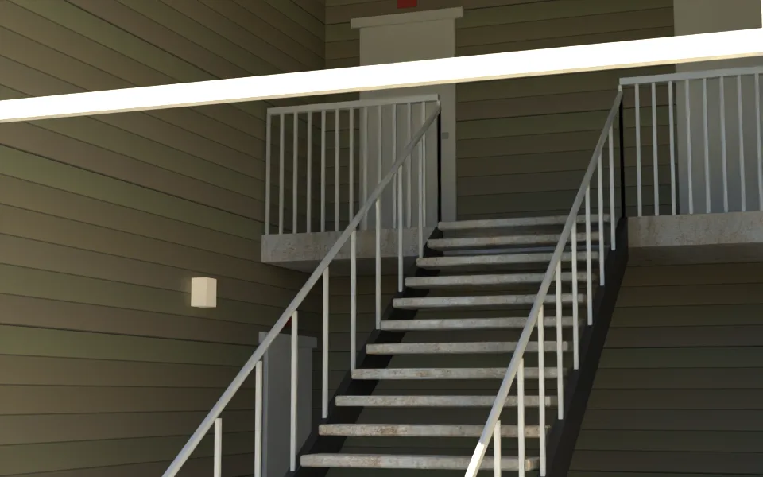
從停車場看 B 棟的樓梯間（電錶、信箱、後面的樹林）：
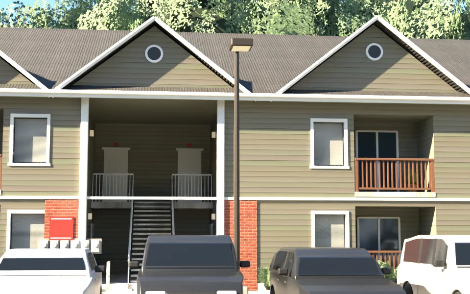
C 棟（淺米色）：
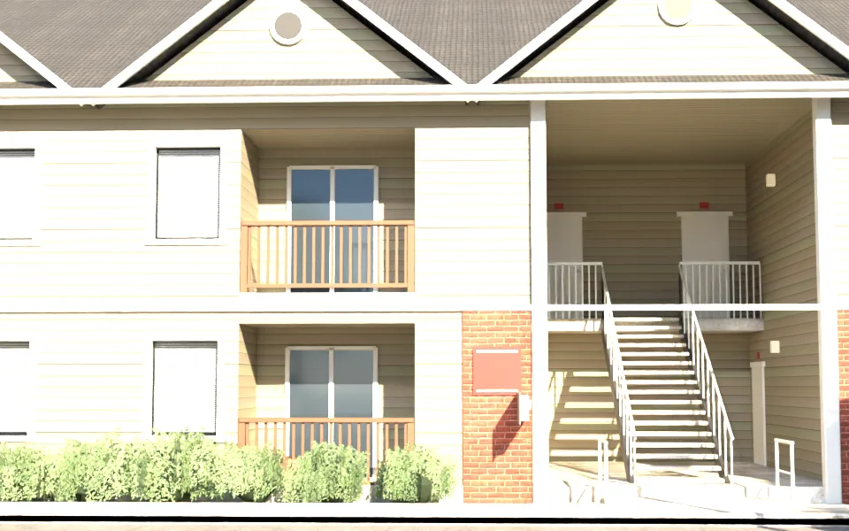
屋頂（山牆、通風口、封簷板、深色瓦）：
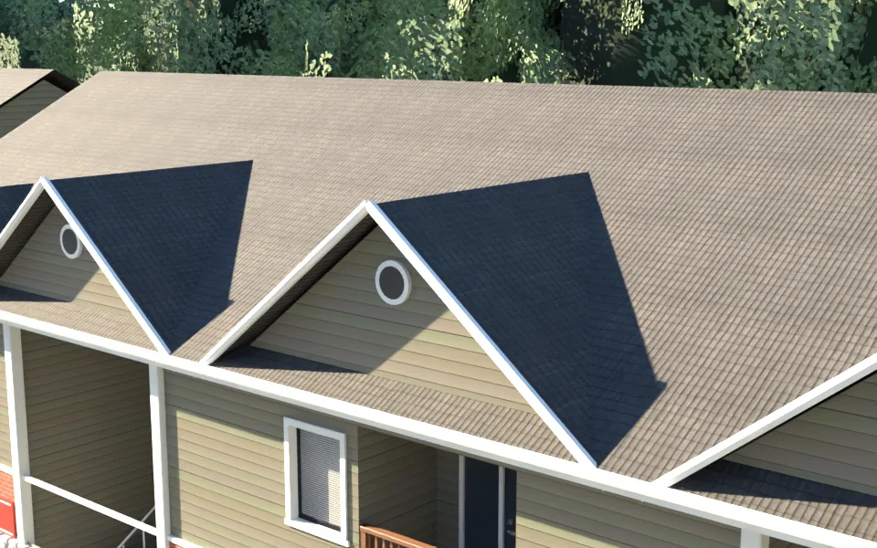
停車場往南看樹林（人眼高度；遊戲鏡頭比較高、往下看）：
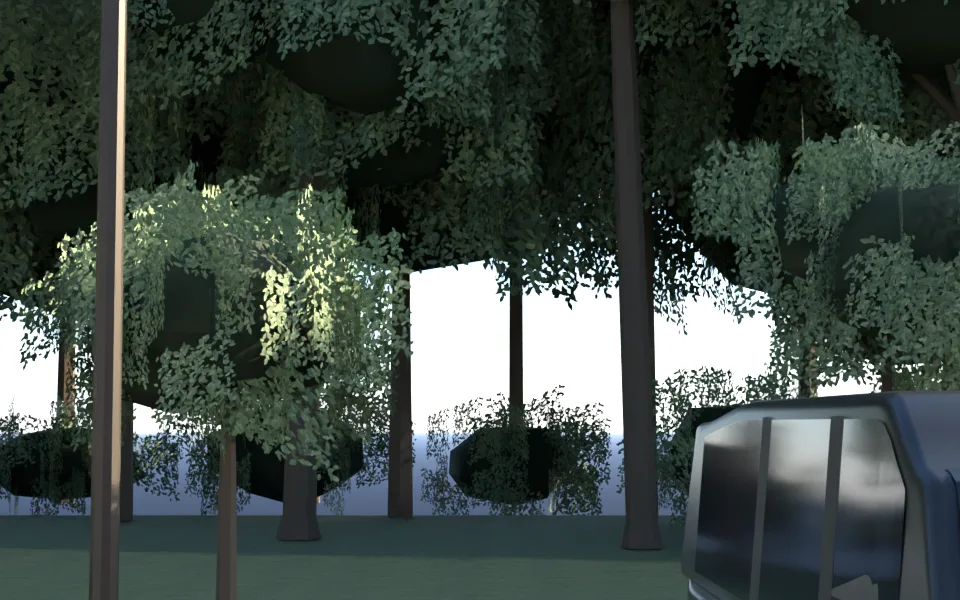
停車場裡的車（近看）：
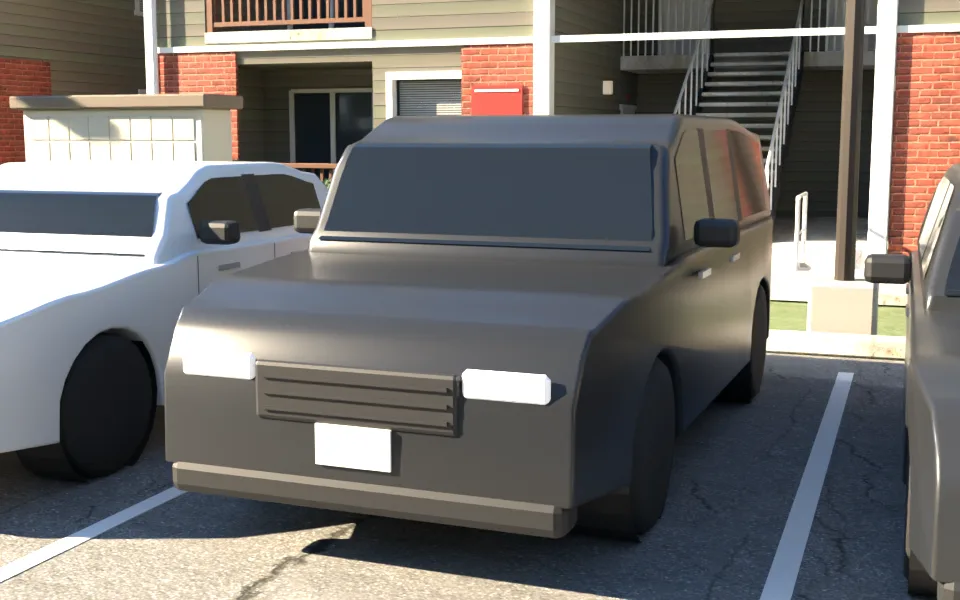

### 汽車五款（`us_cars.glb`；驗收渲染上了紅色，遊戲照 layout 的 color 上色）
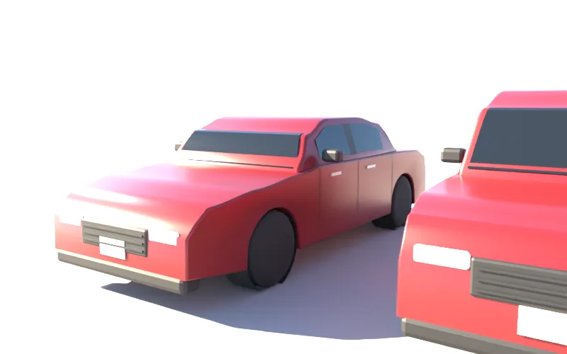
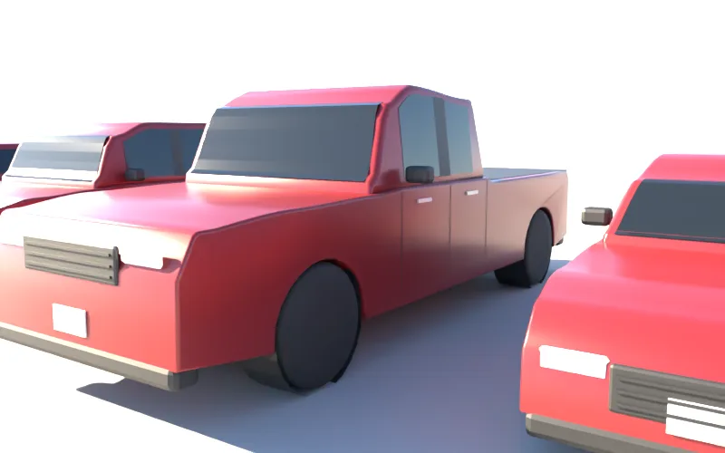
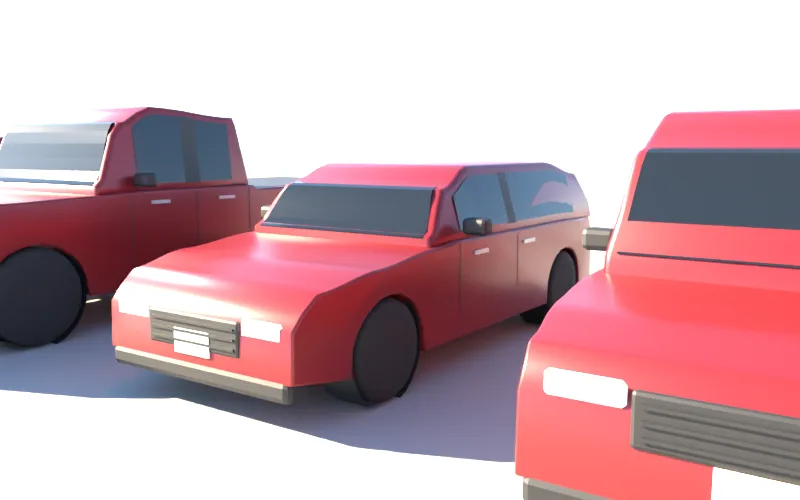
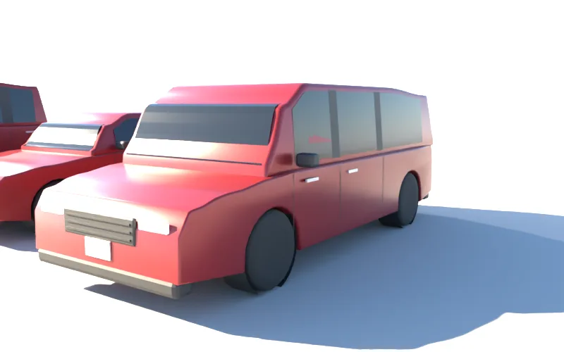
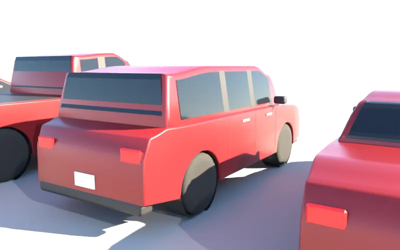

### 版本（自己退件的）
- 汽車第一版（`cars_v1_sedan_q.webp`）：超橢圓斷面放樣，車身像黏土、擋風玻璃是車身色。第二版改成「側面輪廓擠出＋輪廓邊倒圓角」（`cars_v2_sedan_q.webp`），但擋風玻璃前面、後擋後面多一段平台（車頂高度內插的錯誤）。第三版（這一版）修掉，加引擎蓋與車頂微拱、車頭平順收窄、黑色 B 柱、車門接縫、水箱罩橫條。
- 社區第一版（`v1_overview.webp`、`v1_b_front.webp`）：三層樓、曝光過度、灌木是低面數的綠球、C 棟一大片沒有窗；照使用者 10-17 的照片改成兩層、山牆對齊每一戶、樓梯間入口加山牆與欄杆。第二版（`v2_forest.webp`）：樹林是平面的綠色鋸齒、大樹稀稀疏疏；第三版（`v3_lot_west.webp`）：樹冠的芯是淺綠色的低面數石頭。這一版：芯改很暗、平滑、葉片卡加密、外圍一圈連續樹林、樹林邊緣有灌叢。

## 八項（ART_SOP 3-2）
| 項目 | 結果 | 說明 |
|---|---|---|
| 輪廓與倒角 | 通過 | 山牆、封簷板、簷溝、落水管、轉角飾條、窗框四片、陽台欄杆（扶手倒角、立柱）、白柱子倒角；車身是輪廓擠出＋倒圓角，不是方塊 |
| 材質 | 通過 | 壁板＝程式產生的橫向壁板（每棟另烤顏色）＋法線貼圖（每片的唇）；紅磚 Poly Haven `red_brick_03`、屋頂 `grey_roof_tiles`（去黃、調深）、柏油 `asphalt_02`、水泥 `concrete_wall_006`、草地 `grass_ground`；金屬度都 ≤0.45 |
| AO | 部分 | 樹冠的芯很暗（樹冠裡面的陰影）、灌木同樣；牆腳水泥基礎；沒有烘焙 AO |
| 磨損 | 部分 | 柏油貼圖本身的裂縫與補丁；壁板、屋頂沒有做髒污 |
| 生活痕跡 | 通過 | 陽台的椅子、盆栽；門口腳踏墊；集中信箱、垃圾子母車、腳踏車架；停車場停七成、車色混合（照片） |
| 比例 | 通過 | 每層 2.9 m、屋簷 6.0 m、樓梯級高 0.161／級深 0.25、扶手 0.92、陽台欄杆 1.05、車位 2.7×5.5、車道 7 m；車的長寬軸距照真車 |
| 效能 | 部分 | 社區 88k 三角形（樹佔大半）、25 個物件、5.4 MB；車每台約 5.7k 三角形，28 台約 16 萬——**建議遊戲用 InstancedMesh、遠的車降階或只放近的幾排**；GLB 可以再用 glTF Transform／Meshopt 壓 |
| 遊戲截圖 | **沒有** | 要等 LAWWW 接成區域；接好後我拍白天、晚上、手機直向 |

## 還沒做／已知
- 季節：等 AA_213（ART-US-SEASON）。12 月回來那一段要冬天版（落葉、灰色草地、可能有雪）。
- 樓梯間只做到二樓平台；一樓的門、其他戶的門都不能進（只有 213 能進，在 `us_apartment`）。
- 社區辦公室（leasing office）、游泳池沒有做（照片沒有、劇情沒用到）。
