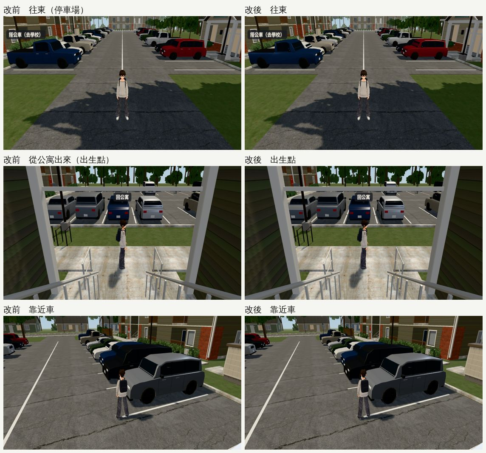
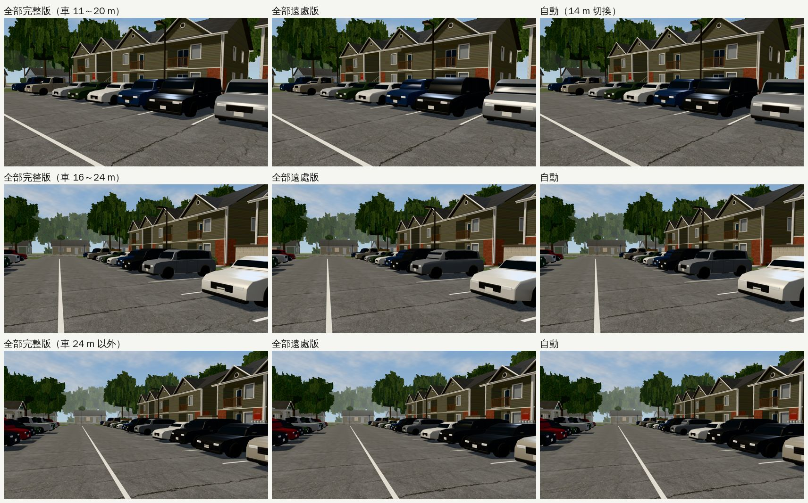

# US-COMMUNITY-EAST-PERF：美國社區往東（停車場、公寓）變快（2026-10-25，LAWWW2-B）

- **派工**：LAWWW-B 10-25 02:0x 的 ③「照巡查清單自己排（D99 三條路線內）」。03:5x 告知 LAWWW-B 開工；04:5x 告知要動 `us3d.js` 哪一段。
- **為什麼排這個**：交換那一學期每天從公寓出來，第一眼就是停車場；往東 SwiftShader 只有 1.6～1.9 fps，比往西（改後 4.0）慢一倍。BB 也記過「往東兩版都 1.5」。
- **對**：開發 `bcb0dc771`（已包含 LAWWW-B 的 `usSeasonKey(g)` 那一行；這次沒碰）。
- **環境**：Playwright＋SwiftShader 手機模擬（844×390），不是 iPhone 實機。
- **狀態**：`READY_FOR_ART_REVIEW`。場景的 `ART_APPROVED` 只有使用者能標。

## 找原因（同一頁切換；出口往東、從公寓出來的出生點兩個鏡頭）

| 切換 | 往東 fps | 出生點 fps | draw call（往東） |
|---|---|---|---|
| 原本 | 1.8～2.0 | 2.2～2.4 | 498 |
| **藏起停車場的車** | **3.2～3.4** | **3.0～3.2** | 107 |
| 藏起葉片卡 | 2.2～2.4 | 2.6～2.8 | 490 |
| 藏起樹冠芯／建築／地面 | 2.0～2.2 | 2.4～2.8 | — |
| 整體關陰影（參考） | 2.6～2.8 | 3.2～3.4 | 337 |

- 最貴的是停車場的 **28 台車**：每台 10 個網格、約 5,800 個三角形，陰影那一輪再畫一次。
- 試過、不採用的：

| 試法 | 結果 | 為什麼不用 |
|---|---|---|
| 把車照停車列分群合併（`P3.mergeStatic`） | draw call 498 → 246，fps 不變 | 慢的不是 draw call，是三角形；合併還會轉成非索引格式（頂點變多） |
| 全部車合成一群 | draw call 138，往東不變、**往西變慢**（3.9 → 3.5） | 合成一個大網格以後，背後的車也剔除不掉 |
| 車的材質改單面 | 只快 0.2 | 輪胎是朝內的旋轉體，單面時**整個不見**、車身顏色也變；風險大 |

- 估上限：把 15 m 外的車整台藏起來，往東 1.9 → 2.6、出生點 2.2 → 2.5。

## 改法

1. **`tools/blender/env_second/us_cars.py`**：每款車多匯出一個 `<款式>_lod1`（遠處用）。
   - 輪廓、比例、車窗位置、材質和完整版一樣：長寬高差 ≤ 4 mm；車漆照樣由遊戲上色，車燈照樣可以關。
   - 只減細節：車身站點 41 → 17、輪拱 13 → 7 點、倒角 1 段；車窗、柱子格數減少；不做門縫、水箱罩橫條、門把；輪胎 10 段、輪圈一個圓盤。
   - 三角形：約 5,800 → 約 1,500（1/4）。
   - **完整版一點都沒動**（三角形數和改前一樣）；GLB 0.87 → 1.18 MB。
2. **`src/us3d.js`**（`patches/us_cars_lod_1025.patch`）：戶外區域放車那一段。
   - 有 `_lod1` 就包 `THREE.LOD`：離鏡頭 `CAR_LOD_D`＝14 m 以內用完整版、以外用低面數。和 `zones3d.js` 公館機車同一套做法。
   - 跟隨鏡頭在玩家後面約 5 m：玩家身邊 9 m 內的車都是完整版。陰影那一輪也跟著換。
   - 上色、關車燈、投影子用同一個函式，兩個版本一樣。
3. `us_community.py`、`us_market_street.py` 的驗收預覽不放 `_lod1`。

## fps（同一頁、同一個鏡頭；每格 5 次，每次 5 秒；844×390）

| 鏡頭 | 改前 | 改後 | 三角形（改前 → 改後） |
|---|---|---|---|
| 出口往東（停車場） | 1.8～2.0（平均 1.9） | 2.4～2.8（平均 2.6，+35%） | 51.3 萬 → 34.1 萬 |
| 從公寓出來（出生點，看停車場） | 2.2～2.4（平均 2.2） | 2.4～2.6（平均 2.6，+14%） | 46.2 萬 → 36.2 萬 |
| 出口往西 | 3.8～4.0 | 4.0～4.2 | 35.0 萬 → 32.0 萬 |
| 停車場中間、靠近車 | 2.2～2.4 | 2.4～2.6 | 51.6 萬 → 40.7 萬 |

- 往東的結果和「15 m 外的車整台藏起來」的上限一樣（2.6）。
- 剩下的成本是近處那幾台車，它們照舊用完整版。
- 量 fps 時沒有其他瀏覽器、Blender 工作。

## 改前、改後（同一個鏡頭）

- 看不出差別：近處的車是完整版；遠處的車換了，但在畫面上只有幾十個像素高。

## 切換點附近：同一批車全用完整版、全用遠處版、自動

- 【捷徑】用 JS 把每台車的 `THREE.LOD` 停在某一級（`autoUpdate=false`），只為了比較；遊戲照常是自動。
- 11 m 以外：完整版和遠處版幾乎一樣。輪框幅條、門把、門縫在這個距離本來就看不出來。
- 遠處版的差別要在 10 m 內才看得出來（例如第二排右邊那台白車的水箱罩）。這個距離遊戲裡是完整版。
- 三張的取景左右差一點，是固定鏡頭轉過去時的小差異，和換版本無關。

## 交件

| 檔案 | 內容 |
|---|---|
| `patches/us_cars_lod_1025.patch`（對 `bcb0dc771`） | `src/us3d.js`、新測試 `tests/us_cars_lod_unit.js` |
| `assets/models/env/second_ai/us_cars.glb`（＋`.json`） | 多五個 `_lod1` 節點 |
| `tools/blender/env_second/us_cars.py`、`us_community.py`、`us_market_street.py` | 腳本 |

## 測試

- **新測試 `node tests/us_cars_lod_unit.js`**：改前 FAIL 8、改後 ALL PASS。檢查項目：
  1. 五款都有完整版和 `_lod1`，`_lod1` ≤ 30% 三角形；
  2. 長寬高差 ≤ 3 cm、材質一樣；
  3. 完整版的三角形和改前一樣；
  4. `us3d.js` 放車包 `THREE.LOD`、切換距離 ≥ 10 m、兩個版本用同一個上色函式。
- **相關的 Node 測試**（套上 patch，在 `bcb0dc771`）ALL PASS：
  - `tests/us_*_unit.js` 全部 15 支（含新的 `us_cars_lod`、`us_traffic`、`us_market_street`、`us_market_cam`、`us_life`、`us_season`、`us_airport_dusk`、`us_community_perf`）、`nav_us`；
  - 還有 `aa370`、`aa412`、`aa424`、`aa450`～`aa454` 美國篇、`exch_min`、`campus_bikes`、`syllabus`、`sign_audit_1025`、`window_night_sync`。
  - 注意：`aa450`～`aa454` 會用 `git show` 讀企劃線的稿；repo 裡沒有企劃分支 `claude/cool-heisenberg-o8kuqx` 的 commit 時，「稿裡有……」那些項目會 FAIL（和這份 patch 無關），fetch 以後全過。

## 沒測

- 手機實機、整套回歸。
- 超市街（`us_market_street`）的停車也走同一段程式，有 `_lod1` 一樣會換；那一區沒有量 fps、沒有拍截圖。
- 超市街路口會動的車（`us_traffic3d.js`）沒改，照舊用完整版。
