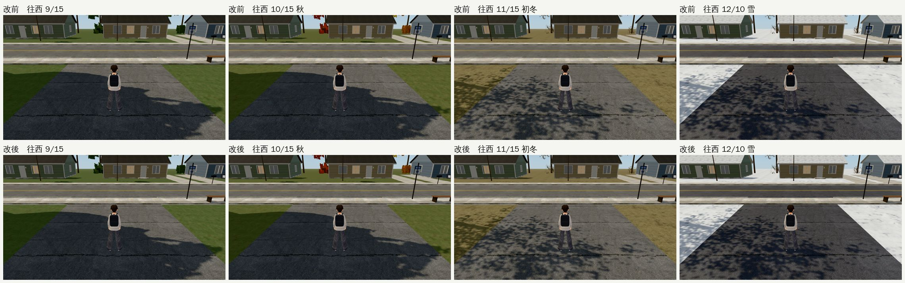
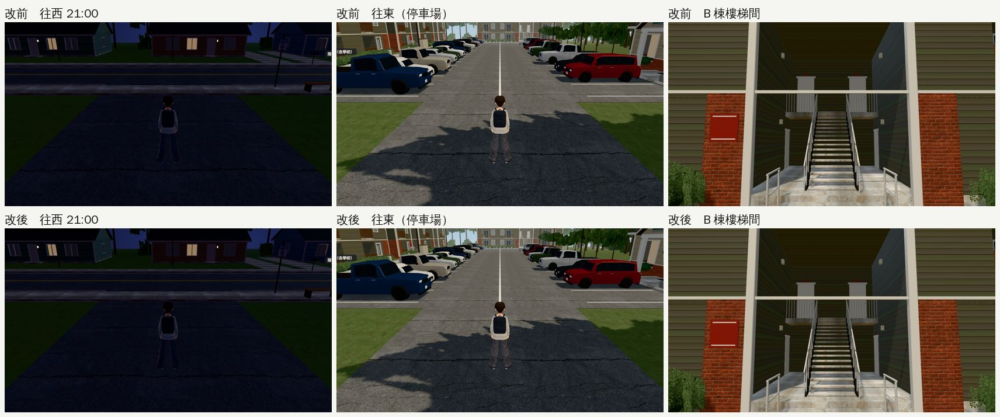
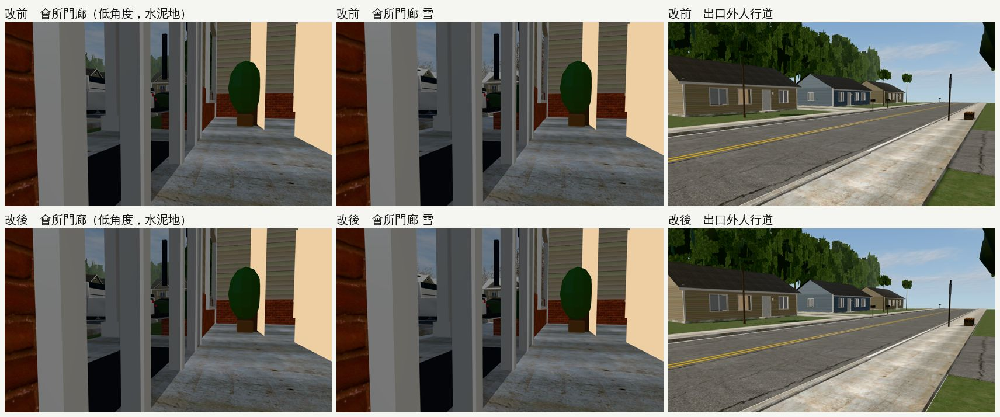

# US-COMMUNITY-WEST-PERF-1025：美國社區西邊出口往西變慢（2026-10-25，LAWWW2-B）

- **派工**：LAWWW-B 10-25 02:0x（②）。
  - BB 在 v9.10.9 發布前量到：社區西邊出口往西，SwiftShader 6.1 → 3.8 fps。原本那個方向是天空，現在是路和平房（路線巡查② 加的）。
  - 目標：拉回 5.5 以上；外觀不退回方塊。
- **對**：開發 `32b1f99dc`（`us_community.glb`、`us_community.py` 和 `b8a6934e7`、`91c8f9c6e` 相同）。
- **環境**：Playwright＋SwiftShader 手機模擬，不是 iPhone 實機。
- **狀態**：`READY_FOR_ART_REVIEW`。場景的 `ART_APPROVED` 只有使用者能標。
- **只換 GLB**：程式、配置、導航都不動。

## 找原因

- 做了 7 個實驗版的 `us_community.glb`，同一個鏡頭量 fps。
  - 鏡頭：出口 (−39, 0)，跟隨鏡頭往西；14:00 晴；9/15。
  - 工具：用 `page.route` 換掉 GLB、每一版重新載入。
- 在同一頁用 JS 切換材質設定再量：不接收陰影、拿掉法線貼圖、單面、不投影子。

| 拿掉／切換（橫向 844×390） | 往西 fps |
|---|---|
| 現在 | 3.0～3.2 |
| **整段拿掉**（＝原本的天空） | 4.0～4.2 |
| 拿掉房子後面那排樹 | 3.0～3.4 |
| 拿掉對面的平房 | 3.0～3.4 |
| 拿掉前院的樹 | 3.0～3.4 |
| 遠處樹林的葉片減少 50%、70% | 3.2～3.4 |
| 地面不接收陰影 | 3.4～3.6 |
| 地面拿掉法線貼圖 | 3.4 |
| 地面不投影子 | 3.2～3.4 |
| **地面改單面** | 3.8～4.0 |

- **樹、房子不是原因**：各自拿掉，變化都在誤差內（±0.2）。
- **原因是地面同一個地方畫了好幾次**：
  - 草地、柏油、水泥是**雙面的薄板**：底面也畫一次，再被頂面蓋掉。
  - 出口外的草地（60 m × 120 m）**整片墊在馬路和兩邊人行道底下**；社區的草地也整片墊在停車場的柏油底下。
  - 原本往西看是天空，天空很便宜；現在畫面上半部是這些疊了幾層的地面，所以變慢。

## 改法（`tools/blender/env_second/us_community.py`）

1. 地面材質改單面：
   - 草地、柏油、水泥、標線（白線、雙黃線）；
   - 季節換裝的草地（秋、初冬、雪）、雪天的柏油也是。
   - 水泥用在路緣、人行道、地基、台階、樓梯平台，全都是封閉的盒子，單面看起來一樣。
2. 草地只鋪在看得到的地方：
   - 出口外：對面人行道以西（前院、房子、後面的樹林），以及這一側人行道和社區之間；馬路、兩邊人行道底下不鋪。
   - 社區：停車場、出口車道的柏油底下不鋪。
- 樹、房子、公車站、葉片都沒動。

## 交件

| 檔案 | 內容 |
|---|---|
| `assets/models/env/second_ai/us_community.glb`（＋`.json`） | 重匯：116,686 → 116,758 個三角形（草地切成幾塊）、8.66 → 8.67 MB |
| `tools/blender/env_second/us_community.py` | 腳本 |
| `tests/us_community_perf_unit.js` | 新測試（讀 GLB，不需要瀏覽器）：改前 FAIL 5、改後 ALL PASS |

- 這份腳本每次匯出，`usc_tree_core`、`usc_shrub_core`、`usc_vc`（電錶的錶面）的頂點會有小差異；原版腳本匯出兩次也一樣，和這次修改無關。

## fps（同一個鏡頭；每格 5 次，每次 5 秒）

| | 整段拿掉（原本的天空，參考） | 改前 | 改後 |
|---|---|---|---|
| 橫向 844×390 往西 | 4.0～4.6（平均 4.3） | 3.2（5 次都 3.2） | 3.8～4.2（平均 4.0） |
| 橫向往東 | 1.2～2.0 | 1.6～1.8 | 1.8～2.0 |
| 直向 390×844 往西 | 3.6～4.0（平均 3.9） | 3.0～3.2（平均 3.1） | 3.6～4.2（平均 3.9） |
| 直向往東 | 2.0 | 1.6～2.0 | 2.0～2.6 |
| draw call／三角形（橫向往西） | 206／32.2 萬 | 219／35.0 萬 | 219／35.0 萬 |

- 改後往西回到「原本的天空」的 93%（橫向）～100%（直向）。
- 這個沙盒比 BB 量的慢：BB 的「天空」是 6.1，這裡橫向 4.3。照比例換算，改後約 5.6（橫向）～6.1（直向），**到 5.5 以上**。
  - 換算是估計；BB 用自己的量法重量才算數。
- 往東也一起變快一點（停車場底下不再墊草地）。
- 三角形數幾乎一樣：慢的不是三角形，是同一個地方畫好幾層。
- 注意：橫向「整段拿掉」那一組量的時候，同時在跑 Blender 的疊面檢查（搶 CPU），往東 1.2～2.0 可能偏低；往西和前兩輪一樣（4.2～4.4）。

## 改前、改後（同一個鏡頭）

- 【捷徑】讀檔把玩家放在社區裡，直接設日期、時刻；藏起路人。改前＝開發分支的 GLB，改後＝這次的 GLB；其他檔案一樣。
- 20 張都拍成功，JS 錯誤 0；draw call 改前改後每一張都一樣，三角形多 144（草地切成幾塊）。
- **看起來沒有差別**：地面改單面沒有破洞、沒有少面；草地和柏油、人行道的交界和原本一樣。

- 低角度那兩張原本要拍停車場的路緣，鏡頭落在會所門廊，照樣用來看單面的水泥地面。

## 測試

- **新測試 `node tests/us_community_perf_unit.js`**：改前 FAIL 5、改後 ALL PASS。檢查項目：
  1. 地面材質（含季節換裝，共 9 個）是單面；
  2. 草地的頂面不和停車場、出口車道、出口外的馬路和兩邊人行道重疊（三角形對矩形裁切，算重疊面積）。改前：停車場底下 1,160 m²、馬路和人行道底下 1,392 m²；
  3. 該有草地的地方還有：對面前院、人行道和社區之間、社區南邊、停車場北邊、西邊、東邊。
- **疊面檢查**（`check_coplanar.py`）：「一定會閃」115 → 115、「遠處才閃」7 → 7，沒有新增。
  - 多出的 9 對是草地切開後，相鄰兩塊交界處的側面背對背；兩面都是單面，看不到。

- **開發分支裡會讀這個 GLB 的測試**（套上新 GLB，在 `32b1f99dc`）：`us_season_unit`、`sign_audit_1025_unit`、`us_lamp_pools_unit`、`exch_min_unit`、`nav_us_unit` 都 ALL PASS。
- 量 fps 和截圖用的是同一份腳本匯出的另一份 GLB（`fix2`），和交件的 GLB 只差上面說的三個網格的頂點順序。
- **量 fps 的工具** `tools/blender/env_second/shots/perf_us_community_west.py`：同一個鏡頭換 GLB 量（說明在檔案開頭），BB 可以用同一套重量。

## 沒測

- 手機實機。
- 整套回歸。
