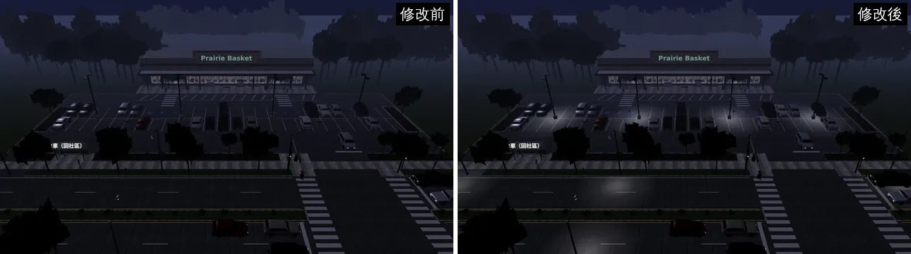
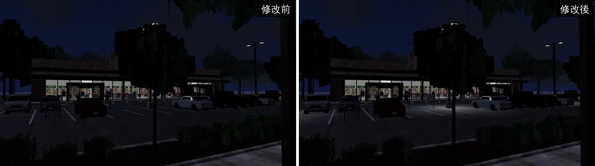
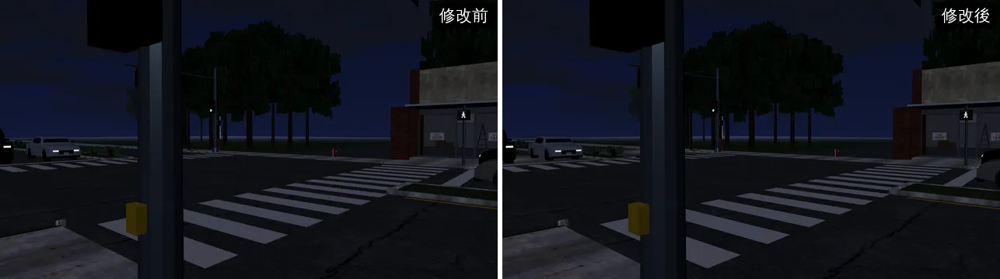
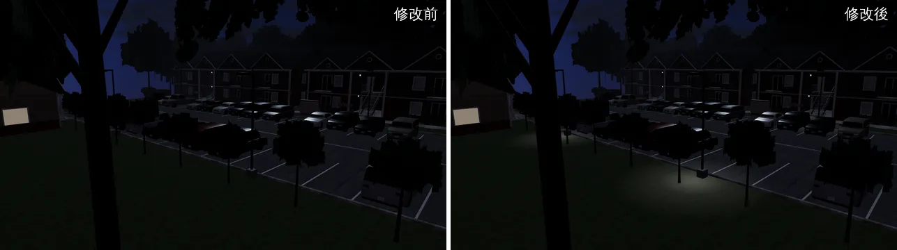

# 美國超市街、公寓社區晚上的路燈地面光圈（US-MS-NIGHT-1021）

帳號 A 的 LAWWW2，2026-10-21 起，10-22 03:5x 遊戲內對照。狀態：**已交付**（遊戲內前後 4 張看過）。

## 問題

美國超市街（`us_market_street`）20:00 的遊戲內截圖：停車場燈桿、眼鏡蛇頭路燈**只有燈頭亮，地上一片黑**——停車場看起來像沒開燈。溫州街、校園的路燈都有地面光圈（`E.lampGlows`，入夜才開）。公寓社區（`us_outside`）的路燈也一樣。

## 改法（`patches/us_lamp_pools.diff`，`src/us3d.js`＋新測試；對開發分支 `c617b2e0` 乾淨）

- `outdoorZone` 多一個選項 `lampPools(L)`：區域給每個燈頭的位置、光圈半徑，鋪在地上（加法混色、不寫深度），交給 `E.lampGlows`——和溫州街、校園同一套，入夜才開。光圈放在自己的 `dyn` 群組（引擎合併靜態網格時不動它）。
- 燈頭位置照 Blender 腳本：
  - 超市街停車場燈桿每支兩個燈頭（桿子前後 1.1 m，冷白光，半徑 7.5 m）；眼鏡蛇頭路燈的燈頭在桿子往馬路 2.75 m（暖白，半徑 6 m）。
  - 公寓社區路燈：桿子往 +z 0.9 m（半徑 4.5 m）。
- `tests/us_lamp_pools_unit.js`（新）：每個燈頭一圈、在燈頭正下方（< 5 cm）、平放在地上、白天藏著、`E.setLamps(true)` 才出現、合併靜態網格以後還在。修改前 **12 FAIL**，修改後 **ALL PASS**（10-22 在 `c617b2e0` 上重跑也 ALL PASS）。

## 遊戲內前後（j18，20:00）

- 環境：Playwright＋SwiftShader，1280×720，演出鏡頭（不是 iPhone）。修改前＝`80af0168`＋超市街 patch（那時超市街還沒整合）；修改後＝再套 `us_lamp_pools.diff`。

超市街從上面看（停車場四支燈桿、對面馬路的眼鏡蛇頭路燈）：修改前停車場、馬路整片黑；修改後每支燈桿下一圈、馬路上每盞路燈下一圈。

公車下車走向超市（玩家一到就看到的角度）：停車場中間那支燈桿下面的地亮起來（白車旁邊）；左邊那一排離燈桿遠，照樣暗——光是從燈下往外暗下去，不是整片打亮。

路口（斑馬線）：這個角度的路燈在 30 m 外，看不出差別（照設計：光圈只在燈下）。

公寓社區（`us_outside`）：修改前路燈下面整片黑；修改後每盞路燈下的草地、人行道一圈光。

## 接法（LAWWW）

- `git apply docs/art-rebuild/second_ai/patches/us_lamp_pools.diff`（`src/us3d.js`＋`tests/us_lamp_pools_unit.js`；對 `c617b2e0`、`6b6ecd80` 乾淨，和 `airport_cam_night.diff` 一起套也乾淨）。
- 跑 `node tests/us_lamp_pools_unit.js`、`node tests/nav_us_unit.js`。

## 還不到的地方（誠實寫）

- 光圈是貼地的半透明圖，不是真的打光：車子、人身上不會被路燈照亮。
- 真機沒看過。
