# SCN-US-LIB 美國法學院圖書館（區域 `us_lawlib`）：照使用者給的照片做

LAWWW2-C，2026-10-18。狀態：`MODEL_READY`。場景標 **PROPOSAL／READY_FOR_ART_REVIEW**（使用者看過才算數）。

## 來源與範圍
- **照片**：使用者 2026-10-18 01:0x 給的兩張「法學院圖書館」照片。照片不放 repo（第三方照片有版權，也會讓人認出是哪一間學校）；文字描述在 `docs/art-rebuild/second_ai/HANDOFF.md`。
- **範圍**：LAWWW-C 00:36 派 SCN-US-LIB，最小可玩——
  - 大門進去；中庭一樓可以走；長桌可以坐。
  - 樓上照 D38 第 4 點「看得懂的方式關起來」：一樓樓梯口拉紅絨繩，旁邊一塊立牌（樓梯＋禁止的圖示，**沒有字**；說明文字由 AA 寫，用互動 `stair_rope`）。
- **D77**：沒有校名、校徽、書名、出版社。書背只有燙金線和空白的黑標籤，是程式畫的貼圖（`tools/blender/env_second/us_lawlib_tex.py`）。

## 玩家會看到什麼
- 從法學院台階下的「進圖書館」進來（`us_campus` 的 `interact` 'library'，在「進教室」東邊 2.6 m）→ 南牆的木框玻璃雙開門，門上是綠色出口燈。
- 一樓：
  - 藍色地毯、米白色方柱、牆腳一圈淺木護牆板。
  - 中庭四張淺木色長閱覽桌，每張六張藍綠色椅子，桌子中間一條電源槽。
  - 北牆一整排細長的藍綠色彩色鉛條玻璃窗（照片二）：16 扇、每扇之間一根木頭直櫺，三種花色輪流；窗前四張短閱覽桌。第一版是五組方窗，和照片放在一起看不像，01:5x 改掉。
  - 西邊三張圓桌；東南角四張藍綠色軟椅圍著小圓桌。
  - 東邊一排排書架：一整套一整套同顏色的判例彙編、燙金線。
  - 南邊服務台（電腦螢幕、還書車）、兩台查詢電腦。
- 抬頭：
  - 挑高中庭到 18.4 m 的天窗（鋼格子）。
  - 四周三層迴廊：米白飾帶＋一條淺木、玻璃欄杆＋淺木扶手＋細鋼柱；迴廊上一排排書架的側板朝中庭，樓板底下有嵌燈。
  - 三段樓梯穿過中庭（一樓 → 二樓東邊、二樓 → 三樓西邊、三樓 → 四樓東邊）：白色鋼骨、淺木踏板、玻璃欄杆，樓梯邊一排小燈（照片一）。
  - 中庭吊著七顆大小不一的鐵絲球（照片一的裝置藝術）。

## Blender 算圖
| 從門口看中庭 | 樓梯和紅絨繩 | 彩色玻璃窗 |
|---|---|---|
| 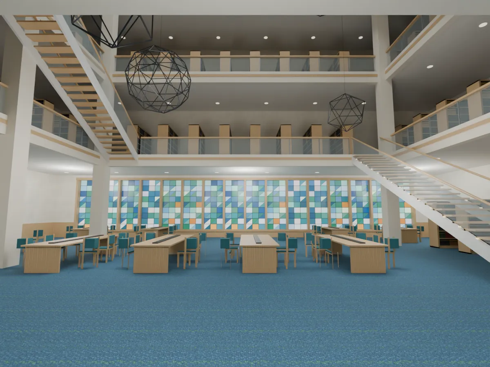 | 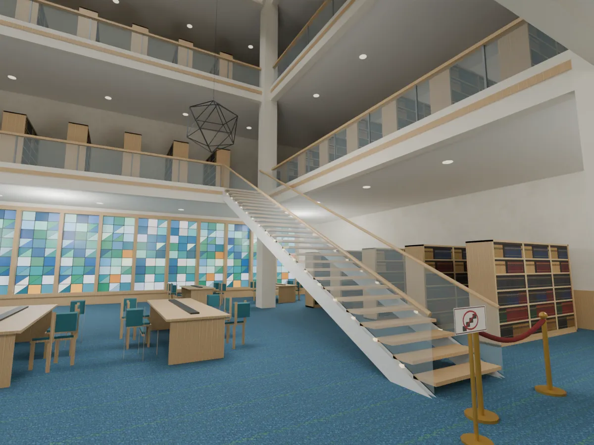 | 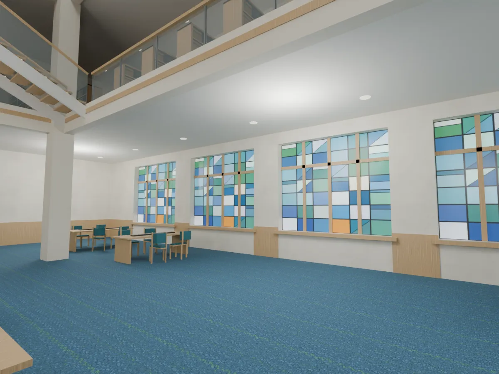 |

| 從西南角看 | 抬頭看天窗、鐵絲球 |
|---|---|
| 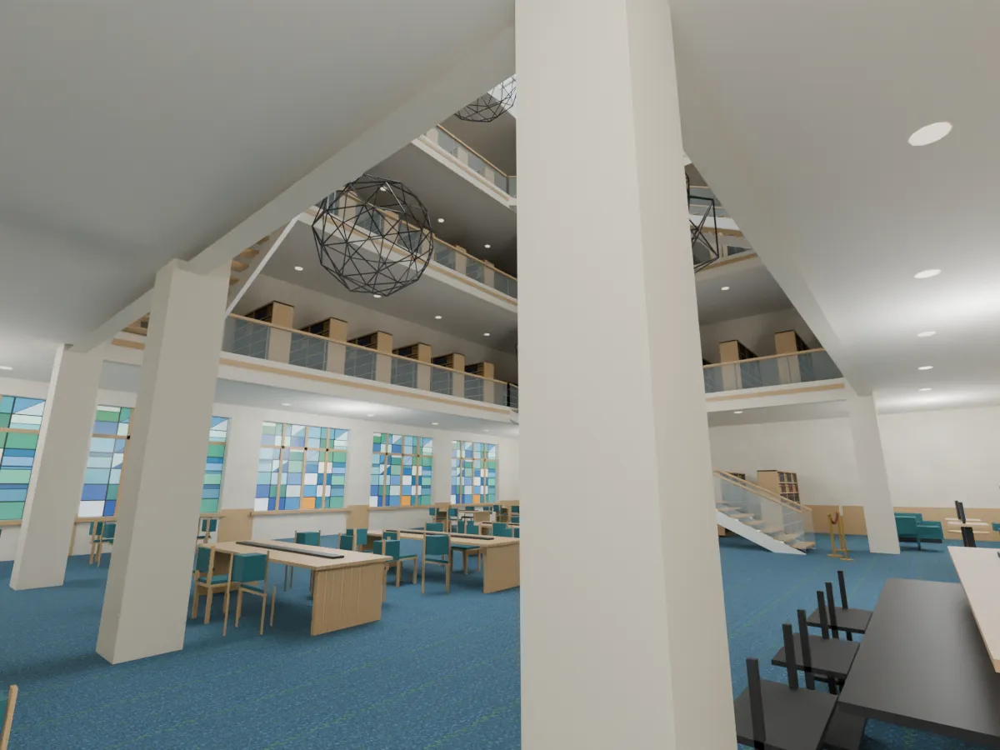 | 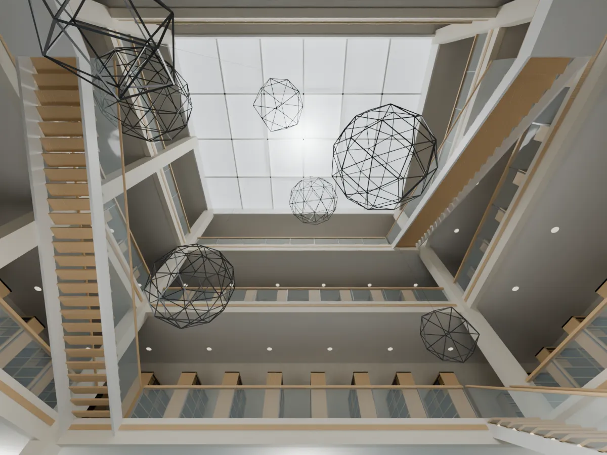 |

## 遊戲內截圖（Playwright、iPhone 直向 390×844 模擬、SwiftShader；不是實機）
做法：在 scratchpad 的測試工作樹（LAWWW-C 分支 `0cd6d028`）臨時接 `us_lawlib` 區域，照 `us_asian_market` 的做法：`Z3.room`＋`attachRoomGLB`＋配置的導航、座位、互動點、出口。這個工作樹**不 commit**，正式接線由 LAWWW-C 做。

| 進門 | 長桌 | 彩色玻璃窗 | 樓梯口（紅絨繩） | 校園：台階下「進圖書館」 |
|---|---|---|---|---|
| 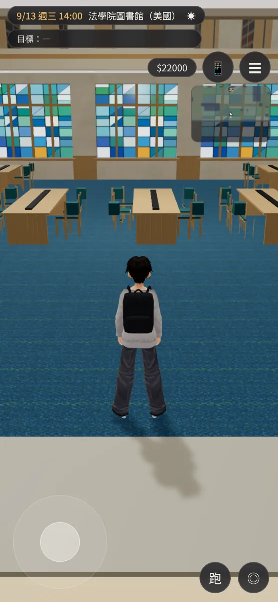 | 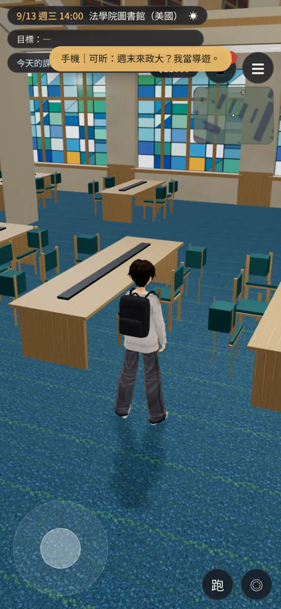 | 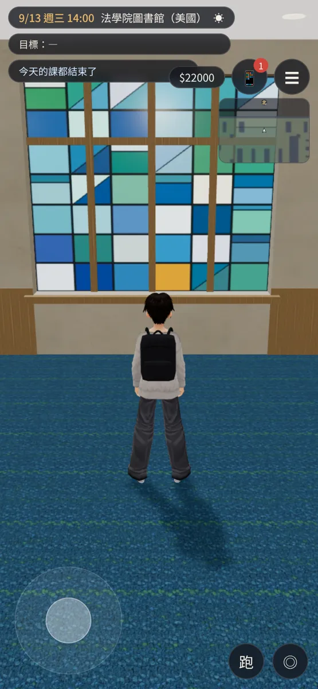 | 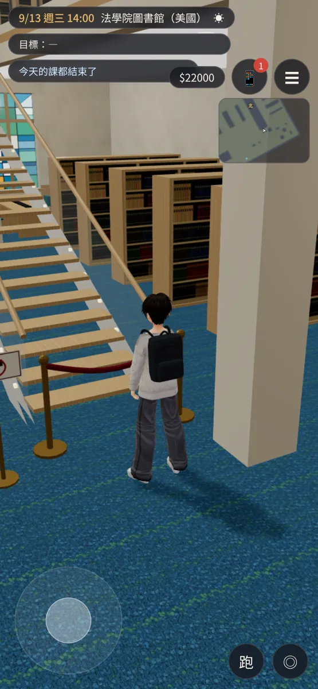 | 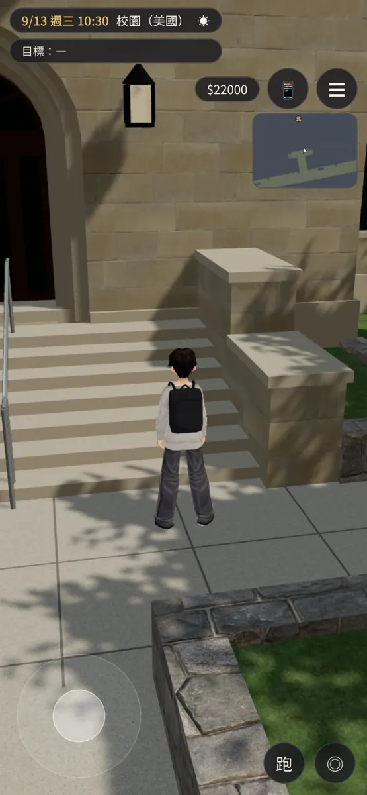 |

橫向（服務台後面，鏡頭是用測試的瞬移放的）：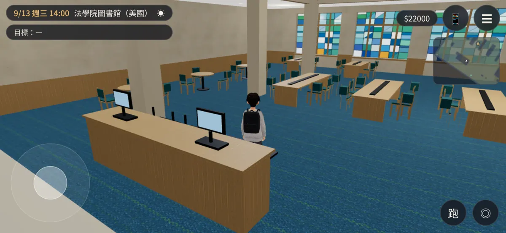

## 交付檔案
- `assets/models/env/second_ai/us_lawlib.glb`：2.4 萬三角形、1.7 MB（彩色玻璃貼圖 `usll_stained_tall.png`）。規格在 `us_lawlib.json`。
- `assets/models/env/second_ai/us_lawlib.layout.json`：由 `tools/blender/env_second/us_lawlib_layout_gen.py` 產生。
  - `bounds` x −13～13、z −10～10；`levels` [0, 4.6, 9.2, 13.8]；`top` 18.4。
  - 一樓走廊的天花板（樓板底）是 4.2 m：建議 `camDist` 5、`Z3.room` 的 h 4.2，鏡頭在樓板下面。
  - `spawn` (0, 8.4) 朝北：從門進來。
  - `exits`：「離開圖書館」(0, 9.2) r 1.2 → `us_campus` 的 `spawn_library_out` (2.6, 8.42) 朝南。
  - `seats` 53 個：中庭長桌 24、窗前短桌 16、圓桌 9、軟椅 4，`kind` 是 study 或 lounge；`yaw` 照遊戲，面向 (sin yaw, cos yaw)。
  - `interact`：服務台、樓梯（樓上書庫）、彩色玻璃窗、書架、查詢電腦。label 中性，說明文字由 AA 寫。
  - `blocks` 31 個：桌子、軟椅（只擋後半）、書架、服務台（後面員工那一側也擋）、查詢電腦、樓梯（含紅絨繩）、方柱。
  - `--check`：出生點、出口、互動點不在阻擋裡；全部座位走得到（旁邊 0.9 m 內）。
- 四面牆各自一組 `WALL_<面>_*`（props `dir`＝往室內的法線），`attachRoomGLB` 會淡出。南牆的門、出口燈、北牆的彩色玻璃都跟著那一面。
- 校園的配置第 2 版加了：
  - `interact` 'library'「進圖書館」(2.6, 7.72) r 1.0；
  - `spawn_library_out` (2.6, 8.42)；
  - 「進教室」的半徑 1.4 → 1.2（兩個互動點不重疊）。
- 腳本：`us_lawlib_layout_gen.py`、`us_lawlib_tex.py`（貼圖 `textures/gen/usll_*.png`）、`us_lawlib.py`（`--preview --cam entry|atrium|window|up|stair|top|game`、`--stats`）。
- 材質：
  - Poly Haven CC0（本機已有）：`dirty_carpet`（藍色地毯）、`white_plaster_02`、`walnut_veneer`（淺木色直紋）。
  - 出口燈 `lawlib_exit.png`：之前程式畫的，沒有字。

## 測試結果
- 通過：
  - 配置 `--check` 沒有問題：走得到的格子 2164 個，座位全部走得到。
  - 遊戲內 6 張截圖沒有 JS 錯誤；南牆在鏡頭退到門外時淡出（l1）。
- 沒測：
  - iPhone 實機；
  - 真的坐下的動畫和起身（座位資料照遊戲格式，沒有實際按）；
  - 正式接線以後的「進圖書館 → 離開」來回（LAWWW-C 接，BB-C 測）；
  - 晚上的燈光。

## 還沒做到照片的地方（誠實列出）
- 照片一的樓梯是斜著穿過中庭、中間有平台；這版三段樓梯都是直跑，貼著中庭的東西兩邊（一樓的人走得比較順）。
- 鐵絲球比照片簡單：照片的球面多、還有幾顆更大的。
- 二～四樓只有書架和走道，沒有照片裡迴廊上的閱覽桌、檯燈；樓上本來就不能去，從一樓抬頭看得到。
- 彩色玻璃是程式畫的格子圖案，三種花色輪流；照片的每扇圖案都不一樣、顏色有漸層。
- 一樓的牆只有護牆板，沒有照片裡的木頭線板和壁燈。
