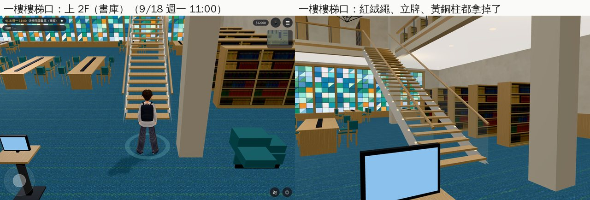
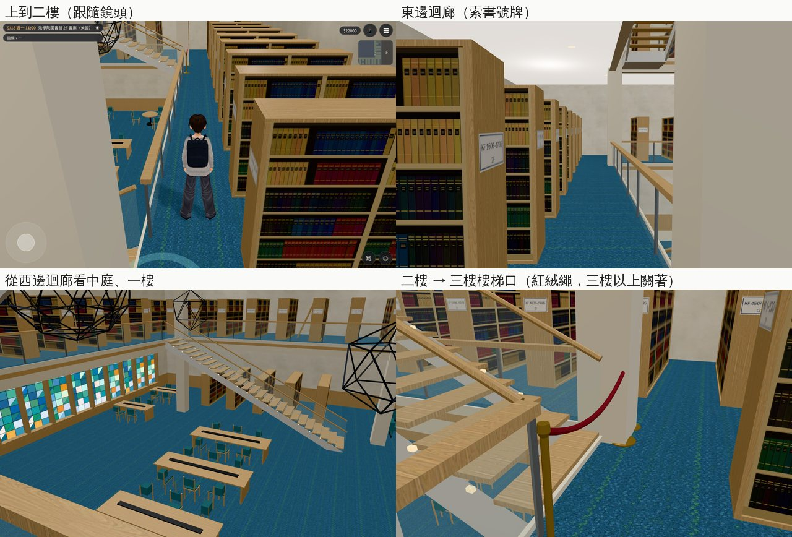
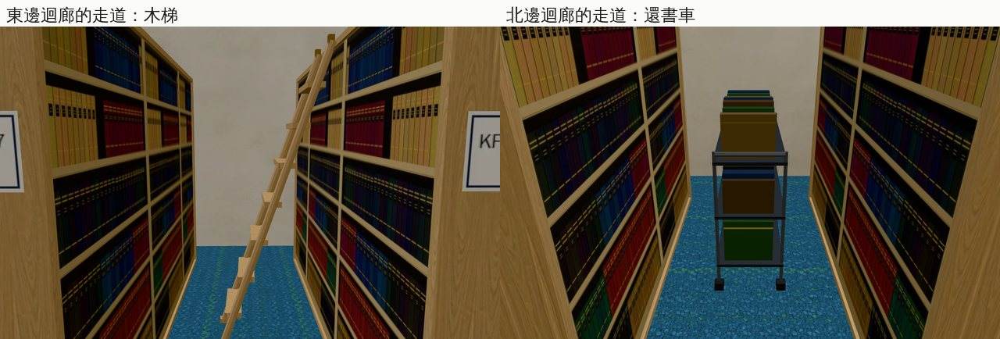

# 美國：法學院圖書館 2F 書庫（AA_399 第 8 節；任務 #82 第七間的另一半）

- **企劃**：AA_399 第 8 節（AA-B，企劃線 `5d09bb725`）。
  - 書庫：開。
  - 學姊平日 10:30～12:00 在 2F，9:00～10:30 在 1F。
  - 美國版的閒聊照舊，只是地點換到書庫。
  - 「樓上書庫整理中」那句拿掉，換成書庫的旁白：「（書架很高，最上層要用梯子。整排都是很舊的判例彙編。）」
- **派工**：LAWWW-B 10-24 03:53（P2）任務 #82 第七間。
  - 07:20 同意做法；
  - 08:05：2F 跟一樓一樣一直開，學姊的作息由 LAWWW-B 接。
- **做的人**：LAWWW2-B。
- **狀態**：`READY_FOR_ART_REVIEW`。場景美術的 `ART_APPROVED` 只有使用者能標。
- **Patch**：`docs/art-rebuild/second_ai/patches/us_lawlib_2f_1024.patch`。
  - 對開發 `bcc821fe0`＋臥室 C 的 patch（`us_bed_c_1024.patch`）做的，要先套臥室 C 那一份。
  - 兩份改同樣三個檔：`rooms_glb3d.js`、`us3d.js`、`room_glb_layouts.js`。
  - 模型在我的分支。

## 做了什麼

- **建築本身**：用一樓那一個 `us_lawlib.glb`。四層樓的中庭、迴廊、書架、樓梯本來就在裡面。
  - 二樓的區域把它往下放 4.6 m，二樓的樓板就在 y 0。
  - 站在二樓的迴廊上，看得到中庭、一樓的長桌和彩色玻璃窗。
- **一樓樓梯口**：紅絨繩、小立牌、黃銅柱（`usll_rope`、`usll_rope_sign`、`usll_stanchions` 三個節點）藏起來，那一點變成「上 2F（書庫）」。
  - `usll_stanchions` 只有那兩根柱子和立牌的桿子。
  - 不用重出 `us_lawlib.glb`。
- **二樓才有的東西**（Blender bpy，`tools/blender/env_second/us_lawlib_2f.py` → `assets/models/env/second_ai/us_lawlib_2f.{glb,json,layout.json}`，2,536 個三角形）：
  - **二樓 → 三樓的樓梯口**：紅絨繩、兩根黃銅柱、小立牌。立牌上是一張卡片和一個鎖的圖示，沒有字。三樓以上這一版關著。
  - **東邊迴廊的一條走道裡**：一把靠在書架上的木梯（旁白「最上層要用梯子」）。
  - **北邊迴廊的一條走道裡**：一台還書車。
  - **西邊迴廊**：一張圓形的踏凳。
  - **每一排書架朝走道那一端**：一塊白色的索書號牌，38 塊，「KF 1–…」一路排下去。KF 是美國國會圖書館分類的「美國法」，一般的分類號，不是書名；四位數的號碼字會縮小。
  - 沒有校名、書名、出版社（D77）。

## 配置（`room_glb_layouts.js` 的 `us_lawlib_2f`）

- **`glb`／`glb_y`／`glb_hide`**：`us_lawlib`、−4.6、三個節點。建築借一樓的模型；這一區自己的 GLB（`bldg.us_lawlib_2f`）另外加進來。
- **`blocks`（導航）**：照 `us_lawlib.py` 的幾何算。
  - 中庭挑空，加上欄杆往迴廊 0.12 m；
  - 每一排書架（東西各 11 排、南北各 8 排）；
  - 方柱；
  - 二樓的木梯、還書車、踏凳、三樓樓梯口的紅絨繩。
  - 書架之間的走道走得進去。
- **`spawn`**：上到二樓、樓梯頂往西一步，面向西。
- **`exits`**：「下樓（一樓）」在樓梯頂的欄杆缺口，回一樓樓梯口（`back_spawn`，紅絨繩原本的位置往南 1 m，面向南）。
- **`interact`**：
  - 書架：旁白照 AA_399，放在 `rooms_glb3d.js` 的 `LOOK`；
  - 樓梯（三樓）、木梯：「看」的字等 AA 寫，現在顯示名稱。
- **`spots`**：
  - `sis`：學姊站在東邊迴廊的走道口，面向書架之間；
  - `player`：玩家在走道上看著她。
- **`lamps`**：六盞補光，四邊的迴廊。
- **沒有 `open`**：跟一樓一樣一直開（LAWWW-B 08:05）。

## 程式

- **`rooms_glb3d.js`**（`zoneFor`）：
  - `L.glb`：載入的是 `bldg.<glb>`（借別的區域的模型），往下 `glb_y`，`glb_hide` 的節點藏起來；這一區自己的 `bldg.<id>` 另外加進來，發光材質也算進去。
  - `L.lamps`：補光的位置；沒寫的照舊兩盞。
  - `LOOK.us_lawlib_2f.stacks`：AA_399 的旁白。
- **`us3d.js`**（一樓 `us_lawlib`）：
  - 樓梯口那一點（`stair_rope`）照 `teach3d.js` 的做法放兩個互動點：
    - 開的時候「上 2F（書庫）」；
    - 原本的「樓梯（樓上書庫）」（整理中）藏起來。
  - 正式模型載入的時候，二樓開著就把那三個節點藏起來。
  - 其他互動點照舊。
- **`room_glb_layouts.js`**：加 `us_lawlib_2f`。

## 給 LAWWW-B

- 學姊平日 10:30～12:00 在 2F（`spots.sis`）、9:00～10:30 在 1F：作息照 LAWWW-B 08:05。
- 「樓梯（三樓）」「木梯」的「看」等 AA。

## 截圖（遊戲內，Playwright＋SwiftShader；不是 iPhone 實機）

開發 `bcc821fe0`＋臥室 C＋這份 patch（測試樹），2028-09-18（一）11:00。每張的 `post` 都確認：區域、正式模型載入、最近的互動點。

### 一樓樓梯口

### 二樓

### 第一輪截圖找到、已經改的

- 索書號牌的字超出牌子（四位數的號碼）：字照牌子的寬度縮小。
- 一樓樓梯口只拿掉紅絨繩、留下兩根黃銅柱，看起來很怪：柱子也一起藏。

## 測試

- **`tests/us_lawlib_2f_unit.js`**（新，14 項；改之前第 1 項就失敗）：
  - 區域、模型：借 `bldg.us_lawlib` 往下 4.6 m、自己的 `bldg.us_lawlib_2f`；
  - 一樓樓梯口只有「上 2F（書庫）」，落點＝spawn；其他互動點照舊；
  - 一樓回來的落點站得住、走得到；正式模型載入以後三個節點藏起來；
  - 二樓：模型往下 4.6 m、紅絨繩藏起來、二樓自己的東西加進來；書架的旁白照 AA_399；
  - 引擎的 `simWalk`：出生點、下樓、書架、三樓樓梯口、木梯、四邊迴廊、書架之間的走道、學姊和玩家的位置都走得到；中庭挑空、兩座樓梯站不上去。
- **相關單元測試**（開發 `bcc821fe0`＋臥室 C＋這份 patch）：107 個。
  - 104 ALL PASS（含 `us_bed_c_unit`、`us_lawlib_2f_unit`、`nav_us_unit`、`rooms_glb_unit`）；
  - 3 個失敗（`aa393_sis_jp_unit`、`aa441_practice_unit`、`date_wish_unit`）：我這份 clone 缺企劃線的 commit，沒有 patch 也一樣失敗。LAWWW-B 08:05 說他那邊全過。

## 還沒做／已知

- 人（學姊）沒有放：位置在 `spots.sis`（LAWWW-B）。
- **樓梯是看得到、走不上去的**：一樓、二樓之間用樓梯口的互動點換區域，和「上樓（C 棟 208）」同一種做法。要真的走上去，得把一樓、二樓做成同一個區域的兩層導航（引擎的分層導航），是另外一件事。
- 三樓、四樓照舊關著。
- 手機效能沒實測。二樓看得到整棟的模型；繪製呼叫、三角形見截圖的 perf：二樓 80 次、一樓 72 次。
