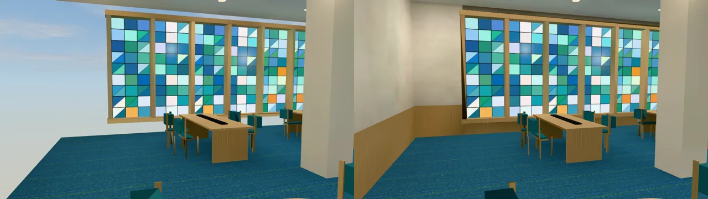
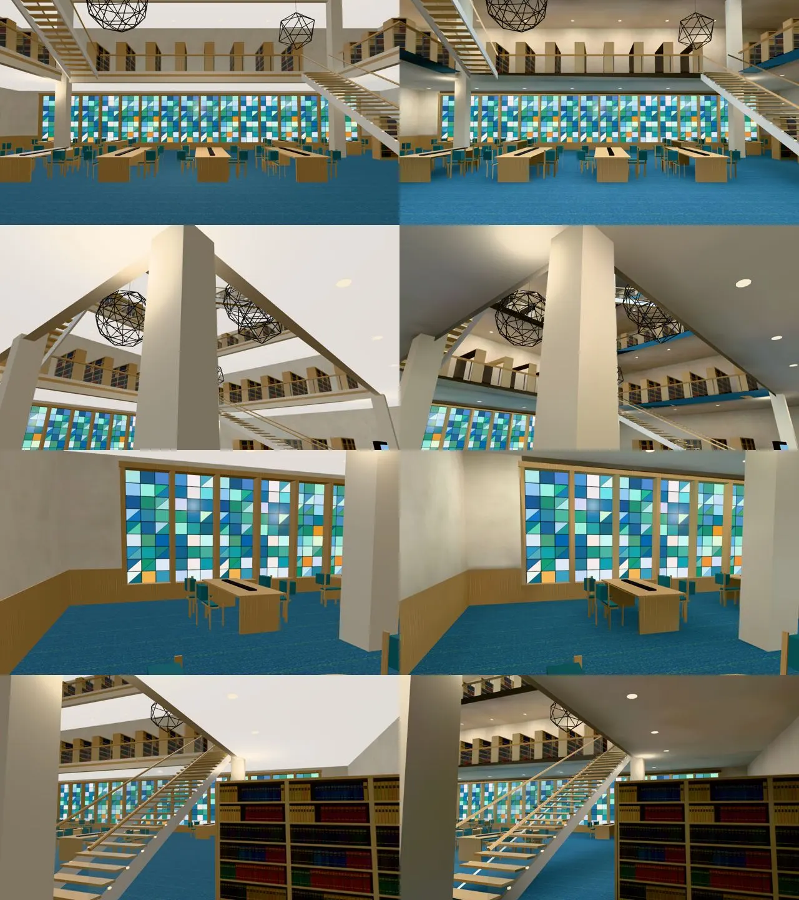
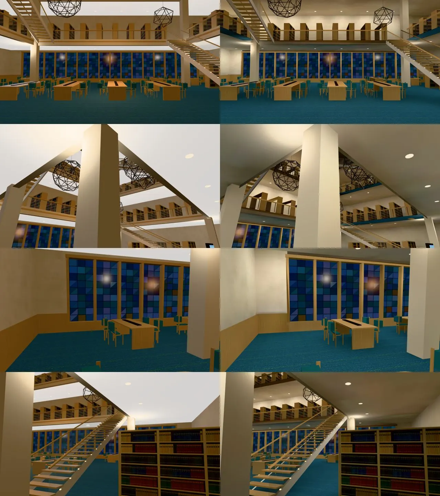

# 美國法學院圖書館（us_lawlib）室內光照烘焙（INTERIOR-AAA-REVIEW-1028 美國那一批；LAWWW2-B 2026-10-31）

- **起因**：INTERIOR-AAA-REVIEW-1028 第 5 節 P1（光照）。美國室內第二間（公寓 → 法學院圖書館 → 亞洲超市）。
- **狀態**：`READY_FOR_ART_REVIEW`。建築、場景只有使用者能標 `ART_APPROVED`。
  - 截圖是 Playwright＋SwiftShader（電腦 1280×720），不是實機。
  - 讀檔放位置、藏玩家和 NPC 是 [捷徑]。
- 模型沒有改（重匯的白模和部署中的一模一樣：三角形數、材質、2,231,712 bytes），只多光照 UV 和 `extras.lightmap`。
  - 烘焙後疊在一起的反面拿掉，四面牆、護牆板、樓梯斜樑留的是朝室內那一面（第二節）。

## 一、怎麼套（給 LAWWW-B）

1. **換二進位**（從我的分支 `claude/funny-albattani-iawshm` 拿）：
   - `assets/models/env/second_ai/us_lawlib.glb`；
   - 新的 `us_lawlib_lm_day.webp`、`us_lawlib_lm_night.webp`。
   - `us_lawlib.json` 不用換。
2. **不用改程式**：us3d.js 的 us_lawlib 區域走 `Z3.attachRoomGLB`，看到 GLB 的 `extras.lightmap` 就接。
   - 天窗、彩色玻璃照舊由 us3d.js 的 `skyTint` 照時段調（GLB 裡沒有 `dayEmit`，不會被 roomLightmap 再調一次）。
   - 二樓開放時要藏的紅絨繩、黃銅柱、小立牌照舊在（`us_lawlib_2f.layout.json` 的 `glb_hide`）；烘焙時當作不存在（影子不烘進地板）。
3. **patch**：`docs/art-rebuild/second_ai/patches/us_interiors_lm_1031.patch`（只有測試；三間一包，見公寓 README）。
   - 新 `tests/us_lawlib_lm_unit.js`：**開發分支原樣 FAIL 3，改後 ALL PASS**。
4. **工具**（只在我的分支）：`bake_us.sh lawlib`、`bake_room.py`（留哪一面的判斷、`--knee`）、鏡頭 `shots/us_rooms_lm_shots.py`、烘焙紀錄 `us_lawlib_lm.json`。

## 二、做法與參數（試了四版）

- **只有兩個地方有光從外面進來**：北牆一樓一整排彩色玻璃（`usll_stained_glass`）、屋頂中間的天窗（`usll_skylight`），兩個都是自發光的面。
  - 整棟包黑殼（`--shell NONE`），這兩片只在白天那一張發光（`--dayemit`，天窗 3.0、彩色玻璃 1.5），晚上是暗的。
  - 烘完拿掉 `extras.lightmap.dayEmit`：晚上變暗是 us3d.js 的 `skyTint` 在調，roomLightmap 再調一次會變兩倍暗（和體育館 1F 的高窗同一個做法）。
- **燈**：每一層樓板底下的嵌燈（`us_lawlib.py`：迴廊每 3.2×3.0 m 一盞，中庭上方沒有）→ 每盞一個往下照的小面光源（45 W、暖白），位置照 `us_lawlib.layout.json` 算，共 60 盞。
  - 中庭（一樓到天窗挑空）中間一顆柔和的補光，位置照遊戲原本那一盞點光源 (0, 3.7, 0)。
  - 圖書館白天也開燈（`--daylights 1.0`，和遊戲一樣：發光面整天都亮）。
- **不烘的**（照舊即時光）：天窗、彩色玻璃、發光面（嵌燈、螢幕、樓梯小燈、出口燈）、玻璃欄杆、門的玻璃、欄杆鋼柱、鐵線雕塑。
  - 紅絨繩、黃銅柱、小立牌烘焙時當作不存在：二樓開放以後遊戲會把它們藏起來，影子不能烘進地板。
- 貼圖 1024²、256 取樣；烘一次約 4 分鐘。

| 版本 | 改了什麼 | 結果 |
|---|---|---|
| 1 | 嵌燈 18 W、天窗 1.2、彩色玻璃 0.8 | 太暗：晚上一樓 0.07～0.23（樓高 4.2 m、地毯是深藍色）。彩色玻璃也被烘了（`--nolm` 寫成 `usll_stained`，物件叫 `WALL_N_stained` 沒對到） |
| 2 | 嵌燈 45 W、天窗 3.0、彩色玻璃 1.5、中庭補光 | 亮度可以；彩色玻璃照舊被烘 |
| 3 | `--nolm` 改 `_stained` | **四面牆、護牆板整片不見**（下圖左），從室內看得到天空——見下一段 |
| 4（定案） | 烘焙工具改留朝室內那一面 | 牆都在；測試 ALL PASS |

### 第三版牆不見的原因（烘焙工具的問題，已修）

- 這棟的牆在 `us_lawlib.py` 裡畫的那一面朝外；單面化（PERF-SINGLESIDE-GLB-1025）補了朝內的反面，遊戲裡看得到的是反面。
- `bake_room.py` 烘焙前會拿掉疊在一起的反面（不拿掉的話光一出去就打到反面，整面烘成全黑）。原本**一律留腳本畫的那一面**——這裡就留了朝外那面，從室內看牆整片不見。
- **修法**（`bake_room.py`，只影響之後的烘焙）：兩面各從正面往外打幾條射線，量正面前面空多遠。
  - 原本那一面前面 0.5 m 內就是外殼／房間邊界、反面那一面朝著房間（2 m 以上，而且是 4 倍以上）才改留反面；其他照舊。
  - 這間改留反面的：四面牆、四面護牆板、樓梯斜樑的外側（原本也留錯邊）、中庭飾帶的底條一半（原本整條朝上，從一樓看不到）、樓板邊緣（貼著外牆、被飾帶蓋住，看不到）。
- 同一個問題也出在亞洲超市的天花板（見亞洲超市 README）。公寓沒有。
- 新測試第 ⑦ 項抓這個：第三版 FAIL、原本 PASS、第四版 PASS。

| 光照貼圖（`lm_probe.py`；白天／晚上） | 第四版 |
|---|---|
| 一樓中庭地毯 | 0.53／0.25 |
| 一樓中庭南（天窗正下方偏南） | 1.37／0.61 |
| 一樓迴廊底下西北 | 0.51／0.51 |
| 一樓迴廊底下東 | 0.25／0.20 |
| 大門石地 | 0.60／0.57 |
| 一樓迴廊天花板 | 0.25／0.17 |
| 北牆二樓 | 0.44／0.48 |
| 西牆一樓 | 0.61／0.61 |

## 三、改前改後（同角度；左＝開發分支原樣，右＝第四版）

- 鏡頭：`us_rooms_lm_shots.py lawlib`。①從大門往北（中庭、彩色玻璃）②中庭西南角往東北往上看（迴廊、天窗）③西北角迴廊底下 ④東邊樓梯口。

### 看得到的差別

- 改前整棟一樣亮：牆、天花板、地毯整片平均，看不出燈在哪裡。
- 現在迴廊底下的天花板有一盞一盞嵌燈的亮圈、牆角暗一點；中庭比迴廊底下亮（天窗）；迴廊的樓板底、飾帶有明暗。
- 晚上：彩色玻璃暗下來（skyTint），室內是嵌燈的暖光。

### 還不夠的（照實寫）

- 一樓中庭南邊（天窗正下方偏南）白天 1.37，比旁邊亮很多；看截圖沒有過曝，先不壓。
- 迴廊底下東邊（樓梯旁）0.2 左右，比西邊暗：樓梯、書架擋了嵌燈。
- 樓上（二～四樓）走不到，只烘了看得到的樓板底、欄杆後面的書架，沒有另外檢查。

## 四、測試

- `tests/us_lawlib_lm_unit.js`：開發分支原樣 FAIL 3，第三版 FAIL 1（第 ⑦ 項，牆朝外），第四版 ALL PASS。
- **效能**（`interior_perf.py`，藏路人，14:00，手機橫向模擬；draw call／三角形）：

| 位置、方向 | 改前 | 改後 |
|---|---|---|
| 大門口 前 | 69／109,914 | 69／103,212 |
| 大門口 左 | 74／110,072 | 74／103,246 |
| 大門口 右 | 77／110,234 | 77／103,408 |
| 大門口 後 | 70／109,992 | 70／103,174 |
| 迴廊底下西北 前 | 60／102,640 | 60／95,944 |
| 迴廊底下西北 左 | 60／109,552 | 60／102,856 |
| 迴廊底下西北 右 | 66／109,768 | 66／103,058 |
| 迴廊底下西北 後 | 68／109,724 | 68／102,924 |

  - draw call 一樣；三角形少約 6,700（疊在一起的反面拿掉了）。多兩張 1024² 的 WebP。
  - 腳本的 `lm` 欄位是 false：那一欄只認 B3.attachFormal（台灣的建築）記的旗標，attachRoomGLB 的房間不記；截圖上光照貼圖有接。
- 沒跑：手機實機、導航（模型沒改）。
