# SCN-US-03 大型超市「Prairie Basket」（草原超市）室內（區域 `us_market`；LAWWW2-C 2026-10-17；狀態 MODEL_READY → READY_FOR_ART_REVIEW）

美國交換（大三下）抵達那天：巴士站 → 超市 → 公寓（AA_144 5-4、US1）。之後在美國的日常採買也用同一個地方。
店名 Prairie Basket（AA_144 5-4，虛構，D77：LAWWW2-B 查過布魯明頓沒有同名）；**貨架上的商品全部是程式產生的假包裝**（色塊、色帶、橢圓、淡色橫線當字），沒有任何真實品牌、商標、可讀的商品名稱。區域招牌是一般英文字（PRODUCE、DAIRY…）。
場景美術的 `ART_APPROVED` 只有使用者能標（D38／D59）。

## 交件
- 模型：`assets/models/env/second_ai/us_market.glb`（6.3 MB、98,732 三角形、46 個物件、40 個材質；同材質合併）。
- 配置（遊戲和 Blender 共用）：`assets/models/env/second_ai/us_market.layout.json`（`tools/blender/env_second/us_market_layout_gen.py` 產生；自我檢查：出生點、出口、互動點不在阻擋裡、走道至少 1.6 m、結帳道之間站得下人）。
- 貼圖：`tools/blender/env_second/us_market_tex.py` 產生（`textures/gen/us_mk_products.png` 商品圖集、`us_mk_signs.png` 招牌、`us_mk_wire.png` 推車鐵絲網、`us_mk_fruit_*.jpg` 九種水果堆無縫貼圖）；地磚 Poly Haven `large_floor_tiles_02`、牆 `white_plaster_02`、檯面 `granite_tile_03`、木作 `walnut_veneer`（CC0）。
- 腳本：`python3 tools/blender/env_second/us_market_layout_gen.py` → `python3 tools/blender/env_second/us_market_tex.py` → `/opt/blenv/bin/python tools/blender/env_second/us_market.py`。

## 空間（layout.json；區域座標 x 往東、z 往南、y 往上；範圍 x −22～22、z −16～16、天花板 6.4 m；入口在南邊）
| 區 | 位置 | 說明 |
|---|---|---|
| 入口 | 自動門兩組：x＝13.5（IN）、−13.5（OUT），在南牆 | `spawn`（從 IN 進來、面向北）、`exit`（OUT 門前，→ `us_outside`；之後可以改成超市停車場） |
| 推車區 | 入口內側東邊 | 14 台推車套在一起、紅色購物籃一疊 |
| 結帳 | 五條有人收銀（x −9～3、z 7.8～11.6）＋自助結帳六台（x 7.2～10.2） | 輸送帶、收銀機螢幕、刷卡機、裝袋轉盤、車道燈號（號碼由遊戲畫：`PLATE_FACE_lane_<n>`）、結帳道入口的小貨架 |
| 服務台 | 西南角 | 木作櫃台＋石材檯面、後面的櫃子、店名牌 |
| 蔬果 | 東邊（x 11～21） | 六張斜面陳列台（每張兩面各三格水果）＋靠東牆的三層冷藏噴霧櫃（生菜、甜椒、檸檬）、塑膠袋架 |
| 貨架 | 中間八條（x −12.4～7.9、z −9～5.4） | 雙面、五層、價格條＋價格標籤（偶爾黃色特價）、兩端端架；走道上方吊號碼牌（號碼＋類別，兩面） |
| 乳製品 | 北牆（x −4～16） | 玻璃門冷藏櫃 16 扇門：牛奶、優格、起司 |
| 肉品 | 北牆（x −13.5～−5） | 開放式冷藏櫃：一盒一盒的肉 |
| 熟食麵包 | 西北角 | 玻璃展示櫃台、後面的麵包架、烤箱、菜單燈箱 |
| 冷凍 | 西邊 | 靠牆一排＋中島背對背兩排，玻璃門 |

- **互動點** `interact`：服務台、結帳、自助結帳、蔬果、牛奶與蛋、熟食櫃台、冷凍食品、推車。
- **導航阻擋** `blocks`：每個長方形有 `why`。
- **發光** `GLOW_*`：天花板 LED、冷藏櫃燈條、收銀機與自助結帳螢幕、車道燈號、熟食菜單燈箱、蔬果櫃燈；晚上由遊戲調亮度。
- **會淡出的牆** `WALL_usm_walls`（鏡頭擋到時）；自動門 `DOOR_usm_auto`。
- **門外的景**：`assets/models/env/views/us_market_out.webp`（從社區停車場渲染的寬景）貼在門外 9 m 的平面上（`GLOW_usm_outside`）。

## 圖（Blender Cycles，Standard、曝光 −1.2，天花板加 35 盞補光代替遊戲的室內光；**不是遊戲內截圖**——遊戲內截圖要等 LAWWW 接成區域）
從入口進來（推車區在背後；左邊自助結帳、右邊花、遠處乳製品冷藏櫃）：
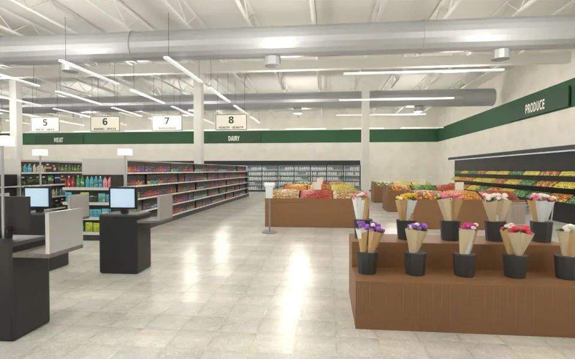
貨架走道（號碼牌、價格條、特價黃標；盡頭是肉品櫃）：
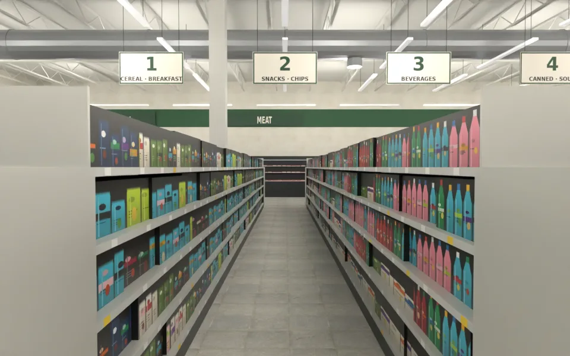
結帳區（五條有人收銀＋自助結帳；陽光從正面玻璃照進來）：
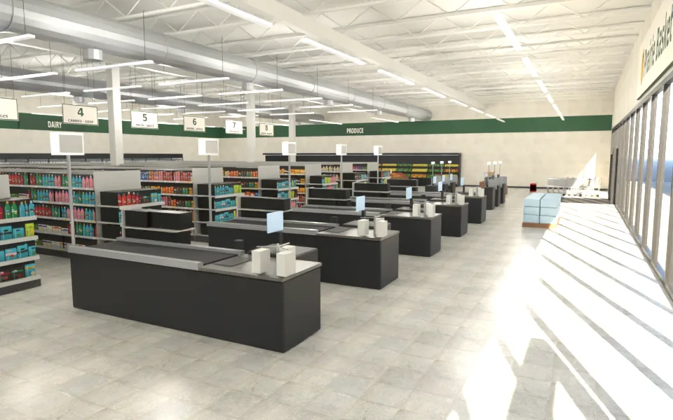
蔬果區（斜面陳列台、靠牆噴霧櫃）：
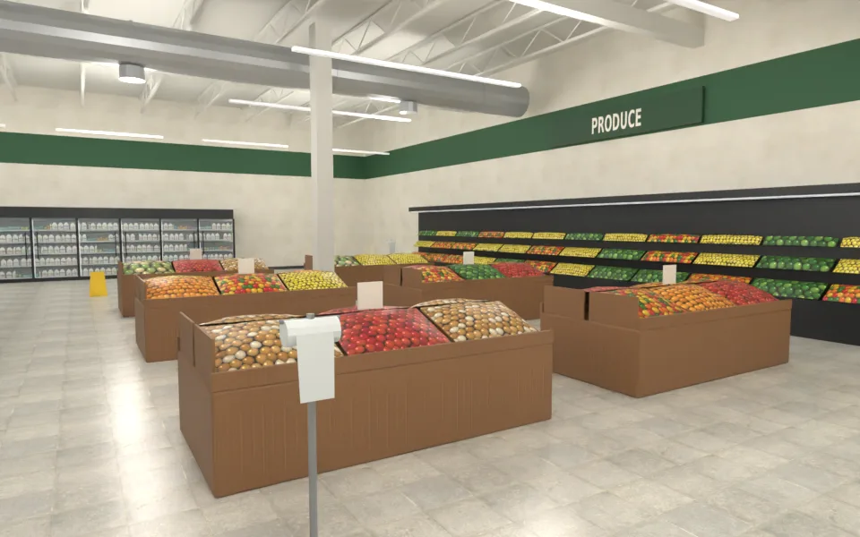
乳製品玻璃門冷藏櫃：
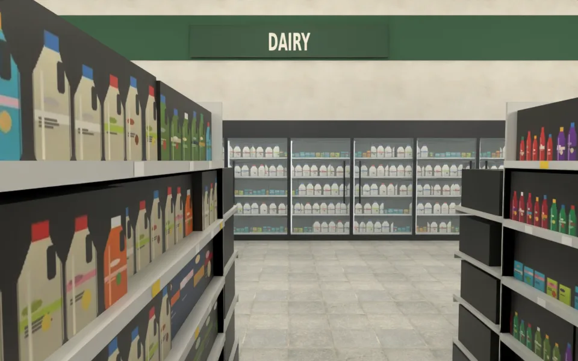
冷凍走道（盡頭是熟食麵包）：
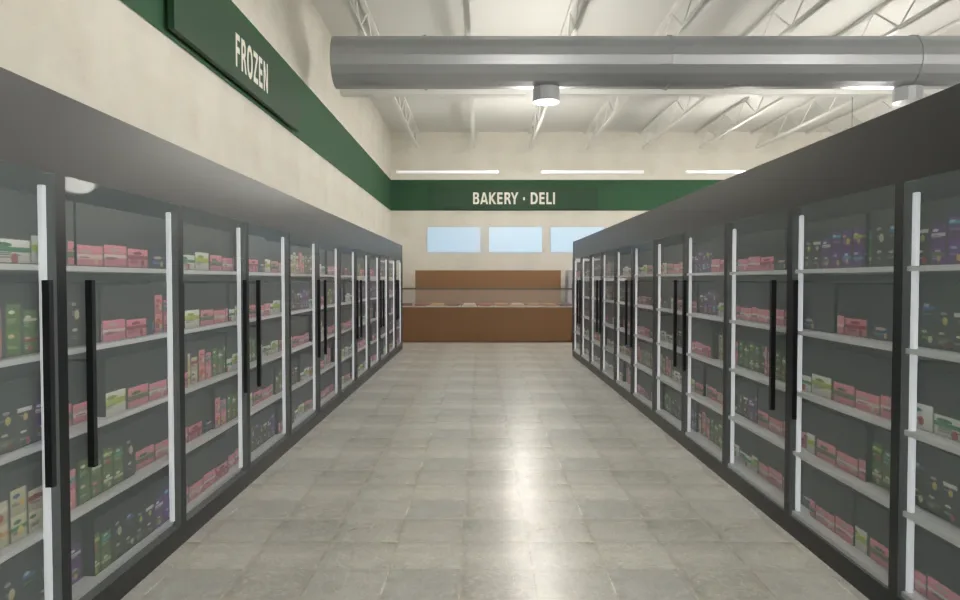
熟食麵包：
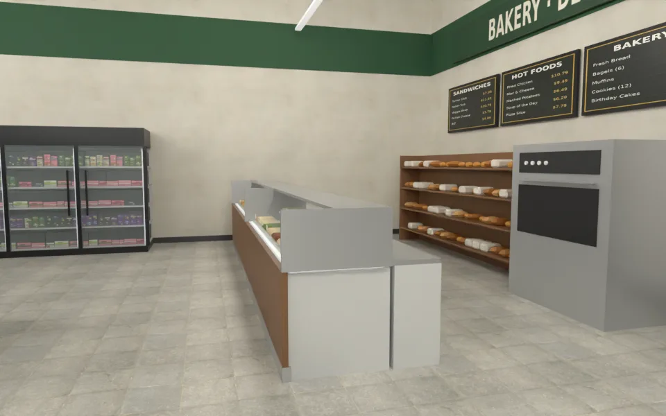
自助結帳：
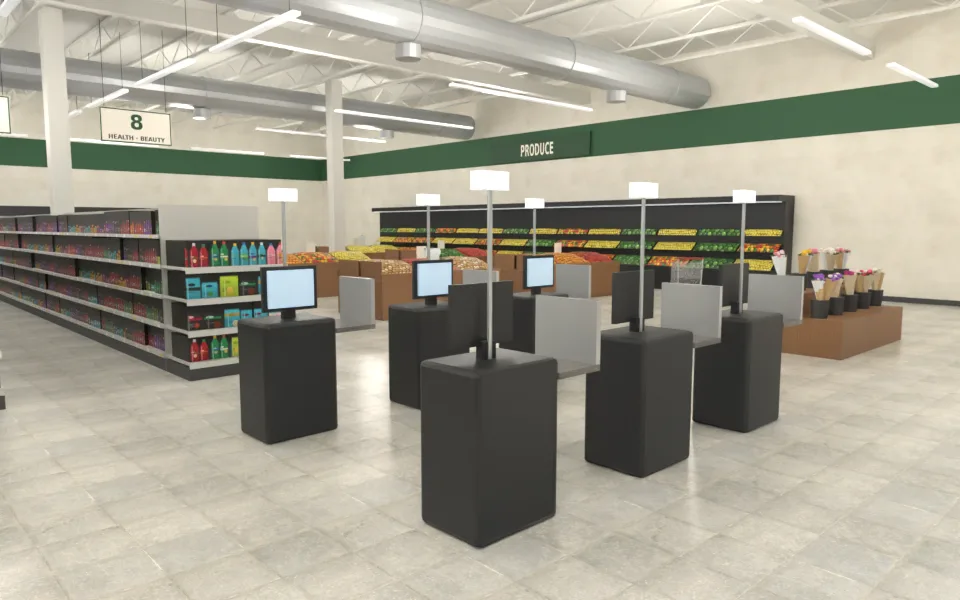
從東南角上方看整間：
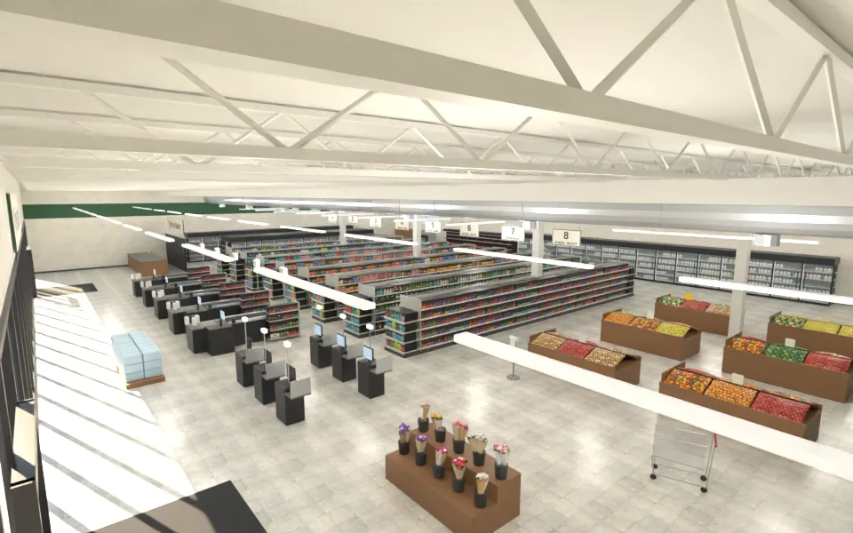
貼圖（假包裝商品圖集的一部分、九種水果堆）：
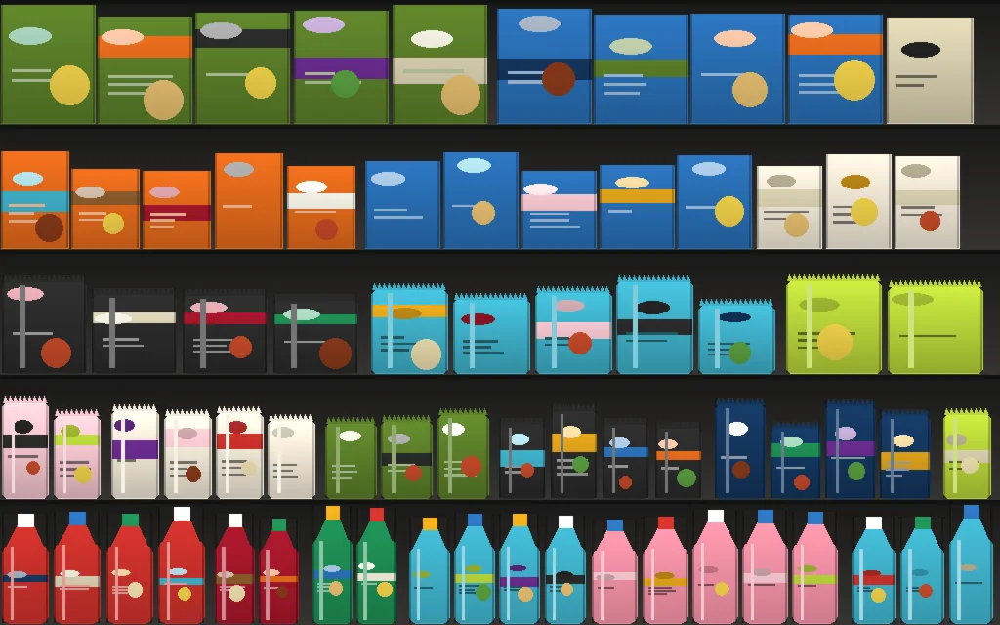
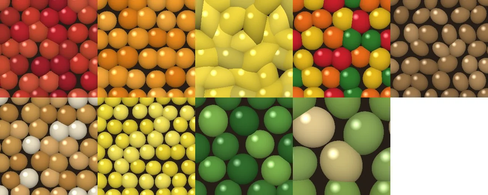

### 版本（自己退件的）
- 第一版（`v1_entrance.webp`、`v1_produce.webp`）：水果是一顆一顆隆起的網格（20 萬三角形、15.5 MB，大半是水果）；花是低面數的彩色球；曝光過度。第二版：水果改成「無縫水果貼圖＋低面數土丘」（9 萬三角形）、花改成包裝花束、袋子架、價格條變細；`v2_deli.webp`：熟食區的麵包架是實心木箱（麵包在裡面看不到）、展示櫃台頂框懸空、菜單是空白的藍色板。這一版：熟食櫃台改成彎玻璃＋發光底板＋不鏽鋼框、開放式麵包架、不鏽鋼烤箱、菜單燈箱有字；端架加側板（走道裡看不到商品塊的側面）。

## 八項（ART_SOP 3-2）
| 項目 | 結果 | 說明 |
|---|---|---|
| 輪廓與倒角 | 通過 | 櫃台、收銀站、自助結帳機、木作陳列台、肉盤、熟食盤是倒角；玻璃門櫃有門框、門把、燈條；推車是真的鐵絲網籃（透明貼圖）＋鍍鉻管＋輪子；天花板是一支一支的桁架（上下弦＋斜腹桿） |
| 材質 | 通過 | 地磚、牆、檯面、木作是 Poly Haven CC0；商品、水果、招牌、菜單是程式畫的貼圖；金屬度都 ≤0.45；玻璃半透明 |
| AO | 部分 | 商品塊的頂面、側面是深色（貨架裡的陰影）；水果貼圖的縫是深色；沒有烘焙 AO |
| 磨損 | 部分 | 地磚貼圖本身的色差；沒有做刮痕、髒污 |
| 生活痕跡 | 通過 | 走道上停著推車、補貨中的紙箱、濕地板告示、塑膠袋架撕下一個袋子、端架促銷、特價黃標、花架、整棧板的瓶裝水、一疊購物籃 |
| 比例 | 通過 | 天花板 6.4 m、貨架 1.95 m 五層、走道 1.7 m、結帳櫃台 0.9 m、冷藏門 1.93 m、推車籃高 0.95 m |
| 效能 | 部分 | 98,732 三角形、46 個物件、6.3 MB；商品塊 2.4 萬三角形（每段一個方塊＋貼圖）；**建議遊戲用 glTF Transform／Meshopt 壓縮**；天花板桁架 8 千三角形可以在低畫質時隱藏 |
| 遊戲截圖 | **沒有** | 要等 LAWWW 接成區域；接好後我拍白天、晚上、手機直向 |

## 還沒做／已知
- 超市外觀（停車場那一面的建築）沒有做：抵達那天的流程是巴士站 → 超市裡面 → 公寓；需要外觀時再排。
- 收銀員、客人是遊戲的 NPC（這個模型裡沒有人）。
