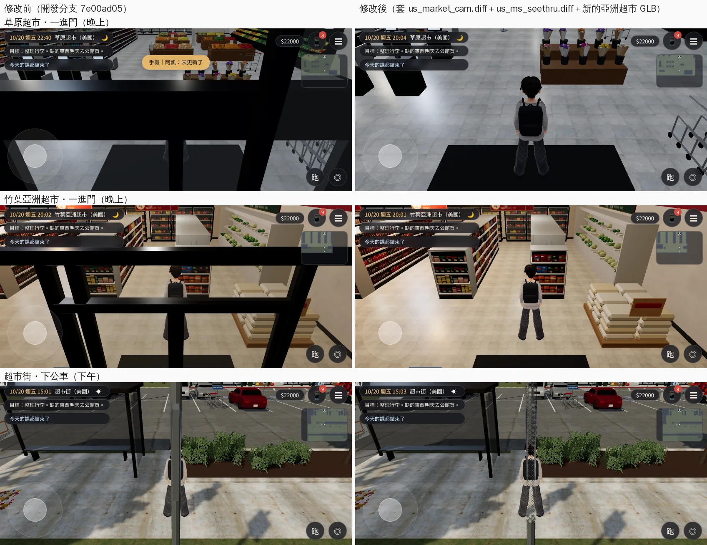

# 美國的兩間超市：一進門鏡頭不在店外；超市街的站牌柱不再擋住人（US-PATROL-1021）

帳號 A 的 LAWWW2，2026-10-22 05:0x～05:4x UTC。

- **狀態**：已交件；`READY_FOR_ART_REVIEW`。
- **起因**：美國篇巡場景（佇列 j14，開發分支 `c617b2e0`，28 張）看到的，記在 `ART_DIRECTOR_PATROL.md` 第 9 節。

## 看到什麼

1. **草原超市、竹葉亞洲超市：一進門鏡頭在店外**（P1：每次進門的第一個畫面）。
   - 從門口進來，面向北，鏡頭在後面（南）。
   - 草原超市 camDist 5 m，鏡頭退到正面玻璃外面 2.6 m；亞洲超市退到外面 2.3 m。
   - 隔著正面的黑色門框、門楣往裡看：畫面上橫著兩條黑帶，人被框擋住。
2. **超市街：站牌柱擋住人**（P2）。
   - 從社區搭公車來，下車的地方 (−22.6, 12.9) 面向北，鏡頭在後面。
   - 站牌柱 (−22.6, 14.9) 剛好在鏡頭和人中間，一根直的柱子把人切成兩半。

## 原因和改法

| | 原因 | 改法 |
|---|---|---|
| 草原超市 | 正式模型沒有會淡出的牆（挑高 6.4 m，原本設計成鏡頭在店裡）；但沒有東西擋住鏡頭往外退 | `patches/us_market_cam.diff`：四面外牆當跟隨鏡頭的牆（`zone.camCols`，和公寓、教學館、機場同一套）。正面的門洞也擋：走到門口就換區域，鏡頭不必出去 |
| 亞洲超市 | 四面牆會淡出（鏡頭可以退到牆外 1.5 m），但正面的玻璃框、門合併在 `usam_black` 裡、不是 `WALL_` 節點：牆淡出了，框還在 | 重建 `us_asian_market.glb`：正面的玻璃、框、門改成 `WALL_S_glass`／`WALL_S_mullions`／`WALL_S_door`（props dir 同南牆），`Z3.attachRoomGLB` 讓它們和南牆一起淡出 |
| 超市街 | 金屬桿沒有標網點透空（台灣的電線桿、行道樹有） | `patches/us_ms_seethru.diff`：`us3d.js` 的 `SEE_MATS`（區域 id → 材質規則）。超市街的金屬桿（停車場燈桿、路燈、號誌桿、站牌柱、公車亭的框）在模型裡都是 `usms_vc_metal`，擋住人時網點透空 |

## 測試（Node，不需要瀏覽器）

- `tests/us_market_cam_unit.js`（新，在 `us_market_cam.diff` 裡）：
  - 在 Node 建出草原超市，每 1 m 一點、8 個方向，照引擎的跟隨鏡頭算鏡頭位置，看「頭 → 鏡頭」有沒有穿過外牆。
  - 外牆照配置的範圍自己算，不是拿 camCols 來量。
  - **修改前 6 FAIL**：15.4% 的方向（1163／7568）鏡頭在店外；一進門那一個在店外；亞洲超市 GLB 的正面不是南牆的節點。
  - **修改後 ALL PASS**：0／7568；一進門鏡頭在店裡、離頭 2.14 m、高 2.89 m（天花板 6.4 m）。
- `tests/us_ms_seethru_unit.js`（新，在 `us_ms_seethru.diff` 裡）：
  - 讀真的 GLB：站牌柱的頂點在 `usms_vc_metal` 裡；下車點往後的鏡頭線真的穿過站牌柱（重現巡場景看到的）。
  - **修改前 1 FAIL**（金屬桿沒標網點透空）、**修改後 ALL PASS**；其他材質（牆、柏油、玻璃、樹、燈）不透空。
- 四個美國 patch（`airport_cam_night.diff`、`us_lamp_pools.diff`、這兩個）對開發分支 `7e00ad05` 一起套、任何順序都乾淨。
- 四個一起套以後，美國的 10 支單元測試 ALL PASS：`us_market_cam_unit`、`us_ms_seethru_unit`、`airport_cam_unit`、`us_lamp_pools_unit`、`nav_us_unit`、`us_cam_walls_unit`、`us_market_street_unit`、`us_life_unit`、`us_season_unit`、`aa370_us_unit`。

## 遊戲內前後（佇列 j29）

左：開發分支 `7e00ad05`；右：套兩個 patch、換亞洲超市 GLB。Playwright＋SwiftShader 手機橫向模擬，不是 iPhone。

- **草原超市**：修改前鏡頭在正面玻璃外，人被門框、門楣擋住，只看得到腳邊；修改後鏡頭在店裡、人的後上方，看得到前面的花架和貨架。
- **亞洲超市**：修改前南牆淡出了，正面的黑色玻璃框還在，一格一格擋在人前面；修改後框和南牆一起淡出。
- **超市街**：站牌柱擋在人前面時變成網點，看得到後面的人。柱子沒有拿掉，也沒有改導航。
- 同一個測試流程也拍了下午 15:00 進門那幾張，但劇情的對話框蓋住了五張（修改前三張、修改後兩張），那幾張不算，上圖用晚上和超市街的。
- 草原超市修改前那一張的遊戲時間是 22:40，修改後是 20:04：修改前那一輪等手機通知時，時間往前走了。兩張都是晚上、店裡燈光一樣。
- 兩個單元測試在同一個工作目錄（`7e00ad05`＋兩個 patch＋新 GLB）重跑：ALL PASS。

## 接法（LAWWW）

1. `git apply docs/art-rebuild/second_ai/patches/us_market_cam.diff docs/art-rebuild/second_ai/patches/us_ms_seethru.diff`
   - 只動 `src/us3d.js`，另外新增兩支測試。
   - 和 `airport_cam_night.diff`、`us_lamp_pools.diff` 一起套也乾淨。
2. 換檔（我的分支）：`assets/models/env/second_ai/us_asian_market.glb`、`.json`（`47eb0d5a`、`baf53ffd`）。
3. `node tests/us_market_cam_unit.js`、`node tests/us_ms_seethru_unit.js`，加上美國的其他單元測試。

## 還不到的地方（誠實寫）

- 草原超市的鏡頭牆是四面外牆；店裡的貨架、冷藏櫃沒有當鏡頭牆（店很大，鏡頭被貨架擋住的情況這次沒量）。
- 金屬桿網點透空只做了超市街；社區、美國校園的燈桿還沒標（巡場景沒看到被擋的情況）。
- 真機沒看過；截圖是 Playwright＋SwiftShader 手機模擬。
