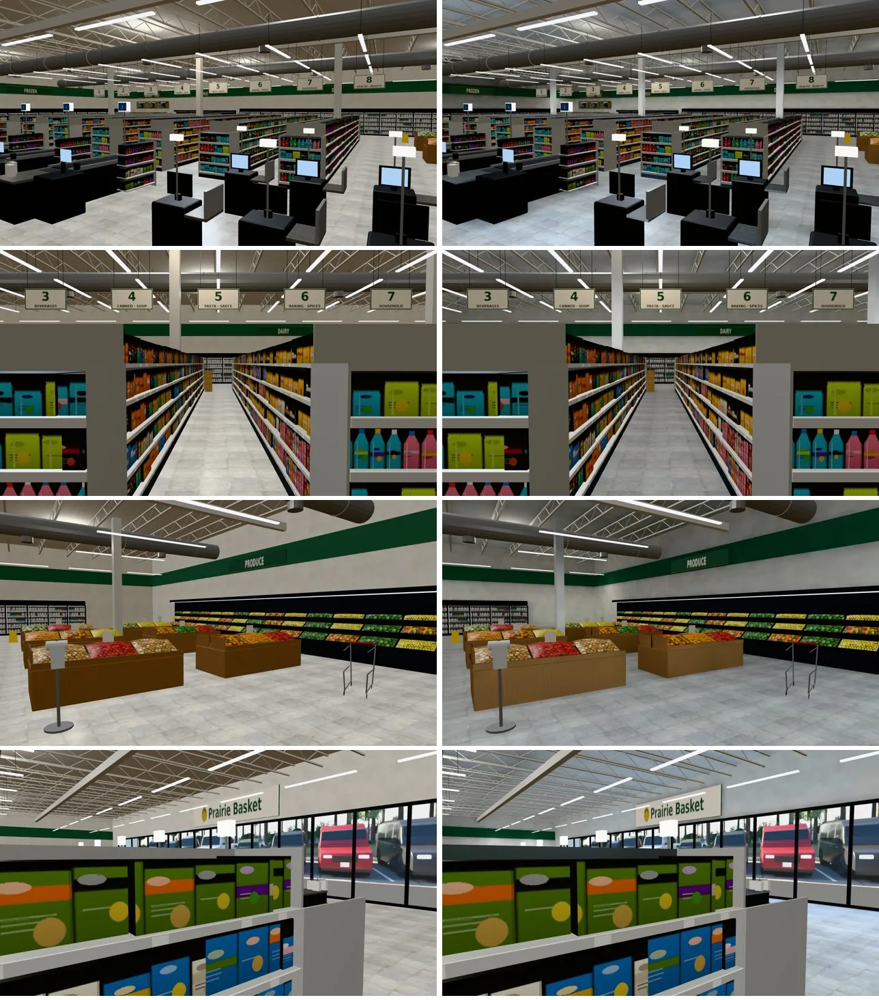
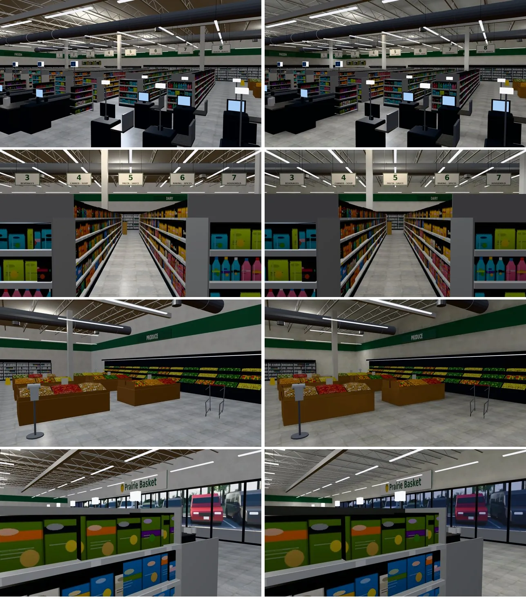
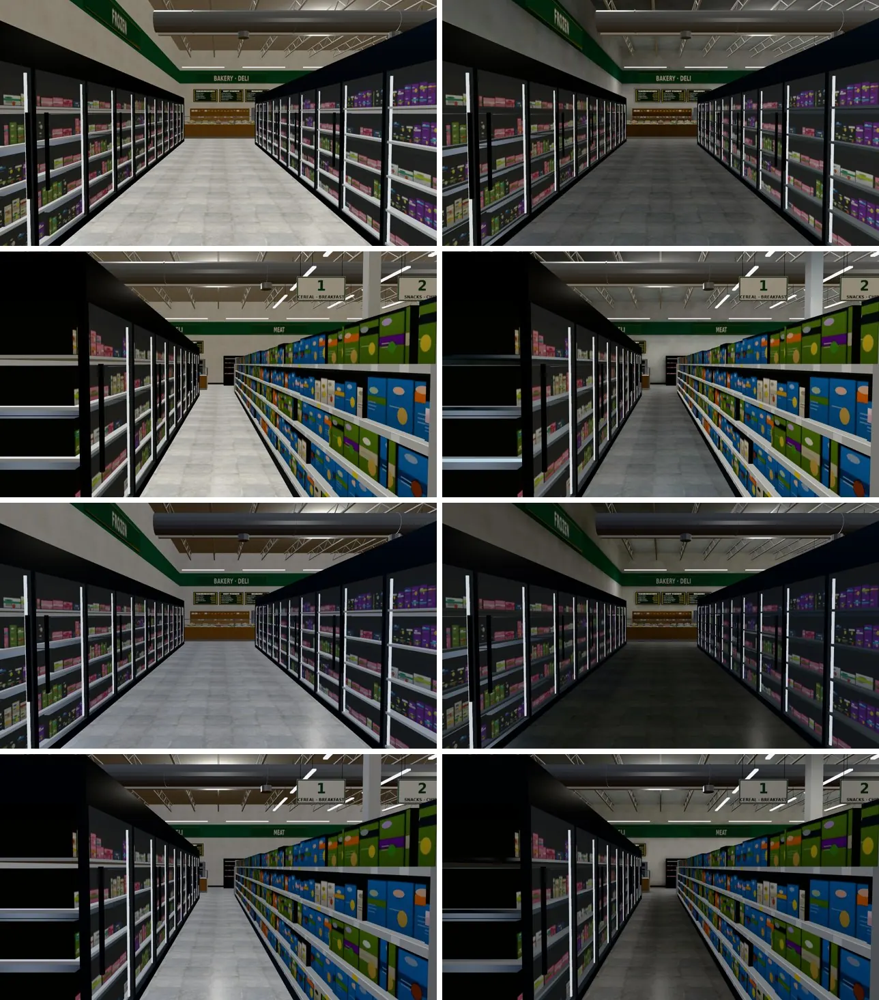

# 美國草原超市（us_market）室內光照烘焙＋晚上窗景（INTERIOR-AAA-REVIEW-1028 美國那一批；LAWWW2〔帳號 A〕2026-11-02）

- **起因**：INTERIOR-AAA-REVIEW-1028 第 5 節 P1（光照）。
  - LAWWW 11-02 04:36、04:40 排的順序：照 D99「夠用的素材凍結」，先烘舊序章那一段、美國交換玩家會待的房間；us_market 第一，接著 jp_room。
  - 美國其他室內（公寓、合租戶、法學院圖書館、亞洲超市）10-31～11-01 已經烘好；這間是美國最後一間大的。
- **狀態**：`READY_FOR_ART_REVIEW`。
  - 場景美術由 BB 驗收（D120）。
  - 截圖是 Playwright＋SwiftShader（電腦 1280×720），不是實機。
  - 讀檔放位置、藏玩家和 NPC 是 [捷徑]。
- **這是第二版**。第一版（`4dc6b17b1`）烘完，西邊冷凍區兩條走道的地板很暗，晚上接近黑的，沒有交件（第四節）。

## 一、怎麼套（給 LAWWW）

1. **換二進位**（從我的分支 `claude/second-ai-env-art` 拿）：
   - `assets/models/env/second_ai/us_market.glb`：7,733,164 → 7,986,324 bytes，多一套 UV（TEXCOORD_1）和 `extras.lightmap`。
   - 新的 `us_market_lm_day.webp`（75 KB）、`us_market_lm_night.webp`（63 KB）。
2. **patch**：`docs/art-rebuild/second_ai/patches/us_market_lm_1102.patch`，內容是 `src/us3d.js` 6 行＋一支新測試。
   - **接光照貼圖**：這一間**沒有**走 `Z3.attachRoomGLB`（us3d.js 直接 `g0.add(root)`），所以光照貼圖不會自己接。
     - 改法：載入正式模型後加一行 `Z3.roomLightmap(z,root,root.userData.lightmap)`。
   - **順便修一個晚上的錯**：
     - 原因：正面玻璃外的停車場窗景（`usm_outside_view`，材質 `GLOW_usm_outside`），原本被 `glowMats(root,/^GLOW_/)` 算進「整天都亮的燈」。
     - 結果：20:30 從店裡往外看，停車場還是白天。
     - 改法：把窗景的材質從 glow 拿出來，改用 `viewTint(views,h)` 照時段調。和公寓、亞洲超市的窗景同一個做法。
   - **新測試** `tests/us_market_lm_unit.js`：開發分支 `f2105305b` 原樣 FAIL 4，套用後 ALL PASS（第六節）。
   - patch 在 `f2105305b` 上 `git apply --check` 乾淨。
3. **工具**（只在我的分支）：
   - 烘焙：`tools/blender/env_second/lightbake/bake_us.sh bigmart`。
   - 烘焙紀錄：`tools/blender/env_second/lightbake/us_market_lm.json`。
   - 鏡頭：`tools/blender/env_second/shots/us_market_lm_shots.py`。

## 二、做法與參數

- **輸入**：遊戲裡正在用的 `us_market.glb`（git blob `54fea93d`），**不從 `us_market.py` 重做**。
  - 原因：總圖 B1 11-02 重做出來和部署中的檔不一樣。
  - 每次都從這個 blob 開始，不會把光照 UV 疊兩次。
- **燈**：照 `us_market.py` 的長條 LED，發光面 `GLOW_usm_leds` 不烘、照舊自己發光。
  - 每條燈一個往下照的面光源（18 W、冷白）：
    - 貨架走道上方 32 條，沿 z；
    - 前段、後段沿 x 33 條（x −20～20 每 4 m，z −12.6／9.5／13.2）；
    - 熟食區 3 條。
  - **第二版加的**：西邊冷凍區兩條走道（x −19、x −13.9）照貨架走道的間距各 4 條，共 8 條（第四節）。
  - 挑高 6.4 m 的鋼承板只吃得到地板反彈的光（總圖 3F 10-31 的教訓），所以每條燈下 1.2 m 再一顆點光源（10 W）。
  - 超市白天燈照樣開（`--daylights 1.0`）。
- **白天**：
  - 正面（南）整片玻璃不包外殼（`--shell S`），天光 0.8。
  - 太陽在南邊（180°、高 40°），強度 1.0。亞洲超市第一版用 2.5 太亮，這次直接用它的定案值。
- **烘焙時藏起來的**（`--hide`）：玻璃（正面帷幕、冷藏櫃的門）、窗外的景、發光面 `GLOW_`、自動門。
- **不烘的**（`--nolm`，照舊即時光）：
  - 商品、價格條、層板、走道牌、水果、推車、鍍鉻、黑色小零件；
  - 桁架、風管、收銀台輸送帶、門牌（遊戲畫字）、頂點色小東西、店外的地面。
  - 原因：上千個小島排不進一張貼圖。總圖 B1 11-02 試烘時只用到左下角，東邊隔間牆整片黑三角。
- **烘的**：地板、鋼承板、牆、柱子、色帶、冷藏櫃背板、收銀台檯面、踢腳板、洞洞板、木作。
- 貼圖 1024²、256 取樣，一次約 20 分鐘。先烘 64 取樣看位置，定案沒有雜點。

### 光照貼圖亮度（`lm_probe.py`；白天／晚上）

| 位置 | 第一版 | 第二版（定案） |
|---|---|---|
| 門口地板（靠正面玻璃） | 1.25／0.43 | 1.22／0.44 |
| 收銀台前 | 0.44／0.32 | 0.48／0.32 |
| 中間走道 | 0.30／0.28 | 0.30／0.28 |
| 第 1、2 排中間 | 0.29／0.26 | 0.31／0.28 |
| **冷凍牆和冷凍島中間（x −19）** | **0.04／0.03** | **0.27／0.26** |
| **冷凍島和第 1 排中間（x −13.9）** | **0.08／0.04** | **0.30／0.26** |
| 蔬果區 | — | 0.40／0.26 |
| 北邊冷藏櫃前 | 0.40／0.40 | 0.41／0.40 |
| 天花板（中間） | 0.17／0.15 | 0.17／0.15 |
| 天花板（冷凍區） | — | 0.12／0.11 |
| 北牆 | 0.35／0.26 | 0.35／0.27 |
| 西牆 | 0.13／0.09 | 0.32／0.27 |

- 地板 0 的地方都是被東西壓住、看不到的：貨架底座、蔬果平台、收銀台、冷凍櫃、柱子。用 1 m 格子把整片地板量過一次，對過位置。

## 三、改前改後（同角度；左＝開發分支 `f2105305b` 原樣，右＝第二版）

- 鏡頭：`us_market_lm_shots.py`（由上到下）：
  1. 門口往西北（整間店）；
  2. 第 5、6 排中間的走道往北；
  3. 東邊蔬果區；
  4. 西南的結帳區往入口看；
  5. 冷凍牆和冷凍島中間的走道（x −19）往北；
  6. 冷凍島和第 1 排中間的走道（x −13.9）往北。

### 看得到的差別

- 超市本來就是整片燈條均勻照明，差別不大：
  - 鋼承板、桁架那一層暗一點、偏冷，不再是一整片平均的灰；
  - 牆從上到下有明暗，貨架端板、冷藏櫃上方有影子。
- 門口靠玻璃那一帶白天比較亮（太陽、天光）。
- **晚上 20:30 窗外的停車場暗下來了**：第 4 張的右邊；改前是白天的停車場。
- 冷凍區兩條走道和其他走道一樣亮（第二版）。

## 四、第一版的問題：冷凍區太暗（沒有交件）

- 第一版只照模型的燈條放光源。模型在西邊冷凍區（冷凍牆、冷凍島、第 1 排貨架之間）天花板沒有燈條，那兩條走道只靠反彈的光：
  - 地板白天 0.04～0.08、晚上 0.03～0.04（中間走道 0.29）；
  - 遊戲裡晚上整條走道接近黑的。烘焙前是即時光，整間一樣亮，所以這是烘焙造成的退步。
- 下圖：左＝原樣，右＝第一版（由上到下：x −19 14:00、x −13.9 14:00、x −19 20:30、x −13.9 20:30）。

- **改法**：照其他走道的間距補 8 條同樣的燈。
  - 天花板 6.4 m、鋼承板深色，抬頭看不太出來那裡沒有燈具（老實說：模型上沒有對應的燈條）。
- **沒用的做法**：讓冷凍櫃的發光面 `GLOW_usm_case` 在烘焙時發光。
  - 同一個材質也包括蔬果牆上方、熟食櫃的大片發光板，共 33 m²；一起發光會把蔬果區、熟食區照爆。

## 五、效能

- 量法：`interior_perf.py`，藏路人，14:00，手機橫向模擬。三個位置各量前、左、右、後四個方向。
  - 改前＝開發 `f2105305b` 原樣；改後＝加上這一包（第二版）。
- 表格裡是 draw call／三角形。

| 位置、方向 | 改前 | 改後 |
|---|---|---|
| 門口 前 | 80／189,990 | 80／189,526 |
| 門口 左 | 81／172,198 | 81／171,734 |
| 門口 右 | 73／177,766 | 73／177,302 |
| 門口 後 | 71／170,330 | 71／169,866 |
| 中間走道 前 | 85／191,406 | 85／190,942 |
| 中間走道 左 | 83／172,358 | 83／171,894 |
| 中間走道 右 | 84／191,394 | 84／190,930 |
| 中間走道 後 | 78／172,162 | 78／171,698 |
| 冷凍區 前 | 69／171,138 | 69／170,674 |
| 冷凍區 左 | 68／171,054 | 68／170,590 |
| 冷凍區 右 | 80／188,730 | 80／188,266 |
| 冷凍區 後 | 74／171,328 | 74／170,864 |

- draw call 一樣，三角形每個方向少 464。
  - 原因：烘焙拿掉疊在一起的反面（`bake_room.py`：不拿掉的話，光一出去就打到反面，那一面會烘成全黑）。
  - 拿掉的面：牆 24→12、色帶 12→6、冷藏櫃背板 332→310、踢腳板 584→292、木作 1380→1248，GLB 全部 115,382→114,918。
  - `singleside_us_market_unit` 照舊 ALL PASS；截圖看不到少面。
- 多兩張 1024² 的 WebP（白天 75 KB、晚上 63 KB）；GLB 多 253 KB（第二套 UV）。

## 六、測試

- `tests/us_market_lm_unit.js`（新）：
  - 開發分支 `f2105305b` 原樣：**FAIL 4**（①光照貼圖、②地板／天花板／牆的第二套 UV、④us3d.js 接光照貼圖、⑤窗景照時段變暗）；
  - 套用後（第一版、第二版）：**ALL PASS**。
- 相關的 11 支（套用第二版後）全部 ALL PASS：
  - `singleside_us_market`、`us_market_cam`、`nav_us`、`room_ceiling`、`us_life`、`us_market_street`；
  - `door_open`、`room_rtnight`、`lm_instancing`、`aa370_us`、`r2y4a_events`。
- **全部 Node**（`tests/*_unit.js`，開發 `f2105305b`＋這一包）：
  - 第一版：841 支、0 失敗；
  - 第二版：841 支、0 失敗。
- **遊戲裡實際載入**（`tools/blender/env_second/shots/us_market_rt_check.py`；SwiftShader，[捷徑] 讀檔直接進區域）：

| | 原樣 | 這一包 |
|---|---|---|
| 接了光照貼圖的材質（`z.lightmapped`） | 0 | 10 |
| 晚上跟著變暗的即時光材質（`z.rtWired`） | 0 | 24 |
| 窗景 `GLOW_usm_outside` 的顏色 14:00 | ffffff | ffffff |
| 窗景 `GLOW_usm_outside` 的顏色 20:30 | ffffff（白天的停車場） | 8189a2（暗下來） |
- 沒跑：手機實機、瀏覽器的真實玩家流程（模型只多一套 UV，導航、碰撞、配置都沒動）。
