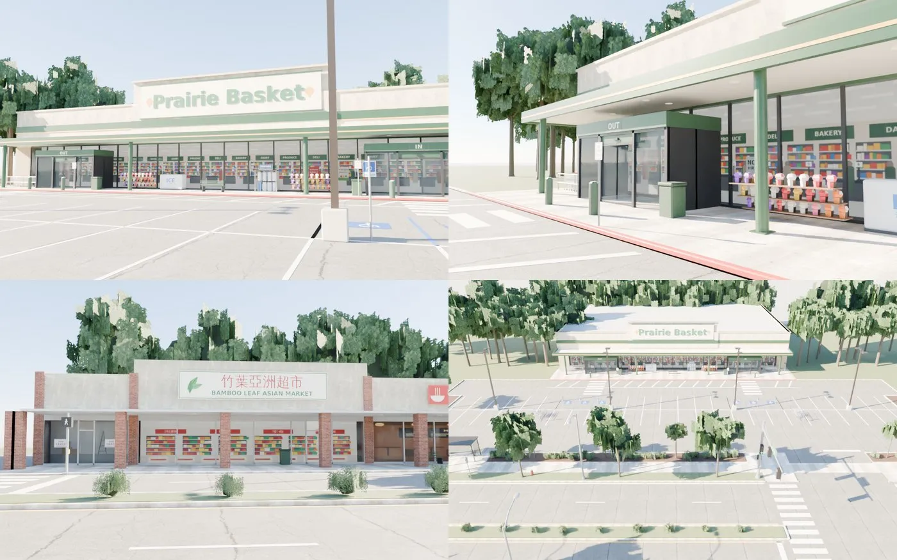
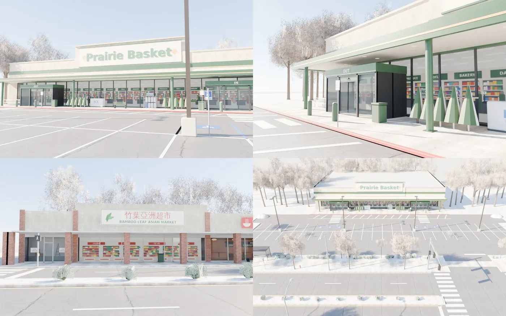
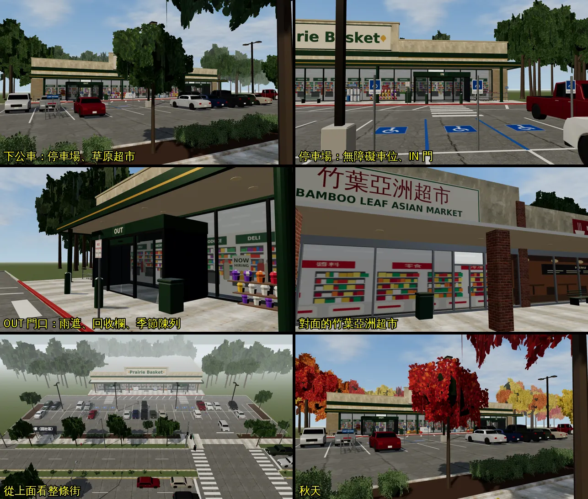
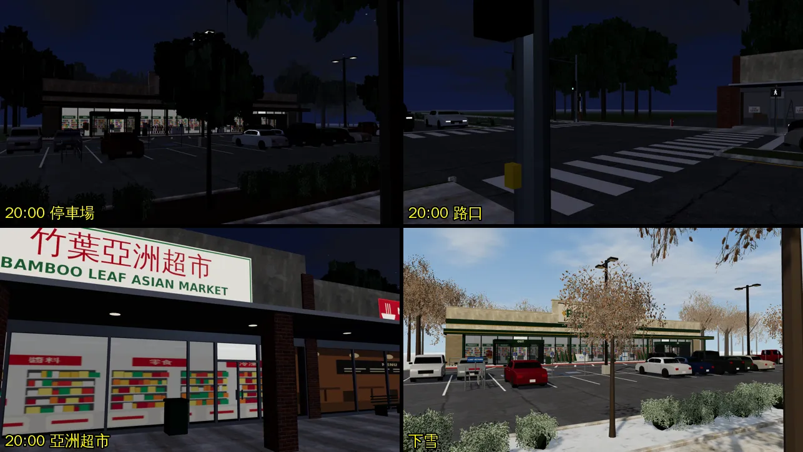

# 美國交換：草原超市和對面亞洲超市之間的停車場、馬路（US-MARKET-STREET）

帳號 A 的 LAWWW2，2026-10-21 21:1x UTC，22:2x 補遊戲內截圖。狀態：**READY_FOR_ART_REVIEW**（MODEL_READY、遊戲裡接得上、走得通；場景美術只有使用者能標 ART_APPROVED）。

## 為什麼做

- 使用者 10-17 說：「超市一個大的超市對面有一個小的亞洲超市」；問要做到哪裡，選了「做停車場和馬路」（`UA-LAWWW2-1017-03`）。
- 原本的接法：大超市（`us_market`）的「離開超市」旁邊有一個「過馬路」，直接跳進亞洲超市（`us_asian_market`），中間沒有街。

## 做了什麼

### 一個可以走的戶外區域 `us_market_street`（超市街）

- 範圍：x −42～42、z −30～46。
- **北邊：草原超市 Prairie Basket**，正面朝南。
  - 米色抹灰、劈裂磚牆腳、深綠色帶；
  - 招牌牆上是立體字（DejaVu Sans Bold 的字形轉成網格），晚上亮；
  - 玻璃帷幕的直框每 2 m 一支，和大超市室內同一組；看得到店內（貼圖），晚上亮；
  - IN／OUT 兩個門斗（x ±13.5，照室內的門），雨遮底下有嵌燈，綠色圓柱；
  - 門口有購物車回收欄、季節陳列（夏天水果、秋天南瓜、冬天聖誕樹）、冰櫃、瓦斯桶籠、長椅。
- **中間：停車場**。
  - 兩排共 54 格，門口有無障礙車位；
  - 消防車道塗紅邊石，斜線區；
  - 雙頭 LED 燈桿 4 支，晚上亮；
  - 停著的車 18 台。
- **馬路**：四線道＋中央分隔島（有草和灌木），兩個路口有斑馬線。
  - 號誌桿在路口遠側（照美國的做法），行人燈掛在號誌桿上，另外有兩支行人燈柱；
  - 路燈：北側 3 支、南側 3 支；
  - 等紅燈的車 7 台，頭燈、煞車燈亮著。
- **南邊：一排小商店**，磚柱＋燈箱招牌＋鋁門窗。
  - 投幣洗衣、麵店、**竹葉亞洲超市**（正對草原超市；門照室內轉 180° 在 x −4.5）、空店面招租；
  - 騎樓雨遮底下有嵌燈。
- **公車站**：候車亭和站牌，在草原超市這一側。
- **四季**：照遊戲日期換（`us_season`）。
  - 秋天：樹葉變色；
  - 11 月和 3 月：樹是光禿的；
  - 下雪：樹上、草地上有雪，停車場角落有鏟雪堆。
- 店名、路名都是虛構的（Prairie Basket、竹葉亞洲超市、Meadow Rd）。

### 接法（`patches/us_market_street.diff`，對開發分支 `d22748f5` 乾淨）

- `src/us3d.js`：新區域 `us_market_street`。
  - 從公車站出生；
  - 走進草原超市（IN 門）、竹葉亞洲超市；
  - 搭公車回社區（`usBus`）。
- 舊的出入口改成走這條街：
  - 社區「出門（去超市）」→ 到超市街的公車站；
  - 草原超市「離開超市」→ 走出 OUT 門，站在門外（不再「過馬路」直接跳）；
  - 亞洲超市只剩一個「出門」。
- 其他檔各一行：
  - `src/assets3d.js` 加一行 manifest；
  - `src/exchange3d.js` 的 `US_ZONES` 加一個字串（LAWWW 的檔）；
  - `src/us_life3d.js` 的地點名字清單加一個字串（LAWWW 的檔）；
  - `src/data/us_layouts.js` 加 `US_MARKET_STREET_LAYOUT`（照 `gen_us_layouts.py` 的格式）。
- 沒有超市街的版本照舊能跑：`US_MARKET_STREET_LAYOUT` 不存在時，所有接線都回到原本的做法。

### 檔案

- 配置：
  - `tools/blender/env_second/us_market_street_layout_gen.py` → `assets/models/env/second_ai/us_market_street.layout.json`；
  - `--check` 檢查出生點、互動點不在阻擋裡，小東西不壓到建築和彼此。
- 貼圖：`tools/blender/env_second/us_market_street_tex.py`（招牌、店內景）。
- 模型：`tools/blender/env_second/us_market_street.py` → `assets/models/env/second_ai/us_market_street.glb`。
  - 59 個網格、94,890 個三角形、8.2 MB；
  - 和社區（7.6 MB）、大超市（6.5 MB）同一級；
  - 只在進這一區時載入。
- 授權：`LICENSES.md` 補一列（Poly Haven CC0 貼圖、字形）。

## 測試

| 測試 | 修改前 | 修改後 |
|---|---|---|
| `tests/us_market_street_unit.js`（新） | 6 FAIL | ALL PASS |
| `tests/nav_us_unit.js`（跟著新接線改：有超市街檢查新的、沒有照舊） | ALL PASS | ALL PASS |
| `us_life_unit`、`exch_min_unit` | ALL PASS | ALL PASS |

`us_market_street_unit.js` 檢查：

- 出生點站得住；三個出入口都在；
- 公車站 → IN 門、OUT 門 → 斑馬線 → 亞洲超市、亞洲超市 → 公車站都走得到（引擎的移動模擬）；
- 分隔島只在路口斷開；
- 25 台車擋得住人；23 支桿子 0.4 m 內站不住；
- 交換系統的美國區域清單、地點清單有這一區；
- 正式模型的燈、四季節點都在，網格 ≤ 70。

## Blender 渲染（D38 第 12.8 節 ⑤，不是遊戲畫面）

**夏天**：停車場往超市看、OUT 門口、對面的竹葉亞洲超市、從上面看整條街。

**下雪**：

## 遊戲內截圖

- 環境：`tools/shots/scene_shot.py`，1280×720，Playwright＋SwiftShader，**不是 iPhone**。
- 開發分支 `a9da472a`＋`us_market_street.diff`＋GLB／配置（2026-10-21 21:3x～22:1x）。
- 拍攝設定在 [`shots.json`](shots.json)（13 張；固定鏡頭、藏起玩家）。
- 12 張可以用；路口白天那一張被手機自動打開的訊息畫面蓋住（有未讀訊息時遊戲會自動打開手機），重拍排在佇列。

**白天 15:00**：下公車看停車場和草原超市、停車場的無障礙車位、OUT 門口、對面的竹葉亞洲超市、從上面看整條街；最後一張是秋天。

**20:00 和下雪**：晚上店內亮著、路燈的燈頭亮著；下雪時樹是光禿的、草地和人行道邊有雪。

看到的問題：

- 晚上的停車場偏暗：路燈只有燈頭亮，地上沒有光圈（溫州街、校園的路燈有）。下一步加地面光圈（`E.lampGlows`）。

## 還不到的地方（誠實寫）

- 晚上的停車場偏暗（見上面）。

- 停車場的車都停著不動；路上的車只有等紅燈的，不會開走。
- 沒有路人，也沒有騎腳踏車的人（美國篇的人流是 LAWWW 的範圍）。
- 8.2 MB 偏大。手機上如果載入太慢，可以先把店內景貼圖、樹的貼圖降到 256。
- 真機沒看過。
